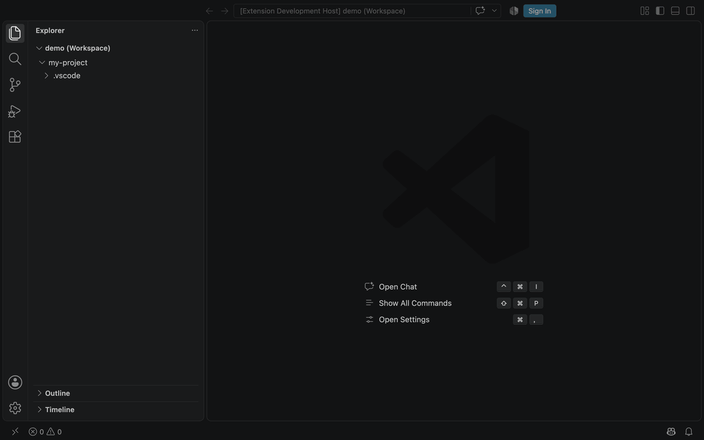
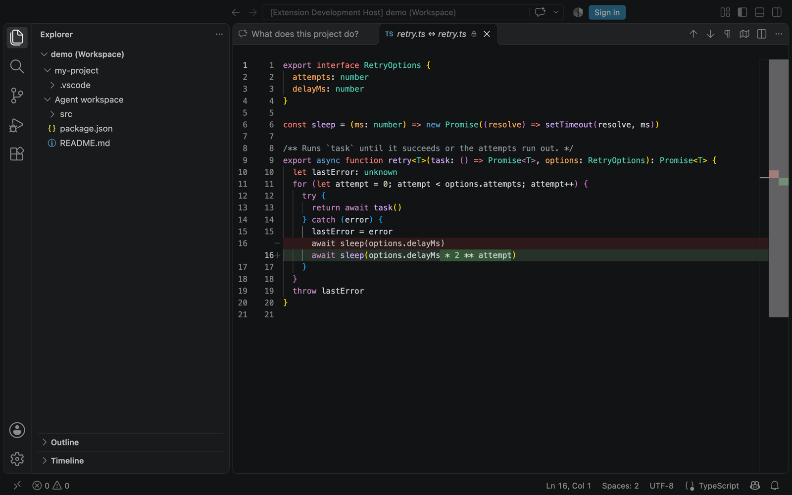
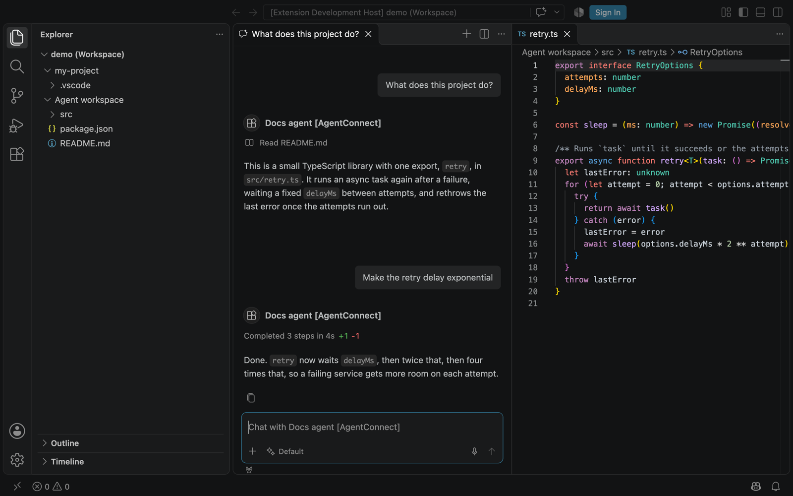

# Using an agent from VS Code

An AgentConnect agent is an [AHP](https://github.com/microsoft/agent-host-protocol) agent host, so
VS Code can chat with it, show what it edits, and open the files in its workspace. The agent keeps
running where it always runs; VS Code is a second window onto the same sessions.



The recordings on this page were made with VS Code 1.146 against a local daemon and a scripted
agent, through [the daemon's VS Code harness](../packages/daemon/test/ahp/vscode/README.md).

## Status

| Part                                        | State                                                                   |
| ------------------------------------------- | ----------------------------------------------------------------------- |
| Chat, tool calls, edits, workspace files    | Served by daemons from v2.14.0.                                         |
| Sign-in from a script or the `ahpc` CLI     | Works with a personal API key.                                          |
| Sign-in from VS Code                        | Needs an authentication provider extension, which is not published yet. |
| The agent's workspace as an Explorer folder | Needs an extension command, which is not published yet.                 |

VS Code 1.146 signs in to an agent host only through an authentication provider it already has, and
it has none for an AgentConnect deployment. Until the extension ships, VS Code connects and then
answers every request with a sign-in error. The server side of
[browser sign-in](designs/ahp-client-sign-in.md) is in place and is what the extension uses.

## Before you start

Your deployment's operator turns AHP on; [Operating the AHP rollout](ahp-operations.md) lists the
switches. For VS Code that is `AHP_MODE=on` on the Control Plane and every relay,
`AHP_AUTHORIZATION_SERVER` on the relay, `PUBLIC_RELAY_URL` on the Control Plane, and either
`AHP_PUBLIC_ACCESS=true` or your user in `AHP_TEST_USER_IDS`.

Then, in the console:

1. Open the agent's integrations, choose **Add API**, and add the AHP protocol. Without that entry the agent refuses
   clients that sign in with a key or a token.
2. Open **Quickstart** on the API card and copy the WebSocket endpoint. It has the form
   `wss://relay.example.test/ahp/agents/<agent-id>`.

## Connect

In a folder you trust, name the endpoint in `.vscode/settings.json`:

```json
{
  "chat.workspaceRemoteAgentHosts": [
    { "name": "AgentConnect", "address": "wss://relay.example.test/ahp/agents/<agent-id>" }
  ]
}
```

`chat.remoteAgentHosts` in your user settings, or **Add Remote Agent Host...** in the Command
Palette, does the same for the Agents window; an editor window reads only the workspace setting.
The agent then appears as a session type when you start a new chat, named after the agent and the
host entry.

The endpoint takes no query string, so a token cannot go in the address.

## What you get

**Chat.** Each chat is an AgentConnect session of that agent, and another AHP client signed in as
you can continue it. The agent runs its configured model, so VS
Code's model picker shows one entry and its choice is not used. One image attachment per message
reaches the agent; other attachments are dropped.

**Edits as whole files.** A file edit shows in the chat with its line counts, and opens as a diff of
the whole file.



**The agent's files.** VS Code reads files from the agent's workspace through its agent-host
filesystem, read-only. A file you hold open reloads when the agent edits it.



## Limits

- Files are read-only, and a file over about 44 KiB does not open.
- A diff shows the whole file only while the edited text is still in the file, in one place.
  After a later edit of the same lines it shows the changed fragment.
- An open file reloads after the agent's own edits. A change made by a shell command the agent ran
  is not reported to VS Code.
- Symbolic links are not listed or opened.
- The agent's secret values are masked in file content, as they are in tool output.
- Each agent is its own endpoint and its own sign-in.

## Without VS Code

A personal API key works today from the [`ahpc`](https://www.npmjs.com/package/@softov/ahpc) CLI and
from [the SDK example](../packages/daemon/examples/README.md). Both sign in with a full-access key;
keep it out of command arguments and URLs.

## When it does not work

- **Nothing happens after connecting, and messages do not send.** VS Code has no sign-in for the
  deployment; see [Status](#status).
- **`Unknown method` in the chat.** The daemon serving the agent is older than v2.14.0.
- **The connection is refused.** AHP is off on the relay or the Control Plane, or the agent has no
  AHP entry.
