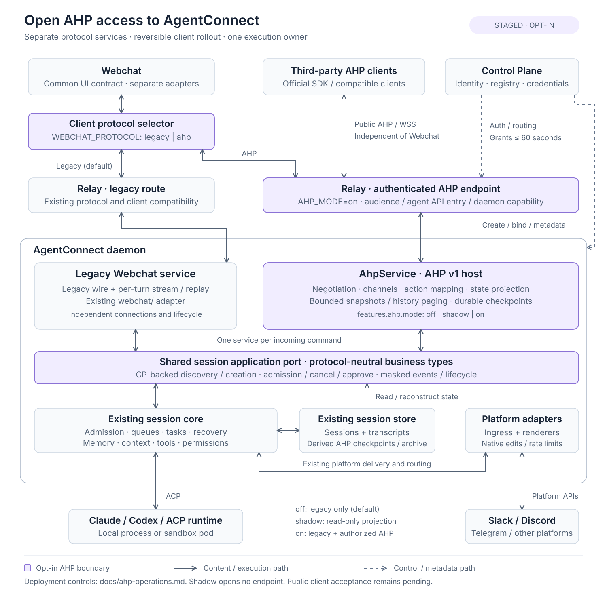

# AHP v1 adoption: an open client interface for AgentConnect

> **Status:** Proposal; no implementation or dependency changes in this PR.
> **Related:** [#1339](https://github.com/agentconnect-md/agentconnect/issues/1339).
> Revisits [#2081](https://github.com/agentconnect-md/agentconnect/pull/2081),
> originally proposed by stkevintan and deferred pending protocol stability.
> **Reviewed:** 2026-10-18, against AHP Spec `1.0.0` and
> `ahp-acp-gateway` `0.2.2` at `9bcd0d4b684b600bb620844fb4ad82feca50c965`.

## 1. Decision proposed

**Primary goal:** expose AgentConnect as an AHP host that any third-party client
supporting the published protocol version, transport, and authentication profile
can connect to. A client should be able to discover authorized agents and
sessions, create or continue a conversation, observe execution, and perform
permitted actions without an AgentConnect-specific client SDK or Webchat protocol.

Add the host inside the existing daemon. Keep AgentConnect's execution,
authorization, durable session identity, and transcript ownership unchanged.
Webchat is the initial first-party consumer and a migration vehicle; simplifying
its synchronization code is a secondary benefit. Third-party interoperability
is an acceptance requirement from the start, even if public availability ships
after the internal rollout.

**Migration constraint:** retain independent legacy and AHP protocol services,
selected by an explicit feature switch. Keep their wire handling, recovery state,
and client adapters separate, with a shared protocol-neutral session application
boundary underneath. The switch must support rollback without a second execution
owner or a copy of the durable conversation.

"Any client" means interoperability within that published compatibility
contract, not support for every optional AHP feature or every client's required
authentication mechanism. Product-specific enhancements must be optional; the
core conversation flow must work with a generic compatible client.

Use the official AHP SDK for protocol types, negotiation, and reducers where
applicable. Evaluate `ahp-acp-gateway` as a reference for the host implementation
and its interoperability tests. Do not deploy its default session store and ACP
process manager as a second owner of AgentConnect sessions.

This scopes #1339 to an open client interface and shared synchronization. It does not unify AgentConnect's
business session model with the protocol's similarly named resources, replace
ACP, or move collaboration routing into AHP.

## 2. Why revisit now

[AHP Spec 1.0.0](https://github.com/microsoft/agent-host-protocol/releases/tag/spec/v1.0.0)
was released on October 2, 2026, after #2081 was deferred. Its
[stability index](https://github.com/microsoft/agent-host-protocol/blob/spec/v1.0.0/docs/specification/versioning.md)
marks Root, Session, and Chat stable. Automation remains early development;
Canvas is experimental, and MCP and Changeset have lower stability than the core.
The initial adoption should depend on the stable core only.

The earlier proposal's architecture remains useful, but several details need
updating to the v1 baseline. This is a comparison with that document, not a claim
that every capability below first appeared in the 1.0 release.

| Earlier proposal                                     | v1 design update                                                                                                   |
| ---------------------------------------------------- | ------------------------------------------------------------------------------------------------------------------ |
| Session-centered transcript state                    | Separate Session metadata/catalog from Chat turns, streaming, tools, and input requests.                           |
| Approval and human input treated as upstream gaps    | Map existing permission/elicitation behavior to defined chat actions; retain AgentConnect authorization.           |
| Multi-session observation treated as an upstream gap | Use multiple channel subscriptions on one connection and `initialSubscriptions`; batching beyond that is optional. |
| Conceptual snapshot/replay mapping                   | Specify both `reconnect` result branches, consistent snapshots, retention, and restart behavior before migration.  |
| Protocol maturity blocks evaluation                  | Pin a reviewed SDK version, negotiate compatibility, and scope adoption to stable channels.                        |
| Staged-generation discard and epoch assumptions      | Keep these as explicit mapping/fencing questions; v1 does not automatically implement AgentConnect's semantics.    |

## 3. Architecture and ownership

The SVG is editable source. All added components in the diagram are proposed,
not current runtime behavior.

### 3.1 AHP host on the daemon

The new host has three responsibilities:

1. **Protocol endpoint:** handshake, version/capability negotiation, channel
   subscriptions, action validation, sequencing, replay, and snapshot responses.
2. **State projection:** fold masked execution output and daemon-owned lifecycle
   events into AHP state. The host is authoritative for the exposed AHP state,
   while its business facts come from the existing session and transcript owners.
3. **Action adapter:** translate permitted client actions into a shared session
   application port for admission, cancellation, configuration, and approval.
   Extract currently Webchat-owned business behavior behind that port as needed;
   the AHP service must not call the legacy transport or a raw ACP subprocess.

Memory/context assembly, tool registration, execution queues, deduplication,
background tasks, ACP attachment/recovery, and platform delivery stay in the
existing daemon. There is one execution path regardless of the observing client.

### 3.2 Relay and Control Plane

Preserve [architecture.md](architecture.md): live message bodies and execution
updates travel on the daemon/relay data plane. The relay forwards AHP frames
without persisting content or owning the reducer state. The CP retains identity,
registry, routing, metadata, and existing control RPC responsibilities.

Browsers cannot generally dial NAT-bound self-hosted daemons or cluster-internal
pool daemons directly. The existing relay route is the proposed carrier, but
`rd/*` is not itself a standard AHP WebSocket endpoint. Phase 1 must define the
AHP frame envelope, connection identity, routing, authenticated principal
propagation, backpressure, and either-hop failure signaling. Clients see standard
AHP JSON-RPC over WebSocket at the published endpoint; the relay-to-daemon
envelope is internal. Endpoint authentication and provider/session discovery are
core design requirements for all clients, not a later VS Code-specific adapter.
Pointing a third-party client at today's relay is not sufficient.

This proposal removes neither CP control dependencies nor every BFF operation.
Bounded transcript/workspace/memory reads can remain; replacing live transcript
invalidation/refetch is a separate Phase 2 decision.

### 3.3 One durable session owner

Existing session rows and transcripts remain the durable business record, using
the deployment's existing data-plane store. AHP snapshots and a bounded action
log are derived projection data; they must not introduce independently created
sessions, competing transcript writers, or a second restart policy.

Not all live state can be reconstructed from transcript text. Pending approval
requests, queued work, active generation identity, and settings also come from
their existing daemon owners. Cold reconstruction must classify interrupted
work according to AgentConnect's recovery policy rather than synthesizing a
successful or still-running turn. Snapshot size, historical pagination, action
retention, and crash-safe sequence allocation are implementation gates.

### 3.4 Public client contract

The published interface must support the following client journey independently
of the AgentConnect Web UI. Organization setup, agent configuration, and issuing
credentials may remain administrative workflows outside AHP.

1. **Connect:** configure the per-agent WSS endpoint and CP-issued credential
   profile below. The relay verifies it through the existing `rc/verify` control
   path; neither relay nor daemon owns a credential store. Publish credential
   provisioning, permissions, expiry, and revocation behavior; a CLI client must
   not require Webchat cookies or a private SDK.
   Connection authentication and AHP resource/provider authentication are distinct
   concerns; an AHP `clientId` or provider credential grants no organization access.
2. **Negotiate:** use standard `initialize` version/capability negotiation.
   Publish the supported core profile and explicit limitations. Treat unknown
   optional capabilities according to AHP compatibility rules.
3. **Discover:** expose authorized AgentConnect agents through the AHP root
   provider catalog, with stable public provider identifiers mapped to agent
   identities. `listSessions` returns only visible sessions in this endpoint's
   scope. Selecting a provider selects the configured AgentConnect agent and its
   existing memory/tools/policies, not an independent raw runtime.
4. **Create or attach:** use standard `createSession` for a new single-agent
   Webchat conversation, or subscribe to a listed session and its default chat.
   The daemon's application port calls CP control RPCs to register the conversation
   ownership and AHP URI binding, following section 4; it does not create a second
   local registry. The daemon still mints the outward session identity and owns
   execution. Webchat and AHP attach to that same conversation/session under the
   existing authorization policy. Client-supplied workspace settings cannot expand
   the agent's existing workspace or sandbox authority.
5. **Interact:** send turns, receive text/tools/state, cancel, and settle supported
   approvals/input requests through standard AHP actions subject to existing
   permissions. No private roster or Webchat request is required for a basic
   single-agent conversation.
6. **Recover:** reconnect and recover state through the same public protocol.
   Generic clients and first-party clients must converge to the same authorized
   state without a private reducer or replay API.

The initial endpoint is per agent, provisionally
`<PUBLIC_RELAY_URL>/ahp/agents/:agentId`. Its provider catalog exposes only that
authorized agent; its session catalog is limited to that agent's authorized
sessions. The relay resolves current placement without exposing daemon/pod
addresses, and refuses a placement that cannot serve the existing session.
It must not advertise an organization-wide catalog on this connection.
Transparent aggregation across independent hosts is separate work: provider
discovery, channel routing, and sequence/replay scope must agree.

**Credential profile.** Reuse the CP's existing personal/service-account API-key
family, hash lookup, membership and agent-visibility checks from
[the agent chat API](shared-bot-relay.md#104-agent-chat-api) and
[key permissions](daemon-api-key-auth.md#key-permissions-and-agent-selection).
The initial full AHP profile accepts CP-issued `full` API keys in the WSS
`Authorization: Bearer` header, still subject to the holder's role, session
audience, continuation/approval policy, and the agent's enabled AHP API entry.
It does not bypass authorization merely because the key is `full`.
Today's `agent:chat` profile covers a narrower turn API; it must not silently gain
catalog/history, cancellation, configuration, or other Webchat operations.
Reject `read` and `agent:chat` keys for this initial profile; a later restricted
AHP profile needs its own explicit action-permission matrix. The AI SDK and AG-UI
routes keep their existing permissions. This is a third protocol on the same
CP/relay auth seam, not a parallel credential system.

Add a proposed `ahp-client-key` verification kind to `rc/verify`, reusing those
CP services. Each verification re-reads organization membership, agent visibility,
credential validity, the enabled AHP API entry, and rollout audience. Cache an
allow verdict for at most 60 seconds and never past credential expiry, scoped to
the credential hash, organization, agent, and authorization context. Long-lived
AHP sockets revalidate before the grant expires; on failure, stop new reads/actions
and close the attachment without cancelling already-admitted daemon work. During
a CP outage, no expired grant may be extended and no new authority may be created.
No secret enters logs, URLs, or telemetry. Browser integrations keep long-lived
keys on a trusted backend which forwards standard AHP frames; first-party
conversation-bound attachments can retain the existing short-lived CP token and
`rc/verify(webchat-token)` path, with its existing scope and no extra create rights.
OAuth is not part of the initial public profile.

Public release requires endpoint and credential documentation, a capability
matrix, and a working minimal client example using only the official AHP SDK.
Publishing the endpoint means authenticated access, not anonymous session access.

### 3.5 Feature switch and two independent protocol services

Implement two sibling services, provisionally `LegacyChatService` and
`AhpChatService`. Each owns its routes, connections, wire schemas, reducer/stream
state, replay policy, and lifecycle. Both call the same protocol-neutral session
application port. Starting both services creates two client interfaces, not two
runtime/session owners; one incoming command is dispatched through one service.

This proposal defines both service modules inside the owning daemon, with
separate relay ingress routes and independently managed listeners/subscriptions.
Out-of-process hosting is out of scope. A later design would need to specify the
additional data-plane hop, authorization, fencing, backpressure, and failure
recovery before introducing it. Module separation delivers the required code
isolation without adding a second process or execution owner in this change.

Proposed controls (names are design placeholders, not existing configuration):

| Control                     | Values / initial default        | Meaning                                                                                                                                                                    |
| --------------------------- | ------------------------------- | -------------------------------------------------------------------------------------------------------------------------------------------------------------------------- |
| `features.ahp.mode`         | `off` (default), `shadow`, `on` | `off`: legacy service only; `shadow`: read-only AHP projection with no client endpoint or command dispatch; `on`: AHP service accepts authorized clients alongside legacy. |
| `features.webchat.protocol` | `legacy` (default), `ahp`       | Select the first-party client adapter and matching endpoint at bootstrap/attachment. Selecting `ahp` requires AHP mode `on`; reject an invalid configuration.              |

Resolve the effective configuration server-side for the deployment or authorized
rollout cohort, and pin it for each client attachment. The second control must
not disable third-party AHP access: Webchat can use legacy while a third-party
client uses the enabled AHP endpoint against the same authorized session.

`on` enables the service, not unrestricted exposure. The CP's rollout audience
initially admits only explicitly allowed first-party/test credentials; widening
it to public-profile credentials is a separate rollout decision. Require an
explicit per-agent AHP API entry, following the existing `apiProtocols` model.
Both gates apply even when Webchat selects AHP, and clients cannot self-assert
membership in the first-party/test audience.

The relay must also check the selected daemon's advertised AHP service/version
capability before opening an attachment, including a first-party AHP attachment.
Use the existing `AGENT_API_PROTOCOL_FEATURE` / `API_AG_UI_V1_FEATURE` gating
pattern from [`agent-api.ts`](../../packages/protocol/src/agent-api.ts), with a
new AHP capability rather than treating AG-UI support as sufficient. Re-check
after re-resolution or reconnect. A cohort flag cannot make an older self-hosted
daemon capable: return explicit unavailability for AHP, preserve the legacy
route, and never send AHP frames to an unadvertised service.

Keep switch evaluation at composition, bootstrap, and route-selection boundaries.
Legacy handlers must not import AHP SDK/reducers, and AHP handlers must not import
`WebchatTransport` or depend on `WebchatTurnStream`/`Pending` internals. Shared
business types must contain no legacy frame or AHP SDK types.

| Proposed boundary               | Owns                                                                                                                                       | Isolation rule                                                                                                                                               |
| ------------------------------- | ------------------------------------------------------------------------------------------------------------------------------------------ | ------------------------------------------------------------------------------------------------------------------------------------------------------------ |
| CP registry / auth services     | Conversation ownership, AHP URI reservations/bindings and collisions, credential verification, rollout grants                              | Control metadata only. Reach these services through scoped control RPCs; no content or AHP reducer state is stored here.                                     |
| Daemon session application port | CP-backed authorized discovery/create, local session reads, admission, cancel, approval/config actions, and masked domain/lifecycle events | Orchestrate registry calls; do not own their facts. Extract admission/continuation/mirroring currently embedded in Webchat once; do not duplicate it in AHP. |
| Existing `webchat/` service     | Legacy encoding, sink, per-turn stream/replay, connection cleanup                                                                          | Preserve legacy behavior behind its adapter; no AHP conditionals in its state machine.                                                                       |
| New `ahp/` service              | AHP negotiation, channels, state projection, action mapping, snapshots/replay                                                              | Depend on the shared port and AHP SDK, not legacy implementation details.                                                                                    |
| Relay ingress modules           | Distinct legacy and standard AHP routes/carriers                                                                                           | Share only transport/auth/routing primitives; never reinterpret an established socket's protocol after a flag change.                                        |
| Frontend client adapters        | Separate legacy and AHP connections/state reducers, selected by one factory                                                                | Expose a common UI-facing view/command contract. Keep protocol branches out of individual message/tool components.                                           |

Changing the Webchat selector affects new attachments. Existing connections stay
on their negotiated protocol while draining; for a switch, detach the old adapter
and attach the new one with the same durable session identity, then reconstruct
its view from that protocol's history/snapshot. Do not copy stream cursors between
protocols or recreate the runtime. Pending actions must be reconciled against
shared durable admission receipts before a retry; loss of an acknowledgment must
never trigger an automatic resend over the other protocol.

Rollback first selects legacy for new first-party attachments. Disabling the AHP
service stops new AHP admissions and drains existing attachments for a bounded
interval, then explicitly closes them without cancelling daemon-owned work.
AHP-only clients receive explicit unavailability and retry when service returns;
they must never receive legacy frames as a fallback. Existing legacy observation
and execution continue, and durable transcripts/session IDs remain compatible.
An emergency immediate disconnect follows the same no-reinterpretation and
no-duplicate-dispatch rules.

Keep the legacy service deployable throughout rollout and the agreed rollback
window. A later cleanup PR may remove it only after the acceptance gates and
deprecation decision; introducing the switch is not authorization to delete the
fallback path.

## 4. Resource and action mapping

Start with one AHP Session and one default Chat per agent-scoped AgentConnect
session. This avoids changing execution ownership to match protocol vocabulary.

The `ahp-session:/` and `ahp-chat:/` schemes below are the v1 wire shapes, not
invented schemes. Their binding to AgentConnect identifiers is our proposal.
The [v1 Session specification](https://github.com/microsoft/agent-host-protocol/blob/spec/v1.0.0/docs/specification/session-channel.md)
lets the client choose the session URI for `createSession`; the client must not
obtain a private AgentConnect ID first. **The CP registry persists the stable URI
binding and answers collisions**, alongside existing outward session metadata.
The proposed uniqueness key is `(orgId, canonical AHP session URI)`, independent
of daemon placement and credential identity; the row binds `agentId`, owner,
`conversationId`, and the daemon-minted outward `sessionId`. This deliberately
uses an organization-wide namespace even though the first endpoint is per agent.
An atomic registry reservation arbitrates concurrent creates, including requests
through different relays/daemons. Return `SessionAlreadyExists` for an occupied
URI, without disclosing its owner or content; supplying a URI never grants access.

Creation uses a metadata-only control flow, following
[Webchat ownership](shared-bot-relay.md#103-hooks-and-webchat):

1. The shared application port asks CP to authorize and atomically reserve the
   URI, allocate a conversation ID, and persist the ownership tuple
   `(conversationId, userId, agentId, orgId)`. The result is a single-agent Webchat
   conversation with an agent-scoped session, not a bare daemon-local conversation.
2. The owning daemon resolves that conversation's session slot and mints/persists
   its outward `sessionId` before any runtime launch, as specified by
   [session identity](session-concept.md#11-session-identity). It then finalizes
   the CP binding through a control RPC fenced to the reservation and current
   placement. CP remains the registry authority; the daemon keeps the execution
   and transcript record. No prompt or AHP snapshot crosses this control path.
3. Return successful `createSession` only after the binding is committed. Durable
   reservation identity and idempotent internal RPCs reconcile an interrupted
   create; they must not allocate another conversation, outward ID, or runtime.
   A duplicate public create still follows the standard collision rule; an
   authorized client recovers a lost success response through standard discovery.
   Unfinished reservations stay unavailable until reconciled rather than being
   reallocated while an old daemon might still own a slot.

New creates and binding changes require CP availability; they fail closed during
an outage. Already-admitted work follows the existing
[authority lifetimes](high-availability.md#authority-lifetimes), including duty
self-fencing for member-set daemons. A daemon-local cache cannot become a second
registry. Webchat attaches through the same CP conversation record, so switching
clients neither copies a transcript nor starts a second runtime.

Already-existing sessions can be exported at `ahp-session:/<sessionId>` only
after CP registers that alias through the same uniqueness check; never shadow a
client-reserved URI. Once published, the binding remains stable across restarts
and is returned by discovery. Existing non-Webchat sessions retain their current
continuation rules. Deep links and outward addressing continue to use `sessionId`.

| AgentConnect concept                     | Proposed AHP representation                                                               | Boundary                                                                                              |
| ---------------------------------------- | ----------------------------------------------------------------------------------------- | ----------------------------------------------------------------------------------------------------- |
| Stable outward `sessionId`               | Stable AHP session URI bound to that ID; `ahp-session:/<sessionId>` for existing sessions | Honor client-chosen URIs at creation; preserve outward identity and existing deep links.              |
| One agent's conversation in that session | Stable `ahp-chat:/<chatId>` in its `defaultChat`/catalog                                  | Persist or deterministically derive a non-sensitive chat identifier; independent of runtime restarts. |
| Runtime `acpSessionId`                   | Host-private binding                                                                      | Never use it as the public channel identity.                                                          |
| Dispatch `sessionKey`                    | No public mapping                                                                         | Keep platform coordinates and queue serialization private.                                            |
| Multi-agent Webchat conversation         | Existing roster plus N Session/Chat subscriptions                                         | Preserve each agent's context, visibility, and continuation rules.                                    |
| Shared conversation across daemons       | Existing routing and merged-view composition                                              | One host's subscriptions do not aggregate other hosts automatically.                                  |
| Daemon execution attempt/generation      | Internal fence plus an explicit projection mapping                                        | An AHP sequence number is not an execution lease.                                                     |

| AHP interaction                                  | AgentConnect behavior to preserve                                                                                                                                                                 |
| ------------------------------------------------ | ------------------------------------------------------------------------------------------------------------------------------------------------------------------------------------------------- |
| `chat/turnStarted`                               | Authorize the principal and admit through the shared session application port, preserving current continuation behavior. Queue-full, paused, draining, and duplicate cases remain host decisions. |
| `chat/turnCancelled`                             | Use current interruption and cleanup barriers before admitting conflicting work.                                                                                                                  |
| `chat/toolCallConfirmed`                         | Use the existing approval policy and first-valid-answer settlement shared by all surfaces. Subscription alone confers no approval rights.                                                         |
| `chat/inputRequested`, answer/completion actions | Project supported input requests; validate answers and settle through the existing request owner. Do not advertise unsupported input variants.                                                    |
| `chat/responsePart`, `chat/delta`, tool actions  | Project already-masked output while retaining message boundaries, tools, and intermediate work.                                                                                                   |
| Reconnect/subscription                           | Re-authorize access, then return a consistent replay or snapshot of authorized channels.                                                                                                          |

Capabilities must be explicit. Do not claim arbitrary multi-chat creation,
automation, filesystem, terminal, or MCP forwarding support simply because the
SDK defines their types. Standard agent/session discovery and single-agent
session creation belong to the required public core. Multi-agent roster
management and other AgentConnect-specific workflows can remain product APIs
or optional, negotiated extensions.

## 5. Consistency, authorization, and generation boundaries

### 5.1 Projection inputs

Attach the projection after secret masking, alongside current output consumers.
Consume both runtime updates and daemon-owned events: admission/terminal state,
approval settlement, discard/reset, cancellation, and recovery. An ACP-only
consumer misses discarded generations and can append the replacement onto an
answer that should have been removed.

Preserve [product conventions](../product-conventions.md), including separate
reply blocks and the transition from live output to saved history. Do not retire
an unfinished live reply merely because its prompt was persisted.

### 5.2 Sequence and reconnect contract

- `serverSeq` is an ordering/replay cursor, not a proof of completeness. A client
  subscribed to only some channels can legitimately observe gaps.
- The relay must provide ordered delivery and surface failure on either hop.
  Detected failure triggers recovery; adjacent sequence arithmetic does not.
- Subscribing must establish a snapshot cursor and live subscription without a
  race that loses updates between the two. Reconnect replay must precede later
  live actions, or return fresh snapshots when the retained window is insufficient.
- Reconnect, replay, and snapshot responses must filter by current channel
  authorization. A previously authorized subscription is not a permanent grant.
- A crash/reassignment must never make an old cursor appear valid against a new
  unrelated log. Before Phase 1, specify durable sequencing or a negotiated
  host-incarnation mechanism with forced reinitialization/snapshot recovery.
  Do not assume v1 supplies an AgentConnect-compatible epoch field.
  A generic client must still recover through standard connection/reconnect
  behavior; understanding a private epoch extension cannot be a public-core prerequisite.
- Keep durable admission/idempotency separate from client optimistic-action
  reconciliation. Lost acknowledgments and resubmitted actions must not cause
  duplicate prompts or approvals.

### 5.3 Authorization and staged output

Apply [session visibility](session-visibility.md) and
[authorization policy](authorization-policy.md) to discovery, subscriptions,
history, actions, and reconnect. Bind the verified principal and organization
to the connection; `clientId` identifies a client, not an authenticated user.
Account for revocation during long-lived subscriptions using the existing
authority lifetimes; a single gateway bearer token is not multi-user policy.

Keep the [turn-final refresh workflow](turn-final-context-refresh.md), including
generation fencing and the regeneration loop. AHP can represent steering
messages, but actual model-context injection remains a runtime capability.

The projection must define how discarded output disappears or is retained as
intermediate work in every client, including one reconnecting during discard.
Require a correct baseline using standard v1 actions/reducers and test it with
an unmodified generic client. Product-specific extensions may enhance presentation,
but must be optional and negotiated. A private reducer cannot be required to
avoid stale output. If a correct standard representation is not yet possible,
resolve that protocol/mapping gap before declaring the public core ready. This
mapping and a no-stale-output test are prerequisites for deleting `superseded`
handling and for public interoperability acceptance.

## 6. What code can become simpler

AHP standardizes the state model and wire contract; it does not make host-side
state retention, transport reliability, or business logic disappear. The first
phase adds code. The benefit is realized when old paths are retired and more
than one client shares the replacement. During coexistence, simplification comes
from extracting shared business behavior and containing protocol-specific code.
Removal of legacy transport/recovery code requires a separate cleanup PR after
the rollback window and deprecation decision in section 3.5.

| Current surface                                                                                                                                                                                     | Proposed consolidation                                                 | What remains / deletion gate                                                                                                                                  |
| --------------------------------------------------------------------------------------------------------------------------------------------------------------------------------------------------- | ---------------------------------------------------------------------- | ------------------------------------------------------------------------------------------------------------------------------------------------------------- |
| [`webchat/transport.ts`](../../packages/daemon/src/webchat/transport.ts): `WebchatTransport` methods `bufferWebchatStreamEvent`, `probeWebchatStream`, `resumeWebchatStream`, `pruneWebchatStreams` | One AHP subscription/replay/snapshot implementation                    | Keep admission, continuation, cancellation, deduplication, and platform mirroring. Remove only the old streaming recovery machinery after parity and rollout. |
| [`frames/webchat.ts`](../../packages/protocol/src/frames/webchat.ts): output/done envelopes, per-turn indices, `lastIndex`                                                                          | Standard action envelopes and projected Chat state                     | Product-specific ingress/roster/attachment contracts and mixed-version compatibility still need adapters.                                                     |
| [`PlaygroundProvider.tsx`](../../packages/web/src/components/console/PlaygroundProvider.tsx) and stream consumers                                                                                   | Shared AHP client/reducer rather than independent event reconciliation | Keep rendering, merged multi-agent views, message identity, saved-history reconciliation, and extension fallback.                                             |
| [`webchat-daemon-bridge.ts`](../../packages/relay/src/webchat-daemon-bridge.ts)                                                                                                                     | Forward a defined AHP stream carrier                                   | Keep authentication, daemon routing, connection cleanup, flow control, and failure propagation.                                                               |
| Console live transcript invalidation/refetch                                                                                                                                                        | Subscribe to the same projection in Phase 2                            | Metadata lists and unrelated bounded BFF reads remain; do not remove all SSE or read APIs.                                                                    |
| New IDE/CLI clients                                                                                                                                                                                 | Reuse Session/Chat/ToolCall state and protocol recovery                | Each client still needs UI, endpoint discovery, credentials, and capability handling.                                                                         |

Do not replace platform renderers, collaboration routing, task orchestration,
memory, sandboxing, or ACP lifecycle with AHP. Avoid claiming a line-count saving
before the spike identifies which old paths can actually be deleted.

## 7. How to use ahp-acp-gateway

The reviewed [gateway](https://github.com/formulahendry/ahp-acp-gateway/tree/9bcd0d4b684b600bb620844fb4ad82feca50c965)
uses official AHP/ACP SDKs and implements a WebSocket host, action projection,
SQLite persistence, bounded replay/snapshot fallback, permission confirmation,
and restart repair. It is useful evidence that this host surface is implementable.
Its documented limitations include one public chat per session, no multi-user
policy or MCP forwarding, and no windowed subscriptions.

| Gateway component                                | AgentConnect application                                                                                                      |
| ------------------------------------------------ | ----------------------------------------------------------------------------------------------------------------------------- |
| ACP-to-AHP mapping                               | Reference for the projection; feed AgentConnect's masked events and daemon lifecycle events rather than bypassing the daemon. |
| Ordering, replay, snapshots, protocol validation | Reuse patterns and assess extractable code against our relay, storage, and ownership/fencing requirements.                    |
| Official-client/fake-ACP integration tests       | Reference scenarios for multi-client convergence, permission races, timeout isolation, and reconnect overflow.                |
| `AcpAdapterFactory`                              | Useful execution seam for a spike, but insufficient by itself for full integration.                                           |
| `GatewayStore` and `AcpV1Process`                | Do not adopt their default ownership. Bridge existing session/storage/recovery owners instead.                                |

In the reviewed code, `GatewayServer` directly constructs `GatewayStore`, and
the default factory starts an ACP subprocess per chat. Replacing only the
factory leaves session creation, storage, recovery, and authorization concerns
in the gateway. A production reuse decision needs separable execution, store,
event-ingress, and authorization boundaries; do not assume those are already
published stable library interfaces.

**Recommendation:** build the projection with the official SDK and use the
gateway as a reference/interop fixture. Consider extracting or upstreaming
reusable host components only after the spike demonstrates a clean boundary.
An independent gateway is useful for client experiments, but those sessions do
not automatically inherit AgentConnect's memory, tools, identity, or routing.

The gateway is MIT-licensed. Preserve attribution/license notices if code is
copied. This proposal adds no gateway code or dependency.

## 8. Incremental implementation and acceptance

### Phase 0: shadow projection

First define the shared session application port and preserve the legacy adapter
against it. Create a proposed `packages/daemon/src/ahp/` projection alongside current output
consumers in `shadow` mode. No client traffic or execution ownership changes. Use the existing
session's masked output and daemon lifecycle events, and compare state against
current Webchat/transcript behavior.

Exit criteria:

- Text, tools, reasoning, reply boundaries, completion, cancellation, and
  approval state agree with the current surfaces.
- Discard/reset and late-output fencing do not leave superseded text visible.
- Snapshot reconstruction after restart uses durable records plus reconciled
  lifecycle state, with explicit treatment of interrupted work.
- The identity map, unsupported capabilities, and extension requirements are
  recorded; no private ACP identifiers or secrets leak into public state.
- In an isolated test host, an official-SDK client fixture consumes the projection
  without first-party reducers and exercises the public core contract and standard
  session-creation binding. This test host does not enable endpoints or dispatch in
  a production shadow deployment.
- Legacy behavior passes with AHP `off`; `shadow` emits no commands and opens no
  client endpoint. Dependency checks enforce the two services' import boundaries.

### Phase 1: shared AHP endpoint, with Webchat behind a flag

Add the authorized relay carrier and AHP action adapter into existing execution
entry points. Keep old clients supported during a bounded migration period.
Use the independent services and controls in section 3.5. Select one frontend
adapter at attachment time; never broadcast an action to both services. Keep
both services available during the rollback window.

Implement the public-shaped endpoint and the discovery/create/attach flow from
section 3.4 now, even if access is initially restricted to a test deployment.
Both Webchat and an independent official-SDK client must exercise that endpoint;
the latter must not import AgentConnect Webchat state or call private product
APIs to run a basic conversation. Keep extensions disabled in a baseline test.

Before default-on and deletion of old streaming code, cover:

- Feature-control matrix: `off + legacy`, `shadow + legacy`, `on + legacy`
  (including a simultaneous third-party AHP client), and `on + ahp`; invalid
  configurations fail explicitly.
- An older or non-advertising daemon never receives AHP frames, including after
  placement changes. `on` with a restricted rollout audience refuses outside
  credentials; explicit public enablement still requires the agent's API entry.
- CP credential verification, membership/entry revocation, and grant expiry are
  tested during both reconnect and long-lived subscriptions. An `agent:chat` key
  cannot gain the initial full AHP profile's broader operations.
- Concurrent URI creates through two daemons converge on one CP reservation;
  collision, alias registration, lost finalize replies, and crashes between
  reservation and binding cannot create a second session owner. CP outage creates
  no new registry facts, while admitted work respects its existing authority.
- A third-party-created session opens in Webchat through the same CP-owned
  conversation and daemon-owned outward session, including before the first turn.
- Flag changes during streaming, lost acknowledgments, pending approvals, and
  reconnect preserve the same session and produce no duplicate execution.
- Rollback drains or explicitly disconnects AHP attachments while the legacy
  service remains usable; an AHP-only client never receives legacy frames.
- Legacy and AHP services have separate protocol tests plus shared application
  contract tests. Import-boundary checks prevent cross-protocol dependencies.

| Scenario                                                 | Required observation                                                                            |
| -------------------------------------------------------- | ----------------------------------------------------------------------------------------------- |
| Two clients observe one existing session                 | Same ordered state and final transcript; observing creates no second runtime.                   |
| Lost acknowledgment, repeated action                     | One admission/effect, deterministic reconciliation.                                             |
| Replay within bounds / beyond bounds                     | Replay / snapshot recovery both converge without sequence-gap heuristics.                       |
| Relay hop loss, slow client, daemon restart/reassignment | Failure is surfaced; bounded buffering and recovery cannot mix stale output with new execution. |
| Cancel or approve concurrently from two surfaces         | Existing authorization and cleanup barriers hold; one valid settlement.                         |
| Revoked/foreign principal or guessed channel             | No discovery, replay, snapshot, or action access outside the audience.                          |
| Discard while streaming or disconnected                  | Every authorized observer reaches the same current generation.                                  |
| Multi-agent and cross-platform continuation              | Preserve roster/scope, reply attribution, origin mirroring, and merged-history behavior.        |
| Old/new clients during rollout                           | Explicit capability negotiation and working fallback; no silent unsupported action success.     |

### Phase 2: publish third-party access; optional Console migration

Third-party access is a required product milestone, not an optional follow-up.
Publish the endpoint, authentication profile, supported capabilities, and
minimal client example. Validate a real independently maintained AHP client
(for example, VS Code) in addition to the SDK fixture, and record the tested
client/version and any compatibility limits. It must discover an authorized
agent, create a new session, resume an existing one, stream output, cancel,
settle a permitted approval, and reconnect without an AgentConnect-specific
plugin. A client that requires unsupported optional features is documented as
outside the supported profile; do not promise full IDE feature parity from
Chat support alone.

First-party Webchat and third-party clients must also observe the same existing
session concurrently. Passing internal Webchat tests alone does not satisfy
this goal, and testing a standalone gateway's separate sessions does not count.

Console live-view migration is optional: if adopted, its content flows through
browser -> relay -> daemon, while the CP BFF retains bounded reads. No live AHP
state is routed through the CP WebSocket or persisted in CP tables.

Retire only the live-view polling/invalidation paths whose replacements are
proven. Existing metadata and bounded workspace/memory APIs remain independently
useful. Console migration can be deferred independently of public client access.

## 9. References and scope of this change

- [Original proposal #2081](https://github.com/agentconnect-md/agentconnect/pull/2081)
  and [tracking issue #1339](https://github.com/agentconnect-md/agentconnect/issues/1339).
- AHP 1.0 [Chat](https://github.com/microsoft/agent-host-protocol/blob/spec/v1.0.0/docs/specification/chat-channel.md),
  [subscriptions](https://github.com/microsoft/agent-host-protocol/blob/spec/v1.0.0/docs/specification/subscriptions.md),
  [lifecycle](https://github.com/microsoft/agent-host-protocol/blob/spec/v1.0.0/docs/specification/lifecycle.md),
  and [versioning](https://github.com/microsoft/agent-host-protocol/blob/spec/v1.0.0/docs/specification/versioning.md).
- Gateway [architecture](https://github.com/formulahendry/ahp-acp-gateway/blob/9bcd0d4b684b600bb620844fb4ad82feca50c965/docs/architecture.md),
  [host implementation](https://github.com/formulahendry/ahp-acp-gateway/blob/9bcd0d4b684b600bb620844fb4ad82feca50c965/src/gateway.ts),
  and [adapter interface](https://github.com/formulahendry/ahp-acp-gateway/blob/9bcd0d4b684b600bb620844fb4ad82feca50c965/src/acp.ts).
- AgentConnect [session model](session-concept.md),
  [multi-agent Webchat](webchat-multi-agents.md), and
  [cross-integration continuation](webchat-cross-integration-continuation.md).

This change covers the refreshed adoption proposal, gateway assessment, code
retirement map, architecture diagram, and phased acceptance criteria. All
implementation, performance measurement, runtime interoperability, and rollout
work remains to be done; #1339 remains open.
