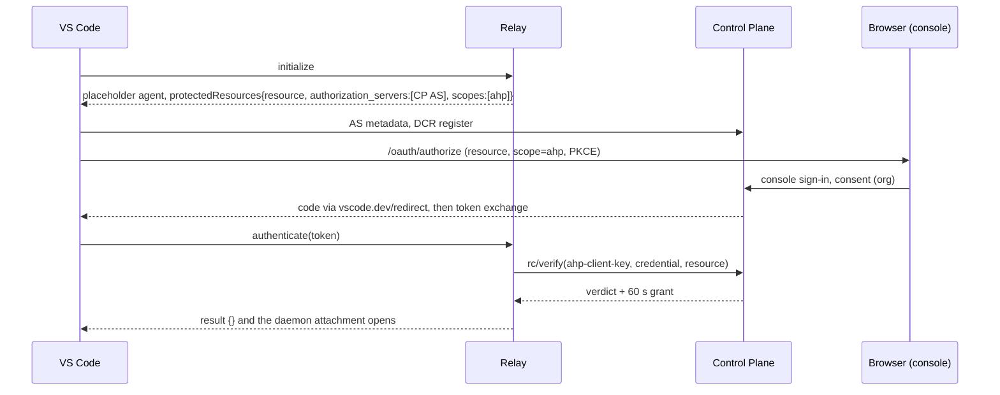

# AHP client sign-in with AgentConnect OAuth

> **Status:** Proposal for review.
> **Related:** [ahp-adoption.md](ahp-adoption.md) §3.4 (endpoint credentials),
> [agent-assistant.md](agent-assistant.md) §7 (the CP's embedded OAuth AS),
> [daemon-api-key-auth.md](daemon-api-key-auth.md) (personal keys).

## 1. Problem

A third-party AHP client signs in to `/ahp/agents/<agentId>` today only by pushing
a `full` personal API key through AHP `authenticate`. VS Code has no field for such a
key: it only sends one through a test-only setting honored under
`--enable-smoke-test-driver`. Without that flag every request answers
`AuthRequired` and session creation fails.

VS Code already implements the standard path. When `initialize` advertises a
required `AgentInfo.protectedResources` entry with `authorization_servers`, it
discovers that server (RFC 8414), registers itself (Client ID Metadata Document if
advertised, else RFC 7591 dynamic client registration), runs authorization code +
PKCE in the browser with `redirect_uri=https://vscode.dev/redirect`, sends the
entry's `resource` (RFC 8707) and `scopes_supported`, and pushes the access token
through `authenticate`. It pushes `authenticate` again on the same connection when
its token changes. AgentConnect needs to be the server at the end of that flow.

## 2. Decision

Use the CP's existing embedded OAuth AS (agent-assistant.md §7), not Logto.

| Option                    | Result                                                                                                                                                                                                                                                                                                         |
| ------------------------- | -------------------------------------------------------------------------------------------------------------------------------------------------------------------------------------------------------------------------------------------------------------------------------------------------------------- |
| CP OAuth AS (chosen)      | Already serves RFC 8414 metadata, RFC 7591 DCR for public clients, PKCE, consent through the console login, org-bound grants, rotating refresh tokens and revocation from the profile page. Tokens are `api_key` rows the CP already verifies.                                                                 |
| Logto as AS               | Logto supports CIMD "dynamic apps", off until a tenant admin enables them and disabled when SSRF protection is relaxed. Its resource indicators match exactly, so per-agent endpoint URLs need one API resource each, and the CP would need a second token verifier for Logto JWTs with org and agent mapping. |
| Personal key only (today) | Works for SDK clients and the CLI; no browser sign-in, and VS Code cannot send it outside test mode.                                                                                                                                                                                                           |

The user signs in to the AgentConnect console (Logto or dev auth, unchanged),
approves the client and the organization on the consent page, and the client
receives a short-lived AgentConnect token confined to AHP.

## 3. Token profile

### 3.1 Scope

Add one scope, `ahp`, to the AS vocabulary (`OAUTH_SCOPES`). It means "use AHP
endpoints as this user, within existing agent visibility and session policy". It
grants nothing on REST or MCP.

- The relay advertises `scopes_supported: ['ahp']` (today it advertises the MCP
  scopes, which would yield a token AHP must refuse).
- Consent keeps the requested `ahp` scope instead of falling back to `mcp:read`
  when no MCP scope was requested. A request naming both families is refused, so
  one grant never spans AHP and the CP API.
- The consent page names what `ahp` allows: chat with the organization's agents
  visible to the user, as that user.

### 3.2 Resource binding

The grant already records the RFC 8707 `resource`. Today nothing checks it; AHP
makes it load-bearing.

- **Advertised resource.** The relay keeps advertising the endpoint it was dialed
  at, `https://<relay-host>/ahp/agents/<agentId>`, because RFC 9728 ties the
  identifier to the endpoint a client reached. Each agent therefore gets its own
  consent and token, which also means a token stolen from one agent's connection
  cannot open another.
- **Check.** AHP verification accepts an OAuth token only when its grant's
  resource is exactly the endpoint being authenticated: same host and the
  `/ahp/agents/<agentId>` of the verified agent. The relay passes the resource it
  advertised alongside the credential; the CP compares it to the grant.
- **Allowed values.** `/authorize` accepts an `ahp` request only with a resource on
  a configured relay origin under `/ahp/agents/`. An unknown origin is refused at
  consent, before any token exists.
- **Future aggregate endpoint.** A multi-agent endpoint (separate work in
  ahp-adoption.md) would advertise its own resource, such as
  `https://<relay-host>/ahp`, and the same check applies to that value; this
  design does not widen per-agent tokens to it.

### 3.3 Confinement elsewhere

An OAuth token whose scopes are only `ahp` must be refused by the REST org-scope
guard and the MCP endpoint, including reads. Today the guard only blocks writes
for scoped tokens, so an `ahp` token would read the REST surface. Conversely an
MCP-scoped token stays refused on AHP, as it is today.

## 4. Verification path

- `rc/verify(ahp-client-key)` keeps one kind for both credential families. The CP
  resolves the token with `authenticateUser`; for `principalType: 'oauth'` it
  requires scope `ahp`, a live grant, and the grant resource check above, then runs
  the same membership, agent visibility, AHP API entry and rollout checks as a
  personal key. Personal keys keep today's rules (`full`, no scopes).
- `liveKey`, which renewal calls every grant period, accepts the same OAuth rows,
  so revoking the grant from the profile page closes the socket within one grant
  period (60 s).
- The rollout gate admits OAuth tokens when `AHP_PUBLIC_ACCESS` is on, or when the
  token's user is listed in a new `AHP_TEST_USER_IDS`. The key-id allowlist cannot
  work because access tokens rotate hourly.
- The relay advertises `authorization_servers` only when
  `AHP_AUTHORIZATION_SERVER` is configured, as today; that is the relay-side switch.

## 5. Token refresh on a live connection

Access tokens last one hour and AHP grants 60 seconds, so renewal re-verifies the
pushed credential. Today an expired access token fails renewal and closes the
socket as `unauthorized`; VS Code reconnects and signs in again.

Improve that: the relay handles `authenticate` on a bound socket. It verifies the
new credential and adopts it for renewal only if the verdict names the same
organization, user and agent; otherwise it answers `AuthRequired` and closes. A
bound `authenticate` never reaches the daemon (today it is forwarded and answered
`Unknown method`).

## 6. Out of scope

- An agent catalog across agents on one connection (ahp-adoption.md, aggregation).
- Remote folder browsing (`resourceList`/`resourceResolve`).
- CIMD on the CP AS. VS Code falls back to DCR; adding CIMD later only changes
  registration, not the token profile.
- Logto changes. Console sign-in is unchanged.

## 7. Security notes

- Tokens are opaque, hashed at rest, org-bound, user-bound, one-hour, revocable,
  and verified on every grant renewal; no JWT verification is added.
- `authenticate` carries the token in-band, never in a URL, and the relay never
  logs it, as with personal keys today.
- Per-agent resources bound at consent keep a token from widening to other agents
  or to the REST and MCP surfaces.
- The consent page is the only place a grant is created, behind console sign-in.

## 8. Rollout and verification

1. CP: `ahp` scope, consent rules, resource check, OAuth acceptance in AHP
   verification and renewal, REST and MCP confinement, `AHP_TEST_USER_IDS`.
2. Relay: advertise `ahp`, pass the advertised resource to verification, handle
   bound `authenticate`.
3. Test: set `AHP_AUTHORIZATION_SERVER` and the test user, then sign in from VS Code
   without the smoke-test flag, create a session, revoke the grant and confirm the
   socket closes, and refresh the token on a live connection.
4. Document the sign-in in `docs/ahp-operations.md`.
