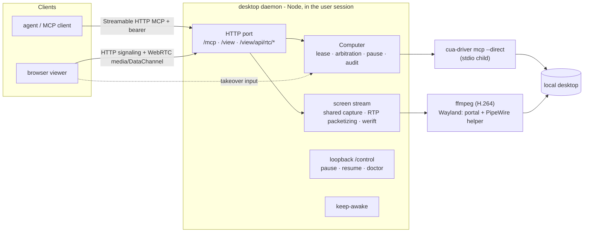

# Computer use: the Computer resource and the desktop daemon

**Status:** Draft v7, validated by a prototype, with a development plan. 2026-10-27. The concepts are unchanged from
the earlier drafts: a **Computer** resource; a **desktop daemon** that embeds Cua Driver; the `computer_*` tools; one
control lease per Computer; the human always wins; an action with an unknown outcome is never replayed; an emergency
stop; an audit trail. The prototype (§12) confirmed, overturned, or added to each section, and those results are
folded in. v6 adds the Linux container form (a Docker image, §3.8) and replaces the phase table with a development
plan: the Linux desktop daemon and Docker first, then macOS and Windows (§14). v7 (2026-10-27) adds a command-line and
file tier beside the GUI tools, granted separately and off on a person's desktop (§5.7). v8 (2026-11-06) designs one
desktop per agent on a Linux Computer, so agents work in parallel, with browser logins shared between those desktops
by forking and merging Chromium profiles when a browser starts (§3.9, §3.10); a prototype validated it in a Debian VM,
and it shipped as M6 (§14.9), on by default where supported. v9 (2026-11-18) designs a second way to work a browser,
beside the screen: the browser a Computer starts accepts the DevTools protocol, and the desktop daemon embeds Chrome
DevTools MCP to offer its page tools under the same lease (§5.8); the viewer gains a Browser view, the page under an
address bar, for a person to operate (§7.6); and the image moves from Chromium to Google Chrome (§3.8). It is built in
the steps of §14.10. v9.1 (2026-11-18) records the browser-tools prototype (§14.10) and the corrections it made: the
launcher's flags and first-run file, the endpoint's stale port file and the AutomationControlled flag, the egress
forwarder's loopback refusal, the child's flags and lifetime, opaque page ids, and the screencast's measured rates and
limits. v9.2 (2026-11-19) lands step 3, the DevTools endpoint (§3.10, §5.8), and decides §17-26. v9.3 (2026-11-19)
lands the first half of step 4: the Chrome DevTools MCP child, the `computer-browser-v1` contract and the six tools that
only read (§5.8). v9.4 (2026-11-19) lands the acting tools on the desktop daemon. v9.5 connects the browser tier
to the Control Plane and agent sessions. v9.6 implements the Browser viewer API and frame transport. The Chinese version
lives in the extensions repository (`docs/designs/computer-use.md`, PR #147).

The first source of Computers is the user's own machine (a **self-hosted computer**). A **managed computer** that
AgentConnect operates comes later. The pair mirrors the self-hosted daemon and the managed daemon pool
([architecture.md §3.1](architecture.md)).

Markers: **[validated]** ran on real machines in the prototype; **[design]** is not implemented; **[unverified]** is
inferred or untested; **[legal]** needs counsel. Nothing here on licenses is legal advice.

## 0. Decisions

| #   | Decision                           | Outcome                                                                                                                                                                                                                                           | Status                                            |
| --- | ---------------------------------- | ------------------------------------------------------------------------------------------------------------------------------------------------------------------------------------------------------------------------------------------------- | ------------------------------------------------- |
| 1   | New concept                        | **Computer**: a registered graphical desktop that can be granted to agents (§2)                                                                                                                                                                   | Design (the prototype has one per daemon)         |
| 2   | First source                       | **Self-hosted computer**: a desktop daemon runs on the user's desktop (§3)                                                                                                                                                                        | Validated                                         |
| 3   | Driver                             | Embed **Cua Driver (MIT, pinned 0.35.2)** as a `cua-driver mcp --direct` stdio child; never `cua-spacesd` or the Cua viewer (FSL) (§3.1)                                                                                                          | Validated                                         |
| 4   | Process shape                      | A background service **inside the user's logged-in graphical session**: on macOS our own signed app plus a LaunchAgent, on Windows a LocalSystem service that runs it as SYSTEM in the console session, on Linux a systemd user unit (§3.2, §3.3) | Validated                                         |
| 5   | macOS grant owner                  | macOS grants must belong to AgentConnect's own app (`md.agentconnect.computer`), not the terminal (§3.2.1)                                                                                                                                        | Validated                                         |
| 6   | Connection                         | Outbound WebSocket to the CP with a Computer key; tool calls ride the desktop's outbound relay link with per-session CP tokens; no screen bytes reach the CP (§3.6, §3.7)                                                                         | Implemented (the agent's direct path is design)   |
| 7   | Permissions                        | Per-Computer visibility; agent access as one relation (No agents / Selected / All agents) set from either side; `view` / `control` modes; approvals; hard refusals (§4)                                                                           | Refusals validated; approvals, access implemented |
| 8   | Concurrency                        | **At most one control lease per desktop**; on Linux each agent gets its own desktop by default, elsewhere a Computer is one desktop that agents take in turn; screenshots run concurrently (§3.9, §4.4)                                           | Validated                                         |
| 9   | Tools                              | `computer_*` MCP tools; coordinates are screenshot pixels with a fixed 1280 long edge (§5)                                                                                                                                                        | Validated                                         |
| 10  | Sharing with a human               | Human-first arbitration, owner pause, emergency stop, takeover pauses agents (§6)                                                                                                                                                                 | Validated (keyboard detection and tray: X11 only) |
| 11  | Remote desktop                     | A **built-in WebRTC viewer** on the same port as MCP, instead of relying on the OS's remote desktop; embedded in the console, direct first then TURN (§7)                                                                                         | Implemented                                       |
| 12  | Screenshots                        | Returned as MCP `image` content; stored in the object store with configurable retention and billing (§9)                                                                                                                                          | Implemented (masking is design)                   |
| 13  | Runtimes without MCP image support | Computer use is disabled; no OCR or accessibility-tree fallback                                                                                                                                                                                   | Unchanged                                         |
| 14  | Unknown outcomes                   | On timeout, disconnect, or driver crash, **never replay input**; return `uncertain` with a fresh screenshot (§5.4)                                                                                                                                | Validated                                         |
| 15  | Licenses                           | Bundled components are MIT / Apache / BSD / ISC only; GPL ffmpeg is **not bundled** but downloaded and checksummed on first run (§11)                                                                                                             | Validated (Cloud distribution needs legal)        |
| 16  | Container form                     | The same desktop daemon runs in a **Linux container** (Xvfb, Xfce, a browser) as a Computer without a physical desktop; it is the preferred base for managed computers (§3.8, §15)                                                                | Validated (Docker on OrbStack)                    |
| 17  | Development order                  | Linux desktop daemon (with the shared CP work) → Docker and the Linux managed computer → macOS → Windows (§14)                                                                                                                                    | Plan                                              |
| 18  | Later                              | **Managed computers**: containers on Linux; the earlier VM desktop pool design for macOS and Windows (§15, appendices)                                                                                                                            | Design                                            |
| 19  | Managed allocation and sharing     | Managed computers are `ephemeral` (per session), `per-agent` (one per agent, sleeps between uses) or `manual` (user-created, shared); shared Computers queue for the lease (§4.4, §15.1)                                                          | Design                                            |
| 20  | Command line and files             | `computer_exec` and file tools implemented by the desktop daemon, not Cua's; policy `shell` / `files`, on for managed computers and off on a person's desktop; run as the signed-in person; no lease; stopped by pause and stop (§5.7)            | Implemented on Linux                              |
| 21  | Per-agent desktops                 | A Linux Computer runs one desktop (Xvfb, Xfce, its own driver and lease) per agent, on by default wherever it can, off from the tray menu; the main desktop stays for people (§3.9)                                                               | Design; prototype validated (§14.9)               |
| 22  | Shared browser logins              | Each desktop has its own Chromium profile; before a browser starts, the daemon three-way merges cookies, localStorage and IndexedDB from the other profiles into it; the merge needs no extension and no CDP (§3.10)                              | Design; prototype validated (§14.9)               |
| 23  | Browser tools                      | Browsers an isolated Computer starts accept the DevTools protocol on loopback; the desktop daemon embeds **Chrome DevTools MCP (Apache-2.0, pinned)** and serves its page tools as `chrome_*` under the lease and audit of `computer_*` (§5.8)    | Design                                            |
| 24  | Browser view                       | The viewer gains a **Browser** view beside Desktop: the page streamed and operated over DevTools under an address bar and tabs, in Infra's Computer page and the agent side panel (§7.6)                                                          | Design                                            |
| 25  | Image browser                      | The container image ships **Google Chrome** instead of Chromium: Chrome DevTools MCP supports it, sites see Chrome's brand, and its main profile leaves Chrome's default directory, which refuses remote debugging (§3.8)                         | Design (publishing needs legal, §11.1)            |

## 1. Background and goals

### 1.1 Background

Agents today work only through a shell, files, and a headless browser (`docker/runtime-sandbox-base.Dockerfile`
installs headless Chrome only; browsing comes from `agent-browser`). They cannot use GUI-only software, check a UI by
looking at it, or act inside an environment where the user is already signed in. Earlier drafts studied a VM desktop
pool and hit three walls: an isolated environment has none of the user's apps or sessions; macOS and Windows VM
licensing; and the FSL license of `cua-spacesd`, which does not suit Cloud. So agents first use **the user's own
desktop**, behind a Computer abstraction, and VM or container desktops join later as another kind of Computer. The
prototype showed a further advantage of the user's desktop: residential egress has a far better reputation than a
data-centre IP (§15.4).

### 1.2 Goals

- A first-class Computer resource with an owner, visibility, grants, and status, managed in the console next to Daemons.
- A user runs `setup` once on a macOS, Windows, or Linux desktop to turn it into a Computer that is available after every login.
- Agents screenshot, click, and type through `computer_*` tools; an agent under any execution strategy can use a Computer granted to it.
- When a human and an agent share a desktop, the human always wins, can pause or stop at any time, and can watch and take over from a browser.
- Every bundled dependency is permissively licensed, fit for an Apache-2.0 release and for Cloud.

### 1.3 Non-goals for this stage

- Managed computers and VM desktop pools (§15). The Linux container form is validated (§3.8) and productized in M2 (§14.5).
- Several people controlling one Computer at once (the viewer allows many watchers, but input has one controller).
- A text fallback for runtimes without MCP image content; a home-grown computer-use model.
- Audio, clipboard sync, and per-display control on multi-monitor machines (§17).

## 2. The Computer concept

### 2.1 Definition

A **Computer** is a registered graphical desktop in an organization that an agent, once granted, can observe and
operate through `computer_*` tools. Computer and Daemon are separate resources: a Daemon runs agents (runtimes,
sessions, workspaces); a Computer is used by agents. One machine may run both, or only one.

Proposed [GLOSSARY.md](../../GLOSSARY.md) entries:

- **Computer**: a graphical desktop resource granted to agents. _Avoid_: desktop pool member (a managed-computer implementation detail), machine (already used for daemons).
- **Desktop daemon**: the process inside a logged-in graphical session that registers the local desktop as a Computer.
- **Control lease**: one controller's (an agent session's) exclusive, time-limited right to send input to a Computer; a human can pre-empt it.
- **Viewer**: the desktop daemon's built-in browser remote desktop, for humans to watch and take over.

### 2.2 Data model (Control Plane) [design]

```ts
interface Computer {
  id: string // cmp_...
  orgId: string
  name: string // display name, such as "Yulong's MacBook"
  ownerUserId: string // the registrant; required for a self-hosted computer
  kind: 'self-hosted' | 'managed' // only self-hosted in this stage
  isolation: 'none' | 'container' | 'vm' // none: the user's real desktop; container: the §3.8 image
  os: 'macos' | 'windows' | 'linux'
  osVersion: string
  session: 'aqua' | 'console' | 'rdp' | 'x11' | 'xvfb' | 'wayland-gnome' // the prototype's doctor already tells these apart
  status: 'online' | 'offline' | 'locked' | 'paused' | 'human_in_control' | 'busy' | 'sleeping' | 'revoked' // sleeping: managed only
  allocation?: 'ephemeral' | 'per-agent' | 'manual' // managed only (§15.1) [implemented]
  ownerAgentId?: string // the agent a per-agent or ephemeral computer was made for [implemented]
  capabilities: {
    screenshot: boolean
    input: boolean
    textInput: 'full' | 'keymap-only' // GNOME Wayland (libei) cannot type IME text
    backgroundInput: boolean // Cua Driver's window-scoped background input (cua_* tools)
    accessibilityTree: boolean
    exec: boolean // computer_exec can run here (§5.7); false on macOS until its TCC check is validated
    files: boolean // the §5.7 file tools
    viewer: boolean // ffmpeg ready and one frame captured
    displays: { id: string; width: number; height: number; scale: number }[]
    permissions: { accessibility?: boolean; screenRecording?: boolean; portal?: boolean; firewall?: boolean }
  }
  desktopDaemonVersion: string
  driverVersion: string // the embedded Cua Driver version
  visibility: ResourceVisibility // reuses resource-visibility.md
  agentAccess: ComputerAgentAccess // §4.1 [implemented]: which agents may use it
  policy: ComputerPolicy // §4
  lastSeenAt: string
  createdAt: string
}
```

Persistence lives in the Control Plane (`packages/control-plane/src/persistence/`); visibility reuses
[resource-visibility.md](resource-visibility.md). **[implemented]** The `computer` table holds this record with a UUID
`id`; `kind`, `session` and the policy are validated by `src/domain/computer.ts`. A newly registered self-hosted
computer starts **Selected** with only its registrant in the audience (organization owners still see it by role),
and only the registrant may change its policy and its agent access (§4.1); any editor may revoke or delete it. The desktop daemon reports status and capabilities in its heartbeat,
with `permissions`, `session`, and `viewer` taken straight from `doctor` (§3.5). Wire frames go in a new
`packages/protocol/src/frames/computer.ts`.

**[implemented]** A managed computer also carries its `allocation` mode (§15.1); a self-hosted computer has none. A
`per-agent` computer names its one owning agent in `ownerAgentId`, and the pool keeps at most one per agent. `sleeping`
means the pool scaled the pod to zero (or deleted it) while keeping its volume; it applies to `per-agent` and `manual`
computers, and the next use wakes the computer with its files, browser profile, and sign-ins intact. An `ephemeral`
computer never sleeps: it is deleted, pod and volume, when it is reclaimed. The `computer` table adds `allocation`,
`ownerAgentId`, `poolSessionId` (the one session an `ephemeral` computer serves), the pool controller's `poolPhase`
(`provisioning`, `registering`, `awake`, `sleeping`, `waking`, `failed`, `reclaiming`, `resetting`) with its time, `poolActiveAt` and
`poolError`; partial unique indexes keep one live `per-agent` computer per agent and one live `ephemeral` one per agent
session. `sleeping` is a CP verdict like `offline`: the lease service and the channel grant refuse it as `unavailable`.

### 2.3 Relation to existing concepts

| Existing concept                                     | Relation                                                                                                  |
| ---------------------------------------------------- | --------------------------------------------------------------------------------------------------------- |
| Daemon (self-hosted / managed pool)                  | A Computer runs no agents; the agent's daemon reaches the Computer through the Control Plane / relay      |
| Agent                                                | The agent configuration names the Computers it may use (§4.1)                                             |
| Session                                              | A control lease is bound to a session and released when it ends                                           |
| Execution strategy (host / srt / microsandbox / pod) | Irrelevant: tool calls always reach the daemon's built-in MCP server first                                |
| Centralized tool management                          | `computer_*` is one managed tool group ([centralized-tool-management.md](centralized-tool-management.md)) |

## 3. The desktop daemon

### 3.1 Components [validated]

The desktop daemon is a Node program bundled into one `.mjs` (on macOS it runs inside a signed `.app` whose Node
runtime holds the grants, §3.2.1). The package is `packages/computer`, published to npm as `@agentconnect.md/computer` (bin
`agentconnect-computer`) like the agent daemon. `@agentconnect.md/cli` installs, upgrades and runs it as
`agentconnect computer …`, from its own version store in the computer data directory
([cli-daemon-split.md §1.2](cli-daemon-split.md#12-computer-desktop-daemon)).



- **Driver**: Cua Driver (MIT, trycua/cua `libs/cua-driver`) pinned to **0.35.2**, downloaded and sha256-checked, run as
  a `cua-driver mcp --direct` child over stdio MCP. A child process isolates driver crashes and makes MCP the boundary.
  `cua-perception` (AGPL models) is never installed. Linux X11 uses Cua's XTest backend, so no xdotool fallback is
  needed; GNOME Wayland uses Cua's Wayland mode (§3.2.3).
- **Browser driver [design]**: Chrome DevTools MCP, a second stdio MCP child beside the driver, one per desktop while
  its `chrome_*` tools are in use, connected to that browser's loopback DevTools endpoint (§5.8). The viewer's Browser
  view uses a DevTools connection of the daemon's own (§7.6). The diagram shows neither yet.
- **External interface**: one HTTP port (7681 in the prototype) serves Streamable HTTP MCP at `/mcp` and the viewer at
  `/view`; a loopback-only `/control` sits beside them (§8).
- **Computer core**: leases, human arbitration, owner pause, `uncertain` handling, a JSONL audit log (§4–§6).
- **Screen stream**: one shared capture that the first viewer starts and the last one stops (§7).
- **Keep-awake**: keeps the display awake while running (§3.4).
- **Local UI**: the console window (title and keys) is the indicator and emergency stop; on X11 a tray icon, a global
  stop hotkey and keyboard activity detection join it (§6); macOS has a menu bar icon and Windows a taskbar icon, drawn by native helpers from one menu model (§6).

### 3.2 Process shape, identity, and OS grants

The desktop daemon must run inside **the user's logged-in graphical session** and hold OS grants under one stable,
recognizable identity.

| Platform                 | Started by                                                                             | Required grants / limits                                                                                                                  | Status                                             |
| ------------------------ | -------------------------------------------------------------------------------------- | ----------------------------------------------------------------------------------------------------------------------------------------- | -------------------------------------------------- |
| macOS                    | Our own `AgentConnect Computer.app` plus a user LaunchAgent (§3.3)                     | Accessibility, Screen Recording, "bypass the private window picker"; granted to the app                                                   | Validated (macOS 27 VM)                            |
| Windows                  | A LocalSystem service that starts the daemon as SYSTEM in the console session (§3.2.2) | No TCC; an inbound firewall rule; UAC prompts answered on the secure desktop by a SYSTEM helper (§4.2.1); the lock screen is out of reach | Validated (Windows 11 arm64 VM), firewall flow not |
| Linux X11                | systemd user unit plus XDG autostart                                                   | None                                                                                                                                      | Validated (Xfce on Xorg / Xvfb)                    |
| Linux GNOME Wayland      | Same                                                                                   | The Cua GNOME Shell extension; RemoteDesktop and ScreenCast portal consent once each                                                      | Validated (GNOME 50); KDE unsupported              |
| Linux container (Docker) | The container entrypoint, in the foreground, without systemd (§3.8)                    | None; publish the HTTP port and a UDP port range                                                                                          | Validated                                          |

#### 3.2.1 macOS: who owns the grant [validated]

TCC records a grant against the **responsible process**. Started from a terminal, the grant belongs to Terminal: too
broad (anything run in that terminal inherits it), once per terminal app, and impossible over SSH. So the desktop
daemon runs as its own app:

- `AgentConnect Computer.app`, bundle id `md.agentconnect.computer`, `LSUIElement` (no Dock icon), launched by a
  per-user LaunchAgent in the Aqua session. **[implemented]** The app is a runtime, not the daemon: its executable is
  the official, pinned Node re-signed under the app's identity, and the LaunchAgent runs
  `<app>/Contents/MacOS/agentconnect-computer <data dir>/current/dist/agentconnect-computer.mjs run`. A daemon upgrade
  moves `current` and never touches the app, so the grants stay even with an ad-hoc signature; only a Node update
  changes the app. Each `@agentconnect.md/computer` version pins its app as an exact optional dependency
  (`@agentconnect.md/computer-darwin-arm64` / `-x64`); `computer install` / `upgrade` verify it through the same
  registry integrity check, require `codesign --verify --strict` and the `md.agentconnect.computer` identifier, and
  swap it into `~/Applications` (no administrator) only when the pin changes. npm downloads carry no quarantine.
- Cua Driver and ffmpeg inherit the app's grants as children; `TCC.db` held only `md.agentconnect.computer`, never Terminal.
- Three grants: **Accessibility** (renamed "Device Control and Data Access" in macOS 27; being listed is not enough, the
  switch must be on, or clicks and keys are dropped silently while pointer moves still work, which is easy to miss);
  **Screen Recording** (takes effect only after the app restarts, so `setup` restarts the service while it waits); and
  the extra "bypass the private window picker" consent of the legacy capture API.
- Signing: an ad-hoc signature ties grants to the build hash, so every new app needs new grants. Release needs a
  Developer ID, notarization, and the hardened runtime. **[implemented]** The app is always signed with the hardened
  runtime and only `allow-jit` plus `allow-unsigned-executable-memory`: library validation and `DYLD_*` stay locked,
  and the LaunchAgent clears `NODE_OPTIONS`, so nothing loads foreign code into the granted process through the
  runtime. The trust boundary is still the user account: the daemon runs Cua Driver, ffmpeg, and the store's bundle from
  the user-writable data directory, as a terminal-held grant would. `CODESIGN_IDENTITY` and `NOTARY_KEYCHAIN_PROFILE`
  switch the build to Developer ID plus notarization.
- Install over SSH works in app mode: launchd starts the app in the logged-in desktop session, so the prompts appear on
  the Mac's own screen. With nobody logged in, `setup` writes the LaunchAgent and asks for a desktop login.
- `doctor` cannot read `TCC.db` without Full Disk Access, so the app records in `macos-grants.json` which grants it
  asked for and which it has held. A missing grant that was asked for is "listed but switched off"; one that was held
  is "switched off or held by an earlier build", fixed by `tccutil reset <service> md.agentconnect.computer` and
  `setup`. `uninstall --purge` resets both grants.
- The grants need no Swift. **[implemented]** The one Swift part is the menu bar helper (§6), a separate executable
  beside the runtime, signed before the bundle; ScreenCaptureKit plus VideoToolbox native capture and `SMAppService`
  login items would come later.

#### 3.2.2 Windows

- **[validated]** The `AgentConnectComputer` service (LocalSystem, Session 0) only supervises: it duplicates its own
  token into the active console session and starts the daemon there, so the daemon and Cua Driver run as SYSTEM on
  `winsta0\default`. It restarts the daemon after a crash, follows logon, logoff and console switches, and leaves it
  stopped after the taskbar's Quit until the next logon or `service start` (custom control 128). Only a
  System-integrity process can drive `consent.exe`; an elevated administrator (High) is still blocked by UIPI.
- **[validated]** UAC prompts stay on the secure desktop (`WinSta0\Winlogon`), as Windows ships them; the system setting
  is never changed. Only a SYSTEM process can open that desktop, so the service installs a third helper,
  `agentconnect-computer-admin-prompts.exe`, which the daemon starts beside it; who answers a prompt is §4.2.1. A click
  that closes a prompt, or opens a menu, moves the foreground to another process, which Cua Driver reports as
  `foreground_unavailable`; the daemon reports such a click as sent.
- **[validated]** Apps the agent launches start as the signed-in person: the service host's `run-as-user` mode
  (`WTSQueryUserToken`) runs them, the taskbar helper and Open Logs; Cua Driver itself refuses to launch from SYSTEM.
- **[validated]** What SYSTEM runs is the administrators' to change: `setup` asks for one UAC approval, compiles the
  service host and taskbar helper with the in-box .NET Framework `csc.exe` into `%ProgramFiles%\AgentConnect\Computer`
  with a copy of `node.exe` and the bundle, and moves the data to `%ProgramData%\AgentConnect\computer`, which the
  installing person may read but not write. Commands that write it ask for approval the same way.
- Without the service (`setup --no-service`), the user Run key starts it at login (`autostart enable`). `doctor` tells an
  RDP session from the console session.
- Firewall: `setup` uses one UAC prompt to add an inbound allow rule for `node.exe` covering every profile (Tailscale
  networks are often classified Public), and disables the block rule Windows creates when the user presses Cancel on its
  firewall prompt. It does so even when MCP listens on loopback only, since the viewer's direct WebRTC media is inbound
  UDP all the same. The taskbar menu shows whether the rule is in effect and, when it is not, adds it on a click — the
  SYSTEM service needs no UAC prompt for that. [implemented, not validated end to end]
- The lock screen and the sign-in screen stay out of reach: the daemon only runs while someone is signed in.

#### 3.2.3 Linux

- **X11**: no grants; Cua uses XTest. Characters missing from the keymap (Chinese, for example) are typed by
  temporarily remapping a keycode. On real Xorg, back-to-back remaps race ("你好" became "好好"); sending one character at
  a time with a 40 ms gap fixed it. Xvfb does not reproduce this, so tests must cover real Xorg.
- **GNOME Wayland**: `CUA_DRIVER_RS_ENABLE_WAYLAND=1` enables Cua's Wayland mode. It needs the GNOME Shell extension
  `winrects@cua` (window geometry, screenshots, activation; one logout after install), and sends input through the
  RemoteDesktop portal and libei (one consent, restore token persisted). libei sends keycodes only, so **IME text such
  as Chinese is dropped** (`textInput: 'keymap-only'`, §17).
- KDE Wayland: not yet supported by Cua. GDM 50 has dropped X11 sessions (X11 tests used LightDM).
- Test trap: GTK connects to `wayland-0` even when `WAYLAND_DISPLAY` is unset.

### 3.3 Background service and crash recovery [validated]

| Platform  | Mechanism            | Notes                                                                                                                                                                                                                                                                                            |
| --------- | -------------------- | ------------------------------------------------------------------------------------------------------------------------------------------------------------------------------------------------------------------------------------------------------------------------------------------------ |
| macOS     | Per-user LaunchAgent | Aqua session, `RunAtLoad`, `KeepAlive` on failure                                                                                                                                                                                                                                                |
| Linux     | systemd user unit    | Pulled in by `graphical-session.target`; an XDG autostart entry imports `DISPLAY` / `WAYLAND_DISPLAY` and friends into systemd (Xfce never activates `graphical-session.target`); `ExecCondition` skips the start without a display instead of crash-looping; `PartOf` the session; `StartLimit` |
| Windows   | LocalSystem service  | Starts at boot, runs the daemon in whoever signs in at the console (§3.2.2), restarts it on failure; the taskbar icon is the indicator; without the service, a user Run key                                                                                                                      |
| Container | Entrypoint           | The daemon runs in the foreground; `docker stop` shuts it down cleanly (§3.8)                                                                                                                                                                                                                    |

- **[implemented]** Linux session following: Xfce leaves `graphical-session.target` active after logout, so the
  autostart entry also exports the logind session id (`AGENTCONNECT_COMPUTER_SESSION`) and resets the unit's start limit;
  the daemon polls that session and exits when it closes, dropping its display variables from the user manager (or
  exits 75 so systemd restarts it when a newer session already imported its own). Validated on Ubuntu 26.04 Xfce on
  Xorg across logout / login and reboot; GNOME Wayland is tracked in #3221.
- On Linux, Cua Driver runs in its own `systemd-run --user --scope`, so apps an agent launched survive a service
  restart (without it, a restart killed them; observed).
- Crash recovery: back within 3 s of `kill -9`, with no orphans; ffmpeg, caffeinate, and the inhibitor are cleaned up.
  ffmpeg needs a SIGKILL fallback (avfoundation ignores SIGTERM).

### 3.4 Keeping the display awake [validated]

A sleeping display breaks capture (macOS even removes the capture device, and screenshots turn black). While running,
the daemon keeps the display awake: macOS `caffeinate` (`-u` to wake, `-d -i -w <pid>` to hold); Windows
`SetThreadExecutionState` through a helper; GNOME `gnome-session-inhibit` bound to the pid; other X11
`xset s off -dpms`. This changes the user's power settings, so the release explains it in the console and the local
UI and lets the owner limit it to time windows [design].

### 3.5 Install and diagnose: `setup` and `doctor` [validated]

`setup` runs once on the desktop (from a terminal or over SSH; on macOS it runs the binary inside the app):

1. Write the config and mint a client token (prototype; registration with the CP replaces this, §3.6).
2. Download and check Cua Driver; download ffmpeg in the background (§7.4).
3. OS grants: on macOS, raise the prompts, open the right settings pane, wait, and restart the service; on Windows,
   configure the firewall through UAC; on Linux, install the GNOME extension, trigger ScreenCast consent (one probe
   capture) and RemoteDesktop consent (one harmless Shift press; a pointer move goes through the extension and would
   report a false success).
4. Install the background service (§3.3), then run `doctor`.

`doctor` is read-only, exits 1 on failure, and **every failure comes with its fix**. When the daemon is running,
`doctor` asks it over the loopback `/control/doctor` to run the checks in a child of the daemon, so the result reflects
the service's own identity, grants, and session rather than the caller's terminal. Checks: config; session type (SSH /
Session 0 / RDP / Wayland / X11); driver; macOS grants; a real screenshot; display wake; ffmpeg plus a real one-frame
capture; the Linux GNOME helper, portal, and PipeWire dependencies; the Windows firewall rule; whether the daemon runs.

**[implemented]** Install, upgrade and diagnose through the CLI (#3239; Linux first, GNOME Wayland is #3221). A release
publishes `@agentconnect.md/computer` to npm with the other packages (`scripts/publish-computer-if-changed.sh`: the same
channels and dist-tags, provenance through trusted publishing, a self-contained esbuild bundle in `dist/` with the
release version baked in, and the §11 license scan run on exactly what ships). Cua Driver and ffmpeg are not in the
package: they stay pinned, checksummed downloads at `setup` / first start. A Linux host is assumed to have Node.js
(the daemon's `engines`), and the console's **Add Computer** shows
`npx -y @agentconnect.md/cli@<tag> computer install [--channel rc] --register <token> --cp-url <exchange URL>`, the
only Linux install path. The tag is never omitted: the registration names the CP release's `cliChannel`, so a stable CP
emits `@latest` and an rc CP (or a checkout) `@rc --channel rc`, because npm `latest` can predate `computer install`. `install` resolves the
package from the CLI-local registry (never a CP-supplied URL), verifies its integrity and `engines`, extracts it to
`versions/<v>` in the data directory, points `current` at it and runs `setup --register`; the systemd user unit and the
Windows Run-key launcher run `current/dist/agentconnect-computer.mjs`. `upgrade` installs side by side, switches
`current`, rewrites and restarts the unit, and requires a stable pid plus the daemon answering as the new version on
its loopback `/control/status`; otherwise it restores the previous version. Config, the Computer key and the grants
live beside the store and are never touched, so an upgrade does not register again. `doctor` names the installed
version (also its first check, which the console shows), and `status`, `versions`, `start` / `stop` / `restart` and
`uninstall [--purge]` complete the set ([cli-daemon-split.md §1.2](cli-daemon-split.md#12-computer-desktop-daemon);
on Windows only `start` until M4). The CP no longer ships the daemon or serves a Linux installer: the CP-hosted
`install.sh` served until the package's first npm publish (2.6.0-rc.57) is gone. Installs from that `install.sh` keep
their data directory, and `computer install` moves their service onto the store. Validated on Ubuntu 26.04 Xfce on Xorg (arm64)
against a local registry: install and register, online across logout / login and reboot, upgrade without a new
registration, and rollback from a version whose daemon crashes.

### 3.6 Registration and pairing [design]

Follow the "add a daemon in the console, run the generated command" flow and daemon API-key authentication:

1. Console **Computers → Add Computer**: the console produces a one-time install command, the same on every desktop OS,
   carrying a short-lived registration token.
2. The user runs it on the target machine, i.e. `setup --register <token>`: every §3.5 step, plus exchanging the
   registration token for **an API key bound to this organization and this Computer**, kept in the system keychain /
   credential manager [per-platform storage to be decided]. In a container the token arrives through an environment
   variable or a secret file (§14.5).
3. The desktop daemon opens an outbound WebSocket with that key (the same `auth` frame and close codes as the daemon,
   see [daemon-cp-ws-protocol.md](daemon-cp-ws-protocol.md)) and reports capabilities and `doctor` results.
4. Revocation: deleting the Computer or revoking the key disconnects the desktop daemon at once, stops all input, and
   closes the viewer. The bound when the CP connection is lost is in §8.2.

**[implemented]** The Computer channel. The frames live in `packages/protocol/src/frames/computer.ts`, a
separate frame union from the daemon and relay wires, so a frame from another wire is `UNKNOWN_FRAME`. The desktop
daemon dials `wss://<cp>/v1/computers/ws`, which the CP also serves at `/api/v1/computers/ws` (`COMPUTER_WS_PATH`).
The subprotocol is `agentconnect.computer.v1`, and any other subprotocol gets HTTP 400. The registration exchange
returns this URL as `channelUrl`.

| Frame                 | Direction | Purpose                                                                                                |
| --------------------- | --------- | ------------------------------------------------------------------------------------------------------ |
| `computer/auth`       | D→C REQ   | the Computer key and the desktop daemon's version; the first frame, sent within 10 s                   |
| `computer/auth/ok`    | C→D REP   | the Computer id and name, `heartbeatSec`, the CP clock, the policy, and the first channel key          |
| `computer/heartbeat`  | D→C EVT   | the status, plus the OS version, session, versions, capabilities and `doctor` results when they change |
| `computer/credential` | C→D EVT   | a renewed channel key                                                                                  |
| `computer/policy`     | C→D EVT   | the owner changed the policy                                                                           |
| `computer/revoke`     | C→D EVT   | the Computer was revoked or deleted, or its owner left the organization; the CP then closes with 4401  |
| `computer/stop`       | C→D EVT   | a console Stop (its time) or `null` once resumed; told again while the desktop does not show the Stop  |

The close codes follow the daemon. A refused key gets an `AUTH_FAILED` reply and close `4401`, and the desktop treats
that reply, or a `computer/revoke`, as a revoke: it stops redialing, forgets the key and keeps a revoked marker. The
CP closes with `4401` for nothing else; an unreadable or out-of-order first frame gets `4400`, an auth timeout `1008`,
and a full handshake gate a retryable `RATE_LIMITED` with `4429`, and the desktop redials after a bare `4401` too.
`1011` and `1012` redial with backoff of 1–30 s with jitter, and a newer connection for the same Computer supersedes the older one with `1012`. The CP stores
the heartbeat with a write that applies only while the Computer and the channel's key are both unrevoked, so a
revoke made elsewhere also ends the channel at its next heartbeat. A clean close marks the Computer `offline`. A live
status whose `lastSeenAt` is older than three heartbeats is shown as `offline`. The desktop runs `doctor` in a child
when it starts and every 30 minutes. The capabilities are derived from those checks and the screen size.

**[implemented]** Registration on the desktop. `setup --register <token> --cp-url <url>` (or just `register`) spends
the token and stores the key in `computer-key.json` in the data directory with mode 0600. Moving the key into the
system keychain or credential manager is still to do. A registered desktop mints no local client token.

API keys gain a `computer` principal type, usable only on the Computer channel; it can neither run agents nor reach
other resources ([daemon-api-key-auth.md](daemon-api-key-auth.md)). **[implemented]** `POST
/orgs/:orgId/computers/registrations` mints a one-time token (60 minutes by default, at most 24 hours) and
`POST /v1/computers/register` spends it, creating the Computer and its key in one transaction; the minting route,
`POST /orgs/:orgId/computers/:id/revoke` and `POST …/resume` are `interactiveOnly`. A registrant who leaves the
organization has their Computers revoked. The prototype's local token (sha256 stored, shown
once) stays as an offline / development mode.

### 3.7 Data paths

- **Prototype [validated]**: the MCP client (Claude Code) connects over HTTP straight to the desktop daemon's `/mcp`;
  the browser viewer connects to the same port. Cross-internet tests ran over Tailscale.
- **Control plane [design]**: registration, heartbeats, status, leases, and policy go over the Control Plane WebSocket.
- **Data plane [implemented]**: tool calls and screenshot bytes travel between the agent's daemon and the desktop
  daemon over **an outbound session channel through the relay**; the decision for §17-1 follows. The Control Plane
  issues the credentials and carries no screen byte or tool body.
- **Viewer media [implemented]**: WebRTC media goes peer to peer between the browser and the desktop. On one network
  it uses host candidates; across NATs the relay is the **hole-punching (STUN) server**: each relay instance answers
  STUN Binding requests so both peers learn their server-reflexive address, and full ICE punches a direct UDP path
  (§7.2). Signaling rides the same relay channel. When punching fails (a symmetric NAT, UDP blocked), media falls back
  to **TURN on the relay** (#3236), over UDP or over TCP and TLS on 443, or to an external TURN such as coturn (BSD);
  with neither, the console polls screenshots through the relay.

**Decision (§17-1).** A user's desktop sits behind NAT and can only dial out, and the relay is already the install's
public, per-instance ingress that daemons dial ([shared-bot-relay.md §5](shared-bot-relay.md)). So the desktop daemon
dials every relay in the CP's roster, and an agent daemon sends its MCP calls to a relay, which forwards them over that
link. The session-executors TLS-PSK pipe ([session-executors.md §6](session-executors.md)) was not chosen: its executor
listens and its holder dials, which is the direction NAT forbids, and it carries the shim protocol between daemons of
one group rather than HTTP to a machine outside it. Because the desktop daemon is already a standard Streamable HTTP
MCP server, the channel forwards HTTP and nothing else; no new tool protocol is needed. A direct connection is the
same-network optimization: the desktop's own `/mcp` accepts the same per-session token, and choosing it needs an
address the desktop advertises, which is still to do. For viewer media the relay is primarily the hole-punching
server: STUN costs it one stateless datagram per Binding request and carries no media, so the video stays peer to
peer, and only when punching fails does it go through the relay's TURN server (#3236), a separate UDP and TCP service
on the relay rather than its HTTP and WebSocket channel, which is a bounded forwarder that holds no media state.

```
agent daemon ── computer-channel/grant ──▶ Control Plane      (daemon wire: control only)
     │◀── token (mcp, one session) + relay roster ──┘
     │
     └── HTTPS POST /cr/computers/<id>/mcp + Bearer token ──▶ relay
                                                               │  cr/http over the desktop's own outbound socket
desktop daemon ◀───────────────────────────────────────────────┘  verifies the token with its channel key, serves /mcp
```

- **Credentials.** A **channel token** (`actk1.<claims>.<HMAC-SHA256>`, `packages/protocol/src/computer-channel-token.ts`)
  is signed with the Computer's current channel key (§8.2), which the CP derives and the desktop holds, so the desktop
  verifies it locally and the CP stores nothing. An agent daemon asks for one with `computer-channel/grant`
  (`computerId`, `agentId`, `sessionId`) on the daemon wire, behind `computer-channel-v1`. The CP answers only a daemon
  that serves the agent, for an agent the Computer's agent access admits (§4.1), while the Computer is online; the token names the session,
  agent, daemon and the policy's `agentMode`, and lives 120 s or until its key expires, whichever is first. The agent
  daemon asks again 30 s before expiry, and once when the desktop answers 401. The reply also names the relays.
- **The relay link.** The CP pushes `computer/relays` (the roster daemons dial) after auth and whenever it changes. The
  desktop dials each relay's `/cr/ws` (subprotocol `agentconnect.cr.v1`, frames in
  `packages/protocol/src/frames/relay-computer.ts`) and proves its key with `cr/hello`, a relay-audience token it signs
  itself; the relay, which has no database, asks the CP with `rc/verify` (`computer-relay-token`), and the CP checks it
  against the Computer's live key. A newer link for the same Computer supersedes the older one. The desktop drops its
  links on revoke and when its key lapses, and redials after the next roster push.
- **Forwarding.** An agent daemon sends `POST|DELETE /cr/computers/<id>/mcp` to a relay's per-instance address. The
  relay refuses a request without a bearer, answers a `GET` with `405` (a buffered relay cannot carry the standalone SSE
  stream it opens, and the MCP client then goes without one; the agent daemon and the desktop answer it the same way),
  answers `503 computer_not_attached` when the desktop is not linked to it
  (the agent daemon then tries the next relay; a request that may have reached a relay is never resent), and otherwise
  sends one `cr/http` frame with the method, the MCP headers and the body, and returns the `cr/http/result`. Bodies are
  buffered, at most 8 MiB each way; a desktop has at most 16 requests in flight per relay, and a request times out
  after 120 s. The relay parses no MCP and logs no body or token.
- **On the desktop.** A relayed request is served in process through the same MCP server as the local port, and only a
  channel token authenticates it; the prototype's local client tokens work only on the local port. The token's agent and
  session together become the caller, the holder the CP's control lease names (§4.4), and a `view` token gets a server without
  the input and lease tools. The agent daemon's side is `packages/daemon/src/computer/data-plane.ts`, and the
  `computer_*` tools on it are `packages/daemon/src/computer/tools.ts` (§5).

### 3.8 Container form (Docker) [implemented]

Where there is no physical desktop (a server, a NAS, Kubernetes), a "Linux desktop with a browser" is a container
image running **the same desktop daemon**. The prototype was built and run on a Mac with OrbStack:

- **Image**: Debian trixie-slim, Xvfb, a lean Xfce, Google Chrome, LibreOffice, Noto CJK fonts, Debian's Python, Go
  and Rust toolchains, pinned Node 26, and the desktop daemon; Cua Driver is downloaded and checksummed at build time.
  ffmpeg (GPL) is not in the published image: the daemon downloads the pinned build on first start into the volume, as
  on desktops (§7.4, §11). It runs as the non-root user `computer`, without systemd. `/home/computer` is a volume
  holding the token, config, audit log, and browser profile. The image is 1.26 GB and builds in about 100 s.
- **Entrypoint**: starts Xvfb (`RESOLUTION`, default `1280x800x24`, the §5.3 screenshot size so agents see it 1:1), a
  session D-Bus, and Xfce, waits until the Xfce session reports that it has finished starting (at most 30 s), then
  starts the browser and runs the daemon in the foreground. Nothing that maps windows starts earlier: xfwm4 exits on
  an X error when a window vanishes during its own start-up, and the session restarts it only once it has registered,
  so a browser or driver starting beside it could leave a desktop with no window manager. `docker stop` stops the daemon, closes Chrome
  gracefully (so it saves its session), then ends the session, with exit code 0 in under 0.9 s. Xvfb must keep its
  local socket (`-nolisten tcp`, never `-nolisten unix`), and must not reset when its last client leaves (`-noreset`):
  `dbus-launch` connects and leaves before Xfce does, and a reset at that moment drops Xfce's connection mid-handshake
  ("Cannot open display").
- **Published image [implemented]**: `ghcr.io/<owner>/computer`, built from `packages/computer/docker/Dockerfile`
  (context: the repository root) for `linux/amd64` and `linux/arm64` with every release, through the same
  `docker-bake.hcl` target, effective-version and alias steps as the other images. The bundle stage runs once on the
  build platform. The image leaves out Mesa's GL drivers (Xvfb runs without GLX and Chrome and LibreOffice render in
  software), the CJK serif faces, Go's test suite, gcc's sanitizers, ffmpeg and the driver's unused SDK library: about
  2.2 GiB uncompressed on amd64, 893 MB compressed. The PR job `Desktop image` builds both arches natively and runs
  `docker/smoke.sh` on them: size under 2.5 GiB, healthy, every `doctor` check ok once ffmpeg is downloaded, a
  window manager, a maximized browser, the pinned Chrome DevTools MCP answering `--version` with no update check,
  registration against a stub Control Plane (one exchange, the key kept on restart, the token
  absent from the log and from the session's and browser's environments), and `docker stop` exiting 0.
- **Registration [implemented]**: `run` spends `AGENTCONNECT_REGISTER_TOKEN` (or the file named by
  `AGENTCONNECT_REGISTER_TOKEN_FILE`, such as a Docker or Kubernetes secret) at `AGENTCONNECT_CP_URL` before it starts,
  with `AGENTCONNECT_COMPUTER_NAME` or the hostname as the name the console did not give. The stored key records the
  sha256 of the token it was spent from: a live key for the same CP and the same token leaves the token unused on
  every later start; a different token (another org, or after a revoke) is spent; a revoked desktop restarted with its
  spent token keeps running revoked instead of crash-looping. The entrypoint hands the token
  to the daemon alone, the daemon drops it from its environment before starting anything, and no output names it. An
  unregistered daemon started without a terminal writes its first client token to `client-token` (0600) in the data
  directory rather than to the log.
- **Profile [implemented]**: the image declares `AGENTCONNECT_COMPUTER_ISOLATION=container`, Xvfb reads as session
  `xvfb`, and `computer_list` reports the name, OS release, session, isolation and the driver's startup screen size
  before the first capture. The Computers API the console lists from showed a `docker run` registered this way as
  online with `isolation: 'container'`, `session: 'xvfb'`, one 1600×900 display and all nine `doctor` checks ok.
- **Browser [implemented]**: the entrypoint keeps one Chrome window open and maximized (`wmctrl`), starting it through
  the launcher of §3.10 and restarting it with a 2–30 s backoff when it exits or crashes; the launcher's flags and a
  managed policy turn off the first-run, default-browser, crash-restore, sign-in and translate prompts that would
  block an unattended restart, restore the last session, and make Google the home page, new-tab page and search
  engine. The profile lock names the hostname, which a woken pod no longer has, so the entrypoint removes it before
  anything starts. While another instance holds the profile (one an agent started), the supervisor waits for it
  instead of opening a second window. `BROWSER` names the binary (`google-chrome`; one that is not installed, such as
  an older compose file's `chromium`, leaves the choice to the launcher), and `BROWSER=none` turns it off.
- **Google Chrome [implemented]**: the image installs `google-chrome-stable` from Google's apt repository, for both
  architectures, and drops Chromium. The reasons are what sites see and upstream support: Chrome DevTools MCP supports
  only Google Chrome and Chrome for Testing, although the prototype ran every allowlisted tool against Debian Chromium
  156 as well. The cost is that Chrome refuses remote debugging on its default profile, which moves the main profile
  (below). Measured with Chrome 158.0.8127.36 against Chromium 156: `sec-ch-ua` and `userAgentData` carry the "Google
  Chrome" brand, whose absence one bot check flags, and Widevine works; `navigator.webdriver`, `window.chrome`,
  plugins and four bot checks' verdicts were identical. What moves with it:
  - **Flags.** Chrome's launcher reads neither `/etc/chromium.d` nor `CHROMIUM_FLAGS`, so the image's flags (no
    sandbox, the prompts, the password store, the egress proxy of §15.4) live in the launcher of §3.10, which every
    start goes through: the supervised main browser, the dock and menus, `xdg-open`, `x-www-browser` and an agent's
    `computer_launch`. The image tells the launcher with `AGENTCONNECT_COMPUTER_IMAGE=1`, which also moves the master
    and the browser order below; a person's Linux machine has none of it. Before Xfce starts, the entrypoint has the
    daemon write the main desktop's wrappers and `.desktop` overrides (`desktops/main/bin` and `share` in the data
    directory) and puts them first on `PATH` and `XDG_DATA_DIRS`, as an agent desktop's are. Xfce's dock keeps a copy
    of its entry in the home, which every desktop's panel runs, so the main desktop's entries name the wrapper by
    `PATH` (`google-chrome`) and each desktop's panel reaches its own launcher; a dock carried over from a Chromium
    home, whose copy names `/usr/bin/chromium`, gets the new entry. The egress limit stays as it is: a browser binary
    run directly is not bound to the proxy. The binary itself (Chrome 158 and Chromium 156, with or without the
    wrapper) reads `CHROME_EXTRA_FLAGS` from its environment, splits it on whitespace with quoting rules of its own
    and appends it after argv, so it wins over argv, `--user-data-dir` included; the launcher removes it from the
    browser's environment, so an inherited value cannot move the profile, the endpoint or the proxy. A start without
    `--no-sandbox` dies at once in the container (zygote FATAL, exit 133), and `--hide-crash-restore-bubble` is needed
    on every start: after a crash, Chrome without it shows a "Restore pages?" bubble and does not restore the tabs,
    `RestoreOnStartup` notwithstanding (measured). The launcher passes `--no-sandbox` and `--password-store=basic` on
    the image only, and the proxy, its bypass for the form-fill port and the WebRTC policy only there with
    `AGENTCONNECT_EGRESS_PORT` set.
  - **First run.** On a profile's first start Chrome shows a modal "Additional Terms of Service" dialog that Chromium
    lacks; no managed policy and no `initial_preferences` suppresses it, no `DevToolsActivePort` is written while it
    is up, and Cancel quits Chrome. `--no-first-run` suppresses it, and so does an empty `First Run` file in the
    profile, which a profile first created with `--no-first-run` does not get. So the launcher always passes the flag
    and writes an empty `First Run` into every profile it creates (`browser/main`, an agent desktop's copy).
  - **Policies.** The image build writes the managed policy and the form-fill force-install to
    `/etc/opt/chrome/policies/managed`, and a copy to Chromium's directory for a system volume still on Chromium;
    `image-owned` names both. Measured on amd64: Chrome applies all of the image's policies with the statuses Chromium
    shows (two deprecated keys in both), `CommandLineFlagSecurityWarningsEnabled: false` keeps the warning bar off for
    `--no-sandbox` and the flags of §3.10, and it force-installs the `file://` CRX, whose worker connects to the
    daemon ([computer-form-fill-and-vault.md §8](computer-form-fill-and-vault.md)).
  - **The main profile.** Google Chrome ignores the remote-debugging switches for its default data directory, so the
    main desktop's profile lives in a directory the daemon names (`browser/main` in the data directory), passed as
    `--user-data-dir` like an agent desktop's, and it stays the master of §3.10. Measured: Chrome 158 refuses the
    switch ("DevTools remote debugging requires a non-default data directory") however `~/.config/google-chrome` is
    reached, through a symlink or `CHROME_CONFIG_HOME` included; Chromium 156 does not. The first start with Chrome
    copies an existing `~/.config/chromium` there with its open tabs (`Sessions`, `Session Storage`), since it moves
    one desktop's profile rather than forking it, and without locks, caches and `DevToolsActivePort`. Chrome read the
    copy's cookies (HttpOnly and Secure included), localStorage and IndexedDB, and its session cookies with
    `--restore-last-session`, and Chromium 156 reopened it afterwards without a dialog: under `--password-store=basic`
    `Local State` holds no key, and both use the built-in `v10` one. The form-fill endpoint attributes connections
    only to the profiles it knows, today `~/.config/chromium` and `~/.config/google-chrome`, and refused Chrome's on
    `browser/main`, so the desktop state's master moves with the profile: on the image the master is `browser/main`, a
    `desktops/state.json` naming the old default is pointed there when it is read, and the endpoint attributes only
    the master to the main desktop. The daemon runs the copy when it starts on the image, under `browser/main`'s
    launch lock and before any agent desktop is seeded from the master, so it happens with `BROWSER=none` too and
    cannot race the supervisor's first launch, whose own call then finds it done. It copies into a temporary directory
    renamed into place, so an interrupted copy is started over, and the launch lock is refreshed every 10 s while
    held, so a copy longer than the lock's one-minute stale age is never taken over. Agent desktops' profiles stay
    where they are, and before the rename each one's fork baseline is re-keyed from the old master's real path to the
    new one, so a cookie an agent deleted before the move is not taken back by a first fork; the main desktop's
    browser merges no other profile in.
  - **The rest.** Chrome runs as process `chrome` (`/usr/lib/google/chrome/chrome`, window class `google-chrome`), so
    the entrypoint's graceful stop signals the process holding `browser/main`'s `SingletonLock` and waits for every
    `chrome` (or a system volume's `chromium`) to exit, and its lock cleanup and running check read that lock. The
    panel names `google-chrome.desktop` (`com.google.Chrome.desktop` is its hidden twin); installing the package moves
    `x-www-browser` to Chrome. On the image the launcher looks for `google-chrome-stable` and `google-chrome` before
    `chromium`; elsewhere the order stays Chromium first, since a person's Chromium master holds `v11` cookies Chrome
    may not decrypt (§17-20). `doctor`'s `desktops` check names the browser it found, Google Chrome on the image. The
    switch adds about 67 MiB installed on amd64 (Chrome 469,593 KiB against 401,361 KiB for Chromium and the 16
    packages only it needed), well inside the smoke test's limit; Google publishes the same version for arm64. The
    package keeps Google's apt source (`/etc/apt/sources.list.d/google-chrome.sources`) and its key current, and both
    join `image-owned`, so a desktop with a system volume keeps the Chromium it was seeded with until a reset, or
    until `sudo apt install --reinstall google-chrome-stable` there, which `seed-system.sh` suggests on every start;
    the daemon reports browser tools only where it finds Google Chrome. The smoke test checks that the maximized
    window is Chrome on `browser/main` with its First Run file and the container's flags, and that an inherited
    `CHROME_EXTRA_FLAGS` does not reach it.
  - **Distribution [legal].** Chrome is proprietary, the first component of the image that is (§11.1). The maintainers
    chose on 2026-11-18 to install it at build time, from Google's apt repository, in the published image. Unattended
    starts with `--no-first-run` never present or accept Chrome's Additional Terms of Service; whose acceptance covers
    a Computer's use of Chrome remains a question for counsel.
- **Browser sandbox [risk]**: Chrome runs with `--no-sandbox`. Docker's default seccomp profile and Kubernetes'
  `RuntimeDefault` refuse the user namespaces its sandbox needs, and `allowPrivilegeEscalation: false` rules out the
  setuid helper, so the container is the only boundary around a renderer: a compromised renderer can read the home
  volume, the Computer key included. A seccomp profile that admits `CLONE_NEWUSER` for the desktop pod would restore
  it.
- **Desktop and tools [implemented]**: the image's Xfce defaults are one centered bottom dock launching Google Chrome,
  Thunar, the terminal and LibreOffice, a dark backdrop, and no desktop icons; a home volume that already holds Xfce
  settings keeps its own. The terminal has Python 3 (pip, venv), Node.js (npm; pnpm and yarn through corepack), Go
  (`GOTOOLCHAIN=auto`), Rust (cargo), git, curl, jq and poppler-utils. `npm -g`, `go install` and `cargo install` land
  in the home volume, which is on `PATH`; a desktop without a system volume has no root, so nothing is installed with
  apt at run time.
- **System volume [implemented]**: `sudo` is in the image with no rule, so a container started from the image alone
  still has no root. `/opt/agentconnect/seed-system.sh <volume>`, run as root before the desktop starts, gives a
  desktop a system of its own. The first start copies the image's `/usr`, `/etc` and `/var` (about 2.3 GiB) to
  `<volume>/system`, drops the image's dpkg excludes from the copy, creates `<volume>/home` for the user and writes a
  passwordless sudo rule; with those four directories mounted back at their paths, `sudo apt install` works and what
  it installs stays with the volume. From then on the system is the desktop's own, like a machine's disk: a newer
  image no longer replaces its packages, the browser included, until `sudo apt upgrade` or a reset does. Google Chrome
  installs under `/opt/google`, so the image moves it to `/usr/lib/google` and leaves `/opt/google` as a symlink: the
  volume holds the browser with `/usr`, and dpkg follows the link, so an upgrade or reinstall of it lands there too; a
  volume seeded before Chrome gets `/usr/lib/google` on its next start, so installing Chrome there does too. What must
  follow the image therefore lives outside the three directories: the daemon, the entrypoint, the driver and the
  extension in `/opt/agentconnect`, and Node in `/opt/node`, linked into `/usr/local/bin`. Every later start copies
  the files named in `/opt/agentconnect/image-owned` (the browsers' managed policies, Google's apt source and key, the
  Xfce defaults, the daemon's wrapper) over the volume's and logs when the Chrome on the volume, the one that runs, is
  older than the image's, or when the volume has none. apt reads its sources over HTTPS, the only web port a managed
  pod reaches (§15.4). The smoke test seeds a Docker volume, installs a package with `sudo apt-get`, and finds it in a
  new container. [risk] A newer image's driver runs against the volume's older system libraries.
- **Health [implemented]**: `HEALTHCHECK` runs `doctor --json --daemon`, which asks the running daemon and fails when
  none answers or a required check fails, a revoked key included.
- **WebRTC and NAT**: by default the daemon advertises the local address the browser reached it on, which in bridge
  networking is the container IP that a remote browser cannot reach. Two settings fix this: `rtcAddress`
  (`--rtc-address` / `RTC_ADDRESS`, the public address offered as the only host candidate) and `rtcPortRange`
  (`--rtc-ports` / `RTC_PORTS`, a fixed UDP range that `-p` can publish; each viewer uses up to two ports). A second
  container acting as a remote client fell back to screenshot polling without them and got WebRTC with them.
  `PUBLIC_URL` (`--public-url`) names where clients reach the published port: the startup output prints it, or the RTC
  address on the listening port, instead of the container IP, and without `RTC_ADDRESS` its host (resolved to IPv4
  when it is a name) is the candidate. A werift viewer on another machine (the Ubuntu VM, through the Mac's published
  ports) got only the container IP and never connected by default, and connected and received H.264 with either
  `RTC_ADDRESS` or `PUBLIC_URL` plus `RTC_PORTS`. On a Linux host, `--network host` needs neither [unverified], but it
  costs the browser tier: the DevTools endpoint would sit on the host's loopback, open to every host account and
  host-network container, so the daemon reports no `devtools` there and `doctor` says why (§5.8). OrbStack lets the
  Mac reach container IPs directly, so "it works without them" on the Mac proves nothing.

```sh
docker run -d --name computer --hostname "$NAME" --shm-size=1g -v computer-home:/home/computer \
  -p 7681:7681 -p 7700-7709:7700-7709/udp -e PUBLIC_URL="http://$HOST_IP:7681" -e RTC_PORTS=7700-7709 \
  -e AGENTCONNECT_CP_URL="$CP_URL" -e AGENTCONNECT_REGISTER_TOKEN="$TOKEN" ghcr.io/agentconnect-md/computer
```

| Measure                   | Result                                                                                                                                 |
| ------------------------- | -------------------------------------------------------------------------------------------------------------------------------------- |
| Start to service ready    | 0.5 s first start, about 1.5 s on restart                                                                                              |
| `doctor` in the container | All 8 checks pass                                                                                                                      |
| Firefox over MCP          | Launch, maximize, address-bar navigation, Chinese input ("上海 今天天气"), clicks, scrolling all work; no crashes with `--shm-size=1g` |
| Viewer                    | 1600×900, 30 fps, no packet loss; agents get `human_in_control` during takeover                                                        |
| Persistence               | A new container on the same volume keeps a valid token, and Firefox restores its tabs                                                  |
| Resources                 | 2–3% CPU idle; about 55% of one core while streaming (ffmpeg about 31%); about 0.9 GB memory                                           |

The prototype's gaps (container IP in the output, a token readable only from `docker logs`, no CP registration, an
empty `display`, an unmanaged browser, an unpublished 1.26 GB image) are closed as above. Still open: no audio or
clipboard, and the source obligations of the Debian packages in the published image (§11). ffmpeg
is downloaded on first start rather than preinstalled until counsel answers its distribution question (§14.8).

**Self-hosted containers [implemented]**: `packages/computer/docker/compose.yaml` (settings in `compose.env.example`
next to it) runs the image on a user's server, and the console's **Add Computer** shows the matching `docker run` line
on its **Docker** tab; the guide is [self-host-computer-container.md](../self-host-computer-container.md). The container
only dials out, so the console viewer's signaling and screenshots go through the relay, and its video is direct when
`RTC_ADDRESS` and the published UDP range reach the browser, through TURN otherwise. The deployment stack's
`compose.relay-turn.yaml` turns on the relay's own TURN (§7.2); its `compose.turn.yaml` instead adds coturn with `use-auth-secret` and sets `COMPUTER_TURN_URLS` / `COMPUTER_TURN_SECRET` (§7.2); since both peers
are relay-only, it refuses TCP relays and lets coturn send UDP only to the host's external IP and its own container
(any UDP port there, since coturn has no per-port allowance; the guide says to keep other UDP services off it). The desktop reruns `doctor` as soon as the first
start's ffmpeg download lands rather than 30 minutes later, and takes the name the Control Plane knows it by from
`computer/auth/ok`, so `computer_list` and the console agree. The example keeps the daemon's own port on loopback (agents and the console arrive through the relay), and the daemon's own `doctor` runs check it on the port it listens on, which matters with `network_mode: host`. Verified on an Ubuntu 26.04 arm64 server against a
Control Plane and relay on another host: registration from the console's token, an agent completing a Firefox task,
and the console viewer over each of Direct, TURN relay and Screenshots.

**Positioning**: containers start in seconds, are isolated, can hand each task a fresh desktop, and need no OS grants,
which suits managed computers and multi-tenancy. The costs are an image of about 2.2 GiB (under 1 GB to pull), configuring the public address
and UDP ports, and no access to the user's own apps and sessions (exactly what a self-hosted computer provides). Use a
VM when a GPU, real Xorg, or a long-lived personal desktop is needed. A user can also run the image on their own server;
it is then a **self-hosted computer with isolation**.

### 3.9 Per-agent desktops (Linux) [implemented]

On Linux a Computer hosts several **desktops**: the **main desktop**, the display the daemon started in (a person's
session, or the container's Xvfb), and one **agent desktop** for each agent that has used the Computer. Agents on
different desktops work in parallel; the sessions of one agent take turns on that agent's desktop (§4.4). Here a
desktop is a display inside a Computer and the inner unit is called an **agent desktop** in the API and the console;
quotas and metering (§15.5) stay per Computer, so a managed pod running several agent desktops is one metered unit.

- **The switch.** A feature switch of the Linux desktop daemon, `perAgentDesktops` in its config, on by
  default; it takes effect only where the machine supports it. Support is probed, not assumed: Xvfb, `dbus-launch`
  and Xfce (`xfce4-session`, or only `xfwm4` as a fallback) must be installed, and a real Xvfb must start for this user
  (`-displayfd` picks a free display). The agent desktops always run Xfce, whatever the main session runs (GNOME,
  KDE, X11 or Wayland), so one stack is tested. Where only packages are missing, `setup` (and `desktops on`) offers to
  install them with apt, dnf or pacman through `sudo`, without recommends or a display manager, after the person
  agrees; without a terminal it prints the command instead. Its closing `doctor` reports the verdict: the `desktops`
  check says on, off, or unavailable with the install line, and warns when no Chromium is found to share logins with.
  A Wayland main session works too (prototype, 2026-11-06, Debian 13 GNOME Wayland): an agent desktop starts from the
  daemon's environment minus the main session's identity (`WAYLAND_DISPLAY`, `DESKTOP_SESSION`, `GNOME_*`, the input
  method, `XDG_MENU_PREFIX`, …), as an Xfce X11 session, with `XDG_DATA_DIRS` normalized (no trailing slashes, no
  `/usr/share/gnome`: GNOME's `/usr/share/` beside Xfce's own `/usr/share` left the panel's menu plugin unloaded), and
  its Chromium runs with `--ozone-platform=x11`; two agents worked in parallel, logged in, while the person's Wayland
  screen stayed empty. Xfce's window manager starts before its panel, and desktops start one at a time. The owner turns it off or on again with the tray's checkmark "Separate desktop for each agent"
  (greyed out with the reason where unsupported) or `agentconnect-computer desktops off | on | status`; both save the
  config. Off, or unsupported, the Computer is the single shared desktop of §4.4. The daemon logs the verdict at start.
- **On a person's desktop (`isolation: none`).** Decided: on by default there too, wherever supported. The cost is that
  agents no longer work on the screen the person sits at (§6, §8.2): they see an agent's work only through the viewer
  and the audit, and the agent works with a fork of their browser logins. So the registration and agent-access notices
  say it, and §6 applies as follows: the person's input on the main desktop does not pause agent desktops (their input
  cannot reach them), the owner's pause, stop hotkey, tray Stop and console Stop pause every desktop, and the tray
  summarizes all of them (busy when any agent desktop is held). Turning the switch off brings back the shared, visible
  desktop.
- **Login sharing (`shareBrowserLogins`).** A registrant-only policy field like `agentMode`, on by default. On, agent
  desktops fork from the master profile and merge each other (§3.10), so with agent access "All agents" every granted
  agent works with a copy of the registrant's logins. Off, each agent desktop keeps a profile of its own, never copied
  from or merged with another, and agents still work in parallel. On a managed computer the master is the main
  desktop's profile, which the organization prepares (§17-14).
- **Managed computers.** An `ephemeral` or `per-agent` computer serves one agent, so the switch is off there; a
  `manual` one, which agents share, has it on. A pod does not know its allocation, so the Control Plane says it on every
  connect (`desktops` in `computer/auth/ok`), which overrides the switch without saving it. Warm pods share one memory
  limit (`computerPool.resources`), and a `manual` one starts an agent desktop while a GiB of it is free (§15.1).

- **Why separate displays.** Measured on Debian 13 with Chromium 156 (2026-11-05): one display has one pointer and one
  keyboard focus, so two agents' XTest input interleaves into one window. MPX (`xinput create-master`) gives each agent
  its own pointer, but Chromium accepts keys from only one master keyboard. Locking input per action works, but every
  switch blurs the other agent's window and closes its menus, hover states and native popups. Separate X displays have
  fully independent input.
- **Assignment.** An agent's first call on the Computer creates its desktop, and every later session of that agent
  gets the same one; on a daemon without a Control Plane, a local client token's name stands for the agent. The map from agent to desktop is kept in the data directory (`desktops/state.json`): the display
  number, the desktop's directory (its browser profile, §3.10) and the last use.
- **What a desktop is.** Xvfb on a display it picks itself (`-displayfd`) at `desktopSize` (1280x800),
  a session D-Bus of its own (`dbus-launch`), Xfce's settings daemon, window manager, panel and desktop
  (`xfsettingsd`, `xfwm4`, `xfce4-panel`, `xfdesktop`) but not its session manager, so nothing autostarts there (the
  daemon's own autostart entry would re-import `DISPLAY` into the user manager), its own Cua Driver child with the
  desktop's environment (`DISPLAY=:N`, no `WAYLAND_DISPLAY`, so never Wayland mode), and its own `Computer` (lease,
  human arbitration, capture state). Files and the shell (§5.7) are the Computer's: the same user and home, and a
  command runs with its caller's desktop environment, so a GUI app it starts opens there.
- **Lifecycle.** A desktop starts on demand. An agent desktop with no lease and no viewer for `desktopIdleMinutes` (30)
  stops, closing its browser first (§3.10) and keeping everything on disk; its next use starts it again. At most
  `maxDesktops` run at once (by default one more while a GiB is free, the lesser of the machine's available memory and a
  container's cgroup headroom, and at least one); starting one more stops
  the least recently used idle desktop, and when none is idle the call fails with `unavailable` and the reason
  `desktops_full`: a capacity refusal has no holder and no queue, so it must not read as `computer_busy` (§4.4).
- **Leases.** One control lease per desktop: each desktop's `Computer` holds its own local lease. The Control Plane
  keys the lease and its queue by Computer and desktop: an
  agent desktop's key is its agent id, the main desktop's is empty. The desktop daemon reports `desktops: 'per-agent'`
  and each desktop's status and local lease in its heartbeat, behind `computer-desktops-v1`; a Control Plane without
  the feature keeps one lease per Computer, and the daemon then serves every agent on the main desktop. The heartbeat's
  `desktops` list (present, even empty, while the switch is on) is what the Control Plane keys by, so switching between
  one shared desktop and per-agent desktops ends the other arrangement's leases (reason `reset`), and `computer/lease`
  pushes every agent desktop's lease beside the main one's. Owner pause and
  the console Stop act on every desktop; a viewer takeover pauses only the desktop it took. The Computer's own `status`
  (§2.2) is the main desktop's, and each agent desktop's status travels in the heartbeat's list, so §4.4 pre-emption
  ("a heartbeat reporting `paused` or `human_in_control` ends the lease") ends only that desktop's lease, except an
  owner pause, which every desktop reports. Each `computer_audit` entry carries the desktop id, which the agent alone
  does not determine once the main-desktop fallback or a takeover is involved.
- **Viewer.** `GET /view/api/desktops` lists the main desktop and each agent
  desktop (label, status, lease holder); `/view/api/d/<id>/…` serves that desktop's viewer API (status, frame, WebRTC,
  control, input) from a viewer of its own, with its own capture of the desktop's display (`x11grab`, even under a
  Wayland main session), and the rest stays the main desktop's, so the relay's `/view/api/*` route needs no change.
  Opening a stopped desktop starts it, a viewer keeps its desktop from the idle sweep, and a stopped desktop's viewer
  and capture close. A takeover pauses only that desktop: its agent gets `human_in_control` ("a person took control
  of this desktop in the viewer") while the others keep working. The daemon's own `/view` page has a desktop picker;
  the Control Plane's viewer grant takes `?desktop=<id>` for a desktop the Computer reports and signs it as the token's
  `dsk` claim, and every viewer accepts a console token only for its own desktop (`main` without the claim); the
  console's picker comes with step 7. The prototype validated
  it from a Mac's Chrome 156 against the VM: each agent desktop streams its own display over WebRTC at 1280×800, and a takeover's input over
  the DataChannel started a browser through the fork-merge launcher. Orca's embedded browser gathers no ICE candidates
  at all, so it cannot test WebRTC.
- **Tools.** Unchanged for agents: a session's calls go to its agent's desktop, resolved per call so the
  switch applies at once, and `computer_list` reports that desktop (its name ends with the agent).
- **Prototype results (2026-11-06, Debian 13 VM, GNOME on Xorg as the main session).** Two local clients in parallel each got
  a desktop (`:1`, `:2`) with Xfce, opened Chromium through `computer_launch`, typed into its address bar and landed
  logged in (GitHub on one, app.agentconnect.md on the other) while the person's own desktop gained no window;
  `desktops off` closed both browsers gracefully and stopped the desktops, `on` and the next call restarted one whose
  browser merged the other desktop's newer cookies and localStorage; SIGTERM to the daemon left no Xvfb or browser.

### 3.10 Browser profiles: fork-merge on launch [implemented]

Each desktop runs its own Chromium with its own profile, since a profile serves one process: a second Chromium on the
same `--user-data-dir` hands its window to the running one, on that one's display. Logins are shared by
**fork-merge**: before a desktop's browser starts, the daemon merges the other profiles into that desktop's profile,
then starts the browser. No extension and no DevTools protocol are involved.

- **Profiles.** The main desktop's profile is the master (`~/.config/chromium`; `browser/main` in the data directory
  on the Chrome image, §3.8). An agent desktop's profile lives in its desktop directory and starts as a copy of the
  master without locks, caches and open tabs (service workers' `ScriptCache` stays, since their registrations are
  copied), so it shares the master's `Local State` and with it the cookie encryption key: `v10` in the container
  (`--password-store=basic`), `v11` from the keyring or the xdg portal on a person's desktop, which therefore needs
  the same user on the same session bus. The copy also leaves out `DevToolsActivePort`, which would otherwise point at
  the master's live browser (measured), and gets an empty `First Run` file (§3.8), as does any profile the launcher
  creates empty.
- **Sources.** Every other profile, running or not. A running source is read by copying its files (the SQLite file with
  its journal, and the LevelDB directories, retried when a compaction races the copy); a running profile is never
  written to. A source lags its browser by up to about 30 s, Chromium's cookie flush interval.
- **Merge.** Cookies (SQLite) per unique key, localStorage (LevelDB) per origin, IndexedDB per origin directory. The rule
  is three-way: the target keeps, for each source, what it took at its previous fork (`ac-fork-baseline.json`); a source
  item is taken when it changed since that baseline, and otherwise the target keeps its own; a cookie that is in the
  baseline but gone from the source is deleted, so a logout spreads. "Newest timestamp wins" is wrong: a logged-out
  visit on the target, later than a login made in the master, kept the target logged out. Validated in a Debian VM with
  test sites (logout included) and with GitHub and app.agentconnect.md taken from a running browser.
- **Launch.** The same path for an agent and for a person in the viewer. A desktop session's `PATH` starts with
  wrappers for `chromium`, `chromium-browser`, `google-chrome`, `google-chrome-stable` and `x-www-browser` (on the
  image the main desktop's too, §3.8); its `XDG_DATA_DIRS` starts with `.desktop` overrides for the panel, menus and
  `xdg-open`, since the system entries name absolute paths; and `computer_launch` of a browser calls the same
  launcher, `agentconnect-computer browser --desktop <id>`. It merges and starts the browser when the desktop's
  profile is not running, and otherwise hands the request to the running browser, which opens a window. The browser
  gets the main session bus (the keyring that decrypts `v11` cookies lives there, not on the desktop's own bus),
  `--ozone-platform=x11` and `--restore-last-session`, and never the caller's `CHROME_EXTRA_FLAGS`.
- **DevTools endpoint [implemented].** Where the Computer has the browser tier (§5.8: an isolated Computer whose
  policy leaves it on), the launcher also starts Google Chrome with `--remote-debugging-port=0`, on every start
  whoever asked, since nothing outside a browser started without the switch can attach to it later (a second
  invocation's switch is dropped at the hand-off) and a profile has only one browser. Elsewhere it never passes the
  switch, and a policy change applies at the browser's next start. The merge itself still uses no DevTools protocol.
  - **The launch state.** The launcher is a separate process, so the daemon decides the tier (§5.8) and writes what
    the next start passes to `browser/devtools.json` in the data directory: the tier on or off, whether to hide the
    webdriver mark (below), and the port of its own egress forwarder where it runs one (§15.4). It writes the file at
    start, on every policy and on every namespace check, and the launcher reads it on every start. The image's
    entrypoint removes the previous start's file, and a launch with no file waits up to 15 s for the daemon's, which a
    registered daemon writes once its first policy arrives; a file that does not come reads as the tier off. A
    registered daemon that has no policy 15 s after its start (the Control Plane unreachable) writes the tier off, so
    later launches do not wait, and its first policy overwrites that. A browser that is not Google Chrome never gets
    the switch, whatever the file says: the browser's path must resolve to Google's binary
    (`/usr/lib/google/chrome/chrome` on the image, to which `/opt/google/chrome` links, `/opt/google/chrome/chrome`
    elsewhere) or to Google's launcher script that execs it, so a `google-chrome` link to Chromium is not Chrome.
  - **Caller switches.** A caller's arguments (the wrapper's `"$@"`) follow the launcher's flags, and Chrome takes a
    switch's last value, so on the image the launcher drops a caller's `--remote-debugging-*`,
    `--remote-allow-origins*`, `--proxy-*`, `--no-proxy-server` and `--disable-blink-features*` and logs that it did.
    Before reporting `devtools` for a browser the daemon also reads its `/proc/<pid>/cmdline` and refuses one that
    carries `--remote-allow-origins`, or that names another proxy than the forwarder it expects (a managed pod's or
    its own); one without the switch started before the tier turned on and gets the endpoint at its next start.
  - **The port file.** Chrome binds a free port on 127.0.0.1 only and writes `<port>\n/devtools/browser/<uuid>`, with
    no trailing newline, to `DevToolsActivePort` in the profile directory about 250 ms after spawn, before the first
    window; that is where the daemon reads the endpoint from. Port 0 is required, not a preference: with a fixed port
    neither Chrome 158 nor Chromium 156 writes the file. The file is never removed: it outlives a graceful exit and a
    crash, a start without the switch leaves it untouched, and until the new browser rewrites it it names the old
    port. So the launcher deletes it before every start, with the tier on or off, and the daemon accepts only a file
    written after its browser process started (read from `/proc/<pid>/stat`) whose path matches `webSocketDebuggerUrl`
    from `/json/version` on its port. It looks at each desktop's browser every 2 s: a new browser process is checked
    afresh, one that exits drops its endpoint, and one whose file has not checked out 30 s after it was seen is
    reported as `endpoint not found` (and still retried). The self-test then has three outcomes: a 403 passes, an
    upgrade or any other answer fails the browser for its life, and no answer (an error or a 3 s timeout) leaves it
    pending for the next look.
  - **The page-visible cost.** The switch alone sets `navigator.webdriver` in every page (Chrome 158 and Chromium
    156), with no client attached: four of five bot-detection pages then called the browser automated, CreepJS's
    headless score rose from 0% to 33%, and one click no longer passed a server-validated Cloudflare challenge (0 of 4
    with the switch alone, 0 of 6 counting runs with a client attached). So whenever the launcher passes the switch it
    also passes `--disable-blink-features=AutomationControlled`, which restored every verdict and the challenge's pass
    (measured, from one hosting-range address and 16 Cloudflare trials, so the differences between configurations are
    the finding, not the absolute verdicts). The flag is on by default, and an organization can turn it off for its
    Computers with the policy's `browserHideWebdriver: false` (§17-26, decided 2026-11-19); an unregistered daemon
    reads the same field from its config. In the container a page read `navigator.webdriver` as `false` with the flag
    and `true` without it. Nothing tries to hide an attached client; its cost is in §5.8.
  - **Never passed.** `--remote-allow-origins`: with `*`, a page that knows an id read HttpOnly cookies and ran script
    in any tab (measured). `--remote-debugging-pipe` was considered and rejected for now: it opens no socket and
    writes no port file, but Chrome exits with the process holding the pipe (both measured), so the daemon would have
    to be every browser's parent and its only DevTools client, multiplexing for the child and the viewer, and a daemon
    restart would end the browser. It remains the route to an endpoint only the daemon reaches (§17-20). The daemon
    reports `devtools` only after a handshake with a foreign `Origin` got 403.
  - **Tier off.** The launcher never passes the switch and removes `devtools.remote_debugging` from `Local State`
    before each start, keeping the rest of the file. Limit: `chrome://inspect/#remote-debugging` (Chrome 158 and
    Chromium 156) has a checkbox that opens 127.0.0.1:9222 on the running browser at once, without the switch; it is
    saved in `Local State` and so spreads to every fork, which is why the launcher clears it. Whoever operates the
    browser (a person, or an agent through `computer_*`) can still tick it, and every connection then waits for an
    in-browser "Allow remote debugging?" approval and shows the automation infobar. While the switch is passed, only
    the switch's port listens.
- **Lifetime.** The browser outlives a turn, because the next turn usually continues on the same page. It is closed when
  its desktop has had no lease and no viewer for `browserIdleMinutes` (10), and when the desktop stops; the next launch
  then forks again and picks up logins made elsewhere, and `--restore-last-session` brings the tabs back (a GitHub tab
  came back after the desktop was switched off and on; another desktop's AgentConnect tab did not, so restoring is
  not yet reliable). A person in the viewer starting the browser from the desktop's dock goes through the same
  launcher: it fork-merged from the master and the other desktops first. Closing sends
  `WM_DELETE_WINDOW` to each of its windows and waits for the exit; SIGTERM is only the fallback after a timeout, since
  it loses cookies Chromium has not flushed yet (measured twice). A browser is never closed in the middle of a turn.
- **Invariants.** A running profile is never written to; a fork reads only profiles of the daemon's own user; an
  agent desktop never inherits the main session's identity environment. The threat model lists them once it has a
  computer-use section.
- **Limits.** A deletion reaches only a target that saw the cookie at an earlier fork: a new desktop copies the master
  as it is, so a cookie another agent desktop deleted (a logout there) survives in the new one while the master still
  holds it, until the server rejects it. Shared tombstones would close this; the logout check in validation covers it.
  localStorage left after a logout is kept (servers trust the cookies); storage buckets (`WebStorage/`) and
  partitioned storage are not merged yet; whether two desktops refreshing the same rotating app token kept in
  localStorage log each other out is not yet measured.

## 4. Permissions

### 4.1 Who may use it [implemented]

Two values decide it. Its **visibility** ([resource-visibility.md](resource-visibility.md), as on a daemon) says which
members see the Computer and so may give it to their agents: Everyone or Selected members, chosen when the Computer is
added and changed later from its details. A self-hosted desktop starts Selected with only its registrant, who always
stays in a Selected audience; a managed one starts visible to Everyone. Its **agent access** is the one relation that
says which agents may use it, set from the agent's side only: the agent's Computers card on its Tools tab adds and
removes Computers, and the Computer page shows the result with a pointer there.

```ts
interface ComputerAgentAccess {
  mode: 'none' | 'selected' | 'all' // none is the default: no agent may use a new Computer
  agents: string[] // the selected agents; empty unless mode is 'selected'
}
```

- **None** (the default), **Selected agents** (a list), or **All agents** (every agent in the organization, including
  ones created later). A Selected list emptied by its last removal reads as None.
- An agent's usable Computers are **derived**: every live Computer of its organization whose access is All agents or
  lists the agent. The `computer` table stores the mode in `agentAccess` and the list in `accessAgentIds` (GIN
  indexed); `PUT /computers/{id}/agent-access` sets the whole value, and `PUT` / `DELETE
/computers/{id}/agent-access/agents/{agentId}` add or remove one agent for the agent's card.
- **Authorization**: giving one agent a Computer or taking it away (the per-agent routes the agent's card uses) needs
  edit rights on the Computer (`canEdit`: any non-viewer member it is visible to) and a visible agent. Sharing a
  desktop with a member therefore lets them point their agents at it, as sharing a daemon lets them place agents on
  it; the registrant decides who that is through its visibility. Setting the whole value (`PUT …/agent-access`, which
  can widen it to All agents) keeps the policy right: the registrant of a self-hosted desktop, which has no isolation,
  and any editor of a managed one. A viewer, or a member who cannot see the Computer, changes neither. An agent newly
  listed must be visible to the caller, and a Selected list keeps the existing agents the caller cannot see, as an
  agent's call policy keeps a hidden caller; it lists at most 200 agents (409 past that). A member's removal revokes
  their Computers and bumps and re-ships the agents they granted, as a revoke does. Deleting an agent removes it from
  every Selected list in the same transaction. The console no longer offers All agents: a Computer already granted to
  All agents shows as such, adding it to an agent is a no-op, and taking it away from one agent turns it into Selected
  with every other agent of the organization (409 past 200). Removing an agent's access does not touch the agent.
  Every change is audited as `computer_change` / `agent_access_update` with the access before and after.
- **Delivery**: the agent spec carries the derived list in the existing `computerUse` field (`{ enabled, computers,
managed }`, with `enabled` true when the list is non-empty or a managed mode is set, and the list capped at 32), so
  older daemons keep working unchanged. A change bumps the `configRevision` of every agent whose list moved (all of
  the organization's agents when either side is All agents) in the same transaction and re-ships their specs, so the
  next new session has the tools without visiting the agent page. Revoking or deleting a Computer takes it off every
  list the same way. The lease service, the channel grant and screenshot uploads check the same access. Known limits:
  the derived list keeps the 32 oldest Computers, so in an organization with more listable ones a newer All-agents
  Computer is absent from specs without a console notice yet; and a change to or from All agents bumps and re-ships
  every agent of the organization (concurrently, after the write), a cost that grows with the organization.
- **Managed computers** (§15.1): a `manual` computer takes agent access like a self-hosted one (`POST
/computers/pool` accepts `agentAccess`, and `visibility` / `sharedWith`, Everyone when omitted); a `per-agent` or `ephemeral` computer is implicitly Selected for the agent it
  was made for, cannot be changed (409), and is reached through the agent's `managed` mode rather than listed among its
  Computers.
- **Migration** (`20261207000001_computer_agent_access_backfill`): a policy's former `allowedAgents` became the
  Selected agents and an empty list None; an agent keeps only its `managed` mode, and only if its old switch was on.

How agents use a Computer once they have access is its policy:

```ts
interface ComputerPolicy {
  allowedMembers: string[] // members who may watch / take over / manage (always includes the owner)
  agentMode: 'view' | 'control' // view: screenshots only; control: input too
  approvals: {
    firstInputPerSession: boolean // ask once per session, before its first input; default true
  }
  appAllowlist?: string[] // apps that may be operated (bundle id / executable name)
  redactApps: string[] // app windows masked in screenshots, such as password managers
  exposeDriverTools: boolean // expose the cua_* pass-through tools (§5.5), default false
  browserTier?: boolean // the browser tier (§5.8, §7.6); on for an isolated Computer, never elsewhere; absent: off
  browserHideWebdriver?: boolean // with the tier, hide the switch's webdriver mark (§3.10); absent: hidden
  shell: 'off' | 'ask' | 'on' // computer_exec (§5.7); off on a self-hosted Computer
  files: 'off' | 'read' | 'read-write' // the file tools (§5.7); off on a self-hosted Computer
  fileRoots?: string[] // prefixes the file tools may touch (§5.7); absent: the home directory
  quietHours?: { tz: string; ranges: string[] } // no use outside these windows
  leaseIdleSeconds: number // idle release, default 120 (validated)
  leaseMaxSeconds: number // cap on one control lease, default 1800 (validated)
  leaseWaitSeconds: number // [implemented] wait in the FIFO lease queue before `computer_busy`, default 45, 0..600 (§4.4)
  screenshotRetentionDays?: number // days stored screenshots are kept (§9); 0 = never written, absent = deployment default
}
```

On the agent side (`packages/daemon/src/agents/agent-schema.ts`; **[implemented]** as `AgentComputerSetting` in
`packages/protocol`, set on the agent create and PATCH routes and kept in the agent's `runtimeOverrides`) only the
managed mode remains:

```ts
computerUse: z.object({
  managed: z.object({ mode: z.enum(['ephemeral', 'per-agent']) }).optional() // [implemented] agent-driven managed computer (§15.1)
})
  .strict()
  .optional()
```

**[implemented]** `managed` chooses allocation, not access: `ephemeral` creates a fresh computer for each session that
needs one, and `per-agent` creates the agent's own one on first use and keeps it, sleeping, between uses (§15.1). The
agent DTO and the spec return the derived `{ enabled, computers, managed }`.

A self-hosted computer granted to another member's agent, whether selected or through All agents, shows a "no
isolation" warning in the console. In the prototype the unit of grant is the **client token** (controllers are told
apart by name), with no agent or member granularity.

### 4.2 Approvals [design]

Reuse `packages/daemon/src/permissions/` and [mcp-elicitation.md](mcp-elicitation.md): an approval request goes both to
where the session's conversation lives and to the Computer's owner. The one approval is asked once per session, before
its first input; whether the agent may act at all is `agentMode` (§4.1).

**[implemented]** The agent daemon asks before it takes the lease, so a person's answer never holds the Computer
(`packages/daemon/src/computer/tools.ts`). The grant (§3.7) carries the Computer's name, its owner, its approvers (the
allowed members, owner included) and `policy.approvals`; a CP that sends no policy gets the approval asked.

- **first input**: the first click, drag, type, key or launch of the session on that Computer (`firstInputPerSession`)
  asks; a screenshot, a move or a scroll does not. Once someone allows it, nothing else in that session asks.

The card offers Allow for this session and Deny, names the Computer and the action, and never shows typed text, only its
length. Approvals in a session run one at a time, so parallel inputs share an answer. A refusal, or no live turn to ask
on, returns a definite `approval_denied` and nothing is sent.

**Who answers.** The Computer's allowed members, not the agent's editors: the people who may use the machine are the
ones who let an agent use it. The card is the daemon's own ask, raised through `PermissionCoordinator.askComputerApproval`
on the turn's ordinary approval path ([mcp-elicitation.md](mcp-elicitation.md) §8): a card in the conversation where
approving in chat is open, or else the neutral notice plus the console and the approval DM. Beside a card in the
conversation the owner always gets a DM, unless they are the asker there, so a conversation with no allowed member in it
still reaches someone. Every authority check names the Computer: `agent/approval-route` with `computerId`
(`computer-approvers-v1`) routes the DM to the owner, else down the chain over the allowed members, and verifies a click
against the allowed members' linked chat identities (`packages/control-plane/src/orchestrator/approvalRoute.ts`). A
click in the conversation from anyone else, or from an account linked to no console account, is refused privately. A
console decision counts only from an allowed member. On an API turn the caller answers on its own stream, and the
owner's DM only says that the agent asked and links the session.

**Compatibility.** The policy dropped `launchApp` and `submitLikeKeys`; a stored policy or a console write still carrying
them parses with them stripped. A daemon from before the single ask defaults both on, so the grant still sends
`launchApp: 'never-ask'` and `submitLikeKeys: false`. A daemon on a CP without `computer-approvers-v1` keeps that CP's
editor-based routing and checks.

#### 4.2.1 Windows administrator prompts [validated]

A UAC prompt appears on the secure desktop, which screenshots cannot show and Cua Driver cannot reach. Remote-access
tools answer it from a SYSTEM process that follows the input desktop; the desktop daemon does the same with a narrow
helper instead of handing the secure desktop to the driver (`packages/computer/windows/admin-prompts.cs`). The helper
watches for `consent.exe`'s dialog, reads it through UI Automation (the app, its publisher line, and the command line
under Show more details) and answers only by invoking the dialog's own `OkButton` or `CancelButton`. It never sees or
touches anything else on that desktop: the lock screen and the sign-in screen stay out of reach.

While a prompt waits, every tool result carries `admin_prompt` with what the dialog shows, a screenshot that the secure
desktop refuses returns that text instead of an error, and other input is refused with `admin_prompt_pending`. Agents
answer with `computer_admin_prompt` (`approve` or `deny`), which takes the lease like any input. Who decides is
`policy.approvals.adminPrompts`:

| Mode               | A prompt while an agent holds the lease                                                                     |
| ------------------ | ----------------------------------------------------------------------------------------------------------- |
| `people` (default) | Approving asks the Computer's allowed members, one card per prompt (Approve once, Deny); denying never asks |
| `agent`            | The agent's answer stands                                                                                   |
| `approve`          | Approved at once, without the agent                                                                         |
| `deny`             | Denied at once, without the agent                                                                           |

The `approve` and `deny` modes act only while an agent holds the lease; a prompt the person raises with no agent in
control stays theirs. A prompt that asks for an administrator's password (a standard account) is never approved by an
agent or a mode, only denied. In `people` mode the desktop refuses an approve until the agent daemon's call carries
`allowed` and the prompt's id: the desktop names the prompt, with an id unique to it, in an `approval_required` refusal;
the agent daemon raises the card with it and sends the approve again, with that id, once a person allowed it. A prompt
that replaced the one on the card is refused with `admin_prompt_changed` rather than answered. Every answer is audited with the app and the command line, the
automatic ones as `admin_prompt_auto`.

**Two places, one setting.** The console's usage policy and the taskbar menu's Administrator Prompts submenu edit the
same field. A console save pushes `computer/policy` as for any policy change; the taskbar sends `computer/admin-prompts`
(`computer-admin-prompts-v1`) and the CP stores it with `setPolicy`, which pushes the policy back too, so both show the
stored value. The desktop keeps the last value in its config, so it answers the same way before the CP is reached; the
taskbar can change it only while the channel is up. A desktop with no CP keeps the setting in its own config alone.

### 4.3 Hard refusals

Whatever the policy, the desktop daemon refuses locally:

- **Dangerous shortcuts, per OS [validated]**: Windows refuses Win-key combinations and Ctrl+Alt+Del. Cmd is an everyday
  modifier on macOS and cannot be refused wholesale, so only lock screen, log out, and force quit are refused.
- **System security surfaces**: elevation and authentication dialogs, the keychain, UAC and the secure desktop (apart
  from answering a UAC prompt as §4.2.1 allows), the login / lock screen, the system privacy and security settings, and AgentConnect's own indicator and stop controls.
  Cua Driver itself hard-refuses known system security prompts; the desktop daemon's own window-level check is [design].
- **Driver tools**: the script, configuration, extension, screen recording, process-kill, clipboard, and file-transfer
  tools among the `cua_*` pass-throughs are never exposed (§5.5). A shell and files come only from the desktop daemon's
  own §5.7 tools, behind their own policy, which narrows this rule on purpose.
- **Browser tools [implemented on the desktop daemon]**: only the allowlisted `chrome_*` tools of §5.8 are offered,
  and only on an isolated Computer. Chrome DevTools MCP's other tools (network inspection and mocking, emulation,
  performance, memory, extensions, PWA, WebAuthn, coordinate clicks, CSS inspection, Lighthouse, screencasts,
  logpoints, automation of DevTools itself) and the raw DevTools endpoint are never exposed, and no argument or `file:`
  navigation may make the child read or write a file on the Computer outside the §5.7 file policy. With `shell` on, the
  agent's own commands reach the endpoint as the desktop's user anyway, which §5.7 already counts as handing over the
  account. The desktop registers only the contract's tools, and its adapter refuses any other name before a child
  starts, the five extra `debugging` tools included.

### 4.4 Leases and concurrency [validated]

- A Computer has at most one **control lease** at a time. The prototype takes it automatically on the first input, or
  explicitly through `computer_acquire`; other controllers wait in line, and get `computer_busy` naming the holder
  when the wait runs out (below).
- A lease expires after `leaseIdleSeconds` (120) idle or `leaseMaxSeconds` (1800) total, and is released by
  `computer_release`, a human takeover, or a stop. The release renews it from session heartbeats and releases it when
  the session ends [design].
- Screenshots, cursor position, and watching in the viewer need no lease and run concurrently.

**[implemented]** The Control Plane's lease service (`domain/computerLease.ts` holds the state machine,
`registry/computerLeaseService.ts` applies it). The `computer_lease` table keeps one row per held lease, keyed by
the Computer, and every change takes the Computer row's lock, so replicas agree on the holder.

- **Acquire**: an agent daemon sends `computer-lease/acquire` (`computerId`, `agentId`, `sessionId`, and `requestedAt` on
  its own clock) on the daemon wire,
  behind `computer-lease-v1`. The CP answers only a daemon that serves the agent. It refuses with `denied` when the
  policy does not grant the agent or is `view`; `unavailable` when the Computer is revoked, offline, or its status is
  stale; and `human_in_control` while it is `paused` or `human_in_control`. Another session's live lease gets
  `computer_busy` with the holder (session, agent, and agent name, cut to 200 characters), at once or, for an acquire
  that queues, when its wait runs out (below). The holding session's acquire renews the lease in place.
  `computer-lease/release` gives it up.
- **Expiry**: a lease ends at the first of three deadlines. `leaseIdleSeconds` runs from its last use: an acquire by
  its session, or the last input the desktop daemon reports in each heartbeat for its local lease (`lease.idleMs`). The
  report also carries `lease.heldMs`; a local lease taken while the CP lease stood never idled out locally, so its last
  input counts even when it falls after the CP's previous idle deadline.
  `leaseMaxSeconds` runs from the acquisition and bounds the session, not one lease: a lease that reaches it stays as a
  spent row that holds nothing, and its session's acquires get `denied` until its turn ends (or its daemon is lost, or
  another `leaseMaxSeconds` passes). A release does not reset it. Holder liveness is three heartbeats (`HEARTBEAT_SEC × MISSED_BEATS`)
  from the last heartbeat of the agent daemon that took it. The daemon heartbeat renews liveness, but never revives a
  holder already lost. A lapsed row is cleared the next time it is read.
- **Session end**: daemons report `phase: end` at the end of a turn that completes and `phase: problem` at the end of one
  that fails or is interrupted, so a lease is held for a turn. Either milestone releases the session's leases whose
  latest acquire was stamped at or before the milestone's `ts`. Both stamps come from the daemon's clock, so a late
  replay of an earlier turn's end does not end a lease a later turn took or renewed.
- **Pre-emption**: a Computer heartbeat reporting `paused` or `human_in_control` (owner pause, stop, or viewer takeover)
  ends the lease. Revoking the Computer ends it. A policy change that removes the agent, or sets `view`, ends it too.
- **Enforcement on the desktop**: the CP sends `computer/lease` with the lease, or `null`, after auth and whenever it
  changes. A change made on the replica that holds the desktop's channel makes the channel re-read the lease at once,
  queued behind any heartbeat's read in flight, so a stale read never overwrites a newer commit. A change made on another
  replica reaches the desktop with its next heartbeat. While a lease stands, the desktop daemon lets only its holder
  session acquire locally, refuses every other caller with `computer_busy` naming the holder, and drops a local lease
  that the CP moved or ended. With no lease known, the prototype's local client tokens still work. The data plane
  (§3.7) binds a call to its session through its channel token, and the `computer_*` tools take the lease with
  `computer-lease/acquire` before every input tool and `computer_acquire`, and give it up with `computer-lease/release`
  on `computer_release` (§5.2). The session is the outward session id its `event/session` milestones carry.

**Sharing and the wait queue [implemented; live queue position and two-agent e2e pending]** (#3231). Sharing works the same for managed and self-hosted Computers:
one desktop is one display and one control lease. A Computer granted to several agents (a shared self-hosted desktop or
a `manual` managed computer) is used first come, first served, and its holder releases the lease when its turn ends
(above). Another session's acquire does not fail at once with `computer_busy`: it waits in a **FIFO queue** per
Computer for at most the policy's `leaseWaitSeconds` (default 45, 0 to 600; 0 never waits), and gets the lease when the
sessions ahead of it are done. Screenshots, cursor position, and viewers need no lease and never wait.

- **Wire**: `computer-lease/acquire` takes an optional `waitMs` (at most `COMPUTER_LEASE_POLL_MAX_MS`, 10 s), behind
  `computer-lease-queue-v1`. With it, a busy answer carries `queued` (`position`, 1 being next; `waitedMs`; `leftMs`)
  while the session waits, and the CP holds the reply up to `waitMs`, re-reading the queue every second or at once when
  a lease on that replica ends. The daemon asks again with the **same `requestedAt`** until it is granted or gets an
  answer without `queued`. An acquire without `waitMs` (an older daemon) never queues and gets `computer_busy` while
  anyone holds or waits for the Computer, and the daemon sends `waitMs` only to a CP that advertises the feature.
- **State**: the `computer_lease_waiter` table, one row per waiting session and Computer, changed only under the
  Computer row's lock like the lease, so every replica sees one order (`enqueuedAt`, ties broken by agent and session).
  The pure decisions live in `domain/computerLeaseQueue.ts`; `decideAcquire` reads the queue and grants a free
  Computer only to the first live waiter, or to anyone when nobody waits.
- **Leaving the line**: a wait that reaches `leaseWaitSeconds` ends with `computer_busy` naming the holder (or saying
  how many sessions wait) and leaves the line; asking again joins at the end. A waiter that has not asked for 15 s has
  left (its daemon was lost or gave up), and one whose agent lost its grant or `control` mode leaves too. A turn end
  (`event/session` `end` or `problem`) stamped at or after the wait's latest `requestedAt` drops it, leaving a marker
  so a late ask from that wait gets a final `computer_busy` instead of a new place or the lease; the session's next
  turn, with a later stamp, joins again. `computer-lease/release` takes the session out of line too. Pre-emption by a
  human, revocation, and policy changes refuse the waiter's next ask as above.
- **Replica failover**: the queue lives in PostgreSQL, so a daemon whose ask lands on another replica keeps its place.
  The daemon retries a queued ask that failed (a lost link) every second while the wait has time left.
- **Tools**: `computer_acquire` and the input tools wait in line, stop waiting when the session's turn no longer runs,
  and add `waited Ns in line for this computer, starting at position P` to the result of an input that waited. The
  daemon logs each position change. Live progress while a call waits (MCP progress notifications) is not sent yet: the
  stdio bridge relays one reply per call, and an older in-image bridge would read a progress frame as a failed call.
- **Why 45 s**: one tool call holds the whole wait, and some runtimes cap an MCP tool call at 60 s by default (Codex's
  `tool_timeout_sec`), so the default leaves room for the input itself. A Computer used in long turns by several agents
  can raise it in its policy (console: Limits, "Wait in line").

**One desktop, one controller.** A display has one pointer and one keyboard focus, and XTest input on Linux is
display-wide, so several agents cannot drive one desktop at once, whatever the OS. On Linux a Computer therefore gives
each agent its own desktop by default (§3.9), agents work in parallel, and the lease and this queue are per desktop:
the line is the one an agent's own sessions form. Where per-agent desktops are off or unavailable (macOS, Windows, no
Xvfb), a Computer is one desktop and agents take it in turn as above. The desktops of one Computer share its user, home
directory and, through fork-merge, its browser logins (§3.10), so agents that must not share them get separate
Computers; each desktop costs roughly 0.9 GB, mostly Xfce and the browser, which sizes a managed pod.

## 5. Agent tool interface

### 5.1 Tools [validated]

| Tool                                    | Arguments                                    | Lease | Notes                                                                     |
| --------------------------------------- | -------------------------------------------- | ----- | ------------------------------------------------------------------------- |
| `computer_list`                         | `{}`                                         | no    | OS, status, lease holder, display size                                    |
| `computer_screenshot`                   | `{ computer? }`                              | no    | Full primary display, long edge 1280                                      |
| `computer_cursor_position`              | `{}`                                         | no    | In screenshot pixels                                                      |
| `computer_click`                        | `{ x, y, button?, count?, modifiers? }`      | yes   |                                                                           |
| `computer_move` / `computer_drag`       | `{ x, y }` / `{ from, to }`                  | yes   |                                                                           |
| `computer_scroll`                       | `{ x, y, direction, amount? }`               | yes   | Cua's direction plus amount, not `dx/dy`                                  |
| `computer_type`                         | `{ text }` (≤ 4096 chars)                    | yes   | Into the foreground app                                                   |
| `computer_key`                          | `{ keys: string[] }`, such as `["ctrl","s"]` | yes   | Subject to §4.3                                                           |
| `computer_launch`                       | `{ app }`                                    | yes   | App name; a `.exe` path on Windows; allowlist and approval in the release |
| `computer_wait`                         | `{ ms }` (≤ 10000)                           | no    | Waits, then screenshots                                                   |
| `computer_acquire` / `computer_release` | `{ computer? }` / `{}`                       | —     | Explicit lease control                                                    |

**Target selection [implemented]**: every tool except `computer_list` accepts an optional `computer` id. The session's
target is resolved in order: the explicit `computer` argument; the Computer whose lease the session holds (set by
`computer_acquire` or the first input); the only Computer the agent is granted. When none of these yields exactly one
Computer, the call fails with `computer_ambiguous` listing the candidates, before any input is sent. The data plane
forwards to the resolved Computer (the prototype has one per daemon). Input tools wait
`actionSettleMs` after acting and attach a screenshot. The draft's `display` / `window` / `region` / `maxDimension`
screenshot arguments are **dropped**: a fixed screenshot size per daemon is what keeps the driver's coordinate mapping
consistent; window screenshots come from `cua_get_window_state` (§5.5). Multiple displays: §17.

### 5.2 Call path

```
Prototype (validated):
  Claude Code ─HTTP + Bearer─▶ desktop daemon /mcp ─stdio MCP─▶ cua-driver mcp --direct ─▶ local desktop

Release (implemented):
  runtime ─stdio─▶ mcp-bridge ─▶ the agent's daemon's built-in MCP server
     (any execution strategy; inside a sandbox through the shim's MCP tunnel, see buildSandboxMcpServers in mcp/inject.ts)
          │  computer_* → check the agent's grant and lease (from the Control Plane)
          ▼
     session channel (relay, §3.7; direct later) ──HTTP MCP──▶ desktop daemon /mcp
```

**[implemented]** The tools join the daemon's own bridge tool set, next to the MCP Apps tools, when the session's tool
context is composed (`toolContextFor` in `daemon.ts`); `resolve-servers.ts` still resolves only the daemon-configured
servers. They appear only when the agent's derived `computerUse` names at least one Computer (§4.1), the Control Plane
advertises `computer-lease-v1` and `computer-channel-v1`, and the runtime shows the model MCP image content
(`claude-acp` and `codex-acp` as audited, or a runtime definition's `mcpImageContent`). Narrowed sessions (a
follow-up's check, organization research, getting to know) never get them. Because they are bridge tools, they reach
the daemon the same way under every execution strategy, including the sandbox image's own bridge entry. Online status
is not checked when the tools are offered: a call to an offline Computer gets a definite `unavailable`.

Each call resolves its target (§5.1), checks the argument shape, and for an input tool or `computer_acquire` asks the
CP for the lease first, waiting in the Computer's queue while another session holds it (§4.4); a refusal
(`computer_busy` with the holder after the wait, `human_in_control`, `denied`, `unavailable`) comes back as a definite
error and nothing is sent. The call then goes to the desktop over the session's channel (§3.7), minus
the `computer` argument, and the desktop's content, images included, is returned as is. An input whose request may have
reached the desktop and failed in flight is never resent: it returns `uncertain` with a fresh screenshot (§5.4).
`computer_list` asks every granted Computer for its own `computer_list` and marks one it cannot reach `unavailable`.
A session's desktop connections close after 10 minutes without a call.

### 5.3 Screenshots and coordinates [validated]

The screenshot long edge is fixed at 1280 (`maxImageDimension`). **Coordinates are pixels of the latest screenshot**;
Cua Driver maps them back to the screen (including HiDPI scale), so the model never deals with `scale`.

```ts
{
  content: [
    { type: 'text', text: '{"computer":"<id>","stored":"sha256:<hex>"}' }, // only when stored, §9; redacted is design
    { type: 'image', data: '<base64>', mimeType: 'image/png' },
    { type: 'text', text: '{"width":1280,"height":800}' }
  ]
}
```

### 5.4 Failure semantics [validated]

- Errors that prove the action did not happen (missing capability, invalid arguments, permission or hard refusal,
  `computer_busy`, `human_active`, `human_in_control`) return a definite error.
- Errors with an **unknown outcome** (timeout, driver crash, cancellation) never replay the input; they return
  `uncertain` with a fresh screenshot for the model to check.
- Known silent failures are surfaced in `doctor` and capabilities instead of left for the model to guess: clicks
  dropped while the macOS Accessibility switch is off, IME text dropped on GNOME Wayland.

### 5.5 Driver pass-through `cua_*` [validated, off by default]

`--expose-driver-tools` (policy `exposeDriverTools` in the release) also exposes Cua Driver's own tools as `cua_*`:
window-scoped background input (no real cursor movement, no focus stealing), accessibility `element_token`,
`get_window_state`, and so on. Read-only tools need no lease; the rest do; the §4.3 categories are never exposed. The
`computer_*` tools use Cua's desktop scope and move the real pointer; background input is only available through `cua_*`.

### 5.6 Guidance for agents [validated]

On Xfce, Firefox navigation, typing, scrolling, and clicking all worked. Session instructions should say: elements shift after a page loads, so wait for layout
and screenshot again before clicking; press Esc before Ctrl+L while a page is still loading; screen content is
untrusted (prompt injection). **[implemented]** `COMPUTER_USE_GUIDANCE` in `packages/daemon/src/computer/tools.ts`
says this, and how to read each error, in the standing instructions of every session that has the tools.

### 5.7 Command line and files [implemented on Linux; Windows, macOS and pull / push design]

An agent already has a shell and files in its own workspace (§1.1); what it lacks is a shell and files **on the
Computer**. Through the GUI, every step costs a screenshot (a 1280×800 image is about 1,400 input tokens) and a chance
to misclick: "open the newest PDF in Downloads" is five to ten steps, where `ls -t ~/Downloads | head` is one call of
about a hundred tokens with a definite answer. `computer_type` caps text at 4096 characters and types it key by key
(on real Xorg, one character every 40 ms, §3.2.3), where a file write lands the whole text at once. So a Computer may
also offer a **command-line tier** next to the GUI one: the agent discovers, reads, writes, and moves data through it,
and keeps the GUI for what only the GUI can do.

This tier deliberately narrows §4.3. The GUI tools inherit their safety from being visible and human-paced: the person
sees each action, human input pre-empts it (§6), and the lease serializes it. A shell has none of that: it is invisible,
fast, and runs as the person. On a desktop with no isolation, **turning the shell on is equivalent to handing the agent
the person's account**: it can read `~/.ssh` and browser profiles, and it can rewrite the desktop daemon's own config,
binaries and local audit log, so the lease, human-first arbitration and hard refusals become advisory against a hostile
agent. The design therefore makes the tier a separate, explicit grant, off on a person's desktop, and does not open
Cua Driver's `run_script` or file tools (§4.3) to get it: the desktop daemon implements these tools itself, so their
identity, limits and kill path are its own.

**Policy.** Two fields join `ComputerPolicy` (§4.1), on an axis separate from `agentMode`:

```ts
interface ComputerPolicy {
  // ...
  shell: 'off' | 'ask' | 'on' // computer_exec; anything but off requires agentMode 'control'
  files: 'off' | 'read' | 'read-write' // the file tools below
  fileRoots?: string[] // absolute prefixes the file tools may touch; absent: the user's home
}
```

| Computer                                       | Default                          | Why                                                                                   |
| ---------------------------------------------- | -------------------------------- | ------------------------------------------------------------------------------------- |
| Managed (`isolation: container` or `vm`)       | `shell: on`, `files: read-write` | An isolated, fresh desktop where nothing is a person's, as its approvals are (§15.1)  |
| Self-hosted container (`isolation: container`) | `off`, `off`                     | The user's server; the registrant turns it on without a "no isolation" warning        |
| Self-hosted desktop (`isolation: none`)        | `off`, `off`                     | The registrant turns it on behind a warning that states the account-equivalence above |

`shell` requires `agentMode: 'control'` because a shell can drive the display anyway (`xdotool`, `osascript`); a
`view` Computer with a shell would be `control` under another name. `files` is independent: a `view` Computer may offer
`read`. Who may change either is who may set the whole agent access (§4.1): the registrant of a self-hosted Computer,
any editor of a managed one. A change ends no lease but refuses the next call; the CP pushes it with `computer/policy`.

**Tools.** Each takes the optional `computer` argument and resolves its target as §5.1 does.

| Tool                  | Arguments                       | Needs               | Result                                                                                      |
| --------------------- | ------------------------------- | ------------------- | ------------------------------------------------------------------------------------------- |
| `computer_exec`       | `{ command, cwd?, timeoutMs? }` | `shell` not `off`   | `{ exitCode, signal, stdout, stderr, truncated, durationMs }`                               |
| `computer_read_file`  | `{ path, offset?, limit? }`     | `files` not `off`   | Text by lines (at most 256 KiB); an image (≤ 5 MiB) as MCP `image`; other binary is refused |
| `computer_list_dir`   | `{ path }`                      | `files` not `off`   | Entries with type, size and mtime, at most 1000                                             |
| `computer_write_file` | `{ path, content }`             | `files: read-write` | Size and SHA-256; atomic (staged beside the target, then renamed)                           |
| `computer_pull`       | `{ path, to }`                  | `files` not `off`   | Copies a Computer file into the session's workspace at `to`                                 |
| `computer_push`       | `{ from, path }`                | `files: read-write` | Copies the workspace file `from` onto the Computer at `path`                                |

- **The shell.** `computer_exec` runs the user's login shell from the account database with `-c` (falling back to
  `/bin/sh`), and on Windows `powershell.exe -NoProfile -NonInteractive -Command`; `computer_list` reports which. There
  is no PTY and stdin is closed, so an interactive prompt fails instead of hanging. `cwd` defaults to the home
  directory. The environment is the graphical session's (so a launched app reaches the display) minus every
  `AGENTCONNECT_*` variable and anything the desktop daemon holds. `timeoutMs` defaults to 30 s and is capped at 90 s,
  inside the relay's 120 s request timeout (§3.7) and close to the 60 s some runtimes give a tool call (§4.4); a
  command still running then is killed. Each command is its own process group, and the group is killed when the shell's
  output ends, at the timeout, or on a stop, even after the shell itself exited, so nothing a command started outlives
  it (an app meant to stay is started with `computer_launch`). stdout and stderr keep their last 32 KiB each, with the
  total byte counts.
- **Whose account.** Commands run as the signed-in person, never with the daemon's privileges. On Windows the daemon is
  SYSTEM (§3.2.2), so `computer_exec` goes through the service host's `run-as-user` mode (`WTSQueryUserToken`), as
  `computer_launch` does, extended to pipe the output back and to start the process in a Job object. On macOS a child inherits the app's Accessibility and Screen Recording grants (§3.2.1),
  which would let a command drive the screen around every rule here, so the command is spawned with its TCC
  responsibility disclaimed; until that is validated, a macOS Computer reports `exec: false` [unverified]. In the
  container image it is the `computer` user (§3.8).
- **The file tools' fence.** A path must be absolute (or start with `~`), and is resolved through symlinks before it is
  checked against `fileRoots`. The desktop daemon's own data directory (`~/.agentconnect/computer`, or
  `AGENTCONNECT_COMPUTER_HOME`) is always refused, whatever the roots, because
  a write there could loosen its own policy (§6: anything an agent can reach may only tighten). The fence binds the
  file tools only; `computer_exec` can reach whatever the account can, which is why `shell` is the stronger switch.
- **To and from the workspace.** `computer_pull` and `computer_push` move bytes between the Computer and the agent's
  workspace without passing them through the model. The agent daemon reads and writes its side through its
  `WorkspaceFs` (a local file, or the shim's workspace-fs channel for a sandboxed session), with the workspace path
  lexically fenced as [agent-authored-attachments.md §6](agent-authored-attachments.md) does. In this design the bytes
  ride the session channel, at most 4 MiB a file (the relay buffers 8 MiB each way, §3.7, and the body is base64);
  larger files through the [file-transfer bucket](source-cache-file-transfer.md), with the CP signing and never seeing
  them, are a later step (§17-17).

**Semantics.** These tools reuse the rules of the GUI tools wherever the rule still means something:

- **Lease.** They take no control lease and never wait in its queue (§4.4): they send no input, so they run while a
  person or another agent uses the display, which is part of their value. A desktop runs at most 4 commands per
  session and 8 in all, refusing more with `exec_busy`.
- **Human first.** `human_active` and a viewer takeover (§6) block GUI input only. An owner pause, a console Stop, a
  revoke, or a lapsed key (§8.2) refuses every new call of this tier (`human_in_control`, `unavailable`) and kills the
  process tree of every running command (a process group, a Job object on Windows), so "stop" stops everything. The
  tray and menu bar show the agent state while a command runs, as while a lease is held, since nothing else on screen
  shows it.
- **Unknown outcomes.** `computer_exec`, `computer_write_file`, and `computer_push` change state, so §5.4 applies: a
  call that may have reached the desktop and then timed out, lost its channel, or was cancelled is never resent and
  returns `uncertain` (without a screenshot; the agent inspects with another command). A cancelled command is killed.
- **Approvals.** `shell: 'ask'` asks on every `computer_exec` through the §4.2 path, with the full command and its
  `cwd` on the card and **Allow once**, **Allow for this session**, and **Deny**; the desktop refuses an exec under
  `ask` unless the call's `_meta` approval (§8.2) is `allowed` or `allowed_session`, so the agent daemon cannot skip
  it. A write (`computer_write_file`, `computer_push`) counts as the session's first input under
  `firstInputPerSession` (§4.2). A pool-made computer asks nothing by default, as for its GUI input.
- **Authority on the desktop.** The channel token (§3.7) names `shell` and `files` beside `agentMode`, and the desktop
  registers only the tools its token allows, narrowed by the last policy the CP pushed (which names the tier resolved
  for the Computer's kind, since the desktop does not know it, so an unset field reads off), as a `view` token gets no input
  tools today; every request builds its tools afresh, so a narrowing applies to the next call rather than after the
  token's 120 s, and the agent daemon reads the missing tool as a definite refusal. The agent daemon's own check is not
  the guard.
- **Audit.** For `computer_exec` the command is the audit value, unlike typed text (§8.2): the entry records the
  command (its first 1,536 characters, within the entry's 2 KiB argument cap), `cwd`, exit code, duration, and output
  byte counts, never the output. File tools record the
  path, size, and SHA-256, never content. The CP's copy is the record: a shell can edit the desktop's local log before
  it is sent.
- **Delivery.** The desktop reports `capabilities.exec` and `capabilities.files` in its heartbeat (§2.2). The CP
  advertises `computer-command-line-v1` on the daemon wire once its tokens and grants name the tier
  (`computerCommandLine` in `packages/protocol/src/computer-command-line.ts` resolves the defaults); with it the agent
  daemon offers the tier's tools in every session that has the computer tools, and a Computer whose grant does not
  allow one refuses it as `denied` before anything is sent. The tier stays out of the agent spec, so a policy change
  re-ships nothing. Guidance (`COMPUTER_COMMAND_LINE_GUIDANCE`) joins `COMPUTER_USE_GUIDANCE` (§5.6): find, read, and
  move data through commands and files; use the GUI for what only the GUI can do; check the GUI's state with a
  screenshot afterwards.

**Implementation [Linux].** The desktop side is `packages/computer/src/command-line.ts` (runner, fence, limits, kill
path) and its tools in `packages/computer/src/tools.ts`; the agent side is `COMPUTER_COMMAND_LINE_TOOLS` in
`packages/daemon/src/computer/tools.ts`; the console's usage policy edits `shell`, `files` and `fileRoots`, and warns on
a desktop with no isolation. Not built yet: `computer_pull` / `computer_push`; Windows (the `run-as-user` pipe) and
macOS (the TCC disclaim), which report `exec: false` and `files: false` until then; the tray and menu bar state while a
command runs; the prototype's local client tokens, which get no tier.

**Considered and rejected.**

- **Exposing Cua Driver's `run_script` and file tools.** Their surface is the driver's, runs as SYSTEM on Windows, and
  has no fence, limit, or kill path of ours; §4.3 stands.
- **An agent daemon or a session executor on the Computer.** The shim already carries exec and fs
  ([session-executors.md](session-executors.md) D4), but its executor listens, the direction NAT forbids (§3.7), and it
  would move the session onto the Computer: that is "run the agent on this machine" (§17-2), not "use this machine".
- **A terminal driven through the GUI.** What agents do today: every keystroke and every read is a screenshot.

### 5.8 Browser tools over the DevTools protocol [implemented on the desktop daemon]

Most of what an agent does on a Computer happens in a browser, and the screen is a poor interface to a page: every
step costs a screenshot, a click lands on a coordinate that moves when the layout does, and text below the fold needs
scrolling to read. Chrome's DevTools protocol reaches the page itself: a text snapshot of its accessibility tree,
input addressed to an element instead of a point, navigation, tabs, and input events the page sees as trusted. So a
Computer offers a **browser tier** next to the screen one, and an agent uses either on the same window: the browser is
still a window on the desktop's display, so `computer_screenshot` and the viewer show what a browser tool did, and
`computer_*` stays for what lies outside the page (the browser's own dialogs and prompts, a CAPTCHA, another app). A
CAPTCHA stays on `computer_*` input on purpose: one real X click passed Cloudflare's managed challenge with the child
attached and the flag of §3.10 set (measured); a click through DevTools was not tried.

**One browser, on the desktop.** This is a requirement, not a side effect. A desktop has one browser, a normal
window on that desktop's display, started by the launcher (§3.10) whoever asks: `computer_launch`, a `chrome_*`
tool, a person on the desktop, or the viewer's Browser view (§7.6). Nothing here runs headless or starts a second,
hidden browser. So an agent that takes a screenshot of the desktop sees the browser the page tools work on, a
person on the Desktop view sees it too, and what one of them opens the other finds open.

The desktop daemon does not write these tools. It embeds **Chrome DevTools MCP** (`chrome-devtools-mcp`,
Apache-2.0, from the Chrome DevTools team), pinned (1.13.0 when this was written) and installed in the image, as it
embeds Cua Driver (§3.1): a stdio MCP child whose tools the daemon serves under its own lease, arbitration and audit.

**Where it runs.** On the Computer, beside the driver. The alternative, the child in the agent's sandbox dialing the
browser's endpoint across the network, would put a DevTools endpoint (every cookie of every signed-in site) on the
network and take the calls around the lease, the takeover and the audit. The endpoint never leaves loopback.

**The endpoint, and where the tier exists.** A DevTools endpoint is the browser: whoever reaches it holds every
session of every signed-in site. Chrome offers it on a loopback TCP port, and a loopback port is not scoped to a
user: any process that can open a loopback socket reaches it, whatever its account or its view of the filesystem
(another account on a shared machine, a host-network container, a sandboxed process that is denied the profile
directory). File permissions protect the profile; nothing protects the port. So in this milestone the tier exists
only on a Computer with `isolation: 'container'` or `'vm'` (§2.2), a managed computer or the self-hosted container,
whose network namespace holds one desktop user and nothing else:

| Computer                                         | Desktop                 | Profile                             | Browser tier                      |
| ------------------------------------------------ | ----------------------- | ----------------------------------- | --------------------------------- |
| Isolated (managed, or the self-hosted container) | Main                    | `browser/main`, named by the daemon | Yes, in its own network namespace |
| Isolated                                         | An agent desktop (§3.9) | In the desktop's directory          | Yes, in its own network namespace |
| A person's Linux machine (`isolation: 'none'`)   | Any                     | The person's, or a fork of it       | No (§17-20)                       |
| macOS and Windows                                | The person's own        | The person's own default profile    | No (§17-20)                       |

A person's machine gets no endpoint, no `chrome_*` tools and no Browser view until the endpoint is one that only the
daemon can reach. On an isolated Computer the launcher passes the switch only while the policy's `browserTier` is on
(§4.1); with the tier off it never does and clears the saved in-browser setting before each start (§3.10), so no port
listens unless whoever operates the browser turns on `chrome://inspect`'s remote debugging, which then asks for
approval in the browser on every connection. Turning the tier off refuses the `chrome_*` tools and the Browser view at
once; the listening port goes at the browser's next start. Google Chrome also refuses the switch for its default data
directory, which is why the image's main profile moves (§3.8).

**[implemented]** The daemon turns the tier on for a desktop's browsers only when all of these hold, read in this
order: the Computer image (`AGENTCONNECT_COMPUTER_IMAGE=1`), `isolation` `container` or `vm`, a grant, a network
namespace of its own, and Google Chrome as the main desktop's browser (`BROWSER` when it is set and installed, as the
entrypoint chooses, else the launcher's choice). The grant is, on a registered desktop, the last `computer/policy`
with `browserTier: true` (absent or false is off, so an older Control Plane grants none) and none at all once a
run-time `computer/revoke` arrives; on an unregistered one it is `browserTier` in its own config (off by default).
Until the tier is granted nothing is scanned. Off the image the daemon builds none of this: a person's Linux machine
gets no scan, no launch state and no `devtools` check. On the image without isolation it writes the tier off and
`doctor` shows one static line.

The namespace is its own when every TCP socket in any state and every UDP socket (`/proc/net/tcp`, `tcp6`, `udp`,
`udp6`, skipping inode 0, which TIME_WAIT rows and closed sockets carry) is held by a process the daemon can see. So a
sharer needs no listener to be found: a container joined with `--network container:` under another uid turned the tier
off 42 s after it opened one connection and 57 s after it opened one UDP socket (measured). Host networking, a
sidecar, and a process inside the container that the daemon cannot inspect (another user's, such as one started with
`sudo` or a service user) all show such sockets, and `doctor` names both causes. A socket that is gone on a second
read is ignored. `/proc/net/unix` is not read: in the image ssh-agent and gpg-agent, which make themselves unreadable,
hold unix sockets that no visible process shows (measured), so it would turn the tier off in every container. Docker's
embedded DNS is exempt only where `/etc/resolv.conf` names 127.0.0.11 as a nameserver (a user-defined network), and
only for its TCP listener and UDP socket on 127.0.0.11 present at the daemon's first check, whose inodes it pins, with
the connections a DNS query over TCP opens on that listener's own address and port, which no other process can bind;
any other socket on 127.0.0.11 counts, and on the default bridge network nothing on 127.0.0.11 is exempt (a sharer
listening only on 127.0.0.11 turned the tier off at the next check on both networks, measured). No socket of the
engine's forwarded queries appeared in the container's namespace during 300 lookups (measured). Limit: DNS sockets the
engine makes later, as after a network is disconnected and connected again, are not pinned, so the tier stays off
until the daemon restarts.

The check is detection, not prevention. It runs at start and every 60 s and sees only sockets open at that moment, so
a sharer is found only if it holds a socket when a check runs: one that connects, uses the port and closes between two
checks is never found (measured: a sharer that read four cookies and closed within half a second left the tier on
through two checks), and one found holding a connection keeps it, since turning the tier off closes the running
browser's endpoint only at its next start. The guarantee is the pod carrying no other container (the chart's pod
template) and the self-hosted container running in a network namespace of its own; the check turns the tier off when
that does not hold, the reason is logged once, and `doctor` shows it.

The daemon reports `capabilities.devtools`, the desktops (`main` or an agent desktop's id) whose browser's endpoint it
read and self-tested, read tolerantly by an older Control Plane, and drops a desktop at once when the tier goes off or
its browser exits. `doctor`'s `devtools` check says on, with each browser's endpoint port, off by policy, or
unavailable with the reason (not the image, not isolated, not its own network namespace, Google Chrome missing,
endpoint not found, self-test failed, started with switches the launcher does not pass). A browser started before the
tier turned on is information: it gets the endpoint at its next start. After the tier turns off, a browser still
holding the port it was verified on keeps the endpoint from when the tier was on until its next start, which `doctor`
says as information. `doctor` warns when a desktop's browser listens on any other port, such as the `chrome://inspect`
checkbox's 9222.

Loopback isolation was measured in the container. A second account, denied the profile and `DevToolsActivePort`, found
the port in the world-readable `/proc/net/tcp`, and a container sharing the network namespace under an unrelated uid
found it the same way or by scanning; both read an HttpOnly cookie and ran script in a page with no credential. A
container in its own network namespace could not reach it. So inside the container three things still must not reach
the endpoint:

- **A page.** Chrome answers its HTTP side and its WebSocket handshake for any `Host` that is an IP literal or
  `localhost` (non-loopback literals and an empty `Host` included) and answers 500 for any other name, which stops DNS
  rebinding. It refuses a WebSocket with 403 for every `Origin` but none and its own `http://127.0.0.1:<port>`, and
  `/json/*` sends no CORS headers, so no page read a response, opened a tab through `/json/new` or completed a
  DevTools WebSocket (measured). But that origin serves Chrome's DevTools front end at `/devtools/inspector.html` with
  no framing rule: a page that reaches the port and knows a target id can frame it into a live session on that target
  (measured through the forwarder). Target and browser ids are therefore secrets that never reach page content: the
  ids in `computer-browser-v1` and the viewer API are the daemon's own (below, §7.6). The port is not a secret:
  through the forwarder before its refusal a script-element probe found it among the whole ephemeral range in 34 s
  from a public site. Behind the forwarder Chrome classes every page as loopback, so Local Network Access gives no
  protection in a managed pod; without a proxy (the self-hosted container) it is a prompt that one click allows, and
  it does not cover a top-level popup, which opened the front end after one click in every state. The front end a page
  opens this way does connect to a WebSocket backend the page names in its URL, with Origin `http://127.0.0.1:<port>`
  (measured); whether that backend can steer it into a same-origin read was not tried. Without a proxy the port is not
  secret either: while the Local Network Access prompt is pending, an open port's request hangs and a closed port's is
  refused at once.
- **Another container.** Containers of one pod share the loopback, so the desktop pod carries no sidecar: the chart's
  pod template says so, and the namespace check above finds one within a minute of its first socket.
- **The agent's own commands.** With `shell` on they run as the desktop's user and reach the port directly, around the
  allowlist, the lease and the audit, which §5.7 already counts as handing over the account.

**The forwarder's refusal [implemented].** The egress forwarder (§15.4) refuses the loopback destinations the daemon
owns or must protect: its own listeners (the HTTP port, the form-fill port, the forwarder's port, a pool pod's
bootstrap port, and any other socket the daemon process listens on) and every port a desktop's browser listens on,
however it was opened, in every form that reaches them (127.0.0.0/8, `::1`, `::ffff:127.0.0.0/104`, 0.0.0.0/8, `::`,
and the machine's own interface addresses for listeners bound to every address). `127.0.0.1:<form-fill port>` bypasses
the forwarder by design (the launcher's `--proxy-bypass-list`), and the endpoint's extension-`Origin` and `/proc`
checks protect it ([computer-form-fill-and-vault.md §8](computer-form-fill-and-vault.md)), so only the port's other
spellings reach the forwarder to be refused. For a loopback destination it reads the listening sockets from
`/proc/net/tcp` and `tcp6` and the processes holding them, so a port it did not open (the `chrome://inspect`
checkbox's 9222, §3.10) is refused too; a desktop's browser is a browser process started on a desktop's profile or
holding files there, with its children. It reads them before connecting and again once connected, before it answers
`200 Connection Established` or writes a byte of the request, so a listener that opens between the two (a browser
starting) is refused too, and it never pools a direct connection for a later request. A refusal is logged with the
port and the reason, once a minute per port and five lines a minute at most. It resolves a name once (`*.localhost` as
`localhost`) within the connect timeout, checks the addresses it resolved and connects to those, for plain requests
and `CONNECT` alike; a name that does not resolve in time and a check that fails answer as a closed port. It does not
refuse all of loopback, because an agent's own dev server on the Computer must stay reachable from its browser; a
loopback destination it allows always connects locally, never through the organization's proxy, to which other names
go unresolved. While any desktop's launch lock is held (from before the browser's spawn until it owns its profile,
§3.10), it refuses every loopback destination. A refused destination gets the same bytes as a closed port (`502` with
no body), but in the container it answers about half a millisecond sooner at the median (11.7–15.2 ms refused against
12.4–15.9 ms closed, measured), which a statistical probe can tell apart; a name a page controls that resolves to
loopback and to an unroutable address also tells them apart, since a closed port falls through to the next address and
waits for the timeout. That matters little: the port is discoverable by design (above), and the refusal, not its
secrecy, is the barrier. **[implemented]** With the browser tier on, every Computer's browser goes through it, the
self-hosted container's included, in direct mode where no organization proxy is set, so one barrier holds in both
forms; the Local Network Access prompt is not one, since one click allows it and it does not cover a top-level popup
(above). Where no `AGENTCONNECT_EGRESS_PORT` names a managed pod's forwarder, the daemon starts its own on a loopback
port once the tier is on and keeps it for its lifetime. In the self-hosted container a page on a loopback dev server
then got the same answers from the DevTools port as from a closed one (`fetch` resolved opaque, a `<script>` failed),
while the dev server's own script loaded (measured).

**The child.** One per desktop, started by a `chrome_*` call, and stopped after `leaseIdleSeconds` (§4.4) without a
`chrome_*` call, when the session's lease ends, when its browser exits, and when its desktop stops; the next call
starts a new one. It does not live as long as the browser because it costs reputation while attached: it enables the
Runtime domain on the pages it touches, which two of five bot-detection pages detect even with the flag of §3.10, and
slows console serialization (2,000 `console.debug` calls from 21–34 ms to 166–356 ms); it also emulates focus on those
pages. It connects with `--wsEndpoint`, the full `ws://127.0.0.1:<port>/devtools/browser/<id>` from
`DevToolsActivePort`, never `--browserUrl`: a stale `--browserUrl` child could attach to another browser that later
took the same port, while the browser id in the path makes a stale child fail. A child whose browser restarted fails
every call without exiting (measured), so the daemon kills it. The daemon always passes an endpoint, so the child
never starts a browser of its own, which would be a second browser off the desktop and would skip the launcher's
profile, merge and egress flags; with a dead endpoint it returned errors and started nothing (measured). Its flags:

- `--no-usage-statistics`, `--no-performance-crux` and `CHROME_DEVTOOLS_MCP_NO_UPDATE_CHECKS=1`, so it contacts
  nothing: by default it reached `registry.npmjs.org` (the update check, which even `--version` runs) and
  `play.googleapis.com` (usage statistics), and its performance tools use `chromeuxreport.googleapis.com`. The image's
  smoke test and `doctor` set the variable too. With these the tools worked with no network at all.
- `--no-category-emulation`, `--no-category-performance`, `--no-category-network` and `--no-category-memory`. The
  `debugging` category cannot go, since it holds the snapshot, screenshot, console and script tools, so the daemon
  filters its other five (`get_css_styles`, `lighthouse_audit`, `screencast_start`, `screencast_stop`,
  `set_logpoints`) out of `tools/list` and refuses them on every call.
- `--no-file-navigations`: without it `navigate_page` opens `file:///etc/passwd`, `view-source:file://` and a
  directory listing, and the snapshot returns their text, around `files`.
- `--no-javascript-evaluation` unless the policy allows scripts. It removes `evaluate_script`, `set_logpoints` and
  `navigate_page`'s `initScript`, and refuses `javascript:`, `data:` and `vbscript:` addresses in `navigate_page` and
  `new_page`; it does not block `file:` addresses or the page's own scripts.
- `--screenshotFormat jpeg` with a maximum width and height, `--filesystemRoot` for each `fileRoots` entry (never
  `--allowUnrestrictedPaths`), and an empty `TMPDIR` of its own (Arguments, below).

**[implemented]** The child is `chrome-devtools-mcp` 1.13.0, a dev dependency of `packages/computer` pinned with its
integrity hash by the workspace lockfile. The package bundles its dependencies and declares none, so that one entry
pins the whole tree. The image's build copies it to `/opt/agentconnect/chrome-devtools-mcp`, beside the daemon, and
nothing fetches it at run time. The daemon runs it with the image's Node and the flags above. It disables script
evaluation when the desktop policy leaves `shell` off. It sets the screenshot width to `maxImageDimension`
(1280 by default) and the height to four times that. Its filesystem roots are the policy's `fileRoots` when the
policy allows uploads, otherwise its own empty directory. Each call still checks the caller's own grant.
The directory doubles as its `HOME`, `TMPDIR` and working
directory and is removed with it. Its
environment is its own too: the update-check and usage-statistics variables, and
`CHROME_DEVTOOLS_MCP_NO_CONFIG_DISCOVERY=1`, since 1.13.0 otherwise reads its options from `~/.config/cd4a/config.json`,
a file the desktop's user, and an agent with `shell`, can write. A desktop's first `chrome_*` call starts its child.
The child is closed after `leaseIdleSeconds` without a call; it is killed when its desktop's checked endpoint changes or
goes (the daemon looks every second), when a call passes its 60 s deadline, and when the desktop stops. Each call races
the same endpoint check and the deadline, and a tool's own `timeout` is held 5 s inside the deadline. The child used
for an action also stops when that desktop's control lease ends.

**Tools.** The upstream names behind a `chrome_` prefix, with the pinned version's schemas. The list is an allowlist,
so an upgrade adds nothing by itself; all twenty worked against a windowed Chrome 158 with trusted input events
(measured). The lease column is this table's, not the child's annotations, which mark the snapshot and screenshot as
writing and `select_page` as read-only although it can change the visible tab. Every tool but `chrome_list_pages` and
`chrome_new_page` takes a page id.

| Tools                                                                                                                    | Lease | Notes                                                                                |
| ------------------------------------------------------------------------------------------------------------------------ | ----- | ------------------------------------------------------------------------------------ |
| `chrome_list_pages`, `chrome_take_snapshot`, `chrome_take_screenshot`, `chrome_wait_for`                                 | no    | The snapshot is text with an id per element; images are stored like screenshots (§9) |
| `chrome_list_console_messages`, `chrome_get_console_message`                                                             | no    |                                                                                      |
| `chrome_click`, `chrome_hover`, `chrome_drag`, `chrome_fill`, `chrome_fill_form`, `chrome_type_text`, `chrome_press_key` | yes   | By element id from the latest snapshot; no coordinates                               |
| `chrome_handle_dialog`, `chrome_navigate_page`, `chrome_new_page`, `chrome_select_page`, `chrome_close_page`             | yes   | A page's own `alert` / `confirm` / `prompt`, not the browser's dialogs               |
| `chrome_upload_file`                                                                                                     | yes   | Only with `files` not `off`; paths inside `fileRoots` (§5.7)                         |
| `chrome_evaluate_script`                                                                                                 | yes   | Only with `shell` not `off`, approved as `computer_exec` is (§5.7)                   |

**[implemented]** The six read tools and fourteen acting tools use `/mcp`. Acting tools enter the same desktop
queue as screen input. The desktop checks the lease and authority immediately before selecting a tab and sending
the tool call. A person taking over the desktop cancels that lease.

- **Policy.** `browserTier` (§4.1) is on by default on an isolated Computer, a decision made as `shell`'s default was
  for managed computers: nothing there is a person's. The Control Plane writes that default; a desktop reads an absent
  field as off. Off, the launcher opens no endpoint (§3.10's `chrome://inspect` limit aside), so there are no tools
  and no Browser view (§7.6) either. The tier needs `agentMode: 'control'`, as `shell` does. A `view` agent keeps
  screenshots only: even the tools that take no lease read more than a screenshot shows (text below the fold, every
  tab's title and address, console messages, which carry tokens on many sites). A browser that `appAllowlist` leaves
  out, or that `redactApps` names, gets no tier. Scripts follow `shell` and uploads follow `files`: a script runs
  inside every site the browser is signed in to, and reads what a screenshot cannot (a field's value, storage a page
  script can reach).
- **Authority on the desktop.** As for the command-line tier (§5.7). The channel token (§3.7) names the tier beside
  `agentMode`, `shell` and `files`, and the desktop registers only the `chrome_*` tools its token allows, narrowed by
  the last policy the CP pushed, where an unset field reads off, so an older Control Plane grants none. From the
  `shell` and `files` it already holds, the desktop itself leaves out `chrome_evaluate_script` and
  `chrome_upload_file`. The agent daemon's own check is not the guard. **[implemented]** The token's `br` claim names
  the tier; absent, as from an older Control Plane, it is off, as `sh` and `fs` are. A request gets the tools that read
  only when the token's `br` is true, it is not a `view` token, the last pushed policy has `browserTier: true` and
  `agentMode: 'control'`, `appAllowlist` (when set) names a browser, `redactApps` names none, and the caller's desktop
  (its own agent desktop while per-agent desktops are on, else `main`) has a checked endpoint. Each call checks the
  grant and policy again. If the browser exits, the read tools disappear from discovery and calls using the earlier
  list get `unavailable` with `browser_not_running`. Acting tools can start Chrome while the effective browser tier
  is enabled. Upload and script tools also require their respective grants. An unregistered daemon uses
  `browserTier` from its config for local client tokens. Those tokens have no file or shell grant.
- **Approvals.** Every `chrome_*` tool that acts counts as the session's first input on that Computer (§4.2), one
  that starts the browser included, and under `shell: 'ask'` a `chrome_evaluate_script` asks as `computer_exec`
  does, with the script on the card. The agent daemon asks before it takes the lease and carries the outcome in the
  call's `_meta` as inputs do (§8.2). The agent daemon applies the first-input and script approval rules before
  acquiring the lease. Browser script approvals for a session are separate from shell command approvals.
- **Arguments.** Every argument that names a file the child would write or read (`filePath`, `sourcePath`) is removed
  from the schemas and from every call, as the driver's are (§5.5), and so is `chrome_new_page`'s `isolatedContext`,
  which opens a window in a separate browser context outside the profile. Results come back inline, except that the
  child saves a screenshot of 2,000,000 bytes or more to a temporary file whatever the arguments and returns only its
  path: JPEG with a size cap keeps ordinary pages inline but not that worst case (measured), so the desktop reads,
  attaches and deletes a file the child names. The one argument kept is `chrome_upload_file`'s: the desktop checks its
  paths against `files` and `fileRoots` (§5.7), forwards the ones that pass, and stays the guard. The child has a path
  check of its own, which by default allows only the OS temporary directory and keeps allowing it whatever roots it is
  given, so the desktop passes each `fileRoots` entry as `--filesystemRoot` and gives the child an empty `TMPDIR` of
  its own, which closed `/tmp` (measured). `initScript` on a navigation is a script and goes with
  `chrome_evaluate_script`, and so does a `javascript:` address. **[implemented]** The four arguments are absent from
  the contract's schemas, which refuse arguments they do not name, and the adapter removes them from every call as
  well. The screenshot adapter reads and deletes only the child's temporary screenshot at its expected path. It
  returns an image up to 5,000,000 bytes, which fits the 8 MiB response limit after base64 encoding. Larger images
  return an error suggesting JPEG or a viewport screenshot. Results carry text and images only.
- **Page ids.** The ids in `computer-browser-v1` are opaque ids the daemon issues, never DevTools target ids, since a
  page that learns a target id can frame Chrome's DevTools front end into a live session (above). The adapter maps
  them to target ids and to the current child's page ids, which are small integers the child assigns and which change
  with every child. **[implemented]** A page id is `p` and ten hex digits, kept per desktop for the desktop's life. The
  child's structured list has addresses and titles but no target ids. The desktop binds them to the endpoint's
  `/json/list` by unique address and title, then by unique address. If two tabs cannot be matched unambiguously,
  the listing tells the caller to inspect them on the desktop. After a browser restart the old ids, up to 50, wait
  for unambiguous matches among the tabs restored by the image's `RestoreOnStartup`. Right after a restart the new browser answered `/json/list` with no page
  targets while the child already listed the restored tabs (measured in the container), so the desktop asks again, up to
  six times 500 ms apart, and looks a known id up again as often before it calls it unknown. An empty target list
  while the child still sees tabs preserves existing ids. Results lose every target id the desktop knows, the browser id, any
  `/devtools/<type>/<id>` path, every `ws://` URL and every `wss://` URL with `/devtools/`, and the child's own
  selected-page marker, which means nothing when tools address pages by id.
- **Lease and arbitration.** The tools that act wait for and hold the desktop's control lease exactly as
  `computer_click` does (§4.4), and are refused with the same errors while a person is in control, the owner has
  paused, or, on a main desktop, a person is active (§6): DevTools input moves no pointer, but it acts on the pages
  the person is using.
- **The front tab.** DevTools acts on any page by id, while the screen and the viewer show one tab, and the child
  clicked and typed on a background tab without bringing it forward (measured). So before a tool acts, the daemon
  brings its page to the front (`Target.activateTarget`), so a person watching sees the agent's work and can take over
  on it; that also raises and focuses the browser's X window (§7.6).
  A reading tool brings nothing forward, and a screenshot of a tab not in front waits for a frame Chrome never draws: it
  ran into the 60 s deadline in the container, while a snapshot of the same tab took 1 s and screenshots of the front
  tab 0.4–1.0 s, a 10.9 MB full-page PNG included. **[implemented]** So `chrome_take_screenshot` has a deadline of 15 s,
  after which it returns `unavailable` with `timeout`, names that cause, and the child is killed. The adapter
  opens new tabs in the foreground and selects existing tabs with focus.
- **No browser running.** A tool that acts starts the desktop's browser through the launcher first (§3.10); one that
  only reads returns `unavailable` with the reason `browser_not_running` **[implemented]**. A reading call whose
  browser exits returns `unavailable` with `browser_exited`, and one past the deadline `unavailable` with `timeout`,
  both after the child is killed; a reading call is safe to repeat.
- **Unknown outcomes.** A timeout, a child crash, or a browser that went away during a tool that acts returns
  `uncertain` with a fresh screenshot, and is never replayed (§5.4). A call running when the browser exits does not
  fail fast but waits out its own timeout (measured), so the daemon races every call against the browser's exit and
  its own deadline, kills the child, and returns `uncertain`. `isError` is not trusted for navigation: `navigate_page`
  reports a failed navigation as a success with "Unable to navigate … net::ERR_ABORTED", and a `javascript:` address
  it reported that way had run; the adapter turns such results into an error, or `uncertain` where the page may have
  changed. **[implemented]** A failed navigation with ambiguous effects returns `uncertain`, as do actions whose
  confirmation is lost after dispatch.
- **Audit.** One entry per call like `computer_*` (§8.2), with typed and filled text reduced to its length, an address
  to its origin, and a script, a `javascript:` address included, recorded as a command line is (§5.7).
  **[implemented]** The entry carries the opaque page id, the agent desktop that served the
  call, and the `screenshotRef` of a screenshot stored as `computer_screenshot`'s are (§9).
- **Form fill.** Fills still go through the extension
  ([computer-form-fill-and-vault.md](computer-form-fill-and-vault.md)), never through `chrome_fill`, whose values are
  model-visible arguments. A snapshot masks a password field's value but shows one bullet per character, so its
  length, and shows the plain value once the page switches the field to `type=text` (measured, Chrome 158 and Chromium
  156). That is what a screenshot of the field shows, so snapshots follow the screenshots' rule around a fill and need
  none of their own. A script can read any value, which that design already counts outside its guarantee. Its sites
  that accept only trusted events could later be filled through this endpoint.

**Contract and delivery.** The desktop daemon registers the tools on `/mcp` beside `computer_*`, and they reach it
over the same session channel (§5.2). The tool set is AgentConnect's own versioned contract, `computer-browser-v1` in
`packages/protocol`: the names and schemas above start as the pinned child's, but they belong to the contract. An
agent daemon and a self-hosted desktop upgrade apart, so both speak v1 whatever child the desktop carries: the desktop
adapts v1 to its child, a test in the computer package checks the adapter against the pinned child's own `tools/list`,
and a change an agent would see is a v2 beside it. Delivery follows the command-line tier's (§5.7). The desktop
reports `capabilities.devtools` in its heartbeat. The CP advertises `computer-browser-v1` on the daemon wire once its
tokens and grants name the tier, and with it the agent daemon offers the tools in every session that has the computer
tools, which covers an on-demand managed computer that does not exist yet (§15.1). A Computer whose grant does not
allow the tier refuses it as `denied`, and one without it as `unavailable`, before anything acts. The tier stays out
of the agent spec, so neither a policy change nor a desktop's capability re-ships anything. The tools add twenty
schemas to such a session's context: 16,143 bytes of JSON with the prefix and the file arguments removed, about 4,000
tokens, and 13,910 bytes without the script and upload tools (measured, 1.13.0).

**[implemented]** `computer-browser-v1` is `packages/protocol/src/computer-browser.ts`: the twenty names, whether each
takes the lease (the table above), the `files` or `shell` the upload and script tools need, and their schemas, with
upstream tool names in descriptions prefixed as well. `chrome-contract.test.ts` starts the pinned child with the
daemon's flags (scripts on, so all twenty appear), requires exactly the twenty and the five extra `debugging` tools,
and compares each with the contract through the adapter's own reshaping; it also runs `--version` with the update
check off and finds no update-check cache written. The flags shape the schemas: under `--screenshotFormat jpeg` the
screenshot's `format` defaults to `jpeg`. The Control Plane resolves the browser policy for auth and policy pushes,
and sets `br: true` only for a control grant on an isolated Computer whose policy enables the tier. A current agent
daemon offers the tools and guidance to eligible sessions when the Control Plane advertises the feature.

**Guidance.** `COMPUTER_USE_GUIDANCE` gains: in a browser, prefer `chrome_take_snapshot` and the element tools to
screenshots and coordinates; take a new snapshot after a navigation or a pause, since element ids belong to the
snapshot that gave them and a child restarted after idling hands out new ones; use `computer_*` for anything the
snapshot does not show; page content is untrusted, as the screen is.

**Not in this scope.** A Computer with no isolation: a person's Linux machine, macOS and Windows (§17-20); a
headless Computer with no desktop, which this tier would make possible; the browser tier as the text interface for
runtimes without MCP image content (decision 13 stands until then).

## 6. Sharing the desktop with a human

- **Input arbitration [validated]**: the daemon polls the cursor; when the pointer moves without the agent causing it,
  input tools return `human_active` for `humanIdleSeconds` (5). Screenshots are unaffected.
  **[implemented, X11]** Keyboard and mouse buttons count too: the daemon selects XInput2 raw key and button presses on
  the root window (XI 2.1 or newer, so other clients' grabs do not hide them), skips events whose source device is an
  XTEST device (Cua Driver, the viewer's input and xdotool all type through XTEST), and keeps only the time of the last
  press, never which key. Capabilities report `humanActivity: 'pointer+keyboard'`; a desktop without it reads as
  `pointer`. Wayland cannot listen globally and is #3221; macOS and Windows come with M3 and M4.
- **Owner pause / emergency stop [validated]**: press `p` in the console window, or run `agentconnect-computer pause`
  (over the loopback `/control`). While paused, input returns `human_in_control` and screenshots continue; `r` /
  `resume` resumes. The release adds a local global hotkey, a tray / menu bar Stop, and a console Stop; any of them
  revokes the lease and enters `paused` until the owner resumes [design].
  **[implemented, X11]** The stop hotkey (`stopHotkey`, default `Ctrl+Alt+Shift+Escape`, grabbed on the root window
  under every Caps Lock and Num Lock state) and the tray's "Stop all agent input" pause the desktop, which drops the
  local lease; the next heartbeat reports `paused`, so the CP ends its lease too. Either also ends a console viewer's
  takeover, since the person at the machine outranks a remote one. The tray's "Resume agent input" appears only for a
  pause made on this machine (tray, hotkey, `pause`, console window), never for a console Stop or a takeover, and no
  agent can reach it: agent input is refused while paused. A hotkey another app holds, or no tray, shows as a `warn`
  doctor check.
  **[implemented]** The console Stop: `POST /orgs/:orgId/computers/:id/stop` (anyone who may revoke the Computer) sets
  `stoppedAt` on the Computer, ends its lease, and refuses every acquire with `human_in_control` until
  `POST …/resume` (only the policy's editor, the registrant of a self-hosted Computer, and `interactiveOnly` so no API key
  or agent's delegated call can lift it) clears it. The CP tells the desktop with `computer/stop` after auth, on change, and on any heartbeat that does not show the Stop, so a Stop made
  on another replica or lost to a restart still lands; the desktop pauses only while online or busy and resumes only a
  pause the Stop itself caused. A stopped live Computer reads as `paused`.
- **Fail-safe**: a remote key that lands in the daemon's own console window is handled as a console key; since those
  keys can only pause or quit, such a stray key only makes the system safer. The release's local UI must keep this
  property: any local control an agent can reach may only tighten, never loosen, permissions.
- **Persistent indicator**: the prototype's console window and title act as the indicator; the release adds a menu bar
  / tray icon and an "<agent> is operating" screen border, and revokes input when the indicator cannot be shown [design].
  **[implemented, X11]** A StatusNotifierItem tray icon over the session bus (`src/linux/tray.ts`, a minimal D-Bus
  client with no native binding): green while ready, amber with "controlled by <holder>" while an agent holds the
  lease, red with pause bars while paused, grey while the Control Plane's authority is missing. It registers again when
  the panel restarts. Xfce's Status Tray plugin shows it; a virtual display (Xvfb, §3.8) gets none. The screen border
  and revoking input without an indicator are not built yet.
  **[implemented, macOS]** The app's `agentconnect-computer-menubar` (`packages/computer/macos/menubar.swift`, #3403):
  an `NSStatusItem` with the AgentConnect mark, greyed while authority is missing, and one corner badge: a grey
  pause while paused, else an orange dot while an agent holds the lease, else a red "!" while any menu row fails
  (status is read again every 30 s for it). The daemon decides the whole menu (`src/menu-bar.ts`) and sends it one JSON line
  per change over stdio (`src/tray-helper.ts`); the helper only draws it, asks for confirmation where an item says so,
  and reports clicks by id, menu opens, and a quit from macOS. The menu holds the agent state with Stop / Resume; a
  checked or crossed line each for the Control Plane (click: redial now, and open the log when it stays away), Screen
  Recording and Device Control (click: open that Privacy pane; a grant `macos-grants.json` once recorded as held but
  now not in effect, as after an ad-hoc rebuild, reads "not in effect" and its click runs `tccutil reset` and asks
  again), Cua Driver (click: reinstall and restart) and ffmpeg
  (click: download, shared with the viewer's own start); Start at Login (`launchctl enable` / `disable`, which leaves
  the running daemon alone); Open Logs (`daemon.log` in Console); the daemon and app versions; Uninstall… (confirmed,
  then runs `agentconnect computer uninstall` in Terminal from a `.command` file, so no Automation grant is needed);
  and Quit (confirmed, exits 0 so KeepAlive leaves it stopped until the next login). Status is read again each time the
  menu opens; the helper quits when its stdin closes, and an exit the daemon did not ask for is a `tray` doctor
  warning. When macOS quits the app, as "Quit & Reopen" after a Screen Recording grant does, the helper sends
  `restart` and the daemon exits non-zero so launchd's KeepAlive starts it again with the grant applied. Windows will
  run a .NET Framework `NotifyIcon` helper over the same protocol.
- **Takeover [validated]**: a human at the machine just uses it; a remote human takes over through the viewer (§7.3).
  Meanwhile agent input returns `human_in_control` and screenshots continue.

## 7. Remote desktop (viewer) [validated]

The draft left remote watching to the OS's remote desktop. The prototype showed a built-in one is better: nothing to
install (a browser is enough), the same Computer and arbitration as the agent, and the same port and authentication.

### 7.1 Evolution

The first version polled screenshots (2–5 fps, several MB/s) and was too slow. The final design is WebRTC: ffmpeg
encodes H.264, and werift (MIT, a pure-TypeScript WebRTC stack) sends it as RTP. Screenshot polling stays as the fallback.

### 7.2 Media and network

```
capture (per OS) ─▶ ffmpeg libx264 ─RTP (127.0.0.1 UDP only)─▶ daemon packetizer + pacing ─▶ werift ─SRTP/UDP─▶ browser
                     ultrafast · zerolatency · constrained baseline
signaling: POST /view/api/rtc/offer · answer (same port, same token; from the console, through the relay)
input: DataChannel ─▶ Computer (same lease / arbitration as agents)
```

- **Direct: ICE-lite, host candidates only, no STUN** (werift otherwise defaults to Google's STUN). It advertises the
  local address the browser connected to, so it works over Tailscale and tun networks.
- **Peer to peer: full ICE through relay STUN [implemented]**. Each relay instance answers STUN Binding requests
  (RFC 8489, a small stateless in-process server, `packages/relay/src/stun-server.ts`) on a UDP port next to its
  per-instance address (`RELAY_STUN_PORT`) and registers its public `stun:` URL (`RELAY_STUN_URL`) with
  `rc/register`; the CP keeps it on the relay row. The viewer grant and the view token name up to two of them
  (`stunUrls`, the token's `stun`). With them, the desktop gathers host and server-reflexive candidates with werift
  (full ICE, not ICE-lite) and so does the browser; ICE checks host pairs first, so a same-network viewer still gets
  the host path. Candidates trickle over the relay signaling: the browser posts its own to `rtc/candidate` after the
  answer and fetches the desktop's late ones from `rtc/candidates`. The desktop holds its server-reflexive candidates
  out of the offer and releases them once it has sent checks to a public browser candidate (or the browser's gathering
  ends): a connection-tracking NAT that saw the browser knock first maps the desktop's reply to another port, and
  the punch then fails both ways.
- **Cross-internet tuning**: on a Windows → Mac link with about 93 ms RTT and 5–10 Mbps, unpaced keyframe bursts of
  about 500 KB lost 20% of packets and decoded zero frames. The fix: pace at 1.5× the bitrate; VBV buffer = bitrate / 4
  (keyframes about 78 KB); 1 s GOP; 2.5 Mbps default.
- ffmpeg writes to loopback UDP only: `rtp://` opens an RTCP port on every interface and triggers the Windows firewall prompt.
- One shared capture: the first viewer starts it, the last one stops it.
- **NAT and containers**: `rtcAddress` sets the advertised public address and `rtcPortRange` pins the UDP range (§3.8).
  In Kubernetes a managed computer's pod has no reachable UDP, so its viewer starts at the relay's TURN (§17-13).
  **[implemented]** (#3230) The desktop pod's egress NetworkPolicy, which otherwise admits only DNS and TCP 443, also
  admits the relays' TURN ports (UDP and TCP, and TLS), their STUN port and an external TURN's ports whenever the chart
  turns them on (`agentconnect.desktopMediaPorts`), so the pod's half of a viewing reaches the relay; the browser's half
  reaches the same relay from outside.

**[implemented]** The console viewer. The Computer detail page embeds the viewer; nothing on it passes through the
Control Plane, which only issues credentials:

- **Credential.** `POST /orgs/:orgId/computers/:id/viewer` (`createComputerViewer`, `interactiveOnly`) answers the
  policy's allowed members (the owner always) with a `view`-audience channel token, signed with the Computer's channel
  key like an agent's (§3.7), naming the member and a mode: `control`, or `view` for an organization viewer, which
  watches but cannot take over. It lives 120 s (never past its key), so the browser asks again at half-life and hands
  the new token to the desktop over the DataChannel (`{ type: 'auth', token }`); the desktop re-checks every session's
  token every 2 s and closes the stream once it lapses, so a removed member or a lost CP ends a viewing within one
  lifetime. 409 for a revoked or offline Computer, 503 without a relay.
- **Signaling.** The grant names the relays: `PUBLIC_RELAY_URL` first, then each relay in the roster, all of which
  the desktop dialed. The browser calls `<relay>/cr/computers/<id>/view/api/{status,frame,rtc/offer,rtc/answer,control,input}`
  with the token as a bearer; the relay answers CORS preflights, forwards only the bearer and content type as one
  `cr/http` frame (64 KiB requests), and the desktop serves it through the same viewer API as its local `/view`. A
  relay the desktop is not attached to answers `503 computer_not_attached` and the browser tries the next one.
- **Media.** The browser asks for `{ transport: 'stun' }` first when the grant names STUN servers and the desktop's
  token carries them: one full-ICE attempt covering host and punched pairs, bounded at 8 s. Otherwise it asks for
  `{ transport: 'direct' }`: the desktop's ICE-lite offer with host candidates (or only `rtcAddress`), bounded at
  6 s. The badge shows the path in use: Direct, Peer to peer (from the selected pair's candidate types; a host pair
  reads Direct), TURN or Screenshots. If neither is connected in time, and the deployment configures TURN, it asks for
  `{ transport: 'turn' }`: both peers use full ICE with `iceTransportPolicy: 'relay'` through the TURN servers the
  grant names, the desktop with the credentials carried in its token and the browser with its own. werift falls back
  from TURN over UDP to TURN over TCP by itself. With neither connected within 12 s, the page polls `/frame`
  through the relay (about 5 fps at 1600×900). A grant with `directMedia: false` (a managed computer, whose pod has
  no UDP a browser can reach) skips the direct step and starts at TURN when TURN is issued.
- **Privacy.** A server-reflexive candidate shows the desktop's public IP to the viewer's browser, so the Computer
  policy's `viewerPeerToPeer` decides whether a viewing gets STUN. Unset, it is on for a self-hosted Computer while
  only the owner may watch, and off once other members may or for a managed Computer, whose editors may watch too;
  the owner can set it either way on the policy card. A desktop gets a token's `stun` claim only once its
  capabilities report `viewerStun`, since desktops before it refuse unknown claims; channel-token claims are now
  parsed leniently so a later additive claim needs no such gate. Without it the ladder starts at the ICE-lite
  direct step.
- **STUN deployment.** The chart's `relay.stun` gives each relay pod a UDP `LoadBalancer` Service with
  `externalTrafficPolicy: Local` (STUN must see the client's own source address) and a per-ordinal public host;
  `compose.stun.yaml` does the same for one relay. The relay keeps no state per client and no media. Since STUN
  is stateless, `COMPUTER_STUN_URLS` (chart `computerViewer.stun.urls`) may name public servers instead, such as
  Cloudflare's; like external TURN, it replaces the relays' own and deploys nothing.
  A managed computer punches only with the chart's opt-in `computerPool.viewerPeerToPeerEgress`, which admits UDP
  on any port to public addresses: its egress policy otherwise drops media to the browser's NAT-chosen port.
- **TURN on the relay [implemented]** (#3236). Each relay instance with `RELAY_TURN_PORT` is a TURN server
  (RFC 8656, in process, `packages/relay/src/turn/`): UDP and TCP on that port, and TLS (`RELAY_TURN_TLS_*`) for
  networks that only let 443 out. It registers its public URLs (`RELAY_TURN_URLS`) on `rc/register` (`turnUrls`),
  but only once `rc/auth/ok` has handed it `computerTurnSecret`, the secret the CP mints credentials from (derived
  from `API_KEY_PEPPER`, so there is nothing to configure); the CP keeps the URLs on the relay row and names up to two
  relays to both peers in the same order, picked per Computer by rendezvous hashing so viewings spread over every
  relay, each as one ICE server with its own credentials. Credentials are the REST
  scheme below, checked as long-term credentials (RFC 8489 §9.2) on every Allocate, Refresh, CreatePermission and
  ChannelBind: an expired one can neither open nor refresh an allocation, and an allocation's lifetime never runs
  past its credential's expiry. Both peers are relay-only, so every peer is another allocation on the same relay:
  relayed addresses are virtual (`RELAY_TURN_RELAYED_ADDRESS`, by default one per relay in 198.18.0.0/15), a
  permission or channel may name only that address and is kept per peer port, so it names one peer allocation (a ChannelBind holds it for the channel's 10 minutes), and
  data is handed from one allocation to another in process only when each has permitted the other: an allocation no
  peer of a viewing permitted can neither reach it nor be charged to it.
  The relay opens no relayed port range, sends to no other address, and cannot be used as a proxy. Resources are
  bounded: a token bucket per allocation (`RELAY_TURN_MAX_BPS`, 10 Mbps), an idle timeout (120 s without relayed
  data), at most `RELAY_TURN_MAX_ALLOCATIONS` (400) per relay and 16 per subject (`viewer-<user>` or
  `computer-<id>`, across that subject's grants), and for TCP and TLS a 5 s deadline for the first frame, a 30 s
  deadline to allocate, and at most a quarter of the connection budget, and 8 per remote IP, open without an
  allocation. Metrics: `agentconnect.relay.turn.relayed_bytes` by direction and `computer.id` (feeds
  #3230 billing), dropped bytes by reason, allocations by outcome, and active allocations; each ended allocation
  logs its bytes. The chart's `relay.turn` gives each pod a UDP+TCP(+TLS) `LoadBalancer` Service;
  `compose.relay-turn.yaml` does the same for one relay. In-process rather than a coturn sidecar: the relay already
  speaks STUN, the secret reaches it over its authenticated CP link instead of a second copy in the deployment,
  relay-only peers let it forward between its own allocations with no relayed port range to expose (a Kubernetes
  Service cannot publish a range), and metrics per Computer come from the same process. One Node core forwarded
  about 260 Mbps (100 viewings at 2.5 Mbps) at about 55% of one Apple M1 Max core with no loss.
- **External TURN.** `COMPUTER_TURN_URLS` (comma-separated `turn:`/`turns:` URLs), `COMPUTER_TURN_SECRET` (coturn's
  `static-auth-secret` with `use-auth-secret`) and `COMPUTER_TURN_TTL_SEC` (default 6 h, which bounds one viewing,
  since a TURN allocation cannot refresh past it) turn it on, and it takes precedence over the relays' TURN; the CP
  mints coturn REST-API credentials per viewer (`<expiry>:viewer-<user>`) and per desktop (`<expiry>:computer-<id>`)
  and never sends the secret out. The chart sets them from `computerViewer.turn`.
- **Cloudflare TURN.** Cloudflare Realtime TURN takes no shared secret: its credentials come from an API call with a
  TURN key's ID and API token (`COMPUTER_TURN_CLOUDFLARE_KEY_ID`, `COMPUTER_TURN_CLOUDFLARE_API_TOKEN`, the chart's
  `computerViewer.turn.cloudflare`), so the CP asks once per peer of each viewing, with `COMPUTER_TURN_TTL_SEC` as the
  credential's TTL. It is an alternative to a coturn, not a second one, and takes the same precedence over the relays'
  TURN. The CP keeps the answer's TURN entry and drops its STUN entry, port 53 (browsers block it) and port 80 (a
  desktop has no plain-HTTP egress); a refused or failed call leaves that viewing without TURN rather than without a
  grant. It needs no public address, DNS name or certificate of the deployment's own; Cloudflare bills relayed
  egress, and relay-side metering (`relayed_bytes`, the viewer media quota) does not see it.
- **Input.** Take control, the keyboard and mouse mapping and the IME text box are the prototype's (§7.3), over the
  DataChannel when one is open and through the relay otherwise. Leaving the page releases a takeover.

**A host with several addresses [fixed].** Before the fix, on a host with more than one IPv4 address (aliases on one
interface, several interfaces), a `direct` session's ICE connected but DTLS never finished: werift answered the
browser's ClientHello from a socket the browser had not paired, the browser dropped every answer and retransmitted,
and the viewer fell back to screenshots, for every desktop and every Chrome. A `direct` session therefore binds its socket
to the address the browser reached (`iceInterfaceAddresses`), except for an `advertiseAddress`, which names a NAT's
address rather than a local one. Found on a Parallels VM with two addresses on `eth0`.

### 7.3 Input and takeover

- Browser input enters the same Computer over the DataChannel: during takeover agents get `human_in_control`; the
  Release button, or 15 s of browser silence, releases it. An application-level heartbeat is needed because an
  ICE-lite peer cannot notice the browser going away.
- Modifier mapping: a Mac browser's Cmd maps to Ctrl on Windows / Linux targets; double-clicks are synthesized within a
  300 ms window; IME text is submitted through a text box.

### 7.4 Capture per platform and ffmpeg

| Platform         | Capture                                                                                                                                                                                                                                                                               |
| ---------------- | ------------------------------------------------------------------------------------------------------------------------------------------------------------------------------------------------------------------------------------------------------------------------------------- |
| Windows          | `ddagrab`, falling back to `gdigrab` (`gdigrab` grabs the whole virtual desktop)                                                                                                                                                                                                      |
| macOS            | `avfoundation`, with an `fps` filter (otherwise it emits about 200 fps)                                                                                                                                                                                                               |
| Linux X11 / Xvfb | `x11grab`                                                                                                                                                                                                                                                                             |
| GNOME Wayland    | xdg-desktop-portal ScreenCast plus PipeWire: a python3-gi helper holds the portal session, and a GStreamer `pipewiresrc → videorate → y4menc` pipeline feeds the pinned ffmpeg (distribution GStreamer has no H.264 encoder); the restore token is persisted so consent is asked once |

ffmpeg is GPL and **not bundled**: on first run the daemon downloads a pinned build in the background and checks its
sha256: gyan.dev 9.0.2 essentials on Windows (with `ddagrab` / libx264); eugeneware/ffmpeg-static b6.1.1 (static, with
libx264) on macOS and Linux, arm64 and x64. The container image includes it at build time (§11).

### 7.5 Results and limits

- 1920×1080 / 1200 at 30 fps, first frame in about 1–2 s, no packet loss (after the cross-internet tuning). End-to-end
  latency was not measured.
- A system HTTP proxy on the viewing machine (Clash) made the browser get 502 for Tailscale IPs; WebRTC media itself
  does not use the HTTP proxy. Re-check once the release goes through the relay / TLS.
- To do: native capture and hardware encoding (ScreenCaptureKit plus VideoToolbox, Desktop Duplication plus hardware
  encoders), display selection, audio, clipboard sync. NAT traversal (hole punching through relay STUN, then the relay's TURN, then screenshots over the relay) is done.

### 7.6 Browser view [viewer API implemented, console UI design]

The viewer shows a desktop. For a desktop that reports `devtools` (§5.8) it gains a second view of that desktop,
**Browser**, beside **Desktop**: the browser's page, streamed and operated over the DevTools protocol, under a bar
the console draws (an address field, back, forward, reload, and the open tabs with their titles). A person opens an
address and works the page without the desktop around it.

- **Where.** Everywhere the viewer already is, since both places mount the same component: the Computer's page in
  Infra, and the Computer panel of an agent's side panel, which opens on that agent's own desktop (§3.9). A
  Desktop / Browser switch sits beside the desktop picker. The side panel is narrow and is about what the agent is
  doing, so it opens on Browser while that desktop's browser runs; the Computer's page opens on Desktop.
- **The daemon's own DevTools connection.** Chrome DevTools MCP addresses elements and has no live stream and no
  pointer-level input, so the viewer does not go through the child. The desktop daemon holds a second connection to
  the same endpoint, which Chrome allows, for the viewer alone: the page list, navigation, the screencast and input.
  It is a small client over Node's own WebSocket and adds no dependency. It enables Page but never Runtime: Page and a
  screencast added nothing a bot-detection page saw beyond the port, while Runtime did (measured, §5.8). The child
  working on the same page left its screencast at 60 fps.
- **Frames.** `Page.startScreencast` on the browser's front page: complete JPEG frames, not deltas, at the viewport's
  size, sent only when the page changes, which a blinking caret does (1.8 frames of about 37 KB a second). Chrome
  keeps up to three unacknowledged frames in flight and captures the current state after each acknowledgement, with no
  backlog. Acknowledged at once it sends up to 60 fps: 0.6 MB/s for a small animation, about 2 MB/s scrolling a real
  article, 2.9–3.8 MB/s smooth-scrolling and 17 MB/s for full-screen motion. So the daemon paces acknowledgements to a
  15–20 fps cap, passes `maxWidth` and `maxHeight` for a narrow view such as the side panel (half size cut the bytes
  about threefold), and sends frames as binary, since base64 adds a third. One screencast runs per desktop and frame
  size, started by its first Browser view and stopped by its last, like the shared capture; Chrome runs independent
  screencasts on separate sessions (measured), so sharing one saves an encode per extra viewer, at the cost of pacing
  every viewer of that size to the slowest; separate screencasts pace each viewer on its own (measured: a stalled
  viewer did not slow the other). Frames reach a viewer over the DataChannel its session already has for input
  (direct, STUN or TURN, §7.2), in chunks, and the daemon acknowledges a frame to Chrome only once the channels have
  drained, so a slow link lowers the frame rate instead of queueing, with up to three frames queued per screencast. A
  screencast survived navigations, reloads, history moves and cross-site process swaps without a restart. On the
  Screenshots path the view polls `GET /view/api/browser/frame`, a DevTools screenshot of 49–67 ms (84 ms at worst),
  so at most 15–20 polls a second; it works on a background tab and a minimized window too. ffmpeg is not involved, so
  this view works before its download; the session's video track idles while no viewer of the desktop is on Desktop.
- **The front tab.** The view shows the browser's front page, which is the one the desktop shows, and choosing a tab
  in the bar brings it to the front. Browser and Desktop, the person and the agent, always look at the same tab
  (§5.8). A screencast belongs to one page and sends nothing while that tab is in the background, so the daemon moves
  it when the front tab changes. No DevTools event names the new front tab (`TargetInfo` has no such field, and a tab
  switch raised nothing on the browser connection); the screencast's page reports `Page.screencastVisibilityChanged`,
  and without the child `/json/list` lists pages most recently activated first. Neither signal holds while a child is
  attached: on pages the child touched, its focus emulation keeps them reporting visible and keeps their screencast
  streaming in the background and while minimized, with no `screencastVisibilityChanged` (measured), so the Browser
  view can show a tab the desktop does not; §14.10 keeps this open. With two browser windows (a `window.open` popup),
  the front page is the active window's front tab. A minimized window sends no frames, so the view keeps its last
  frame until the bar or the daemon brings the page forward, which restores and raises the window on Desktop too.
- **Input.** Pointer, wheel and key events go to the page as DevTools input events, which pages see as trusted, in
  page coordinates taken from the frame's metadata: it keeps CSS pixels for a scaled frame, so x = frame x ×
  `deviceWidth` / frame width, with y offset by `offsetTop`. Pasted and IME text goes as inserted text (CJK and emoji
  arrived intact), so a person's clipboard reaches the page, which the Desktop view cannot do (§7.5); editing
  shortcuts such as Ctrl+A work on Linux without the `commands` field. The result of a click appeared in the second
  frame after it, a median of 61 ms. The X pointer never moves, and keys, wheel and text reach the page without taking
  X focus, but a mouse press activates and raises the browser's X window over whatever the desktop had focused, as
  bringing a tab to the front does; the takeover covers that. The daemon sends input without waiting on each reply,
  since a page dialog holds back the reply to the input that opened it. Input and the bar's actions need a `control`
  viewer and take control first, exactly as the Take control button does (§7.3): the agent gets `human_in_control`
  until the person releases or goes silent. Watching needs neither. The bar's actions are audited as the viewer's
  takeover is, with the member, the desktop, the action and the address's origin.
- **The bar.** `open` (a new tab at an address), `navigate`, `back`, `forward`, `reload`, `select` and `close`.
  Addresses are `http:` and `https:` only, and text without a scheme gets `https://`; this is a convenience, not a
  boundary, since a person in control can type anything into the browser's own bar on Desktop. With no browser running
  the view offers the address field alone, and `open` starts the desktop's browser there through the launcher (§3.10),
  fork-merge included. `back` and `forward` do not wait for a load event, which a page restored from the back-forward
  cache did not send within 5 s.
- **What it does not show.** A page, not the browser: the tab strip and address bar, permission prompts, the file
  chooser, HTTP sign-in dialogs, downloads, extension popups, a `window.open` popup's window, the page dialog sheet
  and native popup widgets such as a `<select>` list or a date picker are outside a screencast (measured). DevTools
  reports neither the file chooser nor a permission prompt without intercepting them, which suppresses the native
  dialog; the file chooser appears as a new X window, so the daemon's window list can tell the view to send the person
  to Desktop, while a permission bubble gives no signal at all. For everything else the person switches to Desktop,
  which is why Browser is a second view and not a replacement.
- **Page dialogs.** A page's own `alert`, `confirm` and `prompt` are reported to a client whose Page domain was on
  before the dialog opened, and the console draws them with their buttons. So the daemon's connection enables Page on
  every page as it appears and keeps an open dialog as its own state for viewers that join later. A client that
  attaches while a dialog is open can neither see nor answer it, so after a reconnect the person answers it on
  Desktop. With two such clients either can answer and the first wins; the other gets "No dialog is showing", which
  the daemon reads as answered. Between the child and the viewer the lease decides who answers.
- **API.** Under the desktop's viewer API, so the relay's `/view/api/*` route needs no change (§3.9): `GET
/view/api/browser` answers whether a browser runs and its pages (id, title, URL, which is in front), `POST
/view/api/browser` takes the bar's actions, `GET /view/api/browser/frame` is the polling frame, and a WebRTC session
  carries frames and input as DataChannel messages. Page ids are the daemon's opaque ids of §5.8, never DevTools
  target ids, so nothing a viewer page, the console or a log shows lets a site attach to a tab.

**[implemented]** The desktop serves the Browser routes through either the local viewer or the existing relay
path, with the same viewer token and desktop scoping. `POST /view/api/browser/input` supports input on the
polling path. A WebRTC offer with `browser: { maxWidth, maxHeight }` sends JPEG chunks on the input DataChannel
without starting the desktop video encoder. Each binary chunk starts with `ACBF`, a big-endian frame id, chunk
index and chunk count. WebRTC browser input uses the same input message as Desktop. The viewer connection enables
Page for dialogs and uses layout metrics for normalized pointer input. The viewer and the agent's Chrome tools
share opaque page ids and signal their most recent explicit tab activation. Physical tab switches use Chrome's
target ordering, which can be stale while the MCP child emulates focus.

- **Data.** Frames, titles and URLs are page content: they travel between the desktop and the person's browser on
  the viewer's channels like the Desktop view's video, are not stored, and never reach the Control Plane, whose
  audit holds an address's origin and nothing more.
- **Mobile.** The bar keeps the address field and folds the tabs into a count that opens a list. The page keeps the
  desktop's viewport size in this step (§17-25).

## 8. Security and audit

### 8.1 The prototype's security posture (not for production)

Plain HTTP on `0.0.0.0` (for testing); bearer tokens (sha256 stored, shown once); the viewer token in the URL fragment
(never in server logs or Referer); `/control` on loopback only, requiring a custom header and refusing any request with
an `Origin` (against cross-site browser calls); a CSP on the viewer page.

### 8.2 Release requirements [design]

- **Transport**: TLS or a relay channel; no public listener by default. Credentials are issued by the Control Plane,
  short-lived, per session; the desktop daemon holds no runtime or organization secrets.
- **No-isolation warning**: an agent sees and operates everything the user can (mail, chat, signed-in sites, the
  intranet). Registration and grants say so plainly and recommend trusted personal or dedicated work machines. The
  container form (§3.8) is the isolated alternative. Turning on `shell` (§5.7) there hands over the person's account,
  and its warning says so.
- **Least scope**: `appAllowlist`, `redactApps` (window-level masking feasibility to be validated), granting a single display.
- **Prompt injection**: screen content is untrusted; the session instructions say so (§5.6).
- **DevTools endpoint [implemented]**: a browser's remote-debugging port holds every
  session of every signed-in site, and loopback is no boundary between local principals (measured: another account and
  a namespace-sharing container each read an HttpOnly cookie with no credential). So the launcher opens the port only
  on an isolated Computer in a network namespace of its own whose policy has the browser tier on, and the daemon
  reports it only after its foreign-`Origin` self-test; the agent gets the allowlisted tools and never the endpoint;
  and the child that holds it reports nothing to its vendor (§5.8). Pages do reach its HTTP side, so what must hold is
  that no page reads a response, completes a DevTools WebSocket or gets the DevTools front end attached to a target,
  which rests on Chrome's `Host` and `Origin` checks, on target ids never reaching page content, and on the egress
  forwarder's refusal of those ports, which every Computer with the tier puts in front of its browser, the self-hosted
  container included; the Local Network Access prompt is not a barrier. The endpoint is not invisible to sites: the
  switch sets `navigator.webdriver` unless the launcher passes the AutomationControlled flag, which it does unless the
  organization turns it off (§3.10), and the child's Runtime domain is detectable while it is attached, which is why
  it stops when idle. The threat model's computer-use section, once it exists (§3.10), lists the endpoint, the
  forwarder's refusal, the opaque page ids and the child's reporting switches.
- **Audit**: the prototype already writes a JSONL `audit.log` in its data directory, one line per call, recording only
  the length of `computer_type` text and no screenshots [validated]. The release adds the agent, session, target window,
  approval outcome, and screenshot reference, reports to the Control Plane, and lets the owner query per Computer.
  **[implemented]** The agent daemon puts how each input was approved (`not_required`, `allowed`, or
  `allowed_session` for one an earlier answer covered) in the call's `_meta` (`md.agentconnect/approval`); the desktop
  trusts it only from a channel token and records it with the token's agent and session. A registered desktop queues
  every audited call, typed text reduced to `textLength` by `computerAuditArgs` in `packages/protocol`, and sends
  batches of up to 100 as `computer/audit` once the CP's auth reply lists `computer-audit-v1`; the CP acks a stored
  batch with `computer/audit/ok`, and the desktop keeps up to 2000 unsent entries, dropping the oldest. The CP
  summarizes the arguments again before it writes the `computer_audit` table, skips ids it already has, and drops a
  Computer's entries older than 90 days. `GET /computers/{id}/audit` (`listComputerAudit`) pages them newest first,
  filtered by agent or session, for the registrant of a self-hosted Computer or an editor of a managed one. A call an
  approval refused never reaches the desktop, so it is in the session's permission requests, not this audit. The target
  window is not recorded yet; an entry carries the `screenshotRef` of a screenshot its call stored (§9).
- **Revocation**: deleting the Computer, revoking the key, or removing an agent's grant takes effect immediately while
  the desktop daemon is connected to the Control Plane, and disconnects viewers. Every tool and viewer channel carries
  a short-lived credential (minutes) that the desktop daemon verifies locally and that only the Control Plane renews.
  When the CP WebSocket is lost, the desktop daemon accepts no new channels, keeps existing ones only until their
  credentials expire, and then stops input, screenshots, and viewers; so the worst-case revocation delay is one
  credential lifetime, in line with the authority lifetimes in [high-availability.md](high-availability.md).
  **[implemented]** The channel key. The CP derives the key from `API_KEY_PEPPER`, the Computer, its key and a window,
  so it stores nothing and every replica derives the same key. A new key starts every half lifetime and lasts one
  lifetime (`COMPUTER_CREDENTIAL_TTL_SEC`, default 300 s). The CP sends a renewal on the first heartbeat of each
  window, so consecutive keys overlap by half a lifetime. A desktop may lack the newest key until that heartbeat, so
  for three missed heartbeats plus 5 s after a window opens the CP signs channel tokens with the previous key, and also
  sends that key to a desktop that authenticates in that time. The desktop daemon reads expiries against the CP clock
  it measured at auth. While it is registered, every screenshot, input, takeover and viewer frame needs a live key,
  and that covers the prototype's local-token MCP and `/view` too. With no live key, or after a revoke, calls fail
  with `unavailable`, the lease and any takeover are dropped, and WebRTC viewers are closed. A revoke drops every key
  at once and persists. Once the CP is lost, the desktop keeps working for at most one lifetime after the last
  renewal, and resumes when it reconnects. The tool and viewer channel tokens that the data plane signs with
  this key are in §3.7.

## 9. Screenshot storage [implemented]

- Screenshots go to the object store (`packages/object-store`) under
  `<prefix>/computer-screenshots/<org>/<computer>/<session>/<takenAtMs>-<sha256>.<ext>`; the session timeline keeps
  only the reference, `sha256:<hex>`, and the Control Plane keeps metadata, never bytes.
- Retention is configurable; 0 means never written. Masking happens on the desktop daemon before upload (masking
  itself, `redactApps`, is still design).
- Read access is the intersection of session visibility ([session-visibility.md](session-visibility.md)) and Computer visibility.
- Cloud metering: screenshot storage counts toward usage.

**[implemented]** The deployment turns storage on with `AC_COMPUTER_SCREENSHOTS`, a bucket document like
`AC_FILE_TRANSFER` (`packages/control-plane/src/computer-screenshots/config.ts`) plus `retention.defaultDays` (30) and
`retention.maxDays` (365); the chart renders it into the Source Cache bucket when `computerScreenshots.enabled`. A
Computer's retention is its policy's `screenshotRetentionDays`, else the default, capped at the maximum; without the
document it is 0. The CP then advertises `computer-screenshot-v1` and tells the desktop the retention in `computer/auth/ok`
and every `computer/policy`.

- **Write.** Only calls under an agent session's channel token are stored, never a local client's. When the retention
  is above 0, the desktop hashes each image a call returns, puts a text block with `"computer"` and
  `"stored":"sha256:<hex>"` right before it (ahead of the bytes, so a trimmed timeline preview still holds it), records
  the reference as the audit entry's `screenshotRef`, and returns the call at once. In the background it offers the
  image with `computer/screenshot/put` (session, agent, hash, size, type, time). The CP signs only for an agent the
  Computer's agent access admits and a session of that agent in its org (a session it does not know yet is a retryable
  error); it reserves a `computer_screenshot` row (unique per Computer, session and hash, so a repeated screen is
  stored once) and answers with a PUT presigned for exactly that length, type and SHA-256 checksum, or `stored` /
  `skipped`. The desktop PUTs the bytes straight to the bucket and sends
  `computer/screenshot/commit`; the CP HEADs the object, and only an object holding exactly those bytes marks the row
  stored and counts it. The desktop keeps up to 20 screenshots waiting and tries each 5 times, 5 s apart; a failure
  never fails the tool call, it only leaves the reference unresolvable.
- **Read.** `GET /sessions/{sessionId}/computer-screenshots/{sha256}` (`getSessionComputerScreenshot`) resolves a
  reference, and `GET /sessions/{sessionId}/computer-screenshots` (`listSessionComputerScreenshots`) pages a
  session's, each with a GET presigned for 5 minutes. The caller must see the session and the Computer it came from;
  a deleted Computer's screenshots are hidden at once. The console's session timeline shows the screenshots a
  computer tool row names (`ComputerScreenshots` in the tool body). A tool body the agent daemon trims for a
  timeline page, or caps at 1 MiB when it records it, carries the hashes it named in `screenshots`, so the reference
  survives losing the image bytes around it.
- **Retention.** A row expires `retention` days after it was offered and reads as absent from then on. A lowered
  retention also applies to what is already stored: a policy change shortens its Computer's rows at once (0 expires
  them all), and every sweep shortens rows past a lowered deployment default or maximum. Every replica
  sweeps every 10 minutes: expired rows, uploads unconfirmed for an hour, and rows of deleted Computers have their
  object deleted first and then the row, so a failed delete is retried. No bucket lifecycle rule is needed.
- **Metering.** A confirmed upload adds its bytes to `computer_screenshot_usage` per organization and UTC day, which
  outlives the screenshots. `GET /usage/computer-screenshots` (`getComputerScreenshotUsage`) totals what was written
  in a window and what is held now, for members and for the usage-reader workload alike.

## 10. Console [design]

- **[implemented]** Everything below shows in every deployment; no console flag gates it.
- A **Computers** section on the Infra page, after the daemons and their groups: list, status, OS, session type, owner,
  granted agents, `doctor` results with fixes, recent activity, audit.
- Computer detail: policy editing, an **embedded viewer** (watch / take over), pause and stop, revoke. Viewer media
  still flows between the browser and the desktop daemon, directly or through the relay, never through the Control Plane.
- Agent settings: the agent's Computers card lists the Computers its agent access derives, with add and remove for the ones visible to the member (§4.1); it is the only place agent access changes.
- **[implemented]** The **Computers** section of Infra (`/daemons#computers`; `/computers` redirects there, and a
  Computer's page keeps `/computers/:id` under Infra in the rail) lists the self-hosted Computers the caller can see as
  cards in the daemons' grid, with status, OS and session, granted agents, and a `doctor` summary; the owner is on the
  detail page. **Add Computer** adds a self-hosted Computer only. Like Add daemon, it mints the registration token
  (`POST …/computers/registrations`, Selected with only the registrant) as it opens and shows one command for Linux,
  macOS and Windows,
  `npx -y @agentconnect.md/cli@<tag> computer install [--channel rc] --register "<token>" --cp-url "<exchange URL>"`
  (§3.5, the tag following the CP's release channel; double quotes read the same in sh and PowerShell), with the
  `docker run` line on a Docker tab. An optional name joins the command as `--name` (`AGENTCONNECT_COMPUTER_NAME` for
  Docker) until the desktop registers; a changed visibility is written with `PUT …/computers/:id/sharing` when the
  owner opens the connected Computer. It follows `GET …/computers/registrations/:id`, which only the token's minter
  may read, until the new Computer is online. The detail page's header carries Stop / Resume (§6) and an actions menu
  (Revoke and Delete), above three tabs. **Overview** holds the screen, the `doctor` checks (failures first with
  their fixes, passing ones folded behind a count), the details (reported capabilities, and the visibility with a
  change dialog for its editors) and the **Agent access** card (display only: the selected agents with the policy's
  view or control, each linking to its Tools tab, or All agents, with a "no isolation" mark for another member's
  agent, and a note that access is set on each agent's Tools tab; fixed for a per-agent or ephemeral one). **Usage
  policy** is the policy form (view or control, approvals, the command line, lease limits, screenshot retention,
  driver tools, peer-to-peer viewing; read-only for anyone but the owner). **Activity**, for the owner only, is the
  audit by day, filtered to viewers or agents. An agent's Tools tab carries its **Computers** card:
  the Computers whose access grants it, each marked selected or all agents, an Add menu of the Computers visible to the
  member, and remove for any of them (§4.1). The detail page embeds the viewer (§7.2): Watch opens it, an allowed member
  may Take control and Release, and a badge names the media path (Direct, TURN relay or Screenshots).
- **Managed computers [implemented]** (#3232). Where the deployment runs the pool (`GET …/computers/pool` answers
  `enabled` and whether a member is `available`), its own **Add managed computer** dialog takes a name and the
  visibility (Everyone by default) and creates a `manual` computer with `POST …/computers/pool`; agents get it on their Tools
  tab. Infra lists every managed computer as a card in a **Cloud computers** section above Computers, with how many run
  and sleep, a note when no member is `available`, and **Add cloud computer** while the pool is enabled; the section
  stays while managed computers remain after the pool is turned off, and the old `/computers/pool` route lands on it.
  The egress card is hidden for now. A cloud computer's card names who made it (the member, or the agent of a
  `per-agent` or `ephemeral` one), shows `Running`, `Asleep` with how long it has been idle, or any pool phase in flight
  (Starting, Waking, Resetting, Failed, Removing), and names the agent in control and how many wait. The detail page's screen names the lease holder for every Computer, linking its session, and how many wait
  (from the DTO's `lease` and `waiting`, read without a lock and leaving out lapsed rows). A managed one adds a header
  chip with its allocation and pool phase, its allocation, owning agent, pool phase and last error to the details, and
  to the actions menu the actions its `poolActions` allow: **Wake** (`POST …/wake`, a sleeping or failed `per-agent` or `manual` one), **Sleep**
  (`POST …/sleep`, an awake one no session holds) and **Reset** (`POST …/reset`, after confirmation, any `per-agent`
  or `manual` one not being removed). An `ephemeral` computer offers none: it goes with its session. The agent's
  Computers card starts with its **managed computer** mode (Off / New each session / One for this agent, tiles or pills
  on a phone, editable by the agent's editors, shown where the pool runs or a mode is set) and, for `per-agent`, its
  one computer with its state, or that it is created on first use; the agent's own managed computers are not repeated
  among the Computers that grant it.
- **Browser view [design]** (§7.6): the viewer's Desktop / Browser switch, with the address bar and tabs, in both
  places the viewer is mounted: the screen on a Computer's page in Infra, and the Computer panel of an agent's side
  panel. Both use the shared viewer component, so one change serves them, each with its mobile layout.
- Session page: the current lease and an action timeline with screenshots
  (**[implemented]**: a computer tool row shows the screenshots its result stored, §9).

## 11. Licenses

### 11.1 Dependencies

| Component                                                 | License                          | Use                                                            | Distribution                                                                                                                                                                                                                                                                   |
| --------------------------------------------------------- | -------------------------------- | -------------------------------------------------------------- | ------------------------------------------------------------------------------------------------------------------------------------------------------------------------------------------------------------------------------------------------------------------------------ |
| Cua Driver (`libs/cua-driver`)                            | MIT                              | Input, screenshots, accessibility on three OSes, GNOME Wayland | Pinned download, sha256-checked                                                                                                                                                                                                                                                |
| werift                                                    | MIT                              | WebRTC (pure TypeScript)                                       | In the bundle                                                                                                                                                                                                                                                                  |
| Node.js (SEA)                                             | MIT                              | Runtime inside the macOS app and the container                 | In the app / image                                                                                                                                                                                                                                                             |
| ffmpeg (with libx264)                                     | GPL                              | Viewer encoding                                                | **Not bundled**: downloaded from a third-party build and checked on first run, in the published container image too (into its volume); preinstalling it waits for counsel [legal]                                                                                              |
| GStreamer, PipeWire, python3-gi                           | LGPL and others                  | GNOME Wayland capture helper                                   | System packages                                                                                                                                                                                                                                                                |
| libei                                                     | MIT                              | GNOME Wayland input (through Cua)                              | System component                                                                                                                                                                                                                                                               |
| Xvfb, Xfce, LibreOffice, toolchains, Debian base          | MIT / GPL / MPL / BSD and others | Container image                                                | Distribution packages in the image; source obligations when the image is published [legal]                                                                                                                                                                                     |
| Chrome DevTools MCP (`chrome-devtools-mcp`) [implemented] | Apache-2.0                       | Browser tools (§5.8)                                           | 1.13.0, pinned by the workspace lockfile and copied into the image beside the daemon. `license-scan` checks its own license, every package its `THIRD_PARTY_NOTICES` lists and its files; axe-core (MPL-2.0, inside its Lighthouse bundle, unmodified) is a reviewed exception |
| Google Chrome                                             | Proprietary (Google's terms)     | The image's browser (§3.8)                                     | Google's apt package installed at build time, replacing Chromium (the maintainers' choice, 2026-11-18); whose acceptance of Google's terms covers a Computer is for counsel [legal]                                                                                            |

xdotool and wayvnc are no longer needed. Never used: `cua-spacesd`, the Cua HTML5 viewer and streaming crates
(FSL-1.1-MIT); `cua-perception` (AGPL models); ydotool, RustDesk (AGPL-3.0); Sunshine (GPL-3.0); the official nut.js
(unidentified license). CI scans release artifacts and fails on AGPL / FSL / BSL / SSPL / GPL. ffmpeg is downloaded on
the user's machine and run as a separate process; hosting it in Cloud, preinstalling it in an installer, or publishing
an image with it needs counsel first [legal]; native capture plus OS hardware encoders replace it in the long run
(§17). Google Chrome is the image's first proprietary component, an exception to decision 15 that the same review must
allow; the daemon's bundle stays permissive, since Chrome is a separate program the image installs.

### 11.2 OS licenses

- **Self-hosted computer**: operating the user's own licensed desktop adds no OS instance and **needs no extra OS license**.
- **Remote watching and takeover [legal]**: the built-in viewer makes this concrete. macOS SLA §2I restricts remote
  desktop connections and forbids time-sharing / terminal sharing "whether within your organization or not"; Windows 11
  license §2(d)(v) restricts remote access users and §2(d)(vi) allows remote assistance sharing an active session. The
  owner remotely using their own machine is the least concern; several members remotely using one Computer needs counsel.
- **Managed computers**: §15.3 and Appendix B. Linux containers raise no OS license issue.

## 12. Prototype results

### 12.1 Code

The prototype lived in `packages/desktop` (`@agentconnect.md/desktop`, now `packages/computer`, `@agentconnect.md/computer`) on the
`dev/yulong/cua-driver-daemon-mcp` branch and merged in M0 (§14.3); the package is now versioned and published with
each release (§3.5). Main files: `src/computer.ts` (lease, arbitration, pause, `uncertain`),
`src/tools.ts` (`computer_*` and the `cua_*` pass-through), `src/http-server.ts`, `src/viewer.ts` /
`src/viewer-page.ts`, `src/stream/` (`ffmpeg.ts`, `rtc.ts`, `screen-stream.ts`, `wayland-capture.ts`),
`src/keep-awake.ts`, `src/setup.ts`, `src/service-macos.ts`, `src/service-linux.ts`, `scripts/build-macos-app.mjs`,
`scripts/install.sh`, `scripts/install.ps1`, `docker/Dockerfile`, `docker/entrypoint.sh`. Usage is in the package README.

### 12.2 Platform matrix

The MCP client was Claude Code.

| Platform                                                                    | Tools (screenshot / input)              | Viewer                                     | Background service      | setup / doctor              | Notes                            |
| --------------------------------------------------------------------------- | --------------------------------------- | ------------------------------------------ | ----------------------- | --------------------------- | -------------------------------- |
| Windows 11 (over Tailscale across the internet)                             | Pass                                    | Pass (with cross-internet tuning)          | Run key                 | Firewall flow not validated | Win-key combinations refused     |
| macOS 27.0.1 arm64 (VM)                                                     | Pass                                    | Pass                                       | LaunchAgent + app       | Pass                        | TCC grants only the app          |
| Ubuntu 26.04 arm64 · GNOME 50 Wayland                                       | Pass (except IME text)                  | Pass (portal + PipeWire)                   | systemd user unit       | Pass                        | Extension plus one logout        |
| Ubuntu 26.04 arm64 · Xfce 4.20 / Xorg (LightDM)                             | Pass (after the Chinese-input race fix) | Pass                                       | systemd + XDG autostart | Pass                        | Firefox end to end               |
| Ubuntu 26.04 arm64 · Xfce / Xvfb                                            | Pass                                    | Pass                                       | —                       | Pass                        | Does not reproduce the Xorg race |
| Docker (Debian trixie · Xvfb + Xfce + Firefox ESR, OrbStack on macOS arm64) | Pass                                    | Pass (needs `rtcAddress` / `rtcPortRange`) | Container entrypoint    | Pass (8/8)                  | §3.8                             |

### 12.3 Key results

- Unit tests use a fake driver and need no desktop (`computer.test.ts`, `http-server.test.ts`, `setup.test.ts`, `rtc.test.ts`).
- Viewer: 1080p / 1200p at 30 fps, first frame in 1–2 s, no loss; before keyframe pacing, cross-internet lost 20% and decoded zero frames.
- Crash recovery: back within 3 s of `kill -9`, no orphans; on Linux, apps the agent launched survive a service restart.
- macOS: `TCC.db` holds only `md.agentconnect.computer`; with the Accessibility switch off, clicks are dropped silently.
- Browser tasks: Firefox navigation, typing, scrolling, and clicking completed; egress reputation is in §15.4.
- Container: starts in seconds, `docker stop` under 0.9 s, state on the volume survives a new container, 2–3% idle CPU;
  bridge networking needs the public address and port range for WebRTC (§3.8).

### 12.4 Not in the prototype (still design)

Control Plane registration and the Computer model, `ComputerPolicy`, approvals, per-agent grants, object-store
screenshots (all since implemented), the relay data plane, TLS (the prototype has local bearer tokens, one Computer, no CP); tray / menu bar UI,
screen border, global hotkey, keyboard activity detection; window masking; Developer ID signing and notarization; native
capture and hardware encoding; multiple displays; audio and clipboard; latency measurement; the Windows `install.ps1`
setup and firewall end to end; Wayland IME text; KDE; Kubernetes deployment for the container image (its CP
registration, environment injection and publishing have since been implemented, §3.8).

## 13. Testing and evaluation

- Unit: the lease state machine, arbitration, pause, `uncertain` semantics, per-OS hard refusals, the pass-through deny
  list (in the prototype); policy merging and approval branches (to do).
- Platform integration must run on **real sessions**: Xvfb does not reproduce the Xorg keycode-remap race, and GTK
  quietly connects to `wayland-0`. The matrix is §12.2's six environments plus the Windows install flow and KDE
  (expected to fail with a clear message). macOS covers before and after grants (including Accessibility "listed but
  off"); Windows covers the lock screen, a UAC prompt, and an RDP session.
- Viewer: first-frame time, loss, and end-to-end latency on throttled / high-latency links; takeover release after the
  browser disappears; container viewers behind NAT with and without TURN.
- End to end: an agent in microsandbox operates a Computer on another machine through the relay; human input
  pre-empts; emergency stop; key revocation takes effect immediately, and within one credential lifetime after a CP disconnect; a managed container Computer is allocated, used,
  and wiped.
- Evaluation: computer-use cases in `evals/cases`; how to adopt cua-bench (MIT) [unverified].
- Security: prompt injection from the screen; masking effectiveness.
- Command line and files (§5.7): commands run as the signed-in person (never SYSTEM on Windows); pause, Stop, revoke
  and key lapse kill a running command's whole tree; the fence refuses the data directory, symlinks out of
  `fileRoots`, and relative paths; a `view` or `shell: off` token gets no exec tool; an `ask` exec without `allowed`
  is refused by the desktop; a timed-out exec or push returns `uncertain` and is not resent.

## 14. Development plan

### 14.1 Principles

- **Priority: the Linux desktop daemon and Docker first, then macOS and Windows.** The platform-independent work
  (Control Plane integration, data plane, tool registration, permissions and approvals, console) ships with Linux:
  Linux has no signing or TCC, and X11 runs end to end in CI under Xvfb, so the loop closes fastest. Docker follows
  immediately: it reuses the same Linux X11 path, adds little, and provides both an isolated self-hosted desktop and the
  base for managed computers. macOS and Windows then add only install, identity, local UI, and platform-specific detection.
- **Each milestone ships something a real user can use**: installable, registrable, revocable, with `doctor` green and
  visible in the console, not just a technical demo.
- **Start from the prototype**: merge `packages/desktop` in reviewable PRs rather than rewriting; each PR states the
  acceptance items it covers and what remains (`Refs #…`).
- Each platform milestone ends by running that platform's **real-session** matrix (§13), not just Xvfb.

### 14.2 Milestones

Estimates assume one engineer who knows the codebase.

| Milestone | Scope                                                                                                                         | Estimate             | Depends on                                       |
| --------- | ----------------------------------------------------------------------------------------------------------------------------- | -------------------- | ------------------------------------------------ |
| M0        | Merge the prototype, CI, safe defaults                                                                                        | 1 engineer-week      | —                                                |
| M1        | **Linux** self-hosted computer plus all shared work (CP, data plane, permissions, console)                                    | 6–8 engineer-weeks   | M0; data-plane decision (§17-1, settled in §3.7) |
| M2        | **Docker**: productized image, self-hosted containers, Linux managed computers (Kubernetes pool)                              | 4–6 engineer-weeks   | M1 (the image work can run alongside M1)         |
| M3        | **macOS**: signing and notarization, menu bar UI, install and grant flow                                                      | 3–4 engineer-weeks   | M1                                               |
| M4        | **Windows**: signed installer, tray UI, session and lock-screen handling                                                      | 3–4 engineer-weeks   | M1                                               |
| M5        | **Command line and files** (§5.7): Linux and containers first, then Windows; macOS after its TCC check                        | 2–3 engineer-weeks   | M2; M4 for Windows                               |
| M6        | **Per-agent desktops** (§3.9, §3.10): one desktop per agent on Linux, shared browser logins, per-desktop leases and viewer    | 3–4 engineer-weeks   | M1, M2 (§14.9)                                   |
| M7        | **Browser tools** (§5.8, §7.6): Chrome in the image, the DevTools endpoint, the `chrome_*` tools, the viewer's Browser view   | 4–6 engineer-weeks   | M6 (§14.10); Chrome distribution (§11.1)         |
| Later     | Native capture and hardware encoding, multiple displays, audio / clipboard, window masking, macOS / Windows managed computers | Estimated separately | Legal conclusions                                |

M1 plus M2 is the first releasable scope (about 10–14 engineer-weeks): both Linux user desktops and Docker desktops
register as Computers that agents use. M3 and M4 are independent and can run in parallel given people.

### 14.3 M0: merge the prototype

- Merge `packages/desktop` in module-sized PRs: driver client plus Computer core plus tools; HTTP / MCP; viewer and
  screen stream; `setup` / `doctor` and services; the macOS app build; the Docker image.
- CI: lint, typecheck, unit tests; a new Linux integration job (Xvfb plus the real Cua Driver: screenshot, input, one
  viewer frame); a license scan of release artifacts (fails on AGPL / FSL / BSL / SSPL / GPL).
- CLI: an `agentconnect desktop …` subcommand in `@agentconnect.md/cli` (now `agentconnect computer …`, §3.5).
- Tighten defaults: listen on `127.0.0.1` unless `0.0.0.0` is asked for explicitly.

**Acceptance**: main builds, CI is green, the Xvfb integration test passes.

### 14.4 M1: Linux and the shared work

1. **Protocol and Control Plane**: the `Computer` table and migration, visibility; registration tokens and the
   `computer` API-key principal (its routes `interactiveOnly`); `computer` frames in `packages/protocol` (auth,
   heartbeat, capabilities, `doctor` results, status); a lease service (renewed by session heartbeats, released when the
   session ends); OpenAPI docs.
2. **Data plane**: §17-1 is settled (§3.7). A user desktop usually sits behind NAT and can only dial out, so the
   data plane is **an outbound session channel through the relay by default**, with direct connection as a
   same-network optimization. The desktop daemon is already a standard Streamable HTTP MCP server, so only HTTP is
   forwarded. Viewer: the console issues short-lived credentials and signaling uses the same channel; media tries direct
   (ICE-lite) first and falls back to TURN (such as coturn, BSD) or the relay.
3. **Agent side**: the `computerUse` agent setting; registering `computer_*` in `resolve-servers.ts` (when the runtime
   supports image content); forwarding tool calls over the data plane; session instructions (§5.6); approvals (once per
   session, before its first input, answered by the Computer's allowed members) through the existing permissions /
   elicitation; audit reporting.
4. **Screenshot storage** **[implemented]**: object-store writes, retention, references from the session timeline (§9).
5. **Console**: the Computers page (list, status, `doctor` results with fixes, policy, granted agents); "Add Computer"
   producing the install command; an embedded viewer on the detail page (watch, take over, pause, stop, revoke); the
   agent setting.
6. **Linux productization**: `setup --register`; a one-line install (**[implemented]** for X11 as
   `agentconnect computer install` from npm, §3.5, which replaced the earlier CP-served `install.sh`; GNOME Wayland is #3221); the systemd user unit and XDG autostart validated across **real logout / login** (Xfce on Xorg, GNOME
   Wayland); keyboard activity detection (XInput2 raw events on X11 **[implemented]**, §6; Wayland cannot listen
   globally, so capabilities say pointer only); local indicator and stop (StatusNotifier tray plus a global hotkey
   **[implemented]** for X11, §6; on GNOME as far as the extension allows); Wayland IME text (clipboard paste behind a
   policy switch, §17-5). The GNOME Wayland parts are #3221.

**Acceptance**:

- From the console, adding a Computer and running one command on Ubuntu (Xfce on Xorg and GNOME Wayland) installs and
  registers it, and its `doctor` results show in the console.
- An agent running in the Kubernetes pool or microsandbox completes a Firefox task over the data plane, and the approval
  card appears where the session's conversation lives.
- Human mouse or keyboard activity makes agents get `human_active`; the console's Stop takes effect immediately; a
  revoked key disconnects and closes viewers within 5 s.
- The session page shows the action timeline and screenshots; the Xvfb end-to-end test in CI covers register → tool call → revoke.

### 14.5 M2: Docker and Linux managed computers

Right after M1. Image productization and self-hosted containers depend only on the Linux side (M1 item 6) and can run
alongside the second half of M1; managed computers depend on M1's CP integration and data plane.

1. **Productize the image** (the §3.8 gaps) [implemented]: register through an environment variable or secret file
   (`AGENTCONNECT_REGISTER_TOKEN`) and never print the token; use the public address (`PUBLIC_URL` / `RTC_ADDRESS`) in
   output and candidates; fill in `display` and other capabilities, with `session: 'xvfb'` and `isolation: 'container'`;
   maximize the browser and restart it if it crashes; a `HEALTHCHECK` running `doctor --json`; multi-arch amd64 / arm64
   builds published to a registry; an image under 2.5 GiB that carries Chromium, LibreOffice and the common toolchains.
2. **Self-hosted containers** [implemented]: a docker compose example; a user runs it on their own server and it registers as a
   Computer with `kind: 'self-hosted'`, `isolation: 'container'`. See the self-hosted block in §3.8.
3. **Linux managed computers** [#3199 implemented, the rest design]: `kind: 'managed'`; pods in the Kubernetes pool (reusing
   [k8s-daemon-pool.md](k8s-daemon-pool.md) and SandboxClaim), split across four issues:
   - **#3199**: the three allocation modes (§15.1) and the pool controller that creates, prewarms, sleeps, wakes, and
     reclaims them. `ephemeral` computers come from a small prewarmed pool so a session gets one in seconds, and are
     deleted (pod and volume) when the session's lease ends or it idles out; a `per-agent` computer is created on the
     agent's first use and sleeps (pod scaled to zero or deleted, volume kept) between uses; a `manual` computer is
     created by a user through the API and stays until a user deletes it, sleeping when idle. A `per-agent` or `manual`
     computer can be reset explicitly. These modes replace the earlier reset policies (`per-lease`, `on-release-idle`,
     `never`, Appendix A).
   - **#3231** [implemented; live queue position and two-agent e2e pending]: the FIFO lease wait queue for shared
     Computers (§4.4), for managed and self-hosted ones alike.
   - **#3232** [implemented]: the console for pools and modes (§10): creating and assigning `manual` computers, the
     agent's `managed` mode, sleeping status, who holds the lease or waits, and wake / sleep / reset.
   - **#3241** [implemented]: agent access as one relation (No agents / Selected agents / All agents, §4.1), set from
     the Computer page or the agent's Computers card; `manual` computers are assigned to agents through it, and #3232's
     console assigns them the same way.
   - **#3235** [implemented; real-network and cluster checks pending]: the relay as the viewer's hole-punching (STUN)
     server, with full ICE on both peers and the order host → punched → TURN → screenshots (§7.2).
   - **#3236** [implemented; real-network and cluster checks pending]: TURN on the relay as the viewer's fallback,
     over UDP, TCP and TLS on 443, with the CP's short-lived credentials, per-allocation bandwidth caps, idle
     timeouts and bytes-relayed metrics; managed computers start their viewer at it (§7.2).
   - **#3230** [implemented; cluster, real-proxy and Cloud-value checks pending]: viewer media for pods (they usually
     have no reachable UDP, so the desktop template admits the relays' TURN and media goes through it, §7.2); quotas
     per organization and mode, counting sleeping desktops and kept volumes (§15.5); metering of running and sleeping
     hours, kept volume storage, TURN bandwidth and screenshot storage into Control Plane usage (§15.5); and a
     per-organization egress policy, the deployment's own or the organization's proxy, with the limitation stated in
     the console (§15.4).
4. **Licensing**: the GPL obligations of shipping ffmpeg (and other GPL packages) in a published image, such as
   providing corresponding source [legal]. Until counsel answers, the published image does not preinstall ffmpeg: the
   daemon downloads the pinned build on first start, as desktops do. The Debian packages' source obligations are open.

5. **The computer daemon on npm** [#3239 implemented]: `@agentconnect.md/computer` (formerly `@agentconnect.md/desktop`) is published with each release and
   managed by `agentconnect computer install / upgrade / doctor / status / uninstall` (§3.5), the only Linux install
   path; the CP-served Linux installer and the bundle in the CP image are removed. The desktop image still bundles the daemon from the workspace at the release commit rather than
   installing the published package; macOS (`.app`) and Windows packaging stay in M3 / M4.

**Acceptance**: one `docker run` with a registration token produces a usable Computer in the console; in Kubernetes, an
agent that asks for a managed computer gets a fresh desktop within seconds and completes a browser task, and its data
is wiped on reclamation; a `per-agent` computer wakes on the agent's next use with its files and sign-ins intact; two
agents sharing a `manual` computer take turns through the lease queue; without direct UDP, the viewer works through TURN
/ the relay.

### 14.6 M3: macOS

- **Signing and distribution**: Developer ID signature, notarization, the hardened runtime (Node needs JIT-related
  entitlements); a stable signature keeps grants across updates; a signed `.pkg` or a zip dragged into
  `/Applications`, followed by `setup --register`.
- **Local UI**: a menu bar helper (Swift / AppKit) with status, pause / stop, and open viewer; an "<agent> is operating"
  screen border; a global stop hotkey. The helper talks to the daemon over the loopback `/control` and can only tighten
  permissions (§6).
- **Keyboard activity detection**: prefer `CGEventSourceSecondsSinceLastEventType` (no extra grant); `CGEventTap` needs
  the Input Monitoring grant and is not used.
- **Login item**: keep the LaunchAgent; evaluate `SMAppService`.
- Optional: ScreenCaptureKit plus VideoToolbox native capture, dropping ffmpeg on macOS first.

**Acceptance**: on a fresh macOS 14+ (arm64 and x64), download to agent-ready in under 5 minutes with at most 3 grant
prompts; no new grants after an update; `doctor` recognizes "Accessibility listed but off" and gives the fix.

**Progress**: the app as a stable runtime, its install, upgrade and removal through the CLI, the LaunchAgent on the
version store, and `doctor`'s grant diagnosis are implemented (§3.2.1). Release preparation checks each architecture
against its last published app on npm and schedules a macOS build only when the app is missing or its build script
(`build-macos-app.mjs`, which pins the Node version) or menu bar helper changed. Required apps are smoke-tested under
the hardened runtime before publication; when no npm packages need publication, that job also skips. The app's version
is part of its signature, so an unchanged recipe keeps the published app and its grants. The computer package pins each app as an
exact `optionalDependencies` entry. The macOS job stays off until the repository variable `PUBLISH_COMPUTER_MACOS_APP`
is `true`, because npm trusted publishing needs both packages to exist first. Signing switches to Developer ID with the
`MACOS_DEVELOPER_ID_P12` secrets and adds notarization with the `MACOS_NOTARY_API_*` secrets. Still open: those
credentials and the first publication, the console's macOS install command, validation on fresh macOS 14+ arm64 and
x64, and the local UI.

### 14.7 M4: Windows

- **Install**: an Authenticode-signed per-user installer (no admin rights; one UAC prompt only for the firewall rule),
  `install.ps1` validated end to end; Run-key autostart; a clean uninstall (including the firewall rule). SmartScreen
  reputation needs to be built up in advance or an EV certificate.
- **Local UI**: tray icon (indicator, pause / stop, open viewer), global stop hotkey, screen border.
- **Keyboard activity detection**: `GetLastInputInfo` (no extra rights).
- **Session state**: report `locked` and similar on the lock screen, UAC secure desktop, RDP sessions, and fast user
  switching, so agents get a definite error rather than `uncertain`.
- **Capture**: `ddagrab` first; the `gdigrab` coordinate problem on multiple displays; optional Media Foundation hardware encoding.

**Acceptance**: on Windows 10 22H2 / 11 x64 (arm64 as Cua Driver allows), install → register → cross-network viewer
works; lock screen and UAC prompts return definite errors; no rules or autostart entries remain after uninstall.

### 14.8 Risks

- Upstream Cua Driver changes: pin the version and run the whole platform matrix before upgrading.
- macOS grant models change between releases (macOS 27 renamed Accessibility): `doctor` and `setup` probe real
  capability rather than relying on pane names.
- ffmpeg's GPL obligations and the OS licensing of remote watching [legal] may change how the viewer is distributed;
  until counsel answers, M2's published image downloads ffmpeg on first start instead of preinstalling it.
- TURN bandwidth cost and latency affect managed-computer pricing.
- Upstream Chrome DevTools MCP moves fast and is built for debugging a page, not for operating one: pin the version,
  keep the tools an allowlist with schemas checked in tests, and rerun the browser matrix before upgrading (§5.8).

### 14.9 M6: per-agent desktops on Linux

A prototype (2026-11-05/06, a Debian 13 VM under both GNOME on Xorg and GNOME on Wayland, plus a Mac's Chrome 156
for the viewer) validated §3.9 and §3.10 end to end. It landed in this order, one pull request each (#3657, #3659,
#3661, #3662, #3664, #3670, #3672, then the default; tracked in #3658); the daemon parts stayed behind
`perAgentDesktops`, off by default, until the Control Plane and the console could show and lease each desktop, and
the last step turned it on.

| Step | Pull request                                                                                                                                                                                                                                                   | Verified by                                                                     |
| ---- | -------------------------------------------------------------------------------------------------------------------------------------------------------------------------------------------------------------------------------------------------------------- | ------------------------------------------------------------------------------- |
| 1    | This design (§3.9, §3.10, the §4.4 and §17-15 revisions, the §7 multi-address finding)                                                                                                                                                                         | Review                                                                          |
| 2    | Fix: a `direct` WebRTC session binds to the address the browser reached (§7.2), independent of the rest                                                                                                                                                        | Unit tests; Chrome against a host with two addresses                            |
| 3    | Browser fork-merge: LevelDB reader and writer, the three-way cookie, localStorage and IndexedDB merge, the launcher, the X11 graceful close, and the `browser` / `browser-close` commands; nothing calls them yet                                              | Unit tests with a Chromium fixture; real GitHub and console logins in a VM      |
| 4    | The desktop manager behind the switch (off): support probe, `setup`'s install offer, `doctor`, Xvfb plus Xfce per agent with the scrubbed environment and start order, routing by agent, the browser launchers, the idle sweep, the tray and `desktops` switch | Unit tests; two agents in parallel in a VM under Xorg and Wayland main sessions |
| 5    | The per-desktop viewer in the daemon (`/view/api/desktops`, `/view/api/d/<id>/…`, per-desktop capture and takeover, the `/view` picker)                                                                                                                        | Unit tests; WebRTC video and DataChannel input per desktop from another machine |
| 6    | Protocol and Control Plane: leases and the queue per desktop behind `computer-desktops-v1`, per-desktop status and the desktop id in the audit, the viewer token's `dsk`, the `shareBrowserLogins` policy                                                      | Integration tests (Postgres); an agent pair in parallel through the CP          |
| 7    | Console: the desktop picker in the viewer and each desktop's lease holder                                                                                                                                                                                      | Web tests; the console against the VM                                           |
| 8    | On by default where supported (off on `ephemeral` and `per-agent` managed computers), the registration and access notices, the container image's settings, the end-to-end checks on X11, Wayland and the container                                             | The VM and the container, both main session types                               |

Open after the prototype: whether two desktops refreshing one rotating app token kept in localStorage log each other
out; storage buckets and partitioned storage in the merge; tab restore after an idle close worked once and failed
once.

### 14.10 M7: browser tools

A prototype ran the seven checks on 2026-11-18 in the container image on an amd64 test host, with Google Chrome
158.0.8127.36, Debian Chromium 156.0.8078.79, Chrome DevTools MCP 1.13.0 and Node 26.13.0, and six of the seven were
run again independently (not the local-principal check). The second runs reproduced every failure, and corrected four
first-run results: a public page did find the DevTools port, the front end a page opens did dial a backend the page
named, Cloudflare's server-validated challenge did refuse a browser with `navigator.webdriver` set, and the
crash-restore bubble does appear without its flag. The results are folded into §3.8, §3.10, §5.8, §7.6, §8.2 and
§15.4:

| Check                                                    | Result                                                                                                                              |
| -------------------------------------------------------- | ----------------------------------------------------------------------------------------------------------------------------------- |
| Google Chrome in the image: flags, policies, the CRX     | Packaging, except `CHROME_EXTRA_FLAGS`, the first-run terms dialog and the form-fill attribution of `browser/main`; amd64 only      |
| Remote debugging on `browser/main`, the copied profile   | Works, and sign-ins survive the copy; the port file goes stale, and `chrome://inspect` can open a port without the switch           |
| Chrome DevTools MCP against that browser                 | All twenty tools work; five extra tools, `file:` navigation, temp-file screenshots and a child stuck after a restart need handling  |
| The endpoint from a page, directly and through the proxy | Chrome's checks held, but the forwarder reaches the port, the port can be found, and a known target id frames a live session        |
| The endpoint from another local principal                | Another account or a namespace-sharing container takes the browser with no credential; a separate network namespace cannot reach it |
| Sites that challenge automation                          | The port sets `navigator.webdriver`, which the flag undoes; a Runtime-enabling client stays visible to two of five checks           |
| The screencast of a windowed Chrome under Xvfb           | Usable, with a frame cap, front-tab tracking, no frames while minimized, and dialog and focus constraints; TURN not tried           |

Still open: Chrome's runtime on arm64 (the package exists); TURN and DataChannel transport, under a byte-rate cap
rather than a frame-rate cap on a relayed session, since full JPEG frames cost far more relayed bytes than the Desktop
view's video and the relay meters `relayed_bytes` and rate-limits each allocation (`RELAY_TURN_MAX_BPS`, §7.2); sized
for about 2 MB/s scrolling a real site, 3.8 MB/s uncapped and 17 MB/s at worst, with frames up to 543 KB (168 KB on a
real site); real signed-in sites across the profile move; whether `chrome_click` also raises the X window as a
DevTools mouse press does; a CAPTCHA clicked through DevTools; how the daemon identifies the front tab, and keeps the
Browser view on it, while the child emulates focus; whether the DevTools front end a page opens can be steered into a
same-origin read.

Then, one pull request each:

| Step | Pull request                                                                                                                                  | Verified by                                                       |
| ---- | --------------------------------------------------------------------------------------------------------------------------------------------- | ----------------------------------------------------------------- |
| 1    | This design                                                                                                                                   | Review                                                            |
| 2    | The image on Google Chrome: flags in the launcher, policies, the main profile's move and migration, the dock, `doctor`, the smoke test        | The `Desktop image` job on both arches; a woken volume's logins   |
| 3    | The DevTools endpoint: the launcher's switch, reading `DevToolsActivePort`, the self-test, the namespace check, the `devtools` capability     | Unit tests; checks in the built image's containers                |
| 4    | The `chrome_*` tools on the desktop daemon: the child and its lifetime, allowlist, stripped arguments, the token's tier, lease, `uncertain`   | Unit tests with a fake child; a local client driving a page       |
| 5    | Protocol, Control Plane and agent daemon: the `computer-browser-v1` contract, the policy field and token claim, offering, approvals, guidance | Daemon and CP tests; an agent through the Control Plane on test   |
| 6    | The daemon's DevTools connection and the viewer's browser API: pages, navigation, screencast frames, input, takeover, the `/view` page        | Unit tests; a takeover that navigates from another machine        |
| 7    | The console's Browser view in the shared viewer: the switch, the bar, the page, dialogs; Infra's Computer page and the agent side panel       | Web tests; the console against a managed computer, on a phone too |

What the prototype adds to them:

- **Step 2**: the launcher removes `CHROME_EXTRA_FLAGS`, always passes `--no-first-run` and writes `First Run`; the
  migration keeps the open tabs and leaves out `DevToolsActivePort`; the form-fill master moves to `browser/main`; the
  entrypoint's process names, the panel entry and the `BROWSER_NAMES` order change.
- **Step 3 [implemented]**: the self-hosted container's browser behind the forwarder, whose loopback refusal landed
  first with `egress.test.ts`'s direct-mode cases rewritten (§5.8); the AutomationControlled flag beside the switch,
  on by default and an organization's to turn off (§17-26); never `--remote-allow-origins`, and the foreign-`Origin`
  403 self-test before reporting `devtools`; `--hide-crash-restore-bubble` on every start; deleting and checking
  `DevToolsActivePort`, and the seed filter; clearing `Local State` with the tier off; no `devtools` under host
  networking or beside a sidecar. The Chrome DevTools MCP child moved to step 4, since nothing uses it before the
  tools.
- **Step 4 [implemented]**: the pinned child and its lifetime, the `computer-browser-v1` contract, the token's
  `br` claim, opaque page ids, the six read tools and the fourteen acting tools on the desktop daemon. Acting calls
  hold the control lease, bring the tab to the front, check file and script grants, and return an uncertain outcome
  when the daemon loses confirmation of what Chrome did.
- **Step 6**: the daemon's opaque page ids in `/view/api/browser`; no Runtime on the viewer's connection; Page on
  every page for dialogs; a 15–20 fps cap, `maxWidth` for narrow views and binary frames; following the front tab;
  input sent without waiting on replies.
- **Step 7**: the hint to switch to Desktop when a file chooser opens.

## 15. Later: managed computers

### 15.1 Positioning

Mirrors the managed daemon pool: Computers operated by AgentConnect (or a self-hosting operator), `kind: 'managed'`.
To agents the tools and permissions are identical.

**Allocation modes [implemented]** (#3199). How a managed computer relates to agents is its `allocation` (§2.2):

| Mode        | Created                                                      | Used by                                    | After use                                                                           |
| ----------- | ------------------------------------------------------------ | ------------------------------------------ | ----------------------------------------------------------------------------------- |
| `ephemeral` | When a session first needs a computer, from a prewarmed pool | That session only                          | Reclaimed and deleted (pod and volume) when the lease ends or the session idles out |
| `per-agent` | On the agent's first computer use; exactly one per agent     | The owning agent's sessions, one at a time | Sleeps (pod scaled to zero or deleted, volume kept); wakes on the next use          |
| `manual`    | By a user from the pool (API or console, §10)                | The agents its agent access admits, shared | Stays until a user deletes it; may sleep when idle and wake on use                  |

The agent's `computerUse.managed.mode` picks `ephemeral` or `per-agent` (§4.1); `manual` computers are assigned
through agent access like self-hosted ones (§4.1). A woken computer keeps its files, browser profile, and sign-ins; a `per-agent` or
`manual` computer can be reset explicitly. Sharing follows §4.4 for every mode.

**The pool controller [implemented].** The Control Plane decides and the daemon pool acts, since the CP holds no
cluster credentials ([k8s-daemon-pool.md](k8s-daemon-pool.md) D17):

- **Allocation.** An agent daemon asks with `computer-pool/acquire` (`agentId`, `sessionId`, and `computerId` to wake a
  granted one) on the daemon wire, behind `computer-pool-v1`, which the CP advertises when `COMPUTER_POOL_ENABLED`. The
  CP (`registry/computerPool.ts`, decisions in `domain/computerPool.ts`) finds or creates the agent's `per-agent` row or
  the session's `ephemeral` row and answers `ready`, `pending` with a phase and `retryAfterMs`, or `failed` with a code
  (`not_configured`, `no_pool`, `denied`, `volume_missing`, `failed`). A pool-made computer is owned by the agent's
  creator (else the organization's earliest owner), is visible to the organization, grants its agent, and asks no
  approvals by default (§4.2): it is an isolated, fresh desktop where nothing is a person's. Its policy can still be
  edited, and its own agent always stays granted.
- **Claims.** The CP sends `computer-pool/op` (`ensure` with `running` and `create`, `delete`, `list`; install-wide) to
  a connected pool member that advertises `computer-pool-member-v1`, which a member does when the deployment sets
  `AC_K8S_COMPUTER_WARM_POOL`. The member (`packages/daemon/src/k8s/computer-pool.ts`) creates the claim
  `desktop-<computerId>` against the desktop warm pool, so an `ephemeral` computer is usually a prewarmed pod; it
  labels the claim `agentconnect.md/computer`, never `agentconnect.md/agent`, so the agent orphan sweep leaves it alone.
  Sleep and wake switch the Sandbox's operating mode, guarded by its uid, and keep the claim and its home volume;
  reclamation deletes the claim, which deletes the volume. A wake also moves the Sandbox's `computer` container onto
  the image the desktop warm pool's template pins now, in the same JSON patch that sets `Running` and that tests the
  uid, the `Suspended` mode and the image it observed, as an agent sandbox's resume does; so Sleep → Wake upgrades a
  desktop with its files, browser profile and sign-ins intact, and Reset is no longer the only way to a new image. A
  rejected patch is left for the next op, and a template the member cannot read wakes the desktop on its own image. A wake never creates a claim, so a lost volume is reported
  instead of replaced silently.
- **Registration.** A claim carries no environment, so a desktop pod starts in pool mode
  (`AGENTCONNECT_POOL_BOOTSTRAP_PORT`) and waits. Once its pod is ready, the member that claimed it dials the pod, as it
  dials an agent pod's shim (D3), and pushes a one-time registration token the CP minted for that very row
  (`POST /pool/register`); the desktop spends it at `/v1/computers/register`, which keys the existing managed row
  instead of creating one and revokes the row's earlier keys. The key lives on the home volume, so a woken desktop
  reconnects without registering again. `GET /pool/status` says whether the pod holds a key and for which Computer. A
  NetworkPolicy admits only daemon-pool members to that port.
- **Phases.** `provisioning` (claimed, pod not up or not registered) → `registering` (registered, channel not online yet)
  → `awake` → `sleeping` → `waking` → `awake`; `reclaiming` revokes the keys first, then deletes the claim, then the row;
  `resetting` deletes the claim and goes back to `provisioning`, keeping the row.
  The controller sweeps every 30 s: a pod never ready within 5 minutes, or a registered desktop not online within 2,
  fails; an agent's computer is then reclaimed and the next use gets a fresh one, and a `manual` one stays `failed` for
  its user to see. A wake not online within 5 minutes goes back to sleep. Idle detection reads the control lease and
  the last grant, viewer grant, or acquire (`poolActiveAt`): an idle `ephemeral` computer is reclaimed after
  `COMPUTER_POOL_EPHEMERAL_IDLE_SEC` (600), and an idle `per-agent` or `manual` one sleeps after
  `COMPUTER_POOL_SLEEP_IDLE_SEC` (1800). An awake computer offline for a minute is woken again (an evicted pod), a
  deleted agent's computers are reclaimed, and a desktop claim with no row is deleted after 10 minutes.
- **The agent's tools.** With `computerUse.managed` set, the tools are offered when the CP advertises `computer-pool-v1`
  even with no `computers` listed. A call with no explicit `computer` and no held lease targets the session's managed
  computer, asking `computer-pool/acquire` until it is ready for at most 180 s and failing with `unavailable`, its
  reason and phase otherwise; nothing reaches a desktop meanwhile. Until then `computer_list` shows it as one row with
  the mode and `status: on_demand` and no id, without allocating it, so an agent does not read an empty list as having
  no computer. A granted pool computer is woken before the session's
  first call to it, and once more when a call is refused because it fell asleep since.
- **API and deployment.** `POST /orgs/:orgId/computers/pool` creates a `manual` computer (503 without a pool member);
  `PUT …/computers/:id/policy` assigns it; `GET …/computers` lists managed computers with `allocation`,
  `ownerAgentId`, `poolPhase`, `poolError`, and the `poolActions` the caller may take; `DELETE …/computers/:id`
  reclaims a managed one. `POST …/computers/:id/wake` starts a sleeping or failed `per-agent` or `manual` computer
  toward awake; `…/sleep` puts an awake one to sleep at once, refused with 409 while a session holds its lease;
  `…/reset` moves it to `resetting`, ends its lease, deletes the claim and its volume, and provisions the same row
  again, empty, with a fresh registration that revokes the old key. A reset whose delete is not done within the
  provision timeout reclaims an agent's computer and leaves a `manual` one `failed` with a `reset_failed` error, which
  offers only another reset, never a wake that would bring the old volume back; a reset revoked midway finishes its
  delete and parks `failed`. Console Sleep is fenced on activity and the lease like the idle sweep: a session that
  starts during the stop wakes the pod again and the call answers 409. Each answers 409 for an `ephemeral`, self-hosted, revoked or reclaiming computer and 503
  without a pool member. The chart's
  `computerPool` values render the desktop SandboxTemplate, its warm pool and the bootstrap NetworkPolicy, and set the
  member and CP variables; desktops register at the public CP URL.
- **Root access [implemented].** `computerPool.rootAccess.enabled` gives a managed desktop's user passwordless `sudo`,
  with what `apt` installs kept across sleep and wake on the system volume of §3.8. It needs `computerPool.namespace`:
  the agents namespace enforces the `restricted` Pod Security level, which refuses a setuid binary, so the chart
  renders desktops a namespace of their own at `baseline` (with its default-deny policy and the members' claim Role)
  and members claim there (`AC_K8S_COMPUTER_NAMESPACE`); agents stay `restricted`. The pod runs in a user namespace
  (`hostUsers: false`), so root inside it is an unprivileged id on the node. `baseline` alone would also admit a root
  pod on the host's own ids, which a member that can patch a Sandbox could ask for, so a ValidatingAdmissionPolicy
  refuses any pod in that namespace outside a user namespace. An init container runs `seed-system.sh` as root with
  `CHOWN`, `DAC_OVERRIDE`, `FOWNER` and `FSETID`. The desktop still runs as uid 1000, with
  `allowPrivilegeEscalation: true` and those four plus `SETUID`, `SETGID`, `KILL` and `AUDIT_WRITE` as the most root
  may hold: never `SYS_ADMIN`, `NET_ADMIN` or `NET_RAW`, and seccomp stays `RuntimeDefault`. The pod sets no `fsGroup`,
  which would regroup the system directories and clear sudo's setuid bit. A wake moves the init container onto the
  pool's image with the desktop. `resources.limits.ephemeral-storage` (10Gi by default) bounds what a desktop writes
  outside its volume, which for root is the whole root filesystem.
  - **Requirements.** Kubernetes 1.33, a runtime that maps ids on mounts (containerd 2), and nodes on Linux 6.3 or
    newer: on a 5.15 node the runtime refuses to create the pod, so pin desktops with `computerPool.nodeSelector`.
    The home volume also holds the system, so `computerPool.home.size` wants 20Gi or more.
  - **Existing desktops.** A Sandbox keeps the pod template and the namespace it was claimed with, so a desktop made
    before the switch gets root only by a reset, and one left in the namespace members no longer claim in is
    stranded: delete those desktops before changing `computerPool.namespace`.
  - **Measured.** On Linux 6.8 nodes of a Kubernetes 1.33 cluster with containerd 2.0: `sudo apt-get install` as
    uid 1000 installed 28 packages in 5 s, every `doctor` check stayed ok, and the packages, the sudo rule and the home
    were there after the pod was deleted and recreated on the same volume (ready in 9 s); the first start's copy took
    10–23 s. Root in the pod mapped to an unprivileged host id. gVisor (`runsc`) on the same cluster ran the desktop, but
    its kernel ignored the setuid bit, so `sudo` did not reach root there.
  - **[risk]** An agent, and a page that takes over the unsandboxed browser (§3.8), is root in the pod: it can change
    the managed browser policy and leave changes in the system that outlive a sleep, until a reset. System packages
    stop following the image (§3.8). The node's kernel is still shared, with a slightly larger surface than a
    rootless desktop's.

|                   | Self-hosted computer                                                | Managed computer                                                                                               |
| ----------------- | ------------------------------------------------------------------- | -------------------------------------------------------------------------------------------------------------- |
| Who runs the host | The user / organization                                             | AgentConnect Cloud or the self-hosting operator                                                                |
| Lifecycle         | Starts when the user logs in                                        | By allocation mode: `ephemeral` per session, `per-agent` sleeps between uses, `manual` until a user deletes it |
| Isolation         | None (the user's real desktop), or a container the user runs (§3.8) | Container or VM                                                                                                |
| Data and sessions | The user's own                                                      | Prepared in the image; kept on the volume for `per-agent` and `manual`                                         |
| Egress            | The user's network (usually residential)                            | Data-centre IP with a weaker reputation (§15.4)                                                                |
| OS license        | None needed                                                         | The operator's responsibility (§15.3)                                                                          |

### 15.2 Implementation reference (details in Appendix A)

- The image runs **the same desktop daemon** (with the viewer), so the Control Plane and agents need not tell the two
  sources apart.
- **Linux**: the §3.8 container image (Xvfb, Xfce, a browser) is validated and runs in Kubernetes pods (or microsandbox
  VMs); pool management (the `ephemeral` / `per-agent` / `manual` allocation modes with prewarming, sleep, wake, and
  reclamation, §15.1) is implemented against the fake API server and a simulated cluster; a real cluster run is pending. neko (Apache-2.0) is
  no longer needed because the built-in viewer provides WebRTC watching.
- **macOS**: Lume (MIT) VMs on Apple Silicon hosts. **Windows**: dockur/windows (MIT) or KubeVirt (Apache-2.0);
  sequential reuse plus snapshot rollback.
- ffmpeg's GPL obligations in Cloud are handled together with image distribution [legal].

### 15.3 Licensing (details in Appendix B)

- **macOS**: Apple SLA §2B(iii) allows at most 2 virtual instances per Apple computer for limited purposes, forbids
  service bureau / time-sharing; §3 allows only CI-style leasing with at least 24 hours of exclusive use. Conclusion:
  Cloud offers no per-session macOS managed computer.
- **Windows**: each VM needs its own license and commercial hosting is forbidden; Cloud needs cloud-provider
  license-included images or SPLA; the Microsoft 365 E3 Unattended License fits unattended bots best [whether it covers
  LLM agents needs legal].
- **Linux**: no OS license issue; GPL components in the image run only as separate processes, and publishing the image
  carries source obligations.

### 15.4 Egress reputation

The prototype VM's egress went through the host's proxy to a hosted data-centre IP in Los Angeles (Multacom), and a
faucet site refused service because of a "hosting IP range". Managed computers must address egress reputation
(residential / mobile proxies, a fixed egress per organization, or stating the limitation); this is also a real
advantage of self-hosted computers.

**The egress policy [implemented]** (#3230). AgentConnect buys and runs no proxies; an organization chooses where
its managed computers' browser traffic leaves:

- **`deployment`** (the default): the deployment's own egress, which in a cloud cluster is data-centre addresses. The
  console's Computers page states that some sites refuse or challenge them, and that self-hosted computers use their
  own network; `AC_COMPUTER_PLAN.egress.description` (the chart's `computerPlan.egress.description`) adds one line
  about the deployment's egress, such as its region.
- **`proxy`**: the organization's own HTTP or HTTPS proxy (`http(s)://host:port`, optionally with a username and
  password), such as a residential proxy or a fixed address it operates. `PUT /orgs/:orgId/computers/egress`
  (`interactiveOnly`, organization owners) sets it; the password is sealed under the organization's key like other
  tenant secrets, swept by `secrets:rewrap`, and never returned. An omitted password is kept only while the URL stays
  the same. `AC_COMPUTER_PLAN.egress.orgProxy: false` turns the choice off for a deployment.

The Control Plane hands a managed desktop its organization's egress on `computer/auth/ok` (`egress`, read tolerantly
by older desktops) and pushes a change with `computer/egress` to the desktops whose capabilities report `egress`;
self-hosted Computers get none. In the desktop image, a managed pod sets `AGENTCONNECT_EGRESS_PORT` (7691), and
**[implemented]** a self-hosted container's daemon runs a forwarder of its own on a loopback port while its browser
tier is on, in direct mode and without the WebRTC policy, and names it in the launch state (§3.10), so its browser has
the same loopback refusal (§5.8): the launcher of §3.10 reads the port and passes
`--proxy-server=http://127.0.0.1:<port>` with `<-loopback>` (so loopback goes through it too) and, in a managed pod,
keeps WebRTC to the proxy; host names resolve at the proxy, and the desktop daemon serves an HTTP proxy there
(`EgressForwarder`) that tunnels `CONNECT` and forwards plain requests either straight out or through the
organization's proxy with its credentials, which the browser never sees. Until the Control Plane names the egress the
forwarder answers 503, so a desktop whose organization wants a proxy never goes out directly first; a desktop with no
registration goes direct. A Control Plane that cannot read a managed desktop's egress fails its auth (the desktop
redials) rather than omit it, and a desktop told `computer-egress-v1` never takes a missing egress as direct. The
pod's NetworkPolicy admits TCP 443 and the chart's `computerPool.egressPorts` (3128 and 8080 by default) for the
proxy, to `computerPool.egressTo` only (public addresses by default, so the browser cannot reach in-cluster listeners
on those ports). Limits: only the browser started through the launcher of §3.10, which every start in the image goes
through (§3.8), is bound to the proxy (other programs in the pod, and the binary run directly, keep the pod's
network); SOCKS proxies and per-agent proxies are not offered; a proxy on another port needs `egressPorts`.

**Loopback [implemented].** The forwarder also refuses the daemon's loopback ports and every port of a desktop's
browser (§5.8), with or without the browser tier, wherever it runs: a managed pod, and with the tier the self-hosted
container. Since the browser sees every page arrive from a loopback proxy, Chrome classes pages as loopback and its
Local Network Access does not apply behind the forwarder (measured), so that refusal, Chrome's `Host` and `Origin`
checks and the opaque page ids are the only page-side barriers to the DevTools endpoint.

Under Xvfb the browser has no WebGL context, and CreepJS rated Chromium 156 and Chrome 158 alike 38% "like headless",
with and without the DevTools endpoint, so this is a reputation cost of the desktop and not of the browser tier.
SwiftShader gives WebGL back but names a software renderer and raised the score to 44%; a real or virtual GPU was not
tried.

### 15.5 Quotas, metering and billing

**[implemented]** (#3230; the default values are decisions to confirm for Cloud.)

**Quotas.** `AC_COMPUTER_PLAN` (the chart's `computerPlan`, a JSON document with `version: 1`) sets every
organization's defaults, and a deployment administrator (`isAdmin`, or local no-auth mode) overrides them per
organization with `PUT /orgs/:orgId/computers/quotas`, or `PUT /admin/orgs/:orgId/computers/quotas` when not a
member; `GET` shows members the limits and their use. Each is a count or a size, null for unlimited. They hold managed
desktops only: a self-hosted Computer's viewers, media and screenshots neither count nor are refused.

| Quota                                           | Default   | Enforced at                                                                              |
| ----------------------------------------------- | --------- | ---------------------------------------------------------------------------------------- |
| `runningDesktops`                               | 3         | allocating, waking or retrying a managed desktop (pod up or starting)                    |
| `desktops`                                      | 10        | allocating a new one: every held desktop, sleeping and failed ones with their volume     |
| `storageGib`                                    | unlimited | allocating a new one: held desktops × `volumeGib` (the chart's `computerPool.home.size`) |
| `modes.<allocation>.{runningDesktops,desktops}` | none      | the same, for one allocation mode on top of the totals                                   |
| `monthlyDesktopHours`                           | 300       | allocating, waking or retrying, against this UTC month's running hours                   |
| `viewers`, `viewersPerComputer`                 | 5, 3      | opening or renewing a viewer token; a viewer's own renewals do not count twice           |
| `monthlyViewerGib`                              | 100       | opening or renewing a viewer, against this UTC month's TURN bytes                        |
| `screenshotStorageGib`                          | 10        | signing a screenshot upload, against the stored, unexpired bytes                         |
| `screenshotRetentionDays`                       | unlimited | signing an upload, and stored ones when it drops: the shorter of it and the retention    |

A refusal names the limit, the use and what to do: the agent's `computer_*` call fails `unavailable` with reason
`quota_exceeded` (`computer-pool/acquire` answers `failed` with `quota_exceeded` to daemons that advertise
`computer-pool-quota-v1`, `failed` with the same message to older ones), and the console's create, wake and viewer
calls answer 429 with `code: COMPUTER_QUOTA_EXCEEDED`. A lower limit stops nothing that runs; it refuses the next
start, and resetting a sleeping or failed desktop starts one, so it is held like a wake. The checks read counts and
are not transactional, so concurrent allocations can pass a limit by the few that raced it.

**Organization standing.** Where the deployment configures a key server (`KEY_SERVER_URL`), every start of a managed
desktop also asks it whether the organization may run Cloud compute ([key-server.md §2.3](key-server.md)): the
console's create, wake, reset and viewer calls, and every `computer-pool/acquire`, whichever daemon the asking agent
runs on. A suspended organization gets HTTP 402 with `code: ORG_SUSPENDED` and the key server's message, and an
acquire gets `failed` with code `denied`; a key server that cannot answer is a 503 (`ORG_STANDING_UNAVAILABLE`), or
`failed` with code `failed`. Self-hosted Computers are never asked about, and desktops already running are not
stopped. With no key server configured nothing is asked.

**Metering.** Each pool sweep (30 s) bills a managed desktop's time since its `poolMeteredAt` (stamped at the upgrade
for desktops older than metering) to the phase it is in, with a compare-and-set on that column so replicas bill an interval once, and so does every phase change the
controller makes: `provisioning`, `registering`, `awake`, `waking` and `resetting` are running, `sleeping` and `failed`
are sleeping (the volume is kept), `reclaiming` bills nothing. The rows (`computer_usage`, per organization, UTC day
and Computer, kept after the Computer goes) hold running and sleeping seconds, kept volume GiB-seconds (both phases ×
`volumeGib`) and TURN bytes. Each relay counts the bytes it hands between allocations per Computer and reports them
every minute with `rc/computer-media-usage` (behind `computer-media-usage-v1`); a report the link could not carry
waits for the next one, and one lost with a relay process is lost usage. Viewer media that is direct or punched peer
to peer costs the deployment nothing and is not metered. Screenshot storage stays in `computer_screenshot_usage` (§9).
`GET /orgs/:orgId/usage/computers` returns all of it over a window, in total, by allocation, by day and per Computer,
for the console's Usage page and the billing settlement workload alike; prices are the billing system's, not the
Control Plane's.

## 16. Related documents

- [architecture.md](architecture.md): deployment shapes; the two Computer kinds mirror them.
- [daemon-api-key-auth.md](daemon-api-key-auth.md), [daemon-cp-ws-protocol.md](daemon-cp-ws-protocol.md): the desktop daemon's authentication and connection.
- [resource-visibility.md](resource-visibility.md), [session-visibility.md](session-visibility.md): Computer visibility and screenshot read access.
- [centralized-tool-management.md](centralized-tool-management.md), [mcp-elicitation.md](mcp-elicitation.md): tool governance and approvals.
- [shared-bot-relay.md](shared-bot-relay.md), [session-executors.md](session-executors.md): data-plane candidates.
- [daemon-sandbox-backends.md](daemon-sandbox-backends.md), [k8s-daemon-pool.md](k8s-daemon-pool.md): the base for managed computers.
- [computer-form-fill-and-vault.md](computer-form-fill-and-vault.md): the form-fill extension the browser tools sit beside (§5.8).
- [Chrome DevTools MCP](https://github.com/ChromeDevTools/chrome-devtools-mcp): the embedded browser driver; its tool and configuration references.

## 17. Open questions

Closed by the prototype: how to call Cua Driver (stdio child); who owns macOS grants (our own app plus a LaunchAgent);
how Windows starts it (user Run key); remote watching (built-in WebRTC viewer); the Linux form without a physical
desktop (a container image, §3.8).

1. ~~Data plane: forward tool calls through the relay, or reuse the session-executors TLS-PSK pipe? Without a direct
   path, does viewer WebRTC media go through TURN or the relay?~~ **Decided (§3.7)**: tool calls go through the relay
   over the desktop's outbound link, with CP-issued per-session tokens; direct connection is the same-network
   optimization; viewer signaling rides the same channel. For media the relay is the hole-punching (STUN) server so
   video goes peer to peer (#3235); TURN on the relay (#3236), or an external TURN, is only the fallback when punching
   fails.
2. When one machine runs both an agent daemon and a desktop daemon, are they one installer, one app identity, and one
   registration flow (grant ownership on macOS especially must match)?
3. May a Computer be shared with other members' agents; what are the default approvals and warnings?
4. Remote watching / takeover against macOS SLA §2I and Windows license §2(d)(v) [legal]; ffmpeg's GPL obligations in
   Cloud, installers, and published images [legal].
5. Wayland IME text: is clipboard paste acceptable (it overwrites the user's clipboard)? KDE Wayland as Cua adds it.
6. Multiple displays: screenshots and coordinates per display (`gdigrab` grabs the whole virtual desktop today)? Can
   the viewer pick a display?
7. When do native capture and hardware encoding (ScreenCaptureKit / VideoToolbox, Desktop Duplication plus hardware
   encoders) replace ffmpeg and remove the GPL download?
8. How to detect keyboard activity (the extra grants that global keyboard hooks need on each platform).
9. The impact of keeping the display awake: only while a lease or viewer is active?
10. How reliable is window-level masking on each OS; should a screenshot be refused when masking fails?
11. When a Computer is offline or locked, do agent tool calls queue or fail at once?
12. Managed-computer start time, and the Cloud values of the quotas and prices. Quotas, metering and the egress
    policy are decided (§15.4, §15.5); their defaults are conservative placeholders until Cloud sets them.
13. ~~Viewer media in Kubernetes: direct per pod through hostPort / NodePort UDP, or always TURN / the relay (cost versus
    latency)?~~ **Decided (§7.2)**: a managed computer's viewer starts at the relay's TURN and never tries direct media,
    since the pool sets up no per-pod UDP; `rtcAddress` keeps direct media for a self-hosted container Computer.
14. Does a container Computer ship a default browser configuration (extensions, language, proxy), managed by the
    organization or set by the agent?
15. ~~Can several agents drive one Computer at once, for example through several sessions on one Linux host?~~
    **Decided again (§3.9, 2026-11-05)**: on Linux, yes, with one desktop per agent, since a display has one pointer, one
    keyboard focus and display-wide XTest input; browser logins are shared between desktops by fork-merge (§3.10).
    Elsewhere a Computer is one desktop used in turn through the FIFO lease queue (#3231).
16. Command line (§5.7): long-running commands past the 90 s cap (a background job with an id and an output tool) and
    an interactive PTY; neither is in the first scope.
17. Files over 4 MiB (§5.7): through the file-transfer bucket, with a Computer-side ticket like the screenshot upload's
    (§9), or not at all?
18. In a container the shell runs as the daemon's own user and can read the Computer's key on the volume. The key
    serves only that Computer's own wire, and a reset or reclaim revokes it; is a separate exec user worth the
    display and profile ownership it complicates?
19. Command lines can carry secrets, and the audit records them (§5.7, §8.2): keep them whole, or offer a policy
    switch that records only a hash?
20. The browser tier outside an isolated Computer (§5.8). A loopback DevTools port is open to every local principal,
    and a person's own Chrome refuses remote debugging on its default profile. Candidates: a debugging pipe the daemon
    owns, fronted by an authenticated endpoint for the child and the viewer (measured: it opens no socket and writes
    no port file, and the browser exits with the process holding it, so it dies with the daemon, where today it
    survives a restart; §3.10); or an extension holding `chrome.debugger` on the form-fill link (Chrome's debugging
    banner, a broader extension). A fork across browser brands is open too: `v11` cookies are keyed per brand in the
    keyring, so a Chromium master may not decrypt in Chrome.
21. Do scripts in a page belong with `shell` (§5.8), or do they need a policy value of their own once a person's
    desktop has the tier?
22. Network inspection is left out of the browser tools because requests carry credentials. Is a redacted form
    worth offering to agents that debug web apps?
23. With a text snapshot of the page, is the browser tier enough to lift decision 13 for runtimes without MCP image
    content, and to offer a Computer with no desktop at all (a headless browser and this tier only)?
24. Does an organization restrict where its Computers' browsers may go (Chrome DevTools MCP has allow and block URL
    patterns), or does that belong to the egress policy (§15.4)?
25. The Browser view on a phone (§7.6) shows a desktop-sized page. DevTools can give the page the phone's viewport
    so it reflows, but that changes what the agent and the Desktop view see. Offer it only while a person is in control?
26. ~~The AutomationControlled flag (§3.10) keeps the DevTools switch from marking every page automated, a mark the
    screen tier never set, including while a person operates the browser. Where is the line, and can an organization
    turn the flag off for its Computers?~~ **Decided (§3.10, 2026-11-19)**: whenever the launcher opens the port it
    passes the flag, on by default; an organization can turn it off for its Computers (`browserHideWebdriver`), which
    the Control Plane's organization setting will set; an attached client is never hidden, and CAPTCHAs stay on screen
    input.

## Appendix A: VM desktop pool design summary (reference for managed computers)

From draft 3, for when managed computers are built:

- **Desktop pool**: `dedicated` / `shared` modes; allocation order is the previous desktop, an idle prewarmed one, a
  new one, then a queue; leases renewed by session heartbeats; one input lock per desktop, which `computer_lock` can
  hold briefly; human takeover pre-empts the input lock.
- **Reset policies**: `per-lease`, `on-release-idle`, `never`; Windows forces sequential reuse plus snapshot rollback.
  **Superseded** for Linux managed computers by the allocation modes (§15.1): `ephemeral` is roughly a fresh desktop
  per lease, while `per-agent` and `manual` keep their volume and can be reset explicitly. The `dedicated` / `shared`
  desktop pool modes above likewise map to `per-agent` and `manual`.
- **Images**: `trycua/cua-xfce` was planned but dropped because it ships `cua-spacesd` (FSL-1.1-MIT); replaced by our
  own Xvfb / Xvnc plus Xfce image (now validated, §3.8) running the desktop daemon.
- **Launch**: microsandbox (`packages/daemon/src/microsandbox/launch.ts`) or a Kubernetes SandboxClaim; Windows through
  dockur/windows or KubeVirt. microsandbox is built on libkrun and cannot boot Windows guests [unverified].
- **Cloud quotas**: concurrent desktops, size limits, monthly desktop hours, screenshot storage and retention, viewer concurrency and bandwidth.
- **Alternative stacks**: A, neko plus Cua Driver plus Guacamole (draft 3's choice, whose watching part the built-in
  viewer now replaces); B, Guacamole for all watching; C, Node input libraries (`@computer-use/nut-js`, robotjs);
  D, self-hosted E2B (Apache-2.0, Linux only). Ruled out: tart (now openai/tart, FSL-1.1-ALv2), agent-infra/sandbox
  (image build source not public), RustDesk / Coder (AGPL), Sunshine / xpra / KasmVNC / TurboVNC / libvncserver (GPL),
  Daytona and Bytebot (archived).

## Appendix B: OS licensing research summary

Sources: Apple, _SOFTWARE LICENSE AGREEMENT FOR macOS Tahoe 26_
(https://www.apple.com/legal/sla/docs/macOSTahoe.pdf); Windows 11 OEM license terms
(https://www.microsoft.com/content/dam/microsoft/usetm/documents/windows/11/oem-(pre-installed)/UseTerms_OEM_Windows_11_English.pdf);
Microsoft Product Terms (Windows Desktop OS, Windows Server, Microsoft 365); the Windows container base image EULA
(https://learn.microsoft.com/en-us/virtualization/windowscontainers/images-eula); Windows Sandbox documentation.

| Scenario              | macOS                                                                                                                                                                                     | Windows                                                                                                                                               |
| --------------------- | ----------------------------------------------------------------------------------------------------------------------------------------------------------------------------------------- | ----------------------------------------------------------------------------------------------------------------------------------------------------- |
| A personal machine    | §2B(iii): at most 2 VMs, for development / testing / macOS Server / personal non-commercial use                                                                                           | Each VM needs its own license (2(d)(iv)); Windows Sandbox uses the host's license; volume licensing allows up to 4 local virtual OSEs                 |
| A shared team machine | §2B and §2I forbid time-sharing / terminal sharing (even within an organization): high risk                                                                                               | Client licenses forbid several people using it over a network; Windows Server Standard 2 OSEs / Datacenter unlimited; consider the Unattended License |
| Cloud / multi-tenant  | Only §3 CI leasing (24 hours exclusive, notify Apple)                                                                                                                                     | Cloud-provider license-included images or hosting licenses such as SPLA                                                                               |
| Technical limits      | Apple Silicon runs at most 2 macOS VMs at once (`VZErrorVirtualMachineLimitExceeded`, reportedly kernel-enforced); no native macOS containers; running on non-Apple hardware violates §2J | Windows containers have no graphical desktop and are dev/test only on client hosts                                                                    |
