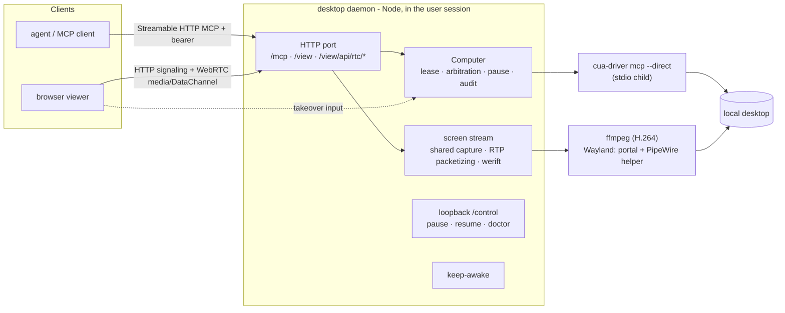

# Computer use: the Computer resource and the desktop daemon

**Status:** Draft v6, validated by a prototype, with a development plan. 2026-10-20.
The concepts are unchanged from the earlier drafts: a **Computer** resource; a **desktop daemon** that embeds Cua Driver;
the `computer_*` tools; one control lease per Computer; the human always wins; an action with an unknown outcome is
never replayed; an emergency stop; an audit trail. The prototype (§12) confirmed, overturned, or added to each section,
and those results are folded in. v6 adds the Linux container form (a Docker image, §3.8) and replaces the phase table
with a development plan: the Linux desktop daemon and Docker first, then macOS and Windows (§14).
The Chinese version lives in the extensions repository (`docs/designs/computer-use.md`, PR #147).

The first source of Computers is the user's own machine (a **self-hosted computer**). A **managed computer** that
AgentConnect operates comes later. The pair mirrors the self-hosted daemon and the managed daemon pool
([architecture.md §3.1](architecture.md)).

Markers: **[validated]** ran on real machines in the prototype; **[design]** is not implemented; **[unverified]** is
inferred or untested; **[legal]** needs counsel. Nothing here on licenses is legal advice.

## 0. Decisions

| #   | Decision                           | Outcome                                                                                                                                                                                        | Status                                            |
| --- | ---------------------------------- | ---------------------------------------------------------------------------------------------------------------------------------------------------------------------------------------------- | ------------------------------------------------- |
| 1   | New concept                        | **Computer**: a registered graphical desktop that can be granted to agents (§2)                                                                                                                | Design (the prototype has one per daemon)         |
| 2   | First source                       | **Self-hosted computer**: a desktop daemon runs on the user's desktop (§3)                                                                                                                     | Validated                                         |
| 3   | Driver                             | Embed **Cua Driver (MIT, pinned 0.35.2)** as a `cua-driver mcp --direct` stdio child; never `cua-spacesd` or the Cua viewer (FSL) (§3.1)                                                       | Validated                                         |
| 4   | Process shape                      | A background service **inside the user's logged-in graphical session**: on macOS our own signed app plus a LaunchAgent, on Windows the user Run key, on Linux a systemd user unit (§3.2, §3.3) | Validated (except the Windows install flow)       |
| 5   | macOS grant owner                  | macOS grants must belong to AgentConnect's own app (`md.agentconnect.desktop`), not the terminal (§3.2.1)                                                                                      | Validated                                         |
| 6   | Connection                         | Outbound WebSocket to the Control Plane with a Computer API key; screen data is never persisted by the Control Plane (§3.6, §3.7)                                                              | Design (the prototype uses local bearer tokens)   |
| 7   | Permissions                        | Per-Computer visibility and grants with `view` / `control` modes; approvals for risky actions; hard refusals for system security surfaces and dangerous shortcuts (§4)                         | Hard refusals validated; the rest is design       |
| 8   | Concurrency                        | **At most one control lease** per Computer at a time; screenshots run concurrently (§4.4)                                                                                                      | Validated                                         |
| 9   | Tools                              | `computer_*` MCP tools; coordinates are screenshot pixels with a fixed 1280 long edge (§5)                                                                                                     | Validated                                         |
| 10  | Sharing with a human               | Human-first arbitration, owner pause, emergency stop, takeover pauses agents (§6)                                                                                                              | Validated (keyboard detection and tray not built) |
| 11  | Remote desktop                     | A **built-in WebRTC viewer** on the same port as MCP, instead of relying on the OS's remote desktop (§7)                                                                                       | Validated                                         |
| 12  | Screenshots                        | Returned as MCP `image` content; stored in the object store with configurable retention and billing (§9)                                                                                       | Return validated; storage is design               |
| 13  | Runtimes without MCP image support | Computer use is disabled; no OCR or accessibility-tree fallback                                                                                                                                | Unchanged                                         |
| 14  | Unknown outcomes                   | On timeout, disconnect, or driver crash, **never replay input**; return `uncertain` with a fresh screenshot (§5.4)                                                                             | Validated                                         |
| 15  | Licenses                           | Bundled components are MIT / Apache / BSD / ISC only; GPL ffmpeg is **not bundled** but downloaded and checksummed on first run (§11)                                                          | Validated (Cloud distribution needs legal)        |
| 16  | Container form                     | The same desktop daemon runs in a **Linux container** (Xvfb, Xfce, a browser) as a Computer without a physical desktop; it is the preferred base for managed computers (§3.8, §15)             | Validated (Docker on OrbStack)                    |
| 17  | Development order                  | Linux desktop daemon (with the shared CP work) → Docker and the Linux managed computer → macOS → Windows (§14)                                                                                 | Plan                                              |
| 18  | Later                              | **Managed computers**: containers on Linux; the earlier VM desktop pool design for macOS and Windows (§15, appendices)                                                                         | Design                                            |

## 1. Background and goals

### 1.1 Background

Agents today work only through a shell, files, and a headless browser (`docker/runtime-sandbox-base.Dockerfile`
installs headless Chrome only; browsing comes from `agent-browser`). They cannot use GUI-only software, check a UI by
looking at it, or act inside an environment where the user is already signed in. Earlier drafts studied a VM desktop
pool and hit three walls: an isolated environment has none of the user's apps or sessions; macOS and Windows VM
licensing; and the FSL license of `cua-spacesd`, which does not suit Cloud. So agents first use **the user's own
desktop**, behind a Computer abstraction, and VM or container desktops join later as another kind of Computer. The
prototype showed a further advantage of the user's desktop: residential egress has a far better reputation than a
data-centre IP (§15.4).

### 1.2 Goals

- A first-class Computer resource with an owner, visibility, grants, and status, managed in the console next to Daemons.
- A user runs `setup` once on a macOS, Windows, or Linux desktop to turn it into a Computer that is available after every login.
- Agents screenshot, click, and type through `computer_*` tools; an agent under any execution strategy can use a Computer granted to it.
- When a human and an agent share a desktop, the human always wins, can pause or stop at any time, and can watch and take over from a browser.
- Every bundled dependency is permissively licensed, fit for an Apache-2.0 release and for Cloud.

### 1.3 Non-goals for this stage

- Managed computers and VM desktop pools (§15). The Linux container form is validated (§3.8) and productized in M2 (§14.5).
- Several people controlling one Computer at once (the viewer allows many watchers, but input has one controller).
- A text fallback for runtimes without MCP image content; a home-grown computer-use model.
- Audio, clipboard sync, and per-display control on multi-monitor machines (§17).

## 2. The Computer concept

### 2.1 Definition

A **Computer** is a registered graphical desktop in an organization that an agent, once granted, can observe and
operate through `computer_*` tools. Computer and Daemon are separate resources: a Daemon runs agents (runtimes,
sessions, workspaces); a Computer is used by agents. One machine may run both, or only one.

Proposed [GLOSSARY.md](../../GLOSSARY.md) entries:

- **Computer**: a graphical desktop resource granted to agents. _Avoid_: desktop pool member (a managed-computer implementation detail), machine (already used for daemons).
- **Desktop daemon**: the process inside a logged-in graphical session that registers the local desktop as a Computer.
- **Control lease**: one controller's (an agent session's) exclusive, time-limited right to send input to a Computer; a human can pre-empt it.
- **Viewer**: the desktop daemon's built-in browser remote desktop, for humans to watch and take over.

### 2.2 Data model (Control Plane) [design]

```ts
interface Computer {
  id: string // cmp_...
  orgId: string
  name: string // display name, such as "Yulong's MacBook"
  ownerUserId: string // the registrant; required for a self-hosted computer
  kind: 'self-hosted' | 'managed' // only self-hosted in this stage
  isolation: 'none' | 'container' | 'vm' // none: the user's real desktop; container: the §3.8 image
  os: 'macos' | 'windows' | 'linux'
  osVersion: string
  session: 'aqua' | 'console' | 'rdp' | 'x11' | 'xvfb' | 'wayland-gnome' // the prototype's doctor already tells these apart
  status: 'online' | 'offline' | 'locked' | 'paused' | 'human_in_control' | 'busy' | 'revoked'
  capabilities: {
    screenshot: boolean
    input: boolean
    textInput: 'full' | 'keymap-only' // GNOME Wayland (libei) cannot type IME text
    backgroundInput: boolean // Cua Driver's window-scoped background input (cua_* tools)
    accessibilityTree: boolean
    viewer: boolean // ffmpeg ready and one frame captured
    displays: { id: string; width: number; height: number; scale: number }[]
    permissions: { accessibility?: boolean; screenRecording?: boolean; portal?: boolean; firewall?: boolean }
  }
  desktopDaemonVersion: string
  driverVersion: string // the embedded Cua Driver version
  visibility: ResourceVisibility // reuses resource-visibility.md
  policy: ComputerPolicy // §4
  lastSeenAt: string
  createdAt: string
}
```

Persistence lives in the Control Plane (`packages/control-plane/src/persistence/`); visibility reuses
[resource-visibility.md](resource-visibility.md). The desktop daemon reports status and capabilities in its heartbeat,
with `permissions`, `session`, and `viewer` taken straight from `doctor` (§3.5). Wire frames go in a new
`packages/protocol/src/frames/computer.ts`.

### 2.3 Relation to existing concepts

| Existing concept                                     | Relation                                                                                                  |
| ---------------------------------------------------- | --------------------------------------------------------------------------------------------------------- |
| Daemon (self-hosted / managed pool)                  | A Computer runs no agents; the agent's daemon reaches the Computer through the Control Plane / relay      |
| Agent                                                | The agent configuration names the Computers it may use (§4.1)                                             |
| Session                                              | A control lease is bound to a session and released when it ends                                           |
| Execution strategy (host / srt / microsandbox / pod) | Irrelevant: tool calls always reach the daemon's built-in MCP server first                                |
| Centralized tool management                          | `computer_*` is one managed tool group ([centralized-tool-management.md](centralized-tool-management.md)) |

## 3. The desktop daemon

### 3.1 Components [validated]

The desktop daemon is a Node program bundled into one `.mjs` (on macOS, a Node single executable application inside a
signed `.app`, §3.2.1). The package is `packages/desktop` with the CLI entry `agentconnect desktop …`, which the CLI routes to the
installed desktop daemon ([cli-daemon-split.md §1.2](cli-daemon-split.md#12-desktop-daemon)); the standalone
`agentconnect-desktop` bin stays for development.



- **Driver**: Cua Driver (MIT, trycua/cua `libs/cua-driver`) pinned to **0.35.2**, downloaded and sha256-checked, run as
  a `cua-driver mcp --direct` child over stdio MCP. A child process isolates driver crashes and makes MCP the boundary.
  `cua-perception` (AGPL models) is never installed. Linux X11 uses Cua's XTest backend, so no xdotool fallback is
  needed; GNOME Wayland uses Cua's Wayland mode (§3.2.3).
- **External interface**: one HTTP port (7681 in the prototype) serves Streamable HTTP MCP at `/mcp` and the viewer at
  `/view`; a loopback-only `/control` sits beside them (§8).
- **Computer core**: leases, human arbitration, owner pause, `uncertain` handling, a JSONL audit log (§4–§6).
- **Screen stream**: one shared capture that the first viewer starts and the last one stops (§7).
- **Keep-awake**: keeps the display awake while running (§3.4).
- **Local UI**: the prototype uses its console window (title and keys) as indicator and emergency stop; a tray or menu bar remains the goal (§6).

### 3.2 Process shape, identity, and OS grants

The desktop daemon must run inside **the user's logged-in graphical session** and hold OS grants under one stable,
recognizable identity.

| Platform                 | Started by                                                                               | Required grants / limits                                                                              | Status                                                    |
| ------------------------ | ---------------------------------------------------------------------------------------- | ----------------------------------------------------------------------------------------------------- | --------------------------------------------------------- |
| macOS                    | Our own `AgentConnect Desktop.app` plus a user LaunchAgent (§3.3)                        | Accessibility, Screen Recording, "bypass the private window picker"; granted to the app               | Validated (macOS 27 VM)                                   |
| Windows                  | User Run key at login, interactive session; **not a service** (Session 0 has no desktop) | No TCC; an inbound firewall rule; the UAC secure desktop and lock screen cannot be captured or driven | Tools and viewer validated; install and firewall flow not |
| Linux X11                | systemd user unit plus XDG autostart                                                     | None                                                                                                  | Validated (Xfce on Xorg / Xvfb)                           |
| Linux GNOME Wayland      | Same                                                                                     | The Cua GNOME Shell extension; RemoteDesktop and ScreenCast portal consent once each                  | Validated (GNOME 50); KDE unsupported                     |
| Linux container (Docker) | The container entrypoint, in the foreground, without systemd (§3.8)                      | None; publish the HTTP port and a UDP port range                                                      | Validated                                                 |

#### 3.2.1 macOS: who owns the grant [validated]

TCC records a grant against the **responsible process**. Started from a terminal, the grant belongs to Terminal: too
broad (anything run in that terminal inherits it), once per terminal app, and impossible over SSH. So the desktop
daemon runs as its own app:

- `AgentConnect Desktop.app`, bundle id `md.agentconnect.desktop`, containing a Node SEA, `LSUIElement` (no Dock icon),
  launched by a per-user LaunchAgent in the Aqua session.
- Cua Driver and ffmpeg inherit the app's grants as children; `TCC.db` held only `md.agentconnect.desktop`, never Terminal.
- Three grants: **Accessibility** (renamed "Device Control and Data Access" in macOS 27; being listed is not enough, the
  switch must be on, or clicks and keys are dropped silently while pointer moves still work, which is easy to miss);
  **Screen Recording** (takes effect only after the app restarts, so `setup` restarts the service while it waits); and
  the extra "bypass the private window picker" consent of the legacy capture API.
- Signing: an ad-hoc signature ties grants to the build hash, so every rebuild needs new grants. Release needs a
  Developer ID, notarization, and the hardened runtime (Node needs the JIT entitlement). Gatekeeper blocks an unsigned
  quarantined download.
- No Swift is needed for this. Swift / AppKit comes later for the menu bar UI, ScreenCaptureKit plus VideoToolbox
  native capture, and `SMAppService` login items.

#### 3.2.2 Windows

- Must run in an interactive user session; the user Run key starts it at login (the prototype's `autostart enable`).
  `doctor` tells an RDP session from the console session.
- Firewall: `setup` uses one UAC prompt to add an inbound allow rule for `node.exe` covering every profile (Tailscale
  networks are often classified Public), and disables the block rule Windows creates when the user presses Cancel on its
  firewall prompt. [implemented, not validated end to end]
- The UAC secure desktop and lock screen cannot be captured or driven from the user session. That boundary is expected.

#### 3.2.3 Linux

- **X11**: no grants; Cua uses XTest. Characters missing from the keymap (Chinese, for example) are typed by
  temporarily remapping a keycode. On real Xorg, back-to-back remaps race ("你好" became "好好"); sending one character at
  a time with a 40 ms gap fixed it. Xvfb does not reproduce this, so tests must cover real Xorg.
- **GNOME Wayland**: `CUA_DRIVER_RS_ENABLE_WAYLAND=1` enables Cua's Wayland mode. It needs the GNOME Shell extension
  `winrects@cua` (window geometry, screenshots, activation; one logout after install), and sends input through the
  RemoteDesktop portal and libei (one consent, restore token persisted). libei sends keycodes only, so **IME text such
  as Chinese is dropped** (`textInput: 'keymap-only'`, §17).
- KDE Wayland: not yet supported by Cua. GDM 50 has dropped X11 sessions (X11 tests used LightDM).
- Test trap: GTK connects to `wayland-0` even when `WAYLAND_DISPLAY` is unset.

### 3.3 Background service and crash recovery [validated]

| Platform  | Mechanism            | Notes                                                                                                                                                                                                                                                                                            |
| --------- | -------------------- | ------------------------------------------------------------------------------------------------------------------------------------------------------------------------------------------------------------------------------------------------------------------------------------------------ |
| macOS     | Per-user LaunchAgent | Aqua session, `RunAtLoad`, `KeepAlive` on failure                                                                                                                                                                                                                                                |
| Linux     | systemd user unit    | Pulled in by `graphical-session.target`; an XDG autostart entry imports `DISPLAY` / `WAYLAND_DISPLAY` and friends into systemd (Xfce never activates `graphical-session.target`); `ExecCondition` skips the start without a display instead of crash-looping; `PartOf` the session; `StartLimit` |
| Windows   | User Run key         | Starts at login; the console window doubles as indicator                                                                                                                                                                                                                                         |
| Container | Entrypoint           | The daemon runs in the foreground; `docker stop` shuts it down cleanly (§3.8)                                                                                                                                                                                                                    |

- On Linux, Cua Driver runs in its own `systemd-run --user --scope`, so apps an agent launched survive a service
  restart (without it, a restart killed them; observed).
- Crash recovery: back within 3 s of `kill -9`, with no orphans; ffmpeg, caffeinate, and the inhibitor are cleaned up.
  ffmpeg needs a SIGKILL fallback (avfoundation ignores SIGTERM).

### 3.4 Keeping the display awake [validated]

A sleeping display breaks capture (macOS even removes the capture device, and screenshots turn black). While running,
the daemon keeps the display awake: macOS `caffeinate` (`-u` to wake, `-d -i -w <pid>` to hold); Windows
`SetThreadExecutionState` through a helper; GNOME `gnome-session-inhibit` bound to the pid; other X11
`xset s off -dpms`. This changes the user's power settings, so the release explains it in the console and the local
UI and lets the owner limit it to time windows [design].

### 3.5 Install and diagnose: `setup` and `doctor` [validated]

`setup` runs once on the desktop (from a terminal or over SSH; on macOS it runs the binary inside the app):

1. Write the config and mint a client token (prototype; registration with the CP replaces this, §3.6).
2. Download and check Cua Driver; download ffmpeg in the background (§7.4).
3. OS grants: on macOS, raise the prompts, open the right settings pane, wait, and restart the service; on Windows,
   configure the firewall through UAC; on Linux, install the GNOME extension, trigger ScreenCast consent (one probe
   capture) and RemoteDesktop consent (one harmless Shift press; a pointer move goes through the extension and would
   report a false success).
4. Install the background service (§3.3), then run `doctor`.

`doctor` is read-only, exits 1 on failure, and **every failure comes with its fix**. When the daemon is running,
`doctor` asks it over the loopback `/control/doctor` to run the checks in a child of the daemon, so the result reflects
the service's own identity, grants, and session rather than the caller's terminal. Checks: config; session type (SSH /
Session 0 / RDP / Wayland / X11); driver; macOS grants; a real screenshot; display wake; ffmpeg plus a real one-frame
capture; the Linux GNOME helper, portal, and PipeWire dependencies; the Windows firewall rule; whether the daemon runs.

### 3.6 Registration and pairing [design]

Follow the "add a daemon in the console, run the generated command" flow and daemon API-key authentication:

1. Console **Computers → Add Computer**: pick the OS; the console produces a one-time install command carrying a
   short-lived registration token.
2. The user runs it on the target machine, i.e. `setup --register <token>`: every §3.5 step, plus exchanging the
   registration token for **an API key bound to this organization and this Computer**, kept in the system keychain /
   credential manager [per-platform storage to be decided]. In a container the token arrives through an environment
   variable or a secret file (§14.5).
3. The desktop daemon opens an outbound WebSocket with that key (the same `auth` frame and close codes as the daemon,
   see [daemon-cp-ws-protocol.md](daemon-cp-ws-protocol.md)) and reports capabilities and `doctor` results.
4. Revocation: deleting the Computer or revoking the key disconnects the desktop daemon at once, stops all input, and
   closes the viewer. The bound when the CP connection is lost is in §8.2.

API keys gain a `computer` principal type, usable only on the Computer channel; it can neither run agents nor reach
other resources ([daemon-api-key-auth.md](daemon-api-key-auth.md)). The prototype's local token (sha256 stored, shown
once) stays as an offline / development mode.

### 3.7 Data paths

- **Prototype [validated]**: the MCP client (Claude Code) connects over HTTP straight to the desktop daemon's `/mcp`;
  the browser viewer connects to the same port. Cross-internet tests ran over Tailscale.
- **Control plane [design]**: registration, heartbeats, status, leases, and policy go over the Control Plane WebSocket.
- **Data plane [design]**: tool calls and screenshot bytes travel between the agent's daemon and the desktop daemon,
  preferably over a session channel through the relay ([shared-bot-relay.md](shared-bot-relay.md)), or over the
  session-executors TLS-PSK pipe ([session-executors.md §6](session-executors.md)); same machine or LAN can connect
  directly. Because the desktop daemon is already a standard Streamable HTTP MCP server, the data plane only forwards
  HTTP; no new tool protocol is needed.
- **Viewer media**: WebRTC media is direct UDP (ICE-lite, host candidates only, §7.2). Without a direct path (no
  Tailscale, behind NAT, inside a pod) it needs TURN or relay forwarding [unverified].
- The Control Plane only issues channel credentials and never persists screen content, consistent with ACP streams not
  passing through the Control Plane.

### 3.8 Container form (Docker) [validated]

Where there is no physical desktop (a server, a NAS, Kubernetes), a "Linux desktop with a browser" is a container
image running **the same desktop daemon**. The prototype was built and run on a Mac with OrbStack:

- **Image**: Debian trixie-slim, Xvfb, a lean Xfce, Firefox ESR, Noto CJK fonts, pinned Node 24, and the desktop
  daemon; Cua Driver and ffmpeg are downloaded and checksummed at build time. It runs as the non-root user `desktop`,
  without systemd. `/home/desktop` is a volume holding the token, config, audit log, and browser profile. The image is
  1.26 GB and builds in about 100 s.
- **Entrypoint**: starts Xvfb (`RESOLUTION`, default `1600x900x24`), a session D-Bus, and Xfce, then runs the daemon in
  the foreground. `docker stop` stops the daemon, closes Firefox gracefully (so no profile lock is left), then ends
  the session, with exit code 0 in under 0.9 s. Xvfb must keep its local socket (`-nolisten tcp`, never
  `-nolisten unix`).
- **WebRTC and NAT**: by default the daemon advertises the local address the browser reached it on, which in bridge
  networking is the container IP that a remote browser cannot reach. Two settings fix this: `rtcAddress`
  (`--rtc-address` / `RTC_ADDRESS`, the public address offered as the only host candidate) and `rtcPortRange`
  (`--rtc-ports` / `RTC_PORTS`, a fixed UDP range that `-p` can publish; each viewer uses up to two ports). A second
  container acting as a remote client fell back to screenshot polling without them and got WebRTC with them. On a Linux
  host, `--network host` needs neither [unverified]. OrbStack lets the Mac reach container IPs directly, so "it works
  without them" on the Mac proves nothing.

```sh
docker run -d --name desktop --hostname "$NAME" --shm-size=1g -v desktop-home:/home/desktop \
  -p 7681:7681 -p 7700-7709:7700-7709/udp -e RTC_ADDRESS="$HOST_IP" -e RTC_PORTS=7700-7709 agentconnect-desktop
```

| Measure                   | Result                                                                                                                                 |
| ------------------------- | -------------------------------------------------------------------------------------------------------------------------------------- |
| Start to service ready    | 0.5 s first start, about 1.5 s on restart                                                                                              |
| `doctor` in the container | All 8 checks pass                                                                                                                      |
| Firefox over MCP          | Launch, maximize, address-bar navigation, Chinese input ("上海 今天天气"), clicks, scrolling all work; no crashes with `--shm-size=1g` |
| Viewer                    | 1600×900, 30 fps, no packet loss; agents get `human_in_control` during takeover                                                        |
| Persistence               | A new container on the same volume keeps a valid token, and Firefox restores its tabs                                                  |
| Resources                 | 2–3% CPU idle; about 55% of one core while streaming (ffmpeg about 31%); about 0.9 GB memory                                           |

Prototype gaps, all in M2 (§14.5): the startup output prints the container IP rather than the public address; the
token is readable only from `docker logs` and cannot be injected through the environment or replaced by CP
registration; `computer_list` reports an empty `display` and takes its name from the container hostname; the browser
is neither maximized nor restarted when it exits; no audio or clipboard.

**Positioning**: containers start in seconds, are isolated, can hand each task a fresh desktop, and need no OS grants,
which suits managed computers and multi-tenancy. The costs are an image of about 1.3 GB, configuring the public address
and UDP ports, and no access to the user's own apps and sessions (exactly what a self-hosted computer provides). Use a
VM when a GPU, real Xorg, or a long-lived personal desktop is needed. A user can also run the image on their own server;
it is then a **self-hosted computer with isolation**.

## 4. Permissions

### 4.1 Who may use it [design]

```ts
interface ComputerPolicy {
  allowedAgents: string[] // agents that may use this Computer
  allowedMembers: string[] // members who may watch / take over / manage (always includes the owner)
  agentMode: 'view' | 'control' // view: screenshots only; control: input too
  approvals: {
    firstInputPerSession: boolean // default true
    launchApp: 'always' | 'session' | 'never-ask'
    submitLikeKeys: boolean // per-use approval for Enter-to-submit and send shortcuts, default true
  }
  appAllowlist?: string[] // apps that may be operated (bundle id / executable name)
  redactApps: string[] // app windows masked in screenshots, such as password managers
  exposeDriverTools: boolean // expose the cua_* pass-through tools (§5.5), default false
  quietHours?: { tz: string; ranges: string[] } // no use outside these windows
  leaseIdleSeconds: number // idle release, default 120 (validated)
  leaseMaxSeconds: number // cap on one control lease, default 1800 (validated)
}
```

On the agent side (`packages/daemon/src/agents/agent-schema.ts`):

```ts
computerUse: z.object({
  enabled: z.boolean().default(false),
  computers: z.array(z.string()).default([]) // Computer ids the agent may use; the Computer's policy must agree too
}).optional()
```

Both sides must agree. A self-hosted computer by default admits only its owner's agents; sharing it with another
member's agent shows a "no isolation" warning in the console. In the prototype the unit of grant is the **client
token** (controllers are told apart by name), with no agent or member granularity.

### 4.2 Approvals [design]

Reuse `packages/daemon/src/permissions/` and [mcp-elicitation.md](mcp-elicitation.md): an approval request goes both to
where the session's conversation lives and to the Computer's owner. Screenshots, moves, and scrolls need no approval by
default; the first input of a session, launching an app, and submit-like keys do, with an optional "always allow in
this session".

### 4.3 Hard refusals

Whatever the policy, the desktop daemon refuses locally:

- **Dangerous shortcuts, per OS [validated]**: Windows refuses Win-key combinations and Ctrl+Alt+Del. Cmd is an everyday
  modifier on macOS and cannot be refused wholesale, so only lock screen, log out, and force quit are refused.
- **System security surfaces**: elevation and authentication dialogs, the keychain, UAC and the secure desktop, the
  login / lock screen, the system privacy and security settings, and AgentConnect's own indicator and stop controls.
  Cua Driver itself hard-refuses known system security prompts; the desktop daemon's own window-level check is [design].
- **Driver tools**: the script, configuration, extension, screen recording, process-kill, clipboard, and file-transfer
  tools among the `cua_*` pass-throughs are never exposed (§5.5).

### 4.4 Leases and concurrency [validated]

- A Computer has at most one **control lease** at a time. The prototype takes it automatically on the first input, or
  explicitly through `computer_acquire`; other controllers get `computer_busy` naming the holder.
- A lease expires after `leaseIdleSeconds` (120) idle or `leaseMaxSeconds` (1800) total, and is released by
  `computer_release`, a human takeover, or a stop. The release renews it from session heartbeats and releases it when
  the session ends [design].
- Screenshots, cursor position, and watching in the viewer need no lease and run concurrently.

## 5. Agent tool interface

### 5.1 Tools [validated]

| Tool                                    | Arguments                                    | Lease | Notes                                                                     |
| --------------------------------------- | -------------------------------------------- | ----- | ------------------------------------------------------------------------- |
| `computer_list`                         | `{}`                                         | no    | OS, status, lease holder, display size                                    |
| `computer_screenshot`                   | `{ computer? }`                              | no    | Full primary display, long edge 1280                                      |
| `computer_cursor_position`              | `{}`                                         | no    | In screenshot pixels                                                      |
| `computer_click`                        | `{ x, y, button?, count?, modifiers? }`      | yes   |                                                                           |
| `computer_move` / `computer_drag`       | `{ x, y }` / `{ from, to }`                  | yes   |                                                                           |
| `computer_scroll`                       | `{ x, y, direction, amount? }`               | yes   | Cua's direction plus amount, not `dx/dy`                                  |
| `computer_type`                         | `{ text }` (≤ 4096 chars)                    | yes   | Into the foreground app                                                   |
| `computer_key`                          | `{ keys: string[] }`, such as `["ctrl","s"]` | yes   | Subject to §4.3                                                           |
| `computer_launch`                       | `{ app }`                                    | yes   | App name; a `.exe` path on Windows; allowlist and approval in the release |
| `computer_wait`                         | `{ ms }` (≤ 10000)                           | no    | Waits, then screenshots                                                   |
| `computer_acquire` / `computer_release` | `{ computer? }` / `{}`                       | —     | Explicit lease control                                                    |

**Target selection [design]**: every tool except `computer_list` accepts an optional `computer` id. The session's
target is resolved in order: the explicit `computer` argument; the Computer whose lease the session holds (set by
`computer_acquire` or the first input); the only Computer the agent is granted. When none of these yields exactly one
Computer, the call fails with `computer_ambiguous` listing the candidates, before any input is sent. The data plane
forwards to the resolved Computer (the prototype has one per daemon). Input tools wait
`actionSettleMs` after acting and attach a screenshot. The draft's `display` / `window` / `region` / `maxDimension`
screenshot arguments are **dropped**: a fixed screenshot size per daemon is what keeps the driver's coordinate mapping
consistent; window screenshots come from `cua_get_window_state` (§5.5). Multiple displays: §17.

### 5.2 Call path

```
Prototype (validated):
  Claude Code ─HTTP + Bearer─▶ desktop daemon /mcp ─stdio MCP─▶ cua-driver mcp --direct ─▶ local desktop

Release (design):
  runtime ─stdio─▶ mcp-bridge ─▶ the agent's daemon's built-in MCP server
     (any execution strategy; inside a sandbox through the shim's MCP tunnel, see buildSandboxMcpServers in mcp/inject.ts)
          │  computer_* → check the agent's grant and lease (from the Control Plane)
          ▼
     session channel (relay / TLS-PSK / direct) ──HTTP MCP──▶ desktop daemon /mcp
```

The tools are registered in `packages/daemon/src/mcp/resolve-servers.ts` and appear only when the agent has computer
use enabled, at least one Computer is available, and the runtime supports MCP image content.

### 5.3 Screenshots and coordinates [validated]

The screenshot long edge is fixed at 1280 (`maxImageDimension`). **Coordinates are pixels of the latest screenshot**;
Cua Driver maps them back to the screen (including HiDPI scale), so the model never deals with `scale`.

```ts
{
  content: [
    { type: 'image', data: '<base64>', mimeType: 'image/png' },
    { type: 'text', text: '{"computer":"cmp_…","width":1280,"height":800,"redacted":[],"stored":"obj://…"}' } // redacted / stored are design
  ]
}
```

### 5.4 Failure semantics [validated]

- Errors that prove the action did not happen (missing capability, invalid arguments, permission or hard refusal,
  `computer_busy`, `human_active`, `human_in_control`) return a definite error.
- Errors with an **unknown outcome** (timeout, driver crash, cancellation) never replay the input; they return
  `uncertain` with a fresh screenshot for the model to check.
- Known silent failures are surfaced in `doctor` and capabilities instead of left for the model to guess: clicks
  dropped while the macOS Accessibility switch is off, IME text dropped on GNOME Wayland.

### 5.5 Driver pass-through `cua_*` [validated, off by default]

`--expose-driver-tools` (policy `exposeDriverTools` in the release) also exposes Cua Driver's own tools as `cua_*`:
window-scoped background input (no real cursor movement, no focus stealing), accessibility `element_token`,
`get_window_state`, and so on. Read-only tools need no lease; the rest do; the §4.3 categories are never exposed. The
`computer_*` tools use Cua's desktop scope and move the real pointer; background input is only available through `cua_*`.

### 5.6 Guidance for agents [validated]

On Xfce, Firefox navigation, typing, scrolling, and clicking all worked. Session instructions
(`packages/daemon/src/acp/session-instructions.ts`) should say: elements shift after a page loads, so wait for layout
and screenshot again before clicking; press Esc before Ctrl+L while a page is still loading; screen content is
untrusted (prompt injection).

## 6. Sharing the desktop with a human

- **Input arbitration [validated]**: the daemon polls the cursor; when the pointer moves without the agent causing it,
  input tools return `human_active` for `humanIdleSeconds` (5). Screenshots are unaffected. Keyboard activity is not
  detected yet [to do].
- **Owner pause / emergency stop [validated]**: press `p` in the console window, or run `agentconnect-desktop pause`
  (over the loopback `/control`). While paused, input returns `human_in_control` and screenshots continue; `r` /
  `resume` resumes. The release adds a local global hotkey, a tray / menu bar Stop, and a console Stop; any of them
  revokes the lease and enters `paused` until the owner resumes [design].
- **Fail-safe**: a remote key that lands in the daemon's own console window is handled as a console key; since those
  keys can only pause or quit, such a stray key only makes the system safer. The release's local UI must keep this
  property: any local control an agent can reach may only tighten, never loosen, permissions.
- **Persistent indicator**: the prototype's console window and title act as the indicator; the release adds a menu bar
  / tray icon and an "<agent> is operating" screen border, and revokes input when the indicator cannot be shown [design].
- **Takeover [validated]**: a human at the machine just uses it; a remote human takes over through the viewer (§7.3).
  Meanwhile agent input returns `human_in_control` and screenshots continue.

## 7. Remote desktop (viewer) [validated]

The draft left remote watching to the OS's remote desktop. The prototype showed a built-in one is better: nothing to
install (a browser is enough), the same Computer and arbitration as the agent, and the same port and authentication.

### 7.1 Evolution

The first version polled screenshots (2–5 fps, several MB/s) and was too slow. The final design is WebRTC: ffmpeg
encodes H.264, and werift (MIT, a pure-TypeScript WebRTC stack) sends it as RTP. Screenshot polling stays as the fallback.

### 7.2 Media and network

```
capture (per OS) ─▶ ffmpeg libx264 ─RTP (127.0.0.1 UDP only)─▶ daemon packetizer + pacing ─▶ werift ─SRTP/UDP─▶ browser
                     ultrafast · zerolatency · constrained baseline
signaling: POST /view/api/rtc/offer · answer (same port, same token)
input: DataChannel ─▶ Computer (same lease / arbitration as agents)
```

- **ICE-lite, host candidates only, no STUN** (werift otherwise defaults to Google's STUN). It advertises the local
  address the browser connected to, so it works over Tailscale and tun networks.
- **Cross-internet tuning**: on a Windows → Mac link with about 93 ms RTT and 5–10 Mbps, unpaced keyframe bursts of
  about 500 KB lost 20% of packets and decoded zero frames. The fix: pace at 1.5× the bitrate; VBV buffer = bitrate / 4
  (keyframes about 78 KB); 1 s GOP; 2.5 Mbps default.
- ffmpeg writes to loopback UDP only: `rtp://` opens an RTCP port on every interface and triggers the Windows firewall prompt.
- One shared capture: the first viewer starts it, the last one stops it.
- **NAT and containers**: `rtcAddress` sets the advertised public address and `rtcPortRange` pins the UDP range (§3.8).
  In Kubernetes each pod needs a reachable address and ports (hostPort / NodePort UDP), or media goes through TURN /
  the relay (§17).

### 7.3 Input and takeover

- Browser input enters the same Computer over the DataChannel: during takeover agents get `human_in_control`; the
  Release button, or 15 s of browser silence, releases it. An application-level heartbeat is needed because an
  ICE-lite peer cannot notice the browser going away.
- Modifier mapping: a Mac browser's Cmd maps to Ctrl on Windows / Linux targets; double-clicks are synthesized within a
  300 ms window; IME text is submitted through a text box.

### 7.4 Capture per platform and ffmpeg

| Platform         | Capture                                                                                                                                                                                                                                                                               |
| ---------------- | ------------------------------------------------------------------------------------------------------------------------------------------------------------------------------------------------------------------------------------------------------------------------------------- |
| Windows          | `ddagrab`, falling back to `gdigrab` (`gdigrab` grabs the whole virtual desktop)                                                                                                                                                                                                      |
| macOS            | `avfoundation`, with an `fps` filter (otherwise it emits about 200 fps)                                                                                                                                                                                                               |
| Linux X11 / Xvfb | `x11grab`                                                                                                                                                                                                                                                                             |
| GNOME Wayland    | xdg-desktop-portal ScreenCast plus PipeWire: a python3-gi helper holds the portal session, and a GStreamer `pipewiresrc → videorate → y4menc` pipeline feeds the pinned ffmpeg (distribution GStreamer has no H.264 encoder); the restore token is persisted so consent is asked once |

ffmpeg is GPL and **not bundled**: on first run the daemon downloads a pinned build in the background and checks its
sha256: gyan.dev 9.0.2 essentials on Windows (with `ddagrab` / libx264); eugeneware/ffmpeg-static b6.1.1 (static, with
libx264) on macOS and Linux, arm64 and x64. The container image includes it at build time (§11).

### 7.5 Results and limits

- 1920×1080 / 1200 at 30 fps, first frame in about 1–2 s, no packet loss (after the cross-internet tuning). End-to-end
  latency was not measured.
- A system HTTP proxy on the viewing machine (Clash) made the browser get 502 for Tailscale IPs; WebRTC media itself
  does not use the HTTP proxy. Re-check once the release goes through the relay / TLS.
- To do: native capture and hardware encoding (ScreenCaptureKit plus VideoToolbox, Desktop Duplication plus hardware
  encoders), display selection, audio, clipboard sync, NAT traversal (TURN / relay).

## 8. Security and audit

### 8.1 The prototype's security posture (not for production)

Plain HTTP on `0.0.0.0` (for testing); bearer tokens (sha256 stored, shown once); the viewer token in the URL fragment
(never in server logs or Referer); `/control` on loopback only, requiring a custom header and refusing any request with
an `Origin` (against cross-site browser calls); a CSP on the viewer page.

### 8.2 Release requirements [design]

- **Transport**: TLS or a relay channel; no public listener by default. Credentials are issued by the Control Plane,
  short-lived, per session; the desktop daemon holds no runtime or organization secrets.
- **No-isolation warning**: an agent sees and operates everything the user can (mail, chat, signed-in sites, the
  intranet). Registration and grants say so plainly and recommend trusted personal or dedicated work machines. The
  container form (§3.8) is the isolated alternative.
- **Least scope**: `appAllowlist`, `redactApps` (window-level masking feasibility to be validated), granting a single display.
- **Prompt injection**: screen content is untrusted; the session instructions say so (§5.6).
- **Audit**: the prototype already writes a JSONL `audit.log` in its data directory, one line per call, recording only
  the length of `computer_type` text and no screenshots [validated]. The release adds the agent, session, target window,
  approval outcome, and screenshot reference, reports to the Control Plane, and lets the owner query per Computer.
- **Revocation**: deleting the Computer, revoking the key, or removing an agent's grant takes effect immediately while
  the desktop daemon is connected to the Control Plane, and disconnects viewers. Every tool and viewer channel carries
  a short-lived credential (minutes) that the desktop daemon verifies locally and that only the Control Plane renews.
  When the CP WebSocket is lost, the desktop daemon accepts no new channels, keeps existing ones only until their
  credentials expire, and then stops input, screenshots, and viewers; so the worst-case revocation delay is one
  credential lifetime, in line with the authority lifetimes in [high-availability.md](high-availability.md).

## 9. Screenshot storage [design]

- Screenshots go to the object store (`packages/object-store`) under `org/computer/session/<ts>-<id>.<fmt>`; the
  session record keeps only the reference and hash.
- Retention is configurable; 0 means never written. Masking happens on the desktop daemon before upload.
- Read access is the intersection of session visibility ([session-visibility.md](session-visibility.md)) and Computer visibility.
- Cloud metering: screenshot storage counts toward usage (`packages/control-plane/src/usage`).

## 10. Console [design]

- A **Computers** page next to Daemons: list, status, OS, session type, owner, granted agents, `doctor` results with
  fixes, recent activity, audit.
- Computer detail: policy editing, an **embedded viewer** (watch / take over), pause and stop, revoke. Viewer media
  still flows between the browser and the desktop daemon, directly or through the relay, never through the Control Plane.
- Agent settings: enable computer use and pick Computers. Session page: the current lease and an action timeline with screenshots.

## 11. Licenses

### 11.1 Dependencies

| Component                            | License                    | Use                                                            | Distribution                                                                                                                           |
| ------------------------------------ | -------------------------- | -------------------------------------------------------------- | -------------------------------------------------------------------------------------------------------------------------------------- |
| Cua Driver (`libs/cua-driver`)       | MIT                        | Input, screenshots, accessibility on three OSes, GNOME Wayland | Pinned download, sha256-checked                                                                                                        |
| werift                               | MIT                        | WebRTC (pure TypeScript)                                       | In the bundle                                                                                                                          |
| Node.js (SEA)                        | MIT                        | Runtime inside the macOS app and the container                 | In the app / image                                                                                                                     |
| ffmpeg (with libx264)                | GPL                        | Viewer encoding                                                | **Not bundled** on desktops: downloaded from a third-party build and checked on first run; preinstalled in the container image [legal] |
| GStreamer, PipeWire, python3-gi      | LGPL and others            | GNOME Wayland capture helper                                   | System packages                                                                                                                        |
| libei                                | MIT                        | GNOME Wayland input (through Cua)                              | System component                                                                                                                       |
| Xvfb, Xfce, Firefox ESR, Debian base | MIT / GPL / MPL and others | Container image                                                | Distribution packages in the image; source obligations when the image is published [legal]                                             |

xdotool and wayvnc are no longer needed. Never used: `cua-spacesd`, the Cua HTML5 viewer and streaming crates
(FSL-1.1-MIT); `cua-perception` (AGPL models); ydotool, RustDesk (AGPL-3.0); Sunshine (GPL-3.0); the official nut.js
(unidentified license). CI scans release artifacts and fails on AGPL / FSL / BSL / SSPL / GPL. ffmpeg is downloaded on
the user's machine and run as a separate process; hosting it in Cloud, preinstalling it in an installer, or publishing
an image with it needs counsel first [legal]; native capture plus OS hardware encoders replace it in the long run (§17).

### 11.2 OS licenses

- **Self-hosted computer**: operating the user's own licensed desktop adds no OS instance and **needs no extra OS license**.
- **Remote watching and takeover [legal]**: the built-in viewer makes this concrete. macOS SLA §2I restricts remote
  desktop connections and forbids time-sharing / terminal sharing "whether within your organization or not"; Windows 11
  license §2(d)(v) restricts remote access users and §2(d)(vi) allows remote assistance sharing an active session. The
  owner remotely using their own machine is the least concern; several members remotely using one Computer needs counsel.
- **Managed computers**: §15.3 and Appendix B. Linux containers raise no OS license issue.

## 12. Prototype results

### 12.1 Code

The prototype lives in `packages/desktop` (`@agentconnect.md/desktop`, `0.0.0-prototype`) on the
`dev/yulong/cua-driver-daemon-mcp` branch, and merges in M0 (§14.3). Main files: `src/computer.ts` (lease, arbitration, pause, `uncertain`),
`src/tools.ts` (`computer_*` and the `cua_*` pass-through), `src/http-server.ts`, `src/viewer.ts` /
`src/viewer-page.ts`, `src/stream/` (`ffmpeg.ts`, `rtc.ts`, `screen-stream.ts`, `wayland-capture.ts`),
`src/keep-awake.ts`, `src/setup.ts`, `src/service-macos.ts`, `src/service-linux.ts`, `scripts/build-macos-app.mjs`,
`scripts/install.sh`, `scripts/install.ps1`, `docker/Dockerfile`, `docker/entrypoint.sh`. Usage is in the package README.

### 12.2 Platform matrix

The MCP client was Claude Code.

| Platform                                                                    | Tools (screenshot / input)              | Viewer                                     | Background service      | setup / doctor              | Notes                            |
| --------------------------------------------------------------------------- | --------------------------------------- | ------------------------------------------ | ----------------------- | --------------------------- | -------------------------------- |
| Windows 11 (over Tailscale across the internet)                             | Pass                                    | Pass (with cross-internet tuning)          | Run key                 | Firewall flow not validated | Win-key combinations refused     |
| macOS 27.0.1 arm64 (VM)                                                     | Pass                                    | Pass                                       | LaunchAgent + app       | Pass                        | TCC grants only the app          |
| Ubuntu 26.04 arm64 · GNOME 50 Wayland                                       | Pass (except IME text)                  | Pass (portal + PipeWire)                   | systemd user unit       | Pass                        | Extension plus one logout        |
| Ubuntu 26.04 arm64 · Xfce 4.20 / Xorg (LightDM)                             | Pass (after the Chinese-input race fix) | Pass                                       | systemd + XDG autostart | Pass                        | Firefox end to end               |
| Ubuntu 26.04 arm64 · Xfce / Xvfb                                            | Pass                                    | Pass                                       | —                       | Pass                        | Does not reproduce the Xorg race |
| Docker (Debian trixie · Xvfb + Xfce + Firefox ESR, OrbStack on macOS arm64) | Pass                                    | Pass (needs `rtcAddress` / `rtcPortRange`) | Container entrypoint    | Pass (8/8)                  | §3.8                             |

### 12.3 Key results

- Unit tests use a fake driver and need no desktop (`computer.test.ts`, `http-server.test.ts`, `setup.test.ts`, `rtc.test.ts`).
- Viewer: 1080p / 1200p at 30 fps, first frame in 1–2 s, no loss; before keyframe pacing, cross-internet lost 20% and decoded zero frames.
- Crash recovery: back within 3 s of `kill -9`, no orphans; on Linux, apps the agent launched survive a service restart.
- macOS: `TCC.db` holds only `md.agentconnect.desktop`; with the Accessibility switch off, clicks are dropped silently.
- Browser tasks: Firefox navigation, typing, scrolling, and clicking completed; egress reputation is in §15.4.
- Container: starts in seconds, `docker stop` under 0.9 s, state on the volume survives a new container, 2–3% idle CPU;
  bridge networking needs the public address and port range for WebRTC (§3.8).

### 12.4 Not in the prototype (still design)

Control Plane registration and the Computer model, `ComputerPolicy`, approvals, per-agent grants, object-store
screenshots, the relay data plane, TLS (the prototype has local bearer tokens, one Computer, no CP); tray / menu bar UI,
screen border, global hotkey, keyboard activity detection; window masking; Developer ID signing and notarization; native
capture and hardware encoding; multiple displays; audio and clipboard; latency measurement; the Windows `install.ps1`
setup and firewall end to end; Wayland IME text; KDE; CP registration, environment injection, Kubernetes deployment,
and publishing for the container image.

## 13. Testing and evaluation

- Unit: the lease state machine, arbitration, pause, `uncertain` semantics, per-OS hard refusals, the pass-through deny
  list (in the prototype); policy merging and approval branches (to do).
- Platform integration must run on **real sessions**: Xvfb does not reproduce the Xorg keycode-remap race, and GTK
  quietly connects to `wayland-0`. The matrix is §12.2's six environments plus the Windows install flow and KDE
  (expected to fail with a clear message). macOS covers before and after grants (including Accessibility "listed but
  off"); Windows covers the lock screen, a UAC prompt, and an RDP session.
- Viewer: first-frame time, loss, and end-to-end latency on throttled / high-latency links; takeover release after the
  browser disappears; container viewers behind NAT with and without TURN.
- End to end: an agent in microsandbox operates a Computer on another machine through the relay; human input
  pre-empts; emergency stop; key revocation takes effect immediately, and within one credential lifetime after a CP disconnect; a managed container Computer is allocated, used,
  and wiped.
- Evaluation: computer-use cases in `evals/cases`; how to adopt cua-bench (MIT) [unverified].
- Security: prompt injection from the screen; masking effectiveness.

## 14. Development plan

### 14.1 Principles

- **Priority: the Linux desktop daemon and Docker first, then macOS and Windows.** The platform-independent work
  (Control Plane integration, data plane, tool registration, permissions and approvals, console) ships with Linux:
  Linux has no signing or TCC, and X11 runs end to end in CI under Xvfb, so the loop closes fastest. Docker follows
  immediately: it reuses the same Linux X11 path, adds little, and provides both an isolated self-hosted desktop and the
  base for managed computers. macOS and Windows then add only install, identity, local UI, and platform-specific detection.
- **Each milestone ships something a real user can use**: installable, registrable, revocable, with `doctor` green and
  visible in the console, not just a technical demo.
- **Start from the prototype**: merge `packages/desktop` in reviewable PRs rather than rewriting; each PR states the
  acceptance items it covers and what remains (`Refs #…`).
- Each platform milestone ends by running that platform's **real-session** matrix (§13), not just Xvfb.

### 14.2 Milestones

Estimates assume one engineer who knows the codebase.

| Milestone | Scope                                                                                                                         | Estimate             | Depends on                                                        |
| --------- | ----------------------------------------------------------------------------------------------------------------------------- | -------------------- | ----------------------------------------------------------------- |
| M0        | Merge the prototype, CI, safe defaults                                                                                        | 1 engineer-week      | —                                                                 |
| M1        | **Linux** self-hosted computer plus all shared work (CP, data plane, permissions, console)                                    | 6–8 engineer-weeks   | M0; data-plane decision (§17-1)                                   |
| M2        | **Docker**: productized image, self-hosted containers, Linux managed computers (Kubernetes pool)                              | 4–6 engineer-weeks   | M1 (the image work can run alongside M1); TURN / relay media path |
| M3        | **macOS**: signing and notarization, menu bar UI, install and grant flow                                                      | 3–4 engineer-weeks   | M1                                                                |
| M4        | **Windows**: signed installer, tray UI, session and lock-screen handling                                                      | 3–4 engineer-weeks   | M1                                                                |
| Later     | Native capture and hardware encoding, multiple displays, audio / clipboard, window masking, macOS / Windows managed computers | Estimated separately | Legal conclusions                                                 |

M1 plus M2 is the first releasable scope (about 10–14 engineer-weeks): both Linux user desktops and Docker desktops
register as Computers that agents use. M3 and M4 are independent and can run in parallel given people.

### 14.3 M0: merge the prototype

- Merge `packages/desktop` in module-sized PRs: driver client plus Computer core plus tools; HTTP / MCP; viewer and
  screen stream; `setup` / `doctor` and services; the macOS app build; the Docker image.
- CI: lint, typecheck, unit tests; a new Linux integration job (Xvfb plus the real Cua Driver: screenshot, input, one
  viewer frame); a license scan of release artifacts (fails on AGPL / FSL / BSL / SSPL / GPL).
- CLI: an `agentconnect desktop …` subcommand in `@agentconnect.md/cli`; the standalone bin is for development only.
- Tighten defaults: listen on `127.0.0.1` unless `0.0.0.0` is asked for explicitly.

**Acceptance**: main builds, CI is green, the Xvfb integration test passes.

### 14.4 M1: Linux and the shared work

1. **Protocol and Control Plane**: the `Computer` table and migration, visibility; registration tokens and the
   `computer` API-key principal (its routes `interactiveOnly`); `computer` frames in `packages/protocol` (auth,
   heartbeat, capabilities, `doctor` results, status); a lease service (renewed by session heartbeats, released when the
   session ends); OpenAPI docs.
2. **Data plane**: settle §17-1 first. A user desktop usually sits behind NAT and can only dial out, so the
   recommendation is **an outbound session channel through the relay by default**, with direct connection as a
   same-network optimization. The desktop daemon is already a standard Streamable HTTP MCP server, so only HTTP is
   forwarded. Viewer: the console issues short-lived credentials and signaling uses the same channel; media tries direct
   (ICE-lite) first and falls back to TURN (such as coturn, BSD) or the relay.
3. **Agent side**: the `computerUse` agent setting; registering `computer_*` in `resolve-servers.ts` (when the runtime
   supports image content); forwarding tool calls over the data plane; session instructions (§5.6); approvals (first
   input of a session, app launch, submit-like keys) through the existing permissions / elicitation; audit reporting.
4. **Screenshot storage**: object-store writes, retention, references from the session timeline (§9).
5. **Console**: the Computers page (list, status, `doctor` results with fixes, policy, granted agents); "Add Computer"
   producing the install command; an embedded viewer on the detail page (watch, take over, pause, stop, revoke); the
   agent setting.
6. **Linux productization**: `setup --register`; a one-line `install.sh` (pinned Node runtime or a single executable,
   pick one); the systemd user unit and XDG autostart validated across **real logout / login** (Xfce on Xorg, GNOME
   Wayland); keyboard activity detection (XInput2 raw events on X11; Wayland cannot listen globally, so capabilities say
   pointer only); local indicator and stop (StatusNotifier tray plus a global hotkey; on GNOME as far as the extension
   allows); Wayland IME text (clipboard paste behind a policy switch, §17-5).

**Acceptance**:

- From the console, adding a Computer and running one command on Ubuntu (Xfce on Xorg and GNOME Wayland) installs and
  registers it, and its `doctor` results show in the console.
- An agent running in the Kubernetes pool or microsandbox completes a Firefox task over the data plane, and the approval
  card appears where the session's conversation lives.
- Human mouse or keyboard activity makes agents get `human_active`; the console's Stop takes effect immediately; a
  revoked key disconnects and closes viewers within 5 s.
- The session page shows the action timeline and screenshots; the Xvfb end-to-end test in CI covers register → tool call → revoke.

### 14.5 M2: Docker and Linux managed computers

Right after M1. Image productization and self-hosted containers depend only on the Linux side (M1 item 6) and can run
alongside the second half of M1; managed computers depend on M1's CP integration and data plane.

1. **Productize the image** (the §3.8 gaps): register through an environment variable or secret file
   (`AGENTCONNECT_REGISTER_TOKEN`) and never print the token; use the public address (`PUBLIC_URL` / `RTC_ADDRESS`) in
   output and candidates; fill in `display` and other capabilities, with `session: 'xvfb'` and `isolation: 'container'`;
   maximize the browser and restart it if it crashes; a `HEALTHCHECK` running `doctor --json`; multi-arch amd64 / arm64
   builds published to a registry; a smaller image (target under 1 GB); an optional Chromium variant.
2. **Self-hosted containers**: a docker compose example; a user runs it on their own server and it registers as a
   Computer with `kind: 'self-hosted'`, `isolation: 'container'`.
3. **Linux managed computers**: `kind: 'managed'`; pods created on demand in the Kubernetes pool (reusing
   [k8s-daemon-pool.md](k8s-daemon-pool.md) and SandboxClaim); allocation, prewarming, and reclamation; reset policies
   (`per-lease` with a fresh volume, `on-release-idle`, `never`); pods usually have no reachable UDP, so viewer media
   goes through TURN or the relay; quotas and billing (concurrent desktops, desktop hours, bandwidth, screenshot
   storage); egress policy (§15.4).
4. **Licensing**: the GPL obligations of shipping ffmpeg (and other GPL packages) in a published image, such as
   providing corresponding source [legal]. Needed before M2 starts.

**Acceptance**: one `docker run` with a registration token produces a usable Computer in the console; in Kubernetes, an
agent that asks for a managed computer gets a fresh desktop within seconds and completes a browser task, and its data
is wiped on reclamation; without direct UDP, the viewer works through TURN / the relay.

### 14.6 M3: macOS

- **Signing and distribution**: Developer ID signature, notarization, the hardened runtime (Node needs JIT-related
  entitlements); a stable signature keeps grants across updates; a signed `.pkg` or a zip dragged into
  `/Applications`, followed by `setup --register`.
- **Local UI**: a menu bar helper (Swift / AppKit) with status, pause / stop, and open viewer; an "<agent> is operating"
  screen border; a global stop hotkey. The helper talks to the daemon over the loopback `/control` and can only tighten
  permissions (§6).
- **Keyboard activity detection**: prefer `CGEventSourceSecondsSinceLastEventType` (no extra grant); `CGEventTap` needs
  the Input Monitoring grant and is not used.
- **Login item**: keep the LaunchAgent; evaluate `SMAppService`.
- Optional: ScreenCaptureKit plus VideoToolbox native capture, dropping ffmpeg on macOS first.

**Acceptance**: on a fresh macOS 14+ (arm64 and x64), download to agent-ready in under 5 minutes with at most 3 grant
prompts; no new grants after an update; `doctor` recognizes "Accessibility listed but off" and gives the fix.

### 14.7 M4: Windows

- **Install**: an Authenticode-signed per-user installer (no admin rights; one UAC prompt only for the firewall rule),
  `install.ps1` validated end to end; Run-key autostart; a clean uninstall (including the firewall rule). SmartScreen
  reputation needs to be built up in advance or an EV certificate.
- **Local UI**: tray icon (indicator, pause / stop, open viewer), global stop hotkey, screen border.
- **Keyboard activity detection**: `GetLastInputInfo` (no extra rights).
- **Session state**: report `locked` and similar on the lock screen, UAC secure desktop, RDP sessions, and fast user
  switching, so agents get a definite error rather than `uncertain`.
- **Capture**: `ddagrab` first; the `gdigrab` coordinate problem on multiple displays; optional Media Foundation hardware encoding.

**Acceptance**: on Windows 10 22H2 / 11 x64 (arm64 as Cua Driver allows), install → register → cross-network viewer
works; lock screen and UAC prompts return definite errors; no rules or autostart entries remain after uninstall.

### 14.8 Risks

- Upstream Cua Driver changes: pin the version and run the whole platform matrix before upgrading.
- macOS grant models change between releases (macOS 27 renamed Accessibility): `doctor` and `setup` probe real
  capability rather than relying on pane names.
- ffmpeg's GPL obligations and the OS licensing of remote watching [legal] may change how M2 (ffmpeg preinstalled in
  the image) and the viewer are distributed; M2 needs an answer before it starts.
- TURN bandwidth cost and latency affect managed-computer pricing.

## 15. Later: managed computers

### 15.1 Positioning

Mirrors the managed daemon pool: Computers operated by AgentConnect (or a self-hosting operator), `kind: 'managed'`.
To agents the tools and permissions are identical.

|                   | Self-hosted computer                                                | Managed computer                                  |
| ----------------- | ------------------------------------------------------------------- | ------------------------------------------------- |
| Who runs the host | The user / organization                                             | AgentConnect Cloud or the self-hosting operator   |
| Lifecycle         | Starts when the user logs in                                        | Created, leased, reclaimed, and reset by the pool |
| Isolation         | None (the user's real desktop), or a container the user runs (§3.8) | Container or VM                                   |
| Data and sessions | The user's own                                                      | Must be prepared in the image                     |
| Egress            | The user's network (usually residential)                            | Data-centre IP with a weaker reputation (§15.4)   |
| OS license        | None needed                                                         | The operator's responsibility (§15.3)             |

### 15.2 Implementation reference (details in Appendix A)

- The image runs **the same desktop daemon** (with the viewer), so the Control Plane and agents need not tell the two
  sources apart.
- **Linux**: the §3.8 container image (Xvfb, Xfce, a browser) is validated and runs in Kubernetes pods (or microsandbox
  VMs); pool management (prewarming, leases, `per-lease` / `on-release-idle` reset) is in §14.5. neko (Apache-2.0) is
  no longer needed because the built-in viewer provides WebRTC watching.
- **macOS**: Lume (MIT) VMs on Apple Silicon hosts. **Windows**: dockur/windows (MIT) or KubeVirt (Apache-2.0);
  sequential reuse plus snapshot rollback.
- ffmpeg's GPL obligations in Cloud are handled together with image distribution [legal].

### 15.3 Licensing (details in Appendix B)

- **macOS**: Apple SLA §2B(iii) allows at most 2 virtual instances per Apple computer for limited purposes, forbids
  service bureau / time-sharing; §3 allows only CI-style leasing with at least 24 hours of exclusive use. Conclusion:
  Cloud offers no per-session macOS managed computer.
- **Windows**: each VM needs its own license and commercial hosting is forbidden; Cloud needs cloud-provider
  license-included images or SPLA; the Microsoft 365 E3 Unattended License fits unattended bots best [whether it covers
  LLM agents needs legal].
- **Linux**: no OS license issue; GPL components in the image run only as separate processes, and publishing the image
  carries source obligations.

### 15.4 Egress reputation

The prototype VM's egress went through the host's proxy to a hosted data-centre IP in Los Angeles (Multacom), and a
faucet site refused service because of a "hosting IP range". Managed computers must address egress reputation
(residential / mobile proxies, a fixed egress per organization, or stating the limitation); this is also a real
advantage of self-hosted computers.

## 16. Related documents

- [architecture.md](architecture.md): deployment shapes; the two Computer kinds mirror them.
- [daemon-api-key-auth.md](daemon-api-key-auth.md), [daemon-cp-ws-protocol.md](daemon-cp-ws-protocol.md): the desktop daemon's authentication and connection.
- [resource-visibility.md](resource-visibility.md), [session-visibility.md](session-visibility.md): Computer visibility and screenshot read access.
- [centralized-tool-management.md](centralized-tool-management.md), [mcp-elicitation.md](mcp-elicitation.md): tool governance and approvals.
- [shared-bot-relay.md](shared-bot-relay.md), [session-executors.md](session-executors.md): data-plane candidates.
- [daemon-sandbox-backends.md](daemon-sandbox-backends.md), [k8s-daemon-pool.md](k8s-daemon-pool.md): the base for managed computers.

## 17. Open questions

Closed by the prototype: how to call Cua Driver (stdio child); who owns macOS grants (our own app plus a LaunchAgent);
how Windows starts it (user Run key); remote watching (built-in WebRTC viewer); the Linux form without a physical
desktop (a container image, §3.8).

1. Data plane: forward tool calls through the relay, or reuse the session-executors TLS-PSK pipe? Without a direct
   path, does viewer WebRTC media go through TURN or the relay?
2. When one machine runs both an agent daemon and a desktop daemon, are they one installer, one app identity, and one
   registration flow (grant ownership on macOS especially must match)?
3. May a Computer be shared with other members' agents; what are the default approvals and warnings?
4. Remote watching / takeover against macOS SLA §2I and Windows license §2(d)(v) [legal]; ffmpeg's GPL obligations in
   Cloud, installers, and published images [legal].
5. Wayland IME text: is clipboard paste acceptable (it overwrites the user's clipboard)? KDE Wayland as Cua adds it.
6. Multiple displays: screenshots and coordinates per display (`gdigrab` grabs the whole virtual desktop today)? Can
   the viewer pick a display?
7. When do native capture and hardware encoding (ScreenCaptureKit / VideoToolbox, Desktop Duplication plus hardware
   encoders) replace ffmpeg and remove the GPL download?
8. How to detect keyboard activity (the extra grants that global keyboard hooks need on each platform).
9. The impact of keeping the display awake: only while a lease or viewer is active?
10. How reliable is window-level masking on each OS; should a screenshot be refused when masking fails?
11. When a Computer is offline or locked, do agent tool calls queue or fail at once?
12. Managed-computer start time, Cloud quotas, billing, and egress IP policy.
13. Viewer media in Kubernetes: direct per pod through hostPort / NodePort UDP, or always TURN / the relay (cost versus latency)?
14. Does a container Computer ship a default browser configuration (extensions, language, proxy), managed by the
    organization or set by the agent?

## Appendix A: VM desktop pool design summary (reference for managed computers)

From draft 3, for when managed computers are built:

- **Desktop pool**: `dedicated` / `shared` modes; allocation order is the previous desktop, an idle prewarmed one, a
  new one, then a queue; leases renewed by session heartbeats; one input lock per desktop, which `computer_lock` can
  hold briefly; human takeover pre-empts the input lock.
- **Reset policies**: `per-lease`, `on-release-idle`, `never`; Windows forces sequential reuse plus snapshot rollback.
- **Images**: `trycua/cua-xfce` was planned but dropped because it ships `cua-spacesd` (FSL-1.1-MIT); replaced by our
  own Xvfb / Xvnc plus Xfce image (now validated, §3.8) running the desktop daemon.
- **Launch**: microsandbox (`packages/daemon/src/microsandbox/launch.ts`) or a Kubernetes SandboxClaim; Windows through
  dockur/windows or KubeVirt. microsandbox is built on libkrun and cannot boot Windows guests [unverified].
- **Cloud quotas**: concurrent desktops, size limits, monthly desktop hours, screenshot storage and retention, viewer concurrency and bandwidth.
- **Alternative stacks**: A, neko plus Cua Driver plus Guacamole (draft 3's choice, whose watching part the built-in
  viewer now replaces); B, Guacamole for all watching; C, Node input libraries (`@computer-use/nut-js`, robotjs);
  D, self-hosted E2B (Apache-2.0, Linux only). Ruled out: tart (now openai/tart, FSL-1.1-ALv2), agent-infra/sandbox
  (image build source not public), RustDesk / Coder (AGPL), Sunshine / xpra / KasmVNC / TurboVNC / libvncserver (GPL),
  Daytona and Bytebot (archived).

## Appendix B: OS licensing research summary

Sources: Apple, _SOFTWARE LICENSE AGREEMENT FOR macOS Tahoe 26_
(https://www.apple.com/legal/sla/docs/macOSTahoe.pdf); Windows 11 OEM license terms
(https://www.microsoft.com/content/dam/microsoft/usetm/documents/windows/11/oem-(pre-installed)/UseTerms_OEM_Windows_11_English.pdf);
Microsoft Product Terms (Windows Desktop OS, Windows Server, Microsoft 365); the Windows container base image EULA
(https://learn.microsoft.com/en-us/virtualization/windowscontainers/images-eula); Windows Sandbox documentation.

| Scenario              | macOS                                                                                                                                                                                     | Windows                                                                                                                                               |
| --------------------- | ----------------------------------------------------------------------------------------------------------------------------------------------------------------------------------------- | ----------------------------------------------------------------------------------------------------------------------------------------------------- |
| A personal machine    | §2B(iii): at most 2 VMs, for development / testing / macOS Server / personal non-commercial use                                                                                           | Each VM needs its own license (2(d)(iv)); Windows Sandbox uses the host's license; volume licensing allows up to 4 local virtual OSEs                 |
| A shared team machine | §2B and §2I forbid time-sharing / terminal sharing (even within an organization): high risk                                                                                               | Client licenses forbid several people using it over a network; Windows Server Standard 2 OSEs / Datacenter unlimited; consider the Unattended License |
| Cloud / multi-tenant  | Only §3 CI leasing (24 hours exclusive, notify Apple)                                                                                                                                     | Cloud-provider license-included images or hosting licenses such as SPLA                                                                               |
| Technical limits      | Apple Silicon runs at most 2 macOS VMs at once (`VZErrorVirtualMachineLimitExceeded`, reportedly kernel-enforced); no native macOS containers; running on non-Apple hardware violates §2J | Windows containers have no graphical desktop and are dev/test only on client hosts                                                                    |
