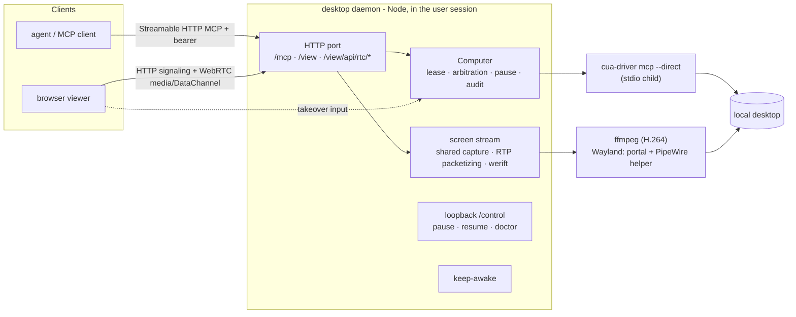

# Computer use: the Computer resource and the desktop daemon

**Status:** Draft v6, validated by a prototype, with a development plan. 2026-10-20.
The concepts are unchanged from the earlier drafts: a **Computer** resource; a **desktop daemon** that embeds Cua Driver;
the `computer_*` tools; one control lease per Computer; the human always wins; an action with an unknown outcome is
never replayed; an emergency stop; an audit trail. The prototype (§12) confirmed, overturned, or added to each section,
and those results are folded in. v6 adds the Linux container form (a Docker image, §3.8) and replaces the phase table
with a development plan: the Linux desktop daemon and Docker first, then macOS and Windows (§14).
The Chinese version lives in the extensions repository (`docs/designs/computer-use.md`, PR #147).

The first source of Computers is the user's own machine (a **self-hosted computer**). A **managed computer** that
AgentConnect operates comes later. The pair mirrors the self-hosted daemon and the managed daemon pool
([architecture.md §3.1](architecture.md)).

Markers: **[validated]** ran on real machines in the prototype; **[design]** is not implemented; **[unverified]** is
inferred or untested; **[legal]** needs counsel. Nothing here on licenses is legal advice.

## 0. Decisions

| #   | Decision                           | Outcome                                                                                                                                                                                        | Status                                            |
| --- | ---------------------------------- | ---------------------------------------------------------------------------------------------------------------------------------------------------------------------------------------------- | ------------------------------------------------- |
| 1   | New concept                        | **Computer**: a registered graphical desktop that can be granted to agents (§2)                                                                                                                | Design (the prototype has one per daemon)         |
| 2   | First source                       | **Self-hosted computer**: a desktop daemon runs on the user's desktop (§3)                                                                                                                     | Validated                                         |
| 3   | Driver                             | Embed **Cua Driver (MIT, pinned 0.35.2)** as a `cua-driver mcp --direct` stdio child; never `cua-spacesd` or the Cua viewer (FSL) (§3.1)                                                       | Validated                                         |
| 4   | Process shape                      | A background service **inside the user's logged-in graphical session**: on macOS our own signed app plus a LaunchAgent, on Windows the user Run key, on Linux a systemd user unit (§3.2, §3.3) | Validated (except the Windows install flow)       |
| 5   | macOS grant owner                  | macOS grants must belong to AgentConnect's own app (`md.agentconnect.desktop`), not the terminal (§3.2.1)                                                                                      | Validated                                         |
| 6   | Connection                         | Outbound WebSocket to the CP with a Computer key; tool calls ride the desktop's outbound relay link with per-session CP tokens; no screen bytes reach the CP (§3.6, §3.7)                      | Implemented (the agent's direct path is design)   |
| 7   | Permissions                        | Per-Computer visibility and grants with `view` / `control` modes; approvals for risky actions; hard refusals for system security surfaces and dangerous shortcuts (§4)                         | Refusals validated; approvals implemented         |
| 8   | Concurrency                        | **At most one control lease** per Computer at a time; screenshots run concurrently (§4.4)                                                                                                      | Validated                                         |
| 9   | Tools                              | `computer_*` MCP tools; coordinates are screenshot pixels with a fixed 1280 long edge (§5)                                                                                                     | Validated                                         |
| 10  | Sharing with a human               | Human-first arbitration, owner pause, emergency stop, takeover pauses agents (§6)                                                                                                              | Validated (keyboard detection and tray: X11 only) |
| 11  | Remote desktop                     | A **built-in WebRTC viewer** on the same port as MCP, instead of relying on the OS's remote desktop; embedded in the console, direct first then TURN (§7)                                      | Implemented                                       |
| 12  | Screenshots                        | Returned as MCP `image` content; stored in the object store with configurable retention and billing (§9)                                                                                       | Implemented (masking is design)                   |
| 13  | Runtimes without MCP image support | Computer use is disabled; no OCR or accessibility-tree fallback                                                                                                                                | Unchanged                                         |
| 14  | Unknown outcomes                   | On timeout, disconnect, or driver crash, **never replay input**; return `uncertain` with a fresh screenshot (§5.4)                                                                             | Validated                                         |
| 15  | Licenses                           | Bundled components are MIT / Apache / BSD / ISC only; GPL ffmpeg is **not bundled** but downloaded and checksummed on first run (§11)                                                          | Validated (Cloud distribution needs legal)        |
| 16  | Container form                     | The same desktop daemon runs in a **Linux container** (Xvfb, Xfce, a browser) as a Computer without a physical desktop; it is the preferred base for managed computers (§3.8, §15)             | Validated (Docker on OrbStack)                    |
| 17  | Development order                  | Linux desktop daemon (with the shared CP work) → Docker and the Linux managed computer → macOS → Windows (§14)                                                                                 | Plan                                              |
| 18  | Later                              | **Managed computers**: containers on Linux; the earlier VM desktop pool design for macOS and Windows (§15, appendices)                                                                         | Design                                            |
| 19  | Managed allocation and sharing     | Managed computers are `ephemeral` (per session), `per-agent` (one per agent, sleeps between uses) or `manual` (user-created, shared); shared Computers queue for the lease (§4.4, §15.1)       | Design                                            |

## 1. Background and goals

### 1.1 Background

Agents today work only through a shell, files, and a headless browser (`docker/runtime-sandbox-base.Dockerfile`
installs headless Chrome only; browsing comes from `agent-browser`). They cannot use GUI-only software, check a UI by
looking at it, or act inside an environment where the user is already signed in. Earlier drafts studied a VM desktop
pool and hit three walls: an isolated environment has none of the user's apps or sessions; macOS and Windows VM
licensing; and the FSL license of `cua-spacesd`, which does not suit Cloud. So agents first use **the user's own
desktop**, behind a Computer abstraction, and VM or container desktops join later as another kind of Computer. The
prototype showed a further advantage of the user's desktop: residential egress has a far better reputation than a
data-centre IP (§15.4).

### 1.2 Goals

- A first-class Computer resource with an owner, visibility, grants, and status, managed in the console next to Daemons.
- A user runs `setup` once on a macOS, Windows, or Linux desktop to turn it into a Computer that is available after every login.
- Agents screenshot, click, and type through `computer_*` tools; an agent under any execution strategy can use a Computer granted to it.
- When a human and an agent share a desktop, the human always wins, can pause or stop at any time, and can watch and take over from a browser.
- Every bundled dependency is permissively licensed, fit for an Apache-2.0 release and for Cloud.

### 1.3 Non-goals for this stage

- Managed computers and VM desktop pools (§15). The Linux container form is validated (§3.8) and productized in M2 (§14.5).
- Several people controlling one Computer at once (the viewer allows many watchers, but input has one controller).
- A text fallback for runtimes without MCP image content; a home-grown computer-use model.
- Audio, clipboard sync, and per-display control on multi-monitor machines (§17).

## 2. The Computer concept

### 2.1 Definition

A **Computer** is a registered graphical desktop in an organization that an agent, once granted, can observe and
operate through `computer_*` tools. Computer and Daemon are separate resources: a Daemon runs agents (runtimes,
sessions, workspaces); a Computer is used by agents. One machine may run both, or only one.

Proposed [GLOSSARY.md](../../GLOSSARY.md) entries:

- **Computer**: a graphical desktop resource granted to agents. _Avoid_: desktop pool member (a managed-computer implementation detail), machine (already used for daemons).
- **Desktop daemon**: the process inside a logged-in graphical session that registers the local desktop as a Computer.
- **Control lease**: one controller's (an agent session's) exclusive, time-limited right to send input to a Computer; a human can pre-empt it.
- **Viewer**: the desktop daemon's built-in browser remote desktop, for humans to watch and take over.

### 2.2 Data model (Control Plane) [design]

```ts
interface Computer {
  id: string // cmp_...
  orgId: string
  name: string // display name, such as "Yulong's MacBook"
  ownerUserId: string // the registrant; required for a self-hosted computer
  kind: 'self-hosted' | 'managed' // only self-hosted in this stage
  isolation: 'none' | 'container' | 'vm' // none: the user's real desktop; container: the §3.8 image
  os: 'macos' | 'windows' | 'linux'
  osVersion: string
  session: 'aqua' | 'console' | 'rdp' | 'x11' | 'xvfb' | 'wayland-gnome' // the prototype's doctor already tells these apart
  status: 'online' | 'offline' | 'locked' | 'paused' | 'human_in_control' | 'busy' | 'sleeping' | 'revoked' // sleeping: managed only
  allocation?: 'ephemeral' | 'per-agent' | 'manual' // managed only (§15.1) [implemented]
  ownerAgentId?: string // the agent a per-agent or ephemeral computer was made for [implemented]
  capabilities: {
    screenshot: boolean
    input: boolean
    textInput: 'full' | 'keymap-only' // GNOME Wayland (libei) cannot type IME text
    backgroundInput: boolean // Cua Driver's window-scoped background input (cua_* tools)
    accessibilityTree: boolean
    viewer: boolean // ffmpeg ready and one frame captured
    displays: { id: string; width: number; height: number; scale: number }[]
    permissions: { accessibility?: boolean; screenRecording?: boolean; portal?: boolean; firewall?: boolean }
  }
  desktopDaemonVersion: string
  driverVersion: string // the embedded Cua Driver version
  visibility: ResourceVisibility // reuses resource-visibility.md
  policy: ComputerPolicy // §4
  lastSeenAt: string
  createdAt: string
}
```

Persistence lives in the Control Plane (`packages/control-plane/src/persistence/`); visibility reuses
[resource-visibility.md](resource-visibility.md). **[implemented]** The `computer` table holds this record with a UUID
`id`; `kind`, `session` and the policy are validated by `src/domain/computer.ts`. A newly registered self-hosted
computer starts **Selected** with only its registrant in the audience (organization owners still see it by role),
and only the registrant may change its policy; any editor may revoke or delete it. The desktop daemon reports status and capabilities in its heartbeat,
with `permissions`, `session`, and `viewer` taken straight from `doctor` (§3.5). Wire frames go in a new
`packages/protocol/src/frames/computer.ts`.

**[implemented]** A managed computer also carries its `allocation` mode (§15.1); a self-hosted computer has none. A
`per-agent` computer names its one owning agent in `ownerAgentId`, and the pool keeps at most one per agent. `sleeping`
means the pool scaled the pod to zero (or deleted it) while keeping its volume; it applies to `per-agent` and `manual`
computers, and the next use wakes the computer with its files, browser profile, and sign-ins intact. An `ephemeral`
computer never sleeps: it is deleted, pod and volume, when it is reclaimed. The `computer` table adds `allocation`,
`ownerAgentId`, `poolSessionId` (the one session an `ephemeral` computer serves), the pool controller's `poolPhase`
(`provisioning`, `registering`, `awake`, `sleeping`, `waking`, `failed`, `reclaiming`) with its time, `poolActiveAt` and
`poolError`; partial unique indexes keep one live `per-agent` computer per agent and one live `ephemeral` one per agent
session. `sleeping` is a CP verdict like `offline`: the lease service and the channel grant refuse it as `unavailable`.

### 2.3 Relation to existing concepts

| Existing concept                                     | Relation                                                                                                  |
| ---------------------------------------------------- | --------------------------------------------------------------------------------------------------------- |
| Daemon (self-hosted / managed pool)                  | A Computer runs no agents; the agent's daemon reaches the Computer through the Control Plane / relay      |
| Agent                                                | The agent configuration names the Computers it may use (§4.1)                                             |
| Session                                              | A control lease is bound to a session and released when it ends                                           |
| Execution strategy (host / srt / microsandbox / pod) | Irrelevant: tool calls always reach the daemon's built-in MCP server first                                |
| Centralized tool management                          | `computer_*` is one managed tool group ([centralized-tool-management.md](centralized-tool-management.md)) |

## 3. The desktop daemon

### 3.1 Components [validated]

The desktop daemon is a Node program bundled into one `.mjs` (on macOS, a Node single executable application inside a
signed `.app`, §3.2.1). The package is `packages/desktop`, published to npm as `@agentconnect.md/desktop` (bin
`agentconnect-desktop`) like the agent daemon. `@agentconnect.md/cli` installs, upgrades and runs it as
`agentconnect computer …` (`desktop` is a hidden alias), from its own version store in the desktop data directory
([cli-daemon-split.md §1.2](cli-daemon-split.md#12-computer-desktop-daemon)).



- **Driver**: Cua Driver (MIT, trycua/cua `libs/cua-driver`) pinned to **0.35.2**, downloaded and sha256-checked, run as
  a `cua-driver mcp --direct` child over stdio MCP. A child process isolates driver crashes and makes MCP the boundary.
  `cua-perception` (AGPL models) is never installed. Linux X11 uses Cua's XTest backend, so no xdotool fallback is
  needed; GNOME Wayland uses Cua's Wayland mode (§3.2.3).
- **External interface**: one HTTP port (7681 in the prototype) serves Streamable HTTP MCP at `/mcp` and the viewer at
  `/view`; a loopback-only `/control` sits beside them (§8).
- **Computer core**: leases, human arbitration, owner pause, `uncertain` handling, a JSONL audit log (§4–§6).
- **Screen stream**: one shared capture that the first viewer starts and the last one stops (§7).
- **Keep-awake**: keeps the display awake while running (§3.4).
- **Local UI**: the console window (title and keys) is the indicator and emergency stop; on X11 a tray icon, a global
  stop hotkey and keyboard activity detection join it (§6); a macOS menu bar and a Windows tray remain the goal.

### 3.2 Process shape, identity, and OS grants

The desktop daemon must run inside **the user's logged-in graphical session** and hold OS grants under one stable,
recognizable identity.

| Platform                 | Started by                                                                               | Required grants / limits                                                                              | Status                                                    |
| ------------------------ | ---------------------------------------------------------------------------------------- | ----------------------------------------------------------------------------------------------------- | --------------------------------------------------------- |
| macOS                    | Our own `AgentConnect Desktop.app` plus a user LaunchAgent (§3.3)                        | Accessibility, Screen Recording, "bypass the private window picker"; granted to the app               | Validated (macOS 27 VM)                                   |
| Windows                  | User Run key at login, interactive session; **not a service** (Session 0 has no desktop) | No TCC; an inbound firewall rule; the UAC secure desktop and lock screen cannot be captured or driven | Tools and viewer validated; install and firewall flow not |
| Linux X11                | systemd user unit plus XDG autostart                                                     | None                                                                                                  | Validated (Xfce on Xorg / Xvfb)                           |
| Linux GNOME Wayland      | Same                                                                                     | The Cua GNOME Shell extension; RemoteDesktop and ScreenCast portal consent once each                  | Validated (GNOME 50); KDE unsupported                     |
| Linux container (Docker) | The container entrypoint, in the foreground, without systemd (§3.8)                      | None; publish the HTTP port and a UDP port range                                                      | Validated                                                 |

#### 3.2.1 macOS: who owns the grant [validated]

TCC records a grant against the **responsible process**. Started from a terminal, the grant belongs to Terminal: too
broad (anything run in that terminal inherits it), once per terminal app, and impossible over SSH. So the desktop
daemon runs as its own app:

- `AgentConnect Desktop.app`, bundle id `md.agentconnect.desktop`, containing a Node SEA, `LSUIElement` (no Dock icon),
  launched by a per-user LaunchAgent in the Aqua session.
- Cua Driver and ffmpeg inherit the app's grants as children; `TCC.db` held only `md.agentconnect.desktop`, never Terminal.
- Three grants: **Accessibility** (renamed "Device Control and Data Access" in macOS 27; being listed is not enough, the
  switch must be on, or clicks and keys are dropped silently while pointer moves still work, which is easy to miss);
  **Screen Recording** (takes effect only after the app restarts, so `setup` restarts the service while it waits); and
  the extra "bypass the private window picker" consent of the legacy capture API.
- Signing: an ad-hoc signature ties grants to the build hash, so every rebuild needs new grants. Release needs a
  Developer ID, notarization, and the hardened runtime (Node needs the JIT entitlement). Gatekeeper blocks an unsigned
  quarantined download.
- No Swift is needed for this. Swift / AppKit comes later for the menu bar UI, ScreenCaptureKit plus VideoToolbox
  native capture, and `SMAppService` login items.

#### 3.2.2 Windows

- Must run in an interactive user session; the user Run key starts it at login (the prototype's `autostart enable`).
  `doctor` tells an RDP session from the console session.
- Firewall: `setup` uses one UAC prompt to add an inbound allow rule for `node.exe` covering every profile (Tailscale
  networks are often classified Public), and disables the block rule Windows creates when the user presses Cancel on its
  firewall prompt. [implemented, not validated end to end]
- The UAC secure desktop and lock screen cannot be captured or driven from the user session. That boundary is expected.

#### 3.2.3 Linux

- **X11**: no grants; Cua uses XTest. Characters missing from the keymap (Chinese, for example) are typed by
  temporarily remapping a keycode. On real Xorg, back-to-back remaps race ("你好" became "好好"); sending one character at
  a time with a 40 ms gap fixed it. Xvfb does not reproduce this, so tests must cover real Xorg.
- **GNOME Wayland**: `CUA_DRIVER_RS_ENABLE_WAYLAND=1` enables Cua's Wayland mode. It needs the GNOME Shell extension
  `winrects@cua` (window geometry, screenshots, activation; one logout after install), and sends input through the
  RemoteDesktop portal and libei (one consent, restore token persisted). libei sends keycodes only, so **IME text such
  as Chinese is dropped** (`textInput: 'keymap-only'`, §17).
- KDE Wayland: not yet supported by Cua. GDM 50 has dropped X11 sessions (X11 tests used LightDM).
- Test trap: GTK connects to `wayland-0` even when `WAYLAND_DISPLAY` is unset.

### 3.3 Background service and crash recovery [validated]

| Platform  | Mechanism            | Notes                                                                                                                                                                                                                                                                                            |
| --------- | -------------------- | ------------------------------------------------------------------------------------------------------------------------------------------------------------------------------------------------------------------------------------------------------------------------------------------------ |
| macOS     | Per-user LaunchAgent | Aqua session, `RunAtLoad`, `KeepAlive` on failure                                                                                                                                                                                                                                                |
| Linux     | systemd user unit    | Pulled in by `graphical-session.target`; an XDG autostart entry imports `DISPLAY` / `WAYLAND_DISPLAY` and friends into systemd (Xfce never activates `graphical-session.target`); `ExecCondition` skips the start without a display instead of crash-looping; `PartOf` the session; `StartLimit` |
| Windows   | User Run key         | Starts at login; the console window doubles as indicator                                                                                                                                                                                                                                         |
| Container | Entrypoint           | The daemon runs in the foreground; `docker stop` shuts it down cleanly (§3.8)                                                                                                                                                                                                                    |

- **[implemented]** Linux session following: Xfce leaves `graphical-session.target` active after logout, so the
  autostart entry also exports the logind session id (`AGENTCONNECT_DESKTOP_SESSION`) and resets the unit's start limit;
  the daemon polls that session and exits when it closes, dropping its display variables from the user manager (or
  exits 75 so systemd restarts it when a newer session already imported its own). Validated on Ubuntu 26.04 Xfce on
  Xorg across logout / login and reboot; GNOME Wayland is tracked in #3221.
- On Linux, Cua Driver runs in its own `systemd-run --user --scope`, so apps an agent launched survive a service
  restart (without it, a restart killed them; observed).
- Crash recovery: back within 3 s of `kill -9`, with no orphans; ffmpeg, caffeinate, and the inhibitor are cleaned up.
  ffmpeg needs a SIGKILL fallback (avfoundation ignores SIGTERM).

### 3.4 Keeping the display awake [validated]

A sleeping display breaks capture (macOS even removes the capture device, and screenshots turn black). While running,
the daemon keeps the display awake: macOS `caffeinate` (`-u` to wake, `-d -i -w <pid>` to hold); Windows
`SetThreadExecutionState` through a helper; GNOME `gnome-session-inhibit` bound to the pid; other X11
`xset s off -dpms`. This changes the user's power settings, so the release explains it in the console and the local
UI and lets the owner limit it to time windows [design].

### 3.5 Install and diagnose: `setup` and `doctor` [validated]

`setup` runs once on the desktop (from a terminal or over SSH; on macOS it runs the binary inside the app):

1. Write the config and mint a client token (prototype; registration with the CP replaces this, §3.6).
2. Download and check Cua Driver; download ffmpeg in the background (§7.4).
3. OS grants: on macOS, raise the prompts, open the right settings pane, wait, and restart the service; on Windows,
   configure the firewall through UAC; on Linux, install the GNOME extension, trigger ScreenCast consent (one probe
   capture) and RemoteDesktop consent (one harmless Shift press; a pointer move goes through the extension and would
   report a false success).
4. Install the background service (§3.3), then run `doctor`.

`doctor` is read-only, exits 1 on failure, and **every failure comes with its fix**. When the daemon is running,
`doctor` asks it over the loopback `/control/doctor` to run the checks in a child of the daemon, so the result reflects
the service's own identity, grants, and session rather than the caller's terminal. Checks: config; session type (SSH /
Session 0 / RDP / Wayland / X11); driver; macOS grants; a real screenshot; display wake; ffmpeg plus a real one-frame
capture; the Linux GNOME helper, portal, and PipeWire dependencies; the Windows firewall rule; whether the daemon runs.

**[implemented]** Install, upgrade and diagnose through the CLI (#3239; Linux first, GNOME Wayland is #3221). A release
publishes `@agentconnect.md/desktop` to npm with the other packages (`scripts/publish-desktop-if-changed.sh`: the same
channels and dist-tags, provenance through trusted publishing, a self-contained esbuild bundle in `dist/` with the
release version baked in, and the §11 license scan run on exactly what ships). Cua Driver and ffmpeg are not in the
package: they stay pinned, checksummed downloads at `setup` / first start. A Linux host is assumed to have Node.js
(the daemon's `engines`), and the console's **Add Computer** shows
`npx -y @agentconnect.md/cli computer install --register <token> --cp-url <exchange URL>` once the package is on npm
(until then, see the transition note below). `install` resolves the
package from the CLI-local registry (never a CP-supplied URL), verifies its integrity and `engines`, extracts it to
`versions/<v>` in the data directory, points `current` at it and runs `setup --register`; the systemd user unit and the
Windows Run-key launcher run `current/dist/agentconnect-desktop.mjs`. `upgrade` installs side by side, switches
`current`, rewrites and restarts the unit, and requires a stable pid plus the daemon answering as the new version on
its loopback `/control/status`; otherwise it restores the previous version. Config, the Computer key and the grants
live beside the store and are never touched, so an upgrade does not register again. `doctor` names the installed
version (also its first check, which the console shows), and `status`, `versions`, `start` / `stop` / `restart` and
`uninstall [--purge]` complete the set ([cli-daemon-split.md §1.2](cli-daemon-split.md#12-computer-desktop-daemon);
on Windows only `start` until M4). Transition: the first npm publish of `@agentconnect.md/desktop` and its trusted
publisher are set up by hand, and until the package exists a release skips it with a warning instead of failing. Until
then the CP image keeps shipping the bundle and serving the CP-hosted `install.sh`, and the console keeps the Linux
`wget … | sh` one-liner whenever the registration carries `linuxInstallerUrl`; a follow-up removes both after the
first publish. Installs from that `install.sh` keep their data directory, and `computer install` moves their service
onto the store. Validated on Ubuntu 26.04 Xfce on Xorg (arm64)
against a local registry: install and register, online across logout / login and reboot, upgrade without a new
registration, and rollback from a version whose daemon crashes.

### 3.6 Registration and pairing [design]

Follow the "add a daemon in the console, run the generated command" flow and daemon API-key authentication:

1. Console **Computers → Add Computer**: pick the OS; the console produces a one-time install command carrying a
   short-lived registration token.
2. The user runs it on the target machine, i.e. `setup --register <token>`: every §3.5 step, plus exchanging the
   registration token for **an API key bound to this organization and this Computer**, kept in the system keychain /
   credential manager [per-platform storage to be decided]. In a container the token arrives through an environment
   variable or a secret file (§14.5).
3. The desktop daemon opens an outbound WebSocket with that key (the same `auth` frame and close codes as the daemon,
   see [daemon-cp-ws-protocol.md](daemon-cp-ws-protocol.md)) and reports capabilities and `doctor` results.
4. Revocation: deleting the Computer or revoking the key disconnects the desktop daemon at once, stops all input, and
   closes the viewer. The bound when the CP connection is lost is in §8.2.

**[implemented]** The Computer channel. The frames live in `packages/protocol/src/frames/computer.ts`, a
separate frame union from the daemon and relay wires, so a frame from another wire is `UNKNOWN_FRAME`. The desktop
daemon dials `wss://<cp>/v1/computers/ws`, which the CP also serves at `/api/v1/computers/ws` (`COMPUTER_WS_PATH`).
The subprotocol is `agentconnect.computer.v1`, and any other subprotocol gets HTTP 400. The registration exchange
returns this URL as `channelUrl`.

| Frame                 | Direction | Purpose                                                                                                |
| --------------------- | --------- | ------------------------------------------------------------------------------------------------------ |
| `computer/auth`       | D→C REQ   | the Computer key and the desktop daemon's version; the first frame, sent within 10 s                   |
| `computer/auth/ok`    | C→D REP   | the Computer id and name, `heartbeatSec`, the CP clock, the policy, and the first channel key          |
| `computer/heartbeat`  | D→C EVT   | the status, plus the OS version, session, versions, capabilities and `doctor` results when they change |
| `computer/credential` | C→D EVT   | a renewed channel key                                                                                  |
| `computer/policy`     | C→D EVT   | the owner changed the policy                                                                           |
| `computer/revoke`     | C→D EVT   | the Computer was revoked or deleted, or its owner left the organization; the CP then closes with 4401  |
| `computer/stop`       | C→D EVT   | a console Stop (its time) or `null` once resumed; told again while the desktop does not show the Stop  |

The close codes follow the daemon. A refused key gets an `AUTH_FAILED` reply and close `4401`, and the desktop treats
that reply, or a `computer/revoke`, as a revoke: it stops redialing, forgets the key and keeps a revoked marker. The
CP closes with `4401` for nothing else; an unreadable or out-of-order first frame gets `4400`, an auth timeout `1008`,
and a full handshake gate a retryable `RATE_LIMITED` with `4429`, and the desktop redials after a bare `4401` too.
`1011` and `1012` redial with backoff of 1–30 s with jitter, and a newer connection for the same Computer supersedes the older one with `1012`. The CP stores
the heartbeat with a write that applies only while the Computer and the channel's key are both unrevoked, so a
revoke made elsewhere also ends the channel at its next heartbeat. A clean close marks the Computer `offline`. A live
status whose `lastSeenAt` is older than three heartbeats is shown as `offline`. The desktop runs `doctor` in a child
when it starts and every 30 minutes. The capabilities are derived from those checks and the screen size.

**[implemented]** Registration on the desktop. `setup --register <token> --cp-url <url>` (or just `register`) spends
the token and stores the key in `computer-key.json` in the data directory with mode 0600. Moving the key into the
system keychain or credential manager is still to do. A registered desktop mints no local client token.

API keys gain a `computer` principal type, usable only on the Computer channel; it can neither run agents nor reach
other resources ([daemon-api-key-auth.md](daemon-api-key-auth.md)). **[implemented]** `POST
/orgs/:orgId/computers/registrations` mints a one-time token (60 minutes by default, at most 24 hours) and
`POST /v1/computers/register` spends it, creating the Computer and its key in one transaction; the minting route,
`POST /orgs/:orgId/computers/:id/revoke` and `POST …/resume` are `interactiveOnly`. A registrant who leaves the
organization has their Computers revoked. The prototype's local token (sha256 stored, shown
once) stays as an offline / development mode.

### 3.7 Data paths

- **Prototype [validated]**: the MCP client (Claude Code) connects over HTTP straight to the desktop daemon's `/mcp`;
  the browser viewer connects to the same port. Cross-internet tests ran over Tailscale.
- **Control plane [design]**: registration, heartbeats, status, leases, and policy go over the Control Plane WebSocket.
- **Data plane [implemented]**: tool calls and screenshot bytes travel between the agent's daemon and the desktop
  daemon over **an outbound session channel through the relay**; the decision for §17-1 follows. The Control Plane
  issues the credentials and carries no screen byte or tool body.
- **Viewer media [implemented]**: WebRTC media is direct UDP first (ICE-lite, host candidates only, §7.2). Without a
  direct path (behind NAT, inside a pod) signaling rides the same relay channel and media falls back to **TURN** (such
  as coturn, BSD), not the relay; with neither, the console polls screenshots through the relay (§7.2).

**Decision (§17-1).** A user's desktop sits behind NAT and can only dial out, and the relay is already the install's
public, per-instance ingress that daemons dial ([shared-bot-relay.md §5](shared-bot-relay.md)). So the desktop daemon
dials every relay in the CP's roster, and an agent daemon sends its MCP calls to a relay, which forwards them over that
link. The session-executors TLS-PSK pipe ([session-executors.md §6](session-executors.md)) was not chosen: its executor
listens and its holder dials, which is the direction NAT forbids, and it carries the shim protocol between daemons of
one group rather than HTTP to a machine outside it. Because the desktop daemon is already a standard Streamable HTTP
MCP server, the channel forwards HTTP and nothing else; no new tool protocol is needed. A direct connection is the
same-network optimization: the desktop's own `/mcp` accepts the same per-session token, and choosing it needs an
address the desktop advertises, which is still to do. Viewer media goes through TURN rather than the relay because it
is UDP and continuous, and the relay is a bounded HTTP and WebSocket forwarder that holds no media state.

```
agent daemon ── computer-channel/grant ──▶ Control Plane      (daemon wire: control only)
     │◀── token (mcp, one session) + relay roster ──┘
     │
     └── HTTPS POST /cr/computers/<id>/mcp + Bearer token ──▶ relay
                                                               │  cr/http over the desktop's own outbound socket
desktop daemon ◀───────────────────────────────────────────────┘  verifies the token with its channel key, serves /mcp
```

- **Credentials.** A **channel token** (`actk1.<claims>.<HMAC-SHA256>`, `packages/protocol/src/computer-channel-token.ts`)
  is signed with the Computer's current channel key (§8.2), which the CP derives and the desktop holds, so the desktop
  verifies it locally and the CP stores nothing. An agent daemon asks for one with `computer-channel/grant`
  (`computerId`, `agentId`, `sessionId`) on the daemon wire, behind `computer-channel-v1`. The CP answers only a daemon
  that serves the agent, for an agent the policy grants, while the Computer is online; the token names the session,
  agent, daemon and the policy's `agentMode`, and lives 120 s or until its key expires, whichever is first. The agent
  daemon asks again 30 s before expiry, and once when the desktop answers 401. The reply also names the relays.
- **The relay link.** The CP pushes `computer/relays` (the roster daemons dial) after auth and whenever it changes. The
  desktop dials each relay's `/cr/ws` (subprotocol `agentconnect.cr.v1`, frames in
  `packages/protocol/src/frames/relay-computer.ts`) and proves its key with `cr/hello`, a relay-audience token it signs
  itself; the relay, which has no database, asks the CP with `rc/verify` (`computer-relay-token`), and the CP checks it
  against the Computer's live key. A newer link for the same Computer supersedes the older one. The desktop drops its
  links on revoke and when its key lapses, and redials after the next roster push.
- **Forwarding.** An agent daemon sends `POST|DELETE /cr/computers/<id>/mcp` to a relay's per-instance address. The
  relay refuses a request without a bearer, answers a `GET` with `405` (a buffered relay cannot carry the standalone SSE
  stream it opens, and the MCP client then goes without one; the agent daemon and the desktop answer it the same way),
  answers `503 computer_not_attached` when the desktop is not linked to it
  (the agent daemon then tries the next relay; a request that may have reached a relay is never resent), and otherwise
  sends one `cr/http` frame with the method, the MCP headers and the body, and returns the `cr/http/result`. Bodies are
  buffered, at most 8 MiB each way; a desktop has at most 16 requests in flight per relay, and a request times out
  after 120 s. The relay parses no MCP and logs no body or token.
- **On the desktop.** A relayed request is served in process through the same MCP server as the local port, and only a
  channel token authenticates it; the prototype's local client tokens work only on the local port. The token's agent and
  session together become the caller, the holder the CP's control lease names (§4.4), and a `view` token gets a server without
  the input and lease tools. The agent daemon's side is `packages/daemon/src/computer/data-plane.ts`, and the
  `computer_*` tools on it are `packages/daemon/src/computer/tools.ts` (§5).

### 3.8 Container form (Docker) [implemented]

Where there is no physical desktop (a server, a NAS, Kubernetes), a "Linux desktop with a browser" is a container
image running **the same desktop daemon**. The prototype was built and run on a Mac with OrbStack:

- **Image**: Debian trixie-slim, Xvfb, a lean Xfce, Firefox ESR, Noto CJK fonts, pinned Node 24, and the desktop
  daemon; Cua Driver is downloaded and checksummed at build time. ffmpeg (GPL) is not in the published image: the
  daemon downloads the pinned build on first start into the volume, as on desktops (§7.4, §11). It runs as the non-root user `desktop`,
  without systemd. `/home/desktop` is a volume holding the token, config, audit log, and browser profile. The image is
  1.26 GB and builds in about 100 s.
- **Entrypoint**: starts Xvfb (`RESOLUTION`, default `1600x900x24`), a session D-Bus, and Xfce, then runs the daemon in
  the foreground. `docker stop` stops the daemon, closes Firefox gracefully (so no profile lock is left), then ends
  the session, with exit code 0 in under 0.9 s. Xvfb must keep its local socket (`-nolisten tcp`, never
  `-nolisten unix`).
- **Published image [implemented]**: `ghcr.io/<owner>/desktop`, built from `packages/desktop/docker/Dockerfile`
  (context: the repository root) for `linux/amd64` and `linux/arm64` with every release, through the same
  `docker-bake.hcl` target, effective-version and alias steps as the other images. The bundle stage runs once on the
  build platform. The image leaves out Mesa's software GL stack (Xvfb runs without GLX and Firefox renders in
  software), the CJK serif faces, npm, ffmpeg and the driver's unused SDK library: 864 MiB on arm64 and about 860 MiB on amd64
  (uncompressed). The PR job `Desktop image` builds both arches natively and runs `docker/smoke.sh` on them: size
  under 1 GiB, healthy, every `doctor` check ok once ffmpeg is downloaded, a maximized browser, registration against
  a stub Control Plane (one exchange, the key kept on restart, the token absent from the log and from the session's
  and browser's environments), and `docker stop` exiting 0.
- **Registration [implemented]**: `run` spends `AGENTCONNECT_REGISTER_TOKEN` (or the file named by
  `AGENTCONNECT_REGISTER_TOKEN_FILE`, such as a Docker or Kubernetes secret) at `AGENTCONNECT_CP_URL` before it starts,
  with `AGENTCONNECT_COMPUTER_NAME` or the hostname as the name the console did not give. The stored key records the
  sha256 of the token it was spent from: a live key for the same CP and the same token leaves the token unused on
  every later start; a different token (another org, or after a revoke) is spent; a revoked desktop restarted with its
  spent token keeps running revoked instead of crash-looping. The entrypoint hands the token
  to the daemon alone, the daemon drops it from its environment before starting anything, and no output names it. An
  unregistered daemon started without a terminal writes its first client token to `client-token` (0600) in the data
  directory rather than to the log.
- **Profile [implemented]**: the image declares `AGENTCONNECT_DESKTOP_ISOLATION=container`, Xvfb reads as session
  `xvfb`, and `computer_list` reports the name, OS release, session, isolation and the driver's startup screen size
  before the first capture. The Computers API the console lists from showed a `docker run` registered this way as
  online with `isolation: 'container'`, `session: 'xvfb'`, one 1600×900 display and all nine `doctor` checks ok.
- **Browser [implemented]**: the entrypoint keeps one Firefox ESR window open and maximized (`wmctrl`), restarting it
  with a 2–30 s backoff when it exits or crashes; prefs turn off the first-run, crash and safe-mode prompts that would
  block an unattended restart. While another instance holds the profile (Firefox restarting itself, or one an agent
  started), the supervisor waits for it instead of opening a second window. `BROWSER=none` turns it off.
- **Health [implemented]**: `HEALTHCHECK` runs `doctor --json --daemon`, which asks the running daemon and fails when
  none answers or a required check fails, a revoked key included.
- **WebRTC and NAT**: by default the daemon advertises the local address the browser reached it on, which in bridge
  networking is the container IP that a remote browser cannot reach. Two settings fix this: `rtcAddress`
  (`--rtc-address` / `RTC_ADDRESS`, the public address offered as the only host candidate) and `rtcPortRange`
  (`--rtc-ports` / `RTC_PORTS`, a fixed UDP range that `-p` can publish; each viewer uses up to two ports). A second
  container acting as a remote client fell back to screenshot polling without them and got WebRTC with them.
  `PUBLIC_URL` (`--public-url`) names where clients reach the published port: the startup output prints it, or the
  RTC address on the listening port, instead of the container IP, and without `RTC_ADDRESS` its host (resolved to IPv4
  when it is a name) is the candidate. A werift viewer on another machine (the Ubuntu VM, through the Mac's published
  ports) got only the container IP and never connected by default, and connected and received H.264 with either
  `RTC_ADDRESS` or `PUBLIC_URL` plus `RTC_PORTS`. On a Linux host, `--network host` needs neither [unverified].
  OrbStack lets the Mac reach container IPs directly, so "it works without them" on the Mac proves nothing.

```sh
docker run -d --name desktop --hostname "$NAME" --shm-size=1g -v desktop-home:/home/desktop \
  -p 7681:7681 -p 7700-7709:7700-7709/udp -e PUBLIC_URL="http://$HOST_IP:7681" -e RTC_PORTS=7700-7709 \
  -e AGENTCONNECT_CP_URL="$CP_URL" -e AGENTCONNECT_REGISTER_TOKEN="$TOKEN" ghcr.io/agentconnect-md/desktop
```

| Measure                   | Result                                                                                                                                 |
| ------------------------- | -------------------------------------------------------------------------------------------------------------------------------------- |
| Start to service ready    | 0.5 s first start, about 1.5 s on restart                                                                                              |
| `doctor` in the container | All 8 checks pass                                                                                                                      |
| Firefox over MCP          | Launch, maximize, address-bar navigation, Chinese input ("上海 今天天气"), clicks, scrolling all work; no crashes with `--shm-size=1g` |
| Viewer                    | 1600×900, 30 fps, no packet loss; agents get `human_in_control` during takeover                                                        |
| Persistence               | A new container on the same volume keeps a valid token, and Firefox restores its tabs                                                  |
| Resources                 | 2–3% CPU idle; about 55% of one core while streaming (ffmpeg about 31%); about 0.9 GB memory                                           |

The prototype's gaps (container IP in the output, a token readable only from `docker logs`, no CP registration, an
empty `display`, an unmanaged browser, an unpublished 1.26 GB image) are closed as above. Still open: no audio or
clipboard, no Chromium variant, and the source obligations of the Debian packages in the published image (§11). ffmpeg
is downloaded on first start rather than preinstalled until counsel answers its distribution question (§14.8).

**Self-hosted containers [implemented]**: `packages/desktop/docker/compose.yaml` (settings in `compose.env.example`
next to it) runs the image on a user's server, and the console's **Add Computer** offers **Docker** with the matching
`docker run` line; the guide is [self-host-desktop-container.md](../self-host-desktop-container.md). The container
only dials out, so the console viewer's signaling and screenshots go through the relay, and its video is direct when
`RTC_ADDRESS` and the published UDP range reach the browser, through TURN otherwise. The stack's `compose.turn.yaml`
adds coturn with `use-auth-secret` and sets `COMPUTER_TURN_URLS` / `COMPUTER_TURN_SECRET` (§7.2); since both peers
are relay-only, it refuses TCP relays and lets coturn send UDP only to the host's external IP and its own container
(any UDP port there, since coturn has no per-port allowance; the guide says to keep other UDP services off it). The desktop reruns `doctor` as soon as the first
start's ffmpeg download lands rather than 30 minutes later, and takes the name the Control Plane knows it by from
`computer/auth/ok`, so `computer_list` and the console agree. The example keeps the daemon's own port on loopback (agents and the console arrive through the relay), and the daemon's own `doctor` runs check it on the port it listens on, which matters with `network_mode: host`. Verified on an Ubuntu 26.04 arm64 server against a
Control Plane and relay on another host: registration from the console's token, an agent completing a Firefox task,
and the console viewer over each of Direct, TURN relay and Screenshots.

**Positioning**: containers start in seconds, are isolated, can hand each task a fresh desktop, and need no OS grants,
which suits managed computers and multi-tenancy. The costs are an image of about 0.9 GB, configuring the public address
and UDP ports, and no access to the user's own apps and sessions (exactly what a self-hosted computer provides). Use a
VM when a GPU, real Xorg, or a long-lived personal desktop is needed. A user can also run the image on their own server;
it is then a **self-hosted computer with isolation**.

## 4. Permissions

### 4.1 Who may use it [design]

```ts
interface ComputerPolicy {
  allowedAgents: string[] // agents that may use this Computer
  allowedMembers: string[] // members who may watch / take over / manage (always includes the owner)
  agentMode: 'view' | 'control' // view: screenshots only; control: input too
  approvals: {
    firstInputPerSession: boolean // default true
    launchApp: 'always' | 'session' | 'never-ask'
    submitLikeKeys: boolean // per-use approval for Enter-to-submit and send shortcuts, default true
  }
  appAllowlist?: string[] // apps that may be operated (bundle id / executable name)
  redactApps: string[] // app windows masked in screenshots, such as password managers
  exposeDriverTools: boolean // expose the cua_* pass-through tools (§5.5), default false
  quietHours?: { tz: string; ranges: string[] } // no use outside these windows
  leaseIdleSeconds: number // idle release, default 120 (validated)
  leaseMaxSeconds: number // cap on one control lease, default 1800 (validated)
  leaseWaitSeconds: number // [design] how long an acquire waits in the FIFO lease queue before `computer_busy` (§4.4)
  screenshotRetentionDays?: number // days stored screenshots are kept (§9); 0 = never written, absent = deployment default
}
```

On the agent side (`packages/daemon/src/agents/agent-schema.ts`; **[implemented]** as `AgentComputerUse` in
`packages/protocol`, set on the agent create and PATCH routes, kept in the agent's `runtimeOverrides`, returned in the
agent DTO and shipped on the spec as value or `null`):

```ts
computerUse: z.object({
  enabled: z.boolean().default(false),
  computers: z.array(z.string()).default([]), // Computer ids the agent may use; the Computer's policy must agree too
  managed: z.object({ mode: z.enum(['ephemeral', 'per-agent']) }).optional() // [implemented] agent-driven managed computer (§15.1)
}).optional()
```

**[implemented]** `managed` chooses, per agent, how the pool gives it an agent-driven managed computer: `ephemeral` creates
a fresh one for each session that needs a computer, and `per-agent` creates the agent's own one on first use and keeps
it, sleeping, between uses (§15.1). The pool creates either kind with the agent already in its `allowedAgents`, so it
needs no entry in `computers`. A `manual` managed computer is not an agent setting: a user creates it from the pool and
grants it to agents through its policy (`allowedAgents`) and their `computers` lists, exactly like a self-hosted
computer, and several agents may share it.

Both sides must agree. A self-hosted computer by default admits only its owner's agents; sharing it with another
member's agent shows a "no isolation" warning in the console. In the prototype the unit of grant is the **client
token** (controllers are told apart by name), with no agent or member granularity.

### 4.2 Approvals [design]

Reuse `packages/daemon/src/permissions/` and [mcp-elicitation.md](mcp-elicitation.md): an approval request goes both to
where the session's conversation lives and to the Computer's owner. Screenshots, moves, and scrolls need no approval by
default; the first input of a session, launching an app, and submit-like keys do, with an optional "always allow in
this session".

**[implemented]** The agent daemon asks before it takes the lease, so a person's answer never holds the Computer
(`packages/daemon/src/computer/tools.ts`). The grant (§3.7) carries the Computer's name, its owner and
`policy.approvals`; a CP that sends no policy gets every approval asked. An input asks when the policy wants one of:

- **first input**: the first click, drag, type, key or launch of the session on that Computer (`firstInputPerSession`);
  a move or a scroll does not count, and any "allow" answers it for the rest of the session;
- **launching an app**: under `launchApp: always`, every `computer_launch` until someone answers Allow for this
  session; under `session`, only the first, whatever the answer; none under `never-ask`;
- **pressing Enter**: a `computer_key` with Return or Enter, or `computer_type` text with a line break
  (`submitLikeKeys`), until someone answers Allow for this session. Keys are judged as the desktop presses them:
  trimmed, lowercased and aliased by the shared `normalizeComputerKey`.

One card covers every reason a call has; it offers Allow once, Allow for this session and Deny. Allow for this session
is the "always allow in this session" above: the person answering waives that call's reasons for the rest of the
session, so `always` and `submitLikeKeys` are the defaults the session starts from, not a floor an approver cannot
lower. It names the Computer and the action and never shows typed text, only its length.
Approvals in a session run one at a time, so parallel inputs share an answer. The card is the daemon's own ask, like
the bot-join confirmation, raised through `PermissionCoordinator.askComputerApproval` on the turn's ordinary approval
path ([mcp-elicitation.md](mcp-elicitation.md) §8): a card in the conversation where people there may approve, or else
the neutral notice plus the console and the approval DM. The approval DM goes to the Computer's owner first and falls
back to the usual chain. Beside a card in the conversation the owner gets a DM too, unless they are the asker there or
the editor DM already went to them. On an API turn the caller answers on its own stream, and the owner's DM only says
that the agent asked and links the session.
Through `agent/approval-route` the owner is reached, and their answer counts, only while they may edit the agent, which
is the default since a self-hosted Computer admits only its owner's agents. A refusal, or no live turn to ask on, returns
a definite `approval_denied` and nothing is sent.

### 4.3 Hard refusals

Whatever the policy, the desktop daemon refuses locally:

- **Dangerous shortcuts, per OS [validated]**: Windows refuses Win-key combinations and Ctrl+Alt+Del. Cmd is an everyday
  modifier on macOS and cannot be refused wholesale, so only lock screen, log out, and force quit are refused.
- **System security surfaces**: elevation and authentication dialogs, the keychain, UAC and the secure desktop, the
  login / lock screen, the system privacy and security settings, and AgentConnect's own indicator and stop controls.
  Cua Driver itself hard-refuses known system security prompts; the desktop daemon's own window-level check is [design].
- **Driver tools**: the script, configuration, extension, screen recording, process-kill, clipboard, and file-transfer
  tools among the `cua_*` pass-throughs are never exposed (§5.5).

### 4.4 Leases and concurrency [validated]

- A Computer has at most one **control lease** at a time. The prototype takes it automatically on the first input, or
  explicitly through `computer_acquire`; other controllers get `computer_busy` naming the holder.
- A lease expires after `leaseIdleSeconds` (120) idle or `leaseMaxSeconds` (1800) total, and is released by
  `computer_release`, a human takeover, or a stop. The release renews it from session heartbeats and releases it when
  the session ends [design].
- Screenshots, cursor position, and watching in the viewer need no lease and run concurrently.

**[implemented]** The Control Plane's lease service (`domain/computerLease.ts` holds the state machine,
`registry/computerLeaseService.ts` applies it). The `computer_lease` table keeps one row per held lease, keyed by
the Computer, and every change takes the Computer row's lock, so replicas agree on the holder.

- **Acquire**: an agent daemon sends `computer-lease/acquire` (`computerId`, `agentId`, `sessionId`, and `requestedAt` on
  its own clock) on the daemon wire,
  behind `computer-lease-v1`. The CP answers only a daemon that serves the agent. It refuses with `denied` when the
  policy does not grant the agent or is `view`; `unavailable` when the Computer is revoked, offline, or its status is
  stale; and `human_in_control` while it is `paused` or `human_in_control`. Another session's live lease gets
  `computer_busy` with the holder (session, agent, and agent name, cut to 200 characters). The holding session's acquire
  renews the lease in place.
  `computer-lease/release` gives it up.
- **Expiry**: a lease ends at the first of three deadlines. `leaseIdleSeconds` runs from its last use: an acquire by
  its session, or the last input the desktop daemon reports in each heartbeat for its local lease (`lease.idleMs`). The
  report also carries `lease.heldMs`; a local lease taken while the CP lease stood never idled out locally, so its last
  input counts even when it falls after the CP's previous idle deadline.
  `leaseMaxSeconds` runs from the acquisition and bounds the session, not one lease: a lease that reaches it stays as a
  spent row that holds nothing, and its session's acquires get `denied` until its turn ends (or its daemon is lost, or
  another `leaseMaxSeconds` passes). A release does not reset it. Holder liveness is three heartbeats (`HEARTBEAT_SEC × MISSED_BEATS`)
  from the last heartbeat of the agent daemon that took it. The daemon heartbeat renews liveness, but never revives a
  holder already lost. A lapsed row is cleared the next time it is read.
- **Session end**: daemons report `phase: end` at the end of a turn that completes and `phase: problem` at the end of one
  that fails or is interrupted, so a lease is held for a turn. Either milestone releases the session's leases whose
  latest acquire was stamped at or before the milestone's `ts`. Both stamps come from the daemon's clock, so a late
  replay of an earlier turn's end does not end a lease a later turn took or renewed.
- **Pre-emption**: a Computer heartbeat reporting `paused` or `human_in_control` (owner pause, stop, or viewer takeover)
  ends the lease. Revoking the Computer ends it. A policy change that removes the agent, or sets `view`, ends it too.
- **Enforcement on the desktop**: the CP sends `computer/lease` with the lease, or `null`, after auth and whenever it
  changes. A change made on the replica that holds the desktop's channel makes the channel re-read the lease at once,
  queued behind any heartbeat's read in flight, so a stale read never overwrites a newer commit. A change made on another
  replica reaches the desktop with its next heartbeat. While a lease stands, the desktop daemon lets only its holder
  session acquire locally, refuses every other caller with `computer_busy` naming the holder, and drops a local lease
  that the CP moved or ended. With no lease known, the prototype's local client tokens still work. The data plane
  (§3.7) binds a call to its session through its channel token, and the `computer_*` tools take the lease with
  `computer-lease/acquire` before every input tool and `computer_acquire`, and give it up with `computer-lease/release`
  on `computer_release` (§5.2). The session is the outward session id its `event/session` milestones carry.

**Sharing and the wait queue [design]** (#3231). Sharing works the same for managed and self-hosted Computers: one
desktop is one display and one control lease. A Computer granted to several agents (a shared self-hosted desktop or a
`manual` managed computer) is used first come, first served, and its holder releases the lease when its turn ends
(above). Another session's acquire no longer fails at once with `computer_busy`: it waits in a **FIFO queue** per
Computer for at most `leaseWaitSeconds`, set by the Computer's policy and bounded by the deployment, and gets the lease
when the sessions ahead of it are done. `computer_busy`, still naming the holder, becomes the result of a wait that
times out. Pre-emption by a human, revocation, and policy changes behave as above; a waiting session that loses its
grant or ends leaves the queue. Screenshots, cursor position, and viewers need no lease and never wait.

**One desktop, one controller.** A display has one pointer and one keyboard focus, and XTest input on Linux is
display-wide, so several agents cannot drive one Computer at once, whatever the OS. Linux could run several independent
displays (Xvfb or Xorg) on one host, each with its own desktop daemon and driver, but each would in effect be a separate
Computer. Several displays per pod are not offered: they would share one user, home directory, and browser profile,
which conflict; isolation would be weaker; and the saving is negligible, because the roughly 0.9 GB each display costs is
mostly Xfce and Firefox. Agents that must work in parallel get separate Computers.

## 5. Agent tool interface

### 5.1 Tools [validated]

| Tool                                    | Arguments                                    | Lease | Notes                                                                     |
| --------------------------------------- | -------------------------------------------- | ----- | ------------------------------------------------------------------------- |
| `computer_list`                         | `{}`                                         | no    | OS, status, lease holder, display size                                    |
| `computer_screenshot`                   | `{ computer? }`                              | no    | Full primary display, long edge 1280                                      |
| `computer_cursor_position`              | `{}`                                         | no    | In screenshot pixels                                                      |
| `computer_click`                        | `{ x, y, button?, count?, modifiers? }`      | yes   |                                                                           |
| `computer_move` / `computer_drag`       | `{ x, y }` / `{ from, to }`                  | yes   |                                                                           |
| `computer_scroll`                       | `{ x, y, direction, amount? }`               | yes   | Cua's direction plus amount, not `dx/dy`                                  |
| `computer_type`                         | `{ text }` (≤ 4096 chars)                    | yes   | Into the foreground app                                                   |
| `computer_key`                          | `{ keys: string[] }`, such as `["ctrl","s"]` | yes   | Subject to §4.3                                                           |
| `computer_launch`                       | `{ app }`                                    | yes   | App name; a `.exe` path on Windows; allowlist and approval in the release |
| `computer_wait`                         | `{ ms }` (≤ 10000)                           | no    | Waits, then screenshots                                                   |
| `computer_acquire` / `computer_release` | `{ computer? }` / `{}`                       | —     | Explicit lease control                                                    |

**Target selection [implemented]**: every tool except `computer_list` accepts an optional `computer` id. The session's
target is resolved in order: the explicit `computer` argument; the Computer whose lease the session holds (set by
`computer_acquire` or the first input); the only Computer the agent is granted. When none of these yields exactly one
Computer, the call fails with `computer_ambiguous` listing the candidates, before any input is sent. The data plane
forwards to the resolved Computer (the prototype has one per daemon). Input tools wait
`actionSettleMs` after acting and attach a screenshot. The draft's `display` / `window` / `region` / `maxDimension`
screenshot arguments are **dropped**: a fixed screenshot size per daemon is what keeps the driver's coordinate mapping
consistent; window screenshots come from `cua_get_window_state` (§5.5). Multiple displays: §17.

### 5.2 Call path

```
Prototype (validated):
  Claude Code ─HTTP + Bearer─▶ desktop daemon /mcp ─stdio MCP─▶ cua-driver mcp --direct ─▶ local desktop

Release (implemented):
  runtime ─stdio─▶ mcp-bridge ─▶ the agent's daemon's built-in MCP server
     (any execution strategy; inside a sandbox through the shim's MCP tunnel, see buildSandboxMcpServers in mcp/inject.ts)
          │  computer_* → check the agent's grant and lease (from the Control Plane)
          ▼
     session channel (relay, §3.7; direct later) ──HTTP MCP──▶ desktop daemon /mcp
```

**[implemented]** The tools join the daemon's own bridge tool set, next to the MCP Apps tools, when the session's tool
context is composed (`toolContextFor` in `daemon.ts`); `resolve-servers.ts` still resolves only the daemon-configured
servers. They appear only when the agent's `computerUse` is enabled and names at least one Computer, the Control Plane
advertises `computer-lease-v1` and `computer-channel-v1`, and the runtime shows the model MCP image content
(`claude-acp` and `codex-acp` as audited, or a runtime definition's `mcpImageContent`). Narrowed sessions (a
follow-up's check, organization research, getting to know) never get them. Because they are bridge tools, they reach
the daemon the same way under every execution strategy, including the sandbox image's own bridge entry. Online status
is not checked when the tools are offered: a call to an offline Computer gets a definite `unavailable`.

Each call resolves its target (§5.1), checks the argument shape, and for an input tool or `computer_acquire` asks the
CP for the lease first; a refusal (`computer_busy` with the holder, `human_in_control`, `denied`, `unavailable`) comes
back as a definite error and nothing is sent. The call then goes to the desktop over the session's channel (§3.7), minus
the `computer` argument, and the desktop's content, images included, is returned as is. An input whose request may have
reached the desktop and failed in flight is never resent: it returns `uncertain` with a fresh screenshot (§5.4).
`computer_list` asks every granted Computer for its own `computer_list` and marks one it cannot reach `unavailable`.
A session's desktop connections close after 10 minutes without a call.

### 5.3 Screenshots and coordinates [validated]

The screenshot long edge is fixed at 1280 (`maxImageDimension`). **Coordinates are pixels of the latest screenshot**;
Cua Driver maps them back to the screen (including HiDPI scale), so the model never deals with `scale`.

```ts
{
  content: [
    { type: 'text', text: '{"computer":"<id>","stored":"sha256:<hex>"}' }, // only when stored, §9; redacted is design
    { type: 'image', data: '<base64>', mimeType: 'image/png' },
    { type: 'text', text: '{"width":1280,"height":800}' }
  ]
}
```

### 5.4 Failure semantics [validated]

- Errors that prove the action did not happen (missing capability, invalid arguments, permission or hard refusal,
  `computer_busy`, `human_active`, `human_in_control`) return a definite error.
- Errors with an **unknown outcome** (timeout, driver crash, cancellation) never replay the input; they return
  `uncertain` with a fresh screenshot for the model to check.
- Known silent failures are surfaced in `doctor` and capabilities instead of left for the model to guess: clicks
  dropped while the macOS Accessibility switch is off, IME text dropped on GNOME Wayland.

### 5.5 Driver pass-through `cua_*` [validated, off by default]

`--expose-driver-tools` (policy `exposeDriverTools` in the release) also exposes Cua Driver's own tools as `cua_*`:
window-scoped background input (no real cursor movement, no focus stealing), accessibility `element_token`,
`get_window_state`, and so on. Read-only tools need no lease; the rest do; the §4.3 categories are never exposed. The
`computer_*` tools use Cua's desktop scope and move the real pointer; background input is only available through `cua_*`.

### 5.6 Guidance for agents [validated]

On Xfce, Firefox navigation, typing, scrolling, and clicking all worked. Session instructions should say: elements shift after a page loads, so wait for layout
and screenshot again before clicking; press Esc before Ctrl+L while a page is still loading; screen content is
untrusted (prompt injection). **[implemented]** `COMPUTER_USE_GUIDANCE` in `packages/daemon/src/computer/tools.ts`
says this, and how to read each error, in the standing instructions of every session that has the tools.

## 6. Sharing the desktop with a human

- **Input arbitration [validated]**: the daemon polls the cursor; when the pointer moves without the agent causing it,
  input tools return `human_active` for `humanIdleSeconds` (5). Screenshots are unaffected.
  **[implemented, X11]** Keyboard and mouse buttons count too: the daemon selects XInput2 raw key and button presses on
  the root window (XI 2.1 or newer, so other clients' grabs do not hide them), skips events whose source device is an
  XTEST device (Cua Driver, the viewer's input and xdotool all type through XTEST), and keeps only the time of the last
  press, never which key. Capabilities report `humanActivity: 'pointer+keyboard'`; a desktop without it reads as
  `pointer`. Wayland cannot listen globally and is #3221; macOS and Windows come with M3 and M4.
- **Owner pause / emergency stop [validated]**: press `p` in the console window, or run `agentconnect-desktop pause`
  (over the loopback `/control`). While paused, input returns `human_in_control` and screenshots continue; `r` /
  `resume` resumes. The release adds a local global hotkey, a tray / menu bar Stop, and a console Stop; any of them
  revokes the lease and enters `paused` until the owner resumes [design].
  **[implemented, X11]** The stop hotkey (`stopHotkey`, default `Ctrl+Alt+Shift+Escape`, grabbed on the root window
  under every Caps Lock and Num Lock state) and the tray's "Stop all agent input" pause the desktop, which drops the
  local lease; the next heartbeat reports `paused`, so the CP ends its lease too. Either also ends a console viewer's
  takeover, since the person at the machine outranks a remote one. The tray's "Resume agent input" appears only for a
  pause made on this machine (tray, hotkey, `pause`, console window), never for a console Stop or a takeover, and no
  agent can reach it: agent input is refused while paused. A hotkey another app holds, or no tray, shows as a `warn`
  doctor check.
  **[implemented]** The console Stop: `POST /orgs/:orgId/computers/:id/stop` (anyone who may revoke the Computer) sets
  `stoppedAt` on the Computer, ends its lease, and refuses every acquire with `human_in_control` until
  `POST …/resume` (only the policy's editor, the registrant of a self-hosted Computer, and `interactiveOnly` so no API key
  or agent's delegated call can lift it) clears it. The CP tells the desktop with `computer/stop` after auth, on change, and on any heartbeat that does not show the Stop, so a Stop made
  on another replica or lost to a restart still lands; the desktop pauses only while online or busy and resumes only a
  pause the Stop itself caused. A stopped live Computer reads as `paused`.
- **Fail-safe**: a remote key that lands in the daemon's own console window is handled as a console key; since those
  keys can only pause or quit, such a stray key only makes the system safer. The release's local UI must keep this
  property: any local control an agent can reach may only tighten, never loosen, permissions.
- **Persistent indicator**: the prototype's console window and title act as the indicator; the release adds a menu bar
  / tray icon and an "<agent> is operating" screen border, and revokes input when the indicator cannot be shown [design].
  **[implemented, X11]** A StatusNotifierItem tray icon over the session bus (`src/linux/tray.ts`, a minimal D-Bus
  client with no native binding): green while ready, amber with "controlled by <holder>" while an agent holds the
  lease, red with pause bars while paused, grey while the Control Plane's authority is missing. It registers again when
  the panel restarts. Xfce's Status Tray plugin shows it; a virtual display (Xvfb, §3.8) gets none. The screen border
  and revoking input without an indicator are not built yet.
- **Takeover [validated]**: a human at the machine just uses it; a remote human takes over through the viewer (§7.3).
  Meanwhile agent input returns `human_in_control` and screenshots continue.

## 7. Remote desktop (viewer) [validated]

The draft left remote watching to the OS's remote desktop. The prototype showed a built-in one is better: nothing to
install (a browser is enough), the same Computer and arbitration as the agent, and the same port and authentication.

### 7.1 Evolution

The first version polled screenshots (2–5 fps, several MB/s) and was too slow. The final design is WebRTC: ffmpeg
encodes H.264, and werift (MIT, a pure-TypeScript WebRTC stack) sends it as RTP. Screenshot polling stays as the fallback.

### 7.2 Media and network

```
capture (per OS) ─▶ ffmpeg libx264 ─RTP (127.0.0.1 UDP only)─▶ daemon packetizer + pacing ─▶ werift ─SRTP/UDP─▶ browser
                     ultrafast · zerolatency · constrained baseline
signaling: POST /view/api/rtc/offer · answer (same port, same token; from the console, through the relay)
input: DataChannel ─▶ Computer (same lease / arbitration as agents)
```

- **ICE-lite, host candidates only, no STUN** (werift otherwise defaults to Google's STUN). It advertises the local
  address the browser connected to, so it works over Tailscale and tun networks.
- **Cross-internet tuning**: on a Windows → Mac link with about 93 ms RTT and 5–10 Mbps, unpaced keyframe bursts of
  about 500 KB lost 20% of packets and decoded zero frames. The fix: pace at 1.5× the bitrate; VBV buffer = bitrate / 4
  (keyframes about 78 KB); 1 s GOP; 2.5 Mbps default.
- ffmpeg writes to loopback UDP only: `rtp://` opens an RTCP port on every interface and triggers the Windows firewall prompt.
- One shared capture: the first viewer starts it, the last one stops it.
- **NAT and containers**: `rtcAddress` sets the advertised public address and `rtcPortRange` pins the UDP range (§3.8).
  In Kubernetes each pod needs a reachable address and ports (hostPort / NodePort UDP), or media goes through TURN /
  the relay (§17).

**[implemented]** The console viewer. The Computer detail page embeds the viewer; nothing on it passes through the
Control Plane, which only issues credentials:

- **Credential.** `POST /orgs/:orgId/computers/:id/viewer` (`createComputerViewer`, `interactiveOnly`) answers the
  policy's allowed members (the owner always) with a `view`-audience channel token, signed with the Computer's channel
  key like an agent's (§3.7), naming the member and a mode: `control`, or `view` for an organization viewer, which
  watches but cannot take over. It lives 120 s (never past its key), so the browser asks again at half-life and hands
  the new token to the desktop over the DataChannel (`{ type: 'auth', token }`); the desktop re-checks every session's
  token every 2 s and closes the stream once it lapses, so a removed member or a lost CP ends a viewing within one
  lifetime. 409 for a revoked or offline Computer, 503 without a relay.
- **Signaling.** The grant names the relays: `PUBLIC_RELAY_URL` first, then each relay in the roster, all of which
  the desktop dialed. The browser calls `<relay>/cr/computers/<id>/view/api/{status,frame,rtc/offer,rtc/answer,control,input}`
  with the token as a bearer; the relay answers CORS preflights, forwards only the bearer and content type as one
  `cr/http` frame (64 KiB requests), and the desktop serves it through the same viewer API as its local `/view`. A
  relay the desktop is not attached to answers `503 computer_not_attached` and the browser tries the next one.
- **Media.** The browser asks for `{ transport: 'direct' }` first: the desktop's ICE-lite offer with host candidates
  (or only `rtcAddress`). If that is not connected within 6 s, and the deployment configures TURN, it asks for
  `{ transport: 'turn' }`: both peers use full ICE with `iceTransportPolicy: 'relay'` through the TURN servers the
  grant names, the desktop with the credentials carried in its token and the browser with its own. werift falls back
  from TURN over UDP to TURN over TCP by itself. With neither connected within 12 s, the page polls `/frame`
  through the relay (about 5 fps at 1600×900).
- **TURN.** `COMPUTER_TURN_URLS` (comma-separated `turn:`/`turns:` URLs), `COMPUTER_TURN_SECRET` (coturn's
  `static-auth-secret` with `use-auth-secret`) and `COMPUTER_TURN_TTL_SEC` (default 6 h, which bounds one viewing,
  since a TURN allocation cannot refresh past it) turn it on; the CP mints coturn REST-API credentials per viewer
  (`<expiry>:viewer-<user>`) and per desktop (`<expiry>:computer-<id>`) and never sends the secret out. The chart sets
  them from `computerViewer.turn`.
- **Input.** Take control, the keyboard and mouse mapping and the IME text box are the prototype's (§7.3), over the
  DataChannel when one is open and through the relay otherwise. Leaving the page releases a takeover.

### 7.3 Input and takeover

- Browser input enters the same Computer over the DataChannel: during takeover agents get `human_in_control`; the
  Release button, or 15 s of browser silence, releases it. An application-level heartbeat is needed because an
  ICE-lite peer cannot notice the browser going away.
- Modifier mapping: a Mac browser's Cmd maps to Ctrl on Windows / Linux targets; double-clicks are synthesized within a
  300 ms window; IME text is submitted through a text box.

### 7.4 Capture per platform and ffmpeg

| Platform         | Capture                                                                                                                                                                                                                                                                               |
| ---------------- | ------------------------------------------------------------------------------------------------------------------------------------------------------------------------------------------------------------------------------------------------------------------------------------- |
| Windows          | `ddagrab`, falling back to `gdigrab` (`gdigrab` grabs the whole virtual desktop)                                                                                                                                                                                                      |
| macOS            | `avfoundation`, with an `fps` filter (otherwise it emits about 200 fps)                                                                                                                                                                                                               |
| Linux X11 / Xvfb | `x11grab`                                                                                                                                                                                                                                                                             |
| GNOME Wayland    | xdg-desktop-portal ScreenCast plus PipeWire: a python3-gi helper holds the portal session, and a GStreamer `pipewiresrc → videorate → y4menc` pipeline feeds the pinned ffmpeg (distribution GStreamer has no H.264 encoder); the restore token is persisted so consent is asked once |

ffmpeg is GPL and **not bundled**: on first run the daemon downloads a pinned build in the background and checks its
sha256: gyan.dev 9.0.2 essentials on Windows (with `ddagrab` / libx264); eugeneware/ffmpeg-static b6.1.1 (static, with
libx264) on macOS and Linux, arm64 and x64. The container image includes it at build time (§11).

### 7.5 Results and limits

- 1920×1080 / 1200 at 30 fps, first frame in about 1–2 s, no packet loss (after the cross-internet tuning). End-to-end
  latency was not measured.
- A system HTTP proxy on the viewing machine (Clash) made the browser get 502 for Tailscale IPs; WebRTC media itself
  does not use the HTTP proxy. Re-check once the release goes through the relay / TLS.
- To do: native capture and hardware encoding (ScreenCaptureKit plus VideoToolbox, Desktop Duplication plus hardware
  encoders), display selection, audio, clipboard sync. NAT traversal (TURN, then screenshots over the relay) is done.

## 8. Security and audit

### 8.1 The prototype's security posture (not for production)

Plain HTTP on `0.0.0.0` (for testing); bearer tokens (sha256 stored, shown once); the viewer token in the URL fragment
(never in server logs or Referer); `/control` on loopback only, requiring a custom header and refusing any request with
an `Origin` (against cross-site browser calls); a CSP on the viewer page.

### 8.2 Release requirements [design]

- **Transport**: TLS or a relay channel; no public listener by default. Credentials are issued by the Control Plane,
  short-lived, per session; the desktop daemon holds no runtime or organization secrets.
- **No-isolation warning**: an agent sees and operates everything the user can (mail, chat, signed-in sites, the
  intranet). Registration and grants say so plainly and recommend trusted personal or dedicated work machines. The
  container form (§3.8) is the isolated alternative.
- **Least scope**: `appAllowlist`, `redactApps` (window-level masking feasibility to be validated), granting a single display.
- **Prompt injection**: screen content is untrusted; the session instructions say so (§5.6).
- **Audit**: the prototype already writes a JSONL `audit.log` in its data directory, one line per call, recording only
  the length of `computer_type` text and no screenshots [validated]. The release adds the agent, session, target window,
  approval outcome, and screenshot reference, reports to the Control Plane, and lets the owner query per Computer.
  **[implemented]** The agent daemon puts how each input was approved (`not_required`, `allowed`, or
  `allowed_session` for one an earlier answer covered) in the call's `_meta` (`md.agentconnect/approval`); the desktop
  trusts it only from a channel token and records it with the token's agent and session. A registered desktop queues
  every audited call, typed text reduced to `textLength` by `computerAuditArgs` in `packages/protocol`, and sends
  batches of up to 100 as `computer/audit` once the CP's auth reply lists `computer-audit-v1`; the CP acks a stored
  batch with `computer/audit/ok`, and the desktop keeps up to 2000 unsent entries, dropping the oldest. The CP
  summarizes the arguments again before it writes the `computer_audit` table, skips ids it already has, and drops a
  Computer's entries older than 90 days. `GET /computers/{id}/audit` (`listComputerAudit`) pages them newest first,
  filtered by agent or session, for the registrant of a self-hosted Computer or an editor of a managed one. A call an
  approval refused never reaches the desktop, so it is in the session's permission requests, not this audit. The target
  window is not recorded yet; an entry carries the `screenshotRef` of a screenshot its call stored (§9).
- **Revocation**: deleting the Computer, revoking the key, or removing an agent's grant takes effect immediately while
  the desktop daemon is connected to the Control Plane, and disconnects viewers. Every tool and viewer channel carries
  a short-lived credential (minutes) that the desktop daemon verifies locally and that only the Control Plane renews.
  When the CP WebSocket is lost, the desktop daemon accepts no new channels, keeps existing ones only until their
  credentials expire, and then stops input, screenshots, and viewers; so the worst-case revocation delay is one
  credential lifetime, in line with the authority lifetimes in [high-availability.md](high-availability.md).
  **[implemented]** The channel key. The CP derives the key from `API_KEY_PEPPER`, the Computer, its key and a window,
  so it stores nothing and every replica derives the same key. A new key starts every half lifetime and lasts one
  lifetime (`COMPUTER_CREDENTIAL_TTL_SEC`, default 300 s). The CP sends a renewal on the first heartbeat of each
  window, so consecutive keys overlap by half a lifetime. A desktop may lack the newest key until that heartbeat, so
  for three missed heartbeats plus 5 s after a window opens the CP signs channel tokens with the previous key, and also
  sends that key to a desktop that authenticates in that time. The desktop daemon reads expiries against the CP clock
  it measured at auth. While it is registered, every screenshot, input, takeover and viewer frame needs a live key,
  and that covers the prototype's local-token MCP and `/view` too. With no live key, or after a revoke, calls fail
  with `unavailable`, the lease and any takeover are dropped, and WebRTC viewers are closed. A revoke drops every key
  at once and persists. Once the CP is lost, the desktop keeps working for at most one lifetime after the last
  renewal, and resumes when it reconnects. The tool and viewer channel tokens that the data plane signs with
  this key are in §3.7.

## 9. Screenshot storage [implemented]

- Screenshots go to the object store (`packages/object-store`) under
  `<prefix>/computer-screenshots/<org>/<computer>/<session>/<takenAtMs>-<sha256>.<ext>`; the session timeline keeps
  only the reference, `sha256:<hex>`, and the Control Plane keeps metadata, never bytes.
- Retention is configurable; 0 means never written. Masking happens on the desktop daemon before upload (masking
  itself, `redactApps`, is still design).
- Read access is the intersection of session visibility ([session-visibility.md](session-visibility.md)) and Computer visibility.
- Cloud metering: screenshot storage counts toward usage.

**[implemented]** The deployment turns storage on with `AC_COMPUTER_SCREENSHOTS`, a bucket document like
`AC_FILE_TRANSFER` (`packages/control-plane/src/computer-screenshots/config.ts`) plus `retention.defaultDays` (30) and
`retention.maxDays` (365); the chart renders it into the Source Cache bucket when `computerScreenshots.enabled`. A
Computer's retention is its policy's `screenshotRetentionDays`, else the default, capped at the maximum; without the
document it is 0. The CP then advertises `computer-screenshot-v1` and tells the desktop the retention in `computer/auth/ok`
and every `computer/policy`.

- **Write.** Only calls under an agent session's channel token are stored, never a local client's. When the retention
  is above 0, the desktop hashes each image a call returns, puts a text block with `"computer"` and
  `"stored":"sha256:<hex>"` right before it (ahead of the bytes, so a trimmed timeline preview still holds it), records
  the reference as the audit entry's `screenshotRef`, and returns the call at once. In the background it offers the
  image with `computer/screenshot/put` (session, agent, hash, size, type, time). The CP signs only for an agent the
  Computer's policy grants and a session of that agent in its org (a session it does not know yet is a retryable
  error); it reserves a `computer_screenshot` row (unique per Computer, session and hash, so a repeated screen is
  stored once) and answers with a PUT presigned for exactly that length, type and SHA-256 checksum, or `stored` /
  `skipped`. The desktop PUTs the bytes straight to the bucket and sends
  `computer/screenshot/commit`; the CP HEADs the object, and only an object holding exactly those bytes marks the row
  stored and counts it. The desktop keeps up to 20 screenshots waiting and tries each 5 times, 5 s apart; a failure
  never fails the tool call, it only leaves the reference unresolvable.
- **Read.** `GET /sessions/{sessionId}/computer-screenshots/{sha256}` (`getSessionComputerScreenshot`) resolves a
  reference, and `GET /sessions/{sessionId}/computer-screenshots` (`listSessionComputerScreenshots`) pages a
  session's, each with a GET presigned for 5 minutes. The caller must see the session and the Computer it came from;
  a deleted Computer's screenshots are hidden at once. The console's session timeline shows the screenshots a
  computer tool row names (`ComputerScreenshots` in the tool body). A tool body the agent daemon trims for a
  timeline page, or caps at 1 MiB when it records it, carries the hashes it named in `screenshots`, so the reference
  survives losing the image bytes around it.
- **Retention.** A row expires `retention` days after it was offered and reads as absent from then on. A lowered
  retention also applies to what is already stored: a policy change shortens its Computer's rows at once (0 expires
  them all), and every sweep shortens rows past a lowered deployment default or maximum. Every replica
  sweeps every 10 minutes: expired rows, uploads unconfirmed for an hour, and rows of deleted Computers have their
  object deleted first and then the row, so a failed delete is retried. No bucket lifecycle rule is needed.
- **Metering.** A confirmed upload adds its bytes to `computer_screenshot_usage` per organization and UTC day, which
  outlives the screenshots. `GET /usage/computer-screenshots` (`getComputerScreenshotUsage`) totals what was written
  in a window and what is held now, for members and for the usage-reader workload alike.

## 10. Console [design]

- A **Computers** page next to Daemons: list, status, OS, session type, owner, granted agents, `doctor` results with
  fixes, recent activity, audit.
- Computer detail: policy editing, an **embedded viewer** (watch / take over), pause and stop, revoke. Viewer media
  still flows between the browser and the desktop daemon, directly or through the relay, never through the Control Plane.
- Agent settings: enable computer use and pick Computers.
- **[implemented]** `/computers` in the rail after Infra lists what the caller can see, with status, OS and session,
  owner, granted agents, and a `doctor` summary. **Add Computer** mints the registration token only when asked, shows
  `npx -y @agentconnect.md/cli computer install --register <token> --cp-url <exchange URL>` on Linux (§3.5), or
  `computer setup` with the same arguments on macOS and Windows, quoted for the chosen OS, and follows `GET …/computers/registrations/:id`, which
  only the token's minter may read, until the new Computer is online. The detail page shows each `doctor` check with its
  fix (failures first), the reported capabilities, Stop / Resume (§6), Revoke and Delete, the policy form (granted
  agents with a "no isolation" mark for another member's agent, view or control, approvals, lease limits, screenshot
  retention, driver tools; read-only for anyone but the owner), and, for the owner, the audit as recent activity. An
  agent's Tools tab carries the `computerUse` setting: the switch, the picked Computers, whether each one's policy
  grants the agent, and a Grant button for that Computer's owner. The detail page embeds the viewer (§7.2): Watch opens it, an allowed member
  may Take control and Release, and a badge names the media path (Direct, TURN relay or Screenshots).
- Session page: the current lease and an action timeline with screenshots
  (**[implemented]**: a computer tool row shows the screenshots its result stored, §9).

## 11. Licenses

### 11.1 Dependencies

| Component                            | License                    | Use                                                            | Distribution                                                                                                                                                                      |
| ------------------------------------ | -------------------------- | -------------------------------------------------------------- | --------------------------------------------------------------------------------------------------------------------------------------------------------------------------------- |
| Cua Driver (`libs/cua-driver`)       | MIT                        | Input, screenshots, accessibility on three OSes, GNOME Wayland | Pinned download, sha256-checked                                                                                                                                                   |
| werift                               | MIT                        | WebRTC (pure TypeScript)                                       | In the bundle                                                                                                                                                                     |
| Node.js (SEA)                        | MIT                        | Runtime inside the macOS app and the container                 | In the app / image                                                                                                                                                                |
| ffmpeg (with libx264)                | GPL                        | Viewer encoding                                                | **Not bundled**: downloaded from a third-party build and checked on first run, in the published container image too (into its volume); preinstalling it waits for counsel [legal] |
| GStreamer, PipeWire, python3-gi      | LGPL and others            | GNOME Wayland capture helper                                   | System packages                                                                                                                                                                   |
| libei                                | MIT                        | GNOME Wayland input (through Cua)                              | System component                                                                                                                                                                  |
| Xvfb, Xfce, Firefox ESR, Debian base | MIT / GPL / MPL and others | Container image                                                | Distribution packages in the image; source obligations when the image is published [legal]                                                                                        |

xdotool and wayvnc are no longer needed. Never used: `cua-spacesd`, the Cua HTML5 viewer and streaming crates
(FSL-1.1-MIT); `cua-perception` (AGPL models); ydotool, RustDesk (AGPL-3.0); Sunshine (GPL-3.0); the official nut.js
(unidentified license). CI scans release artifacts and fails on AGPL / FSL / BSL / SSPL / GPL. ffmpeg is downloaded on
the user's machine and run as a separate process; hosting it in Cloud, preinstalling it in an installer, or publishing
an image with it needs counsel first [legal]; native capture plus OS hardware encoders replace it in the long run (§17).

### 11.2 OS licenses

- **Self-hosted computer**: operating the user's own licensed desktop adds no OS instance and **needs no extra OS license**.
- **Remote watching and takeover [legal]**: the built-in viewer makes this concrete. macOS SLA §2I restricts remote
  desktop connections and forbids time-sharing / terminal sharing "whether within your organization or not"; Windows 11
  license §2(d)(v) restricts remote access users and §2(d)(vi) allows remote assistance sharing an active session. The
  owner remotely using their own machine is the least concern; several members remotely using one Computer needs counsel.
- **Managed computers**: §15.3 and Appendix B. Linux containers raise no OS license issue.

## 12. Prototype results

### 12.1 Code

The prototype lived in `packages/desktop` (`@agentconnect.md/desktop`) on the
`dev/yulong/cua-driver-daemon-mcp` branch and merged in M0 (§14.3); the package is now versioned and published with
each release (§3.5). Main files: `src/computer.ts` (lease, arbitration, pause, `uncertain`),
`src/tools.ts` (`computer_*` and the `cua_*` pass-through), `src/http-server.ts`, `src/viewer.ts` /
`src/viewer-page.ts`, `src/stream/` (`ffmpeg.ts`, `rtc.ts`, `screen-stream.ts`, `wayland-capture.ts`),
`src/keep-awake.ts`, `src/setup.ts`, `src/service-macos.ts`, `src/service-linux.ts`, `scripts/build-macos-app.mjs`,
`scripts/install.sh`, `scripts/install.ps1`, `docker/Dockerfile`, `docker/entrypoint.sh`. Usage is in the package README.

### 12.2 Platform matrix

The MCP client was Claude Code.

| Platform                                                                    | Tools (screenshot / input)              | Viewer                                     | Background service      | setup / doctor              | Notes                            |
| --------------------------------------------------------------------------- | --------------------------------------- | ------------------------------------------ | ----------------------- | --------------------------- | -------------------------------- |
| Windows 11 (over Tailscale across the internet)                             | Pass                                    | Pass (with cross-internet tuning)          | Run key                 | Firewall flow not validated | Win-key combinations refused     |
| macOS 27.0.1 arm64 (VM)                                                     | Pass                                    | Pass                                       | LaunchAgent + app       | Pass                        | TCC grants only the app          |
| Ubuntu 26.04 arm64 · GNOME 50 Wayland                                       | Pass (except IME text)                  | Pass (portal + PipeWire)                   | systemd user unit       | Pass                        | Extension plus one logout        |
| Ubuntu 26.04 arm64 · Xfce 4.20 / Xorg (LightDM)                             | Pass (after the Chinese-input race fix) | Pass                                       | systemd + XDG autostart | Pass                        | Firefox end to end               |
| Ubuntu 26.04 arm64 · Xfce / Xvfb                                            | Pass                                    | Pass                                       | —                       | Pass                        | Does not reproduce the Xorg race |
| Docker (Debian trixie · Xvfb + Xfce + Firefox ESR, OrbStack on macOS arm64) | Pass                                    | Pass (needs `rtcAddress` / `rtcPortRange`) | Container entrypoint    | Pass (8/8)                  | §3.8                             |

### 12.3 Key results

- Unit tests use a fake driver and need no desktop (`computer.test.ts`, `http-server.test.ts`, `setup.test.ts`, `rtc.test.ts`).
- Viewer: 1080p / 1200p at 30 fps, first frame in 1–2 s, no loss; before keyframe pacing, cross-internet lost 20% and decoded zero frames.
- Crash recovery: back within 3 s of `kill -9`, no orphans; on Linux, apps the agent launched survive a service restart.
- macOS: `TCC.db` holds only `md.agentconnect.desktop`; with the Accessibility switch off, clicks are dropped silently.
- Browser tasks: Firefox navigation, typing, scrolling, and clicking completed; egress reputation is in §15.4.
- Container: starts in seconds, `docker stop` under 0.9 s, state on the volume survives a new container, 2–3% idle CPU;
  bridge networking needs the public address and port range for WebRTC (§3.8).

### 12.4 Not in the prototype (still design)

Control Plane registration and the Computer model, `ComputerPolicy`, approvals, per-agent grants, object-store
screenshots (all since implemented), the relay data plane, TLS (the prototype has local bearer tokens, one Computer, no CP); tray / menu bar UI,
screen border, global hotkey, keyboard activity detection; window masking; Developer ID signing and notarization; native
capture and hardware encoding; multiple displays; audio and clipboard; latency measurement; the Windows `install.ps1`
setup and firewall end to end; Wayland IME text; KDE; Kubernetes deployment for the container image (its CP
registration, environment injection and publishing have since been implemented, §3.8).

## 13. Testing and evaluation

- Unit: the lease state machine, arbitration, pause, `uncertain` semantics, per-OS hard refusals, the pass-through deny
  list (in the prototype); policy merging and approval branches (to do).
- Platform integration must run on **real sessions**: Xvfb does not reproduce the Xorg keycode-remap race, and GTK
  quietly connects to `wayland-0`. The matrix is §12.2's six environments plus the Windows install flow and KDE
  (expected to fail with a clear message). macOS covers before and after grants (including Accessibility "listed but
  off"); Windows covers the lock screen, a UAC prompt, and an RDP session.
- Viewer: first-frame time, loss, and end-to-end latency on throttled / high-latency links; takeover release after the
  browser disappears; container viewers behind NAT with and without TURN.
- End to end: an agent in microsandbox operates a Computer on another machine through the relay; human input
  pre-empts; emergency stop; key revocation takes effect immediately, and within one credential lifetime after a CP disconnect; a managed container Computer is allocated, used,
  and wiped.
- Evaluation: computer-use cases in `evals/cases`; how to adopt cua-bench (MIT) [unverified].
- Security: prompt injection from the screen; masking effectiveness.

## 14. Development plan

### 14.1 Principles

- **Priority: the Linux desktop daemon and Docker first, then macOS and Windows.** The platform-independent work
  (Control Plane integration, data plane, tool registration, permissions and approvals, console) ships with Linux:
  Linux has no signing or TCC, and X11 runs end to end in CI under Xvfb, so the loop closes fastest. Docker follows
  immediately: it reuses the same Linux X11 path, adds little, and provides both an isolated self-hosted desktop and the
  base for managed computers. macOS and Windows then add only install, identity, local UI, and platform-specific detection.
- **Each milestone ships something a real user can use**: installable, registrable, revocable, with `doctor` green and
  visible in the console, not just a technical demo.
- **Start from the prototype**: merge `packages/desktop` in reviewable PRs rather than rewriting; each PR states the
  acceptance items it covers and what remains (`Refs #…`).
- Each platform milestone ends by running that platform's **real-session** matrix (§13), not just Xvfb.

### 14.2 Milestones

Estimates assume one engineer who knows the codebase.

| Milestone | Scope                                                                                                                         | Estimate             | Depends on                                       |
| --------- | ----------------------------------------------------------------------------------------------------------------------------- | -------------------- | ------------------------------------------------ |
| M0        | Merge the prototype, CI, safe defaults                                                                                        | 1 engineer-week      | —                                                |
| M1        | **Linux** self-hosted computer plus all shared work (CP, data plane, permissions, console)                                    | 6–8 engineer-weeks   | M0; data-plane decision (§17-1, settled in §3.7) |
| M2        | **Docker**: productized image, self-hosted containers, Linux managed computers (Kubernetes pool)                              | 4–6 engineer-weeks   | M1 (the image work can run alongside M1)         |
| M3        | **macOS**: signing and notarization, menu bar UI, install and grant flow                                                      | 3–4 engineer-weeks   | M1                                               |
| M4        | **Windows**: signed installer, tray UI, session and lock-screen handling                                                      | 3–4 engineer-weeks   | M1                                               |
| Later     | Native capture and hardware encoding, multiple displays, audio / clipboard, window masking, macOS / Windows managed computers | Estimated separately | Legal conclusions                                |

M1 plus M2 is the first releasable scope (about 10–14 engineer-weeks): both Linux user desktops and Docker desktops
register as Computers that agents use. M3 and M4 are independent and can run in parallel given people.

### 14.3 M0: merge the prototype

- Merge `packages/desktop` in module-sized PRs: driver client plus Computer core plus tools; HTTP / MCP; viewer and
  screen stream; `setup` / `doctor` and services; the macOS app build; the Docker image.
- CI: lint, typecheck, unit tests; a new Linux integration job (Xvfb plus the real Cua Driver: screenshot, input, one
  viewer frame); a license scan of release artifacts (fails on AGPL / FSL / BSL / SSPL / GPL).
- CLI: an `agentconnect desktop …` subcommand in `@agentconnect.md/cli` (now `agentconnect computer …`, §3.5).
- Tighten defaults: listen on `127.0.0.1` unless `0.0.0.0` is asked for explicitly.

**Acceptance**: main builds, CI is green, the Xvfb integration test passes.

### 14.4 M1: Linux and the shared work

1. **Protocol and Control Plane**: the `Computer` table and migration, visibility; registration tokens and the
   `computer` API-key principal (its routes `interactiveOnly`); `computer` frames in `packages/protocol` (auth,
   heartbeat, capabilities, `doctor` results, status); a lease service (renewed by session heartbeats, released when the
   session ends); OpenAPI docs.
2. **Data plane**: §17-1 is settled (§3.7). A user desktop usually sits behind NAT and can only dial out, so the
   data plane is **an outbound session channel through the relay by default**, with direct connection as a
   same-network optimization. The desktop daemon is already a standard Streamable HTTP MCP server, so only HTTP is
   forwarded. Viewer: the console issues short-lived credentials and signaling uses the same channel; media tries direct
   (ICE-lite) first and falls back to TURN (such as coturn, BSD) or the relay.
3. **Agent side**: the `computerUse` agent setting; registering `computer_*` in `resolve-servers.ts` (when the runtime
   supports image content); forwarding tool calls over the data plane; session instructions (§5.6); approvals (first
   input of a session, app launch, submit-like keys) through the existing permissions / elicitation; audit reporting.
4. **Screenshot storage** **[implemented]**: object-store writes, retention, references from the session timeline (§9).
5. **Console**: the Computers page (list, status, `doctor` results with fixes, policy, granted agents); "Add Computer"
   producing the install command; an embedded viewer on the detail page (watch, take over, pause, stop, revoke); the
   agent setting.
6. **Linux productization**: `setup --register`; a one-line install (**[implemented]** for X11, first as a CP-served
   `install.sh`, now `agentconnect computer install` from npm, §3.5; GNOME Wayland is #3221); the systemd user unit and XDG autostart validated across **real logout / login** (Xfce on Xorg, GNOME
   Wayland); keyboard activity detection (XInput2 raw events on X11 **[implemented]**, §6; Wayland cannot listen
   globally, so capabilities say pointer only); local indicator and stop (StatusNotifier tray plus a global hotkey
   **[implemented]** for X11, §6; on GNOME as far as the extension allows); Wayland IME text (clipboard paste behind a
   policy switch, §17-5). The GNOME Wayland parts are #3221.

**Acceptance**:

- From the console, adding a Computer and running one command on Ubuntu (Xfce on Xorg and GNOME Wayland) installs and
  registers it, and its `doctor` results show in the console.
- An agent running in the Kubernetes pool or microsandbox completes a Firefox task over the data plane, and the approval
  card appears where the session's conversation lives.
- Human mouse or keyboard activity makes agents get `human_active`; the console's Stop takes effect immediately; a
  revoked key disconnects and closes viewers within 5 s.
- The session page shows the action timeline and screenshots; the Xvfb end-to-end test in CI covers register → tool call → revoke.

### 14.5 M2: Docker and Linux managed computers

Right after M1. Image productization and self-hosted containers depend only on the Linux side (M1 item 6) and can run
alongside the second half of M1; managed computers depend on M1's CP integration and data plane.

1. **Productize the image** (the §3.8 gaps) [implemented, except the optional Chromium variant]: register through an environment variable or secret file
   (`AGENTCONNECT_REGISTER_TOKEN`) and never print the token; use the public address (`PUBLIC_URL` / `RTC_ADDRESS`) in
   output and candidates; fill in `display` and other capabilities, with `session: 'xvfb'` and `isolation: 'container'`;
   maximize the browser and restart it if it crashes; a `HEALTHCHECK` running `doctor --json`; multi-arch amd64 / arm64
   builds published to a registry; a smaller image (target under 1 GB); an optional Chromium variant.
2. **Self-hosted containers** [implemented]: a docker compose example; a user runs it on their own server and it registers as a
   Computer with `kind: 'self-hosted'`, `isolation: 'container'`. See the self-hosted block in §3.8.
3. **Linux managed computers** [#3199 implemented, the rest design]: `kind: 'managed'`; pods in the Kubernetes pool (reusing
   [k8s-daemon-pool.md](k8s-daemon-pool.md) and SandboxClaim), split across four issues:
   - **#3199**: the three allocation modes (§15.1) and the pool controller that creates, prewarms, sleeps, wakes, and
     reclaims them. `ephemeral` computers come from a small prewarmed pool so a session gets one in seconds, and are
     deleted (pod and volume) when the session's lease ends or it idles out; a `per-agent` computer is created on the
     agent's first use and sleeps (pod scaled to zero or deleted, volume kept) between uses; a `manual` computer is
     created by a user through the API and stays until a user deletes it, sleeping when idle. A `per-agent` or `manual`
     computer can be reset explicitly. These modes replace the earlier reset policies (`per-lease`, `on-release-idle`,
     `never`, Appendix A).
   - **#3231**: the FIFO lease wait queue for shared Computers (§4.4), for managed and self-hosted ones alike.
   - **#3232**: the console for pools and modes: creating and assigning `manual` computers, the agent's `managed` mode,
     and sleeping status.
   - **#3230**: viewer media for pods (they usually have no reachable UDP, so media goes through TURN or the relay);
     quotas per mode, counting sleeping desktops and kept volumes; billing for running and sleeping hours and kept
     volume storage, plus bandwidth and screenshot storage; egress policy (§15.4).
4. **Licensing**: the GPL obligations of shipping ffmpeg (and other GPL packages) in a published image, such as
   providing corresponding source [legal]. Until counsel answers, the published image does not preinstall ffmpeg: the
   daemon downloads the pinned build on first start, as desktops do. The Debian packages' source obligations are open.

5. **The computer daemon on npm** [#3239 implemented]: `@agentconnect.md/desktop` is published with each release and
   managed by `agentconnect computer install / upgrade / doctor / status / uninstall` (§3.5), replacing the CP-served
   Linux installer. The desktop image still bundles the daemon from the workspace at the release commit rather than
   installing the published package; macOS (`.app`) and Windows packaging stay in M3 / M4.

**Acceptance**: one `docker run` with a registration token produces a usable Computer in the console; in Kubernetes, an
agent that asks for a managed computer gets a fresh desktop within seconds and completes a browser task, and its data
is wiped on reclamation; a `per-agent` computer wakes on the agent's next use with its files and sign-ins intact; two
agents sharing a `manual` computer take turns through the lease queue; without direct UDP, the viewer works through TURN
/ the relay.

### 14.6 M3: macOS

- **Signing and distribution**: Developer ID signature, notarization, the hardened runtime (Node needs JIT-related
  entitlements); a stable signature keeps grants across updates; a signed `.pkg` or a zip dragged into
  `/Applications`, followed by `setup --register`.
- **Local UI**: a menu bar helper (Swift / AppKit) with status, pause / stop, and open viewer; an "<agent> is operating"
  screen border; a global stop hotkey. The helper talks to the daemon over the loopback `/control` and can only tighten
  permissions (§6).
- **Keyboard activity detection**: prefer `CGEventSourceSecondsSinceLastEventType` (no extra grant); `CGEventTap` needs
  the Input Monitoring grant and is not used.
- **Login item**: keep the LaunchAgent; evaluate `SMAppService`.
- Optional: ScreenCaptureKit plus VideoToolbox native capture, dropping ffmpeg on macOS first.

**Acceptance**: on a fresh macOS 14+ (arm64 and x64), download to agent-ready in under 5 minutes with at most 3 grant
prompts; no new grants after an update; `doctor` recognizes "Accessibility listed but off" and gives the fix.

### 14.7 M4: Windows

- **Install**: an Authenticode-signed per-user installer (no admin rights; one UAC prompt only for the firewall rule),
  `install.ps1` validated end to end; Run-key autostart; a clean uninstall (including the firewall rule). SmartScreen
  reputation needs to be built up in advance or an EV certificate.
- **Local UI**: tray icon (indicator, pause / stop, open viewer), global stop hotkey, screen border.
- **Keyboard activity detection**: `GetLastInputInfo` (no extra rights).
- **Session state**: report `locked` and similar on the lock screen, UAC secure desktop, RDP sessions, and fast user
  switching, so agents get a definite error rather than `uncertain`.
- **Capture**: `ddagrab` first; the `gdigrab` coordinate problem on multiple displays; optional Media Foundation hardware encoding.

**Acceptance**: on Windows 10 22H2 / 11 x64 (arm64 as Cua Driver allows), install → register → cross-network viewer
works; lock screen and UAC prompts return definite errors; no rules or autostart entries remain after uninstall.

### 14.8 Risks

- Upstream Cua Driver changes: pin the version and run the whole platform matrix before upgrading.
- macOS grant models change between releases (macOS 27 renamed Accessibility): `doctor` and `setup` probe real
  capability rather than relying on pane names.
- ffmpeg's GPL obligations and the OS licensing of remote watching [legal] may change how the viewer is distributed;
  until counsel answers, M2's published image downloads ffmpeg on first start instead of preinstalling it.
- TURN bandwidth cost and latency affect managed-computer pricing.

## 15. Later: managed computers

### 15.1 Positioning

Mirrors the managed daemon pool: Computers operated by AgentConnect (or a self-hosting operator), `kind: 'managed'`.
To agents the tools and permissions are identical.

**Allocation modes [implemented]** (#3199). How a managed computer relates to agents is its `allocation` (§2.2):

| Mode        | Created                                                      | Used by                                    | After use                                                                           |
| ----------- | ------------------------------------------------------------ | ------------------------------------------ | ----------------------------------------------------------------------------------- |
| `ephemeral` | When a session first needs a computer, from a prewarmed pool | That session only                          | Reclaimed and deleted (pod and volume) when the lease ends or the session idles out |
| `per-agent` | On the agent's first computer use; exactly one per agent     | The owning agent's sessions, one at a time | Sleeps (pod scaled to zero or deleted, volume kept); wakes on the next use          |
| `manual`    | By a user from the pool (API; console in #3232)              | The agents its policy grants, shared       | Stays until a user deletes it; may sleep when idle and wake on use                  |

The agent's `computerUse.managed.mode` picks `ephemeral` or `per-agent` (§4.1); `manual` computers are assigned
through policy like self-hosted ones. A woken computer keeps its files, browser profile, and sign-ins; a `per-agent` or
`manual` computer can be reset explicitly [design]. Sharing follows §4.4 for every mode.

**The pool controller [implemented].** The Control Plane decides and the daemon pool acts, since the CP holds no
cluster credentials ([k8s-daemon-pool.md](k8s-daemon-pool.md) D17):

- **Allocation.** An agent daemon asks with `computer-pool/acquire` (`agentId`, `sessionId`, and `computerId` to wake a
  granted one) on the daemon wire, behind `computer-pool-v1`, which the CP advertises when `COMPUTER_POOL_ENABLED`. The
  CP (`registry/computerPool.ts`, decisions in `domain/computerPool.ts`) finds or creates the agent's `per-agent` row or
  the session's `ephemeral` row and answers `ready`, `pending` with a phase and `retryAfterMs`, or `failed` with a code
  (`not_configured`, `no_pool`, `denied`, `volume_missing`, `failed`). A pool-made computer is owned by the agent's
  creator (else the organization's earliest owner), is visible to the organization, grants its agent, and asks no
  approvals by default (§4.2): it is an isolated, fresh desktop where nothing is a person's. Its policy can still be
  edited, and its own agent always stays granted.
- **Claims.** The CP sends `computer-pool/op` (`ensure` with `running` and `create`, `delete`, `list`; install-wide) to
  a connected pool member that advertises `computer-pool-member-v1`, which a member does when the deployment sets
  `AC_K8S_DESKTOP_WARM_POOL`. The member (`packages/daemon/src/k8s/desktop-pool.ts`) creates the claim
  `desktop-<computerId>` against the desktop warm pool, so an `ephemeral` computer is usually a prewarmed pod; it
  labels the claim `agentconnect.md/computer`, never `agentconnect.md/agent`, so the agent orphan sweep leaves it alone.
  Sleep and wake switch the Sandbox's operating mode, guarded by its uid, and keep the claim and its home volume;
  reclamation deletes the claim, which deletes the volume. A wake never creates a claim, so a lost volume is reported
  instead of replaced silently.
- **Registration.** A claim carries no environment, so a desktop pod starts in pool mode
  (`AGENTCONNECT_POOL_BOOTSTRAP_PORT`) and waits. Once its pod is ready, the member that claimed it dials the pod, as it
  dials an agent pod's shim (D3), and pushes a one-time registration token the CP minted for that very row
  (`POST /pool/register`); the desktop spends it at `/v1/computers/register`, which keys the existing managed row
  instead of creating one and revokes the row's earlier keys. The key lives on the home volume, so a woken desktop
  reconnects without registering again. `GET /pool/status` says whether the pod holds a key and for which Computer. A
  NetworkPolicy admits only daemon-pool members to that port.
- **Phases.** `provisioning` (claimed, pod not up or not registered) → `registering` (registered, channel not online yet)
  → `awake` → `sleeping` → `waking` → `awake`; `reclaiming` revokes the keys first, then deletes the claim, then the row.
  The controller sweeps every 30 s: a pod never ready within 5 minutes, or a registered desktop not online within 2,
  fails; an agent's computer is then reclaimed and the next use gets a fresh one, and a `manual` one stays `failed` for
  its user to see. A wake not online within 5 minutes goes back to sleep. Idle detection reads the control lease and
  the last grant, viewer grant, or acquire (`poolActiveAt`): an idle `ephemeral` computer is reclaimed after
  `COMPUTER_POOL_EPHEMERAL_IDLE_SEC` (600), and an idle `per-agent` or `manual` one sleeps after
  `COMPUTER_POOL_SLEEP_IDLE_SEC` (1800). An awake computer offline for a minute is woken again (an evicted pod), a
  deleted agent's computers are reclaimed, and a desktop claim with no row is deleted after 10 minutes.
- **The agent's tools.** With `computerUse.managed` set, the tools are offered when the CP advertises `computer-pool-v1`
  even with no `computers` listed. A call with no explicit `computer` and no held lease targets the session's managed
  computer, asking `computer-pool/acquire` until it is ready for at most 180 s and failing with `unavailable`, its
  reason and phase otherwise; nothing reaches a desktop meanwhile. A granted pool computer is woken before the session's
  first call to it, and once more when a call is refused because it fell asleep since.
- **API and deployment.** `POST /orgs/:orgId/computers/pool` creates a `manual` computer (503 without a pool member);
  `PUT …/computers/:id/policy` assigns it; `GET …/computers` lists managed computers with `allocation`,
  `ownerAgentId`, `poolPhase`, and `poolError`; `DELETE …/computers/:id` reclaims a managed one. The chart's
  `computerPool` values render the desktop SandboxTemplate, its warm pool and the bootstrap NetworkPolicy, and set the
  member and CP variables; desktops register at the public CP URL.

|                   | Self-hosted computer                                                | Managed computer                                                                                               |
| ----------------- | ------------------------------------------------------------------- | -------------------------------------------------------------------------------------------------------------- |
| Who runs the host | The user / organization                                             | AgentConnect Cloud or the self-hosting operator                                                                |
| Lifecycle         | Starts when the user logs in                                        | By allocation mode: `ephemeral` per session, `per-agent` sleeps between uses, `manual` until a user deletes it |
| Isolation         | None (the user's real desktop), or a container the user runs (§3.8) | Container or VM                                                                                                |
| Data and sessions | The user's own                                                      | Prepared in the image; kept on the volume for `per-agent` and `manual`                                         |
| Egress            | The user's network (usually residential)                            | Data-centre IP with a weaker reputation (§15.4)                                                                |
| OS license        | None needed                                                         | The operator's responsibility (§15.3)                                                                          |

### 15.2 Implementation reference (details in Appendix A)

- The image runs **the same desktop daemon** (with the viewer), so the Control Plane and agents need not tell the two
  sources apart.
- **Linux**: the §3.8 container image (Xvfb, Xfce, a browser) is validated and runs in Kubernetes pods (or microsandbox
  VMs); pool management (the `ephemeral` / `per-agent` / `manual` allocation modes with prewarming, sleep, wake, and
  reclamation, §15.1) is implemented against the fake API server and a simulated cluster; a real cluster run is pending. neko (Apache-2.0) is
  no longer needed because the built-in viewer provides WebRTC watching.
- **macOS**: Lume (MIT) VMs on Apple Silicon hosts. **Windows**: dockur/windows (MIT) or KubeVirt (Apache-2.0);
  sequential reuse plus snapshot rollback.
- ffmpeg's GPL obligations in Cloud are handled together with image distribution [legal].

### 15.3 Licensing (details in Appendix B)

- **macOS**: Apple SLA §2B(iii) allows at most 2 virtual instances per Apple computer for limited purposes, forbids
  service bureau / time-sharing; §3 allows only CI-style leasing with at least 24 hours of exclusive use. Conclusion:
  Cloud offers no per-session macOS managed computer.
- **Windows**: each VM needs its own license and commercial hosting is forbidden; Cloud needs cloud-provider
  license-included images or SPLA; the Microsoft 365 E3 Unattended License fits unattended bots best [whether it covers
  LLM agents needs legal].
- **Linux**: no OS license issue; GPL components in the image run only as separate processes, and publishing the image
  carries source obligations.

### 15.4 Egress reputation

The prototype VM's egress went through the host's proxy to a hosted data-centre IP in Los Angeles (Multacom), and a
faucet site refused service because of a "hosting IP range". Managed computers must address egress reputation
(residential / mobile proxies, a fixed egress per organization, or stating the limitation); this is also a real
advantage of self-hosted computers.

## 16. Related documents

- [architecture.md](architecture.md): deployment shapes; the two Computer kinds mirror them.
- [daemon-api-key-auth.md](daemon-api-key-auth.md), [daemon-cp-ws-protocol.md](daemon-cp-ws-protocol.md): the desktop daemon's authentication and connection.
- [resource-visibility.md](resource-visibility.md), [session-visibility.md](session-visibility.md): Computer visibility and screenshot read access.
- [centralized-tool-management.md](centralized-tool-management.md), [mcp-elicitation.md](mcp-elicitation.md): tool governance and approvals.
- [shared-bot-relay.md](shared-bot-relay.md), [session-executors.md](session-executors.md): data-plane candidates.
- [daemon-sandbox-backends.md](daemon-sandbox-backends.md), [k8s-daemon-pool.md](k8s-daemon-pool.md): the base for managed computers.

## 17. Open questions

Closed by the prototype: how to call Cua Driver (stdio child); who owns macOS grants (our own app plus a LaunchAgent);
how Windows starts it (user Run key); remote watching (built-in WebRTC viewer); the Linux form without a physical
desktop (a container image, §3.8).

1. ~~Data plane: forward tool calls through the relay, or reuse the session-executors TLS-PSK pipe? Without a direct
   path, does viewer WebRTC media go through TURN or the relay?~~ **Decided (§3.7)**: tool calls go through the relay
   over the desktop's outbound link, with CP-issued per-session tokens; direct connection is the same-network
   optimization; viewer signaling rides the same channel and media falls back to TURN, not the relay.
2. When one machine runs both an agent daemon and a desktop daemon, are they one installer, one app identity, and one
   registration flow (grant ownership on macOS especially must match)?
3. May a Computer be shared with other members' agents; what are the default approvals and warnings?
4. Remote watching / takeover against macOS SLA §2I and Windows license §2(d)(v) [legal]; ffmpeg's GPL obligations in
   Cloud, installers, and published images [legal].
5. Wayland IME text: is clipboard paste acceptable (it overwrites the user's clipboard)? KDE Wayland as Cua adds it.
6. Multiple displays: screenshots and coordinates per display (`gdigrab` grabs the whole virtual desktop today)? Can
   the viewer pick a display?
7. When do native capture and hardware encoding (ScreenCaptureKit / VideoToolbox, Desktop Duplication plus hardware
   encoders) replace ffmpeg and remove the GPL download?
8. How to detect keyboard activity (the extra grants that global keyboard hooks need on each platform).
9. The impact of keeping the display awake: only while a lease or viewer is active?
10. How reliable is window-level masking on each OS; should a screenshot be refused when masking fails?
11. When a Computer is offline or locked, do agent tool calls queue or fail at once?
12. Managed-computer start time, Cloud quotas, billing, and egress IP policy (quotas, billing, and egress are #3230).
13. Viewer media in Kubernetes: direct per pod through hostPort / NodePort UDP, or always TURN / the relay (cost versus latency)?
14. Does a container Computer ship a default browser configuration (extensions, language, proxy), managed by the
    organization or set by the agent?
15. ~~Can several agents drive one Computer at once, for example through several sessions on one Linux host?~~
    **Decided (§4.4)**: no. A display has one pointer, one keyboard focus, and display-wide XTest input; extra displays
    per pod are effectively separate Computers and are not offered. A shared Computer is used in turn through the FIFO
    lease queue (#3231), and parallel agents get separate Computers.

## Appendix A: VM desktop pool design summary (reference for managed computers)

From draft 3, for when managed computers are built:

- **Desktop pool**: `dedicated` / `shared` modes; allocation order is the previous desktop, an idle prewarmed one, a
  new one, then a queue; leases renewed by session heartbeats; one input lock per desktop, which `computer_lock` can
  hold briefly; human takeover pre-empts the input lock.
- **Reset policies**: `per-lease`, `on-release-idle`, `never`; Windows forces sequential reuse plus snapshot rollback.
  **Superseded** for Linux managed computers by the allocation modes (§15.1): `ephemeral` is roughly a fresh desktop
  per lease, while `per-agent` and `manual` keep their volume and can be reset explicitly. The `dedicated` / `shared`
  desktop pool modes above likewise map to `per-agent` and `manual`.
- **Images**: `trycua/cua-xfce` was planned but dropped because it ships `cua-spacesd` (FSL-1.1-MIT); replaced by our
  own Xvfb / Xvnc plus Xfce image (now validated, §3.8) running the desktop daemon.
- **Launch**: microsandbox (`packages/daemon/src/microsandbox/launch.ts`) or a Kubernetes SandboxClaim; Windows through
  dockur/windows or KubeVirt. microsandbox is built on libkrun and cannot boot Windows guests [unverified].
- **Cloud quotas**: concurrent desktops, size limits, monthly desktop hours, screenshot storage and retention, viewer concurrency and bandwidth.
- **Alternative stacks**: A, neko plus Cua Driver plus Guacamole (draft 3's choice, whose watching part the built-in
  viewer now replaces); B, Guacamole for all watching; C, Node input libraries (`@computer-use/nut-js`, robotjs);
  D, self-hosted E2B (Apache-2.0, Linux only). Ruled out: tart (now openai/tart, FSL-1.1-ALv2), agent-infra/sandbox
  (image build source not public), RustDesk / Coder (AGPL), Sunshine / xpra / KasmVNC / TurboVNC / libvncserver (GPL),
  Daytona and Bytebot (archived).

## Appendix B: OS licensing research summary

Sources: Apple, _SOFTWARE LICENSE AGREEMENT FOR macOS Tahoe 26_
(https://www.apple.com/legal/sla/docs/macOSTahoe.pdf); Windows 11 OEM license terms
(https://www.microsoft.com/content/dam/microsoft/usetm/documents/windows/11/oem-(pre-installed)/UseTerms_OEM_Windows_11_English.pdf);
Microsoft Product Terms (Windows Desktop OS, Windows Server, Microsoft 365); the Windows container base image EULA
(https://learn.microsoft.com/en-us/virtualization/windowscontainers/images-eula); Windows Sandbox documentation.

| Scenario              | macOS                                                                                                                                                                                     | Windows                                                                                                                                               |
| --------------------- | ----------------------------------------------------------------------------------------------------------------------------------------------------------------------------------------- | ----------------------------------------------------------------------------------------------------------------------------------------------------- |
| A personal machine    | §2B(iii): at most 2 VMs, for development / testing / macOS Server / personal non-commercial use                                                                                           | Each VM needs its own license (2(d)(iv)); Windows Sandbox uses the host's license; volume licensing allows up to 4 local virtual OSEs                 |
| A shared team machine | §2B and §2I forbid time-sharing / terminal sharing (even within an organization): high risk                                                                                               | Client licenses forbid several people using it over a network; Windows Server Standard 2 OSEs / Datacenter unlimited; consider the Unattended License |
| Cloud / multi-tenant  | Only §3 CI leasing (24 hours exclusive, notify Apple)                                                                                                                                     | Cloud-provider license-included images or hosting licenses such as SPLA                                                                               |
| Technical limits      | Apple Silicon runs at most 2 macOS VMs at once (`VZErrorVirtualMachineLimitExceeded`, reportedly kernel-enforced); no native macOS containers; running on non-Apple hardware violates §2J | Windows containers have no graphical desktop and are dev/test only on client hosts                                                                    |
