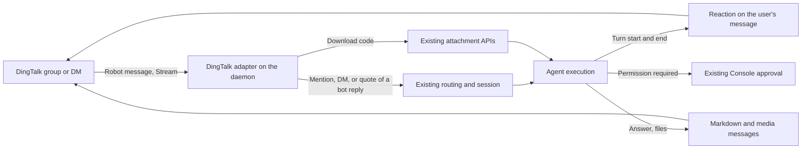

# DingTalk Integration Design

Status: Proposed (draft). Facts marked **measured** come from a live probe
against a test organization; facts marked **unverified** still need one.

> Related: [platform modules](integration-plugin-architecture.md),
> [Lark / Feishu](feishu-integration.md), [QQ](qq-integration.md),
> [inbound attachments](inbound-file-attachments.md),
> [product conventions](../product-conventions.md).

## 1. Goal and scope

Add a native `dingtalk` integration for the mainland DingTalk service. One bot
serves one agent. Members of a group mention the bot to start work; a direct
message to the bot is its own conversation. The Console offers the integration
on hosted and self-hosted deployments alike.

| Capability            | Initial scope and boundary                                                                                             |
| --------------------- | ---------------------------------------------------------------------------------------------------------------------- |
| Distribution          | Each organization creates its own enterprise internal app and pastes its credentials into the Console (§2).            |
| Ingress               | Daemon-owned Stream connection. No relay module and no public callback endpoint.                                       |
| Groups and DMs        | Explicit mentions in groups; every message in a DM. DingTalk delivers nothing else from a group.                       |
| Sessions              | Telegram's reply-chain model: a new mention starts a session; replying to a bot message continues it.                  |
| Streaming and replies | A thinking reaction on the user's message acknowledges the turn; the answer is one or more Markdown messages (§4.3).   |
| Attachments           | Inbound files and images through the robot download API; outbound images and files through media upload.               |
| Questions, approvals  | A numbered text card answered by replying to it; tool approvals stay in the Console with a notice in the conversation. |

Outside this scope: third-party (marketplace or distributed) apps, the
international DingTalk service, relay-terminated HTTP callbacks, sign-in with
DingTalk, membership-based permission sync, and one bot serving several agents.

## 2. Distribution model

DingTalk has three bot shapes. Only the **enterprise internal app robot** both
receives messages and supports DMs; a custom webhook robot only sends, and a
group-template robot has no DMs.

A one-click install needs a third-party enterprise app. DingTalk refuses to
create one — and likewise a third-party personal app — until the developer
organization has onboarded as a product solution provider (**measured**: the
developer console blocks creation). Marketplace listing then adds commercial
thresholds, and targeted distribution requires the service to run on Alibaba
Cloud. Neither fits v1, so v1 uses per-organization internal apps, the same
shape as the Lark / Feishu custom app and the QQ bot. §8 records what the
third-party path would change.

Credentials are the app's **Client ID** (formerly AppKey) and **Client Secret**.
They map onto the existing two secret slots exactly as Lark / Feishu does:
`botToken` ← Client Secret, `appToken` ← Client ID. For an internal app the
inbound `robotCode` equals the Client ID (**measured**), so no third value is
needed.

Validation exchanges the credentials for an access token
(`POST /v1.0/oauth2/accessToken`, 7,200-second lifetime); rejected credentials
answer HTTP 400 `invalidClientIdOrSecret`, which the Console shows as
`DINGTALK_CREDENTIALS_INVALID`, and an unreachable service is
`DINGTALK_CHECK_UNAVAILABLE`. The token exchange does not reveal the
organization, so the bot's external identity is the Client ID under the
tenantless sentinel, which keeps one bot per app. v1 needs no organization ID;
recording `chatbotCorpId` would need a new daemon report, and waits for a
feature that reads it.

## 3. Architecture

The daemon opens the Stream connection, receives robot messages, and owns every
outbound call, reaction, and attachment transfer. The Control Plane handles
installation, credentials, and configuration and stays off the message path.

The Stream handshake is `POST /v1.0/gateway/connections/open` with the Client ID
and Secret, which returns a WebSocket endpoint and a single-use ticket valid for
90 seconds. Frames are JSON with `type` `SYSTEM`, `EVENT`, or `CALLBACK`; the
client answers `ping` and acknowledges each frame by `messageId`. DingTalk
periodically sends a `disconnect` system frame to rebalance and closes ten
seconds later. The official Node SDK hard-codes the gateway host and uses a
legacy token endpoint, so the adapter carries its own small client.

### 3.1 One live connection per app

An app may hold up to 50 connections, and DingTalk sends each message to **one
randomly chosen connection** (**measured**: consecutive messages alternated
between two connections with no stickiness). Two daemons sharing one app would
split its traffic, so exactly one daemon may hold the integration's connection,
and duty failover must not let two daemons connect at once.

### 3.2 Robot messages are never redelivered

DingTalk pushes a robot message once. **Measured** in both modes:

- **Stream:** with no connection open, a DM was simply lost; it never arrived
  after reconnecting.
- **HTTP callback:** a 500 response, a response after five seconds, and no
  response at all each produced exactly one delivery, with none in the
  following five minutes.

A relay-terminated callback therefore moves the always-on requirement from the
daemon to the relay without removing it, which is why v1 keeps Stream. The
adapter minimizes the gap instead: on a `disconnect` frame it opens the
replacement connection before the old one closes, so a rebalance loses nothing;
a daemon restart or duty handover still drops messages sent during the gap.
User documentation says so, and the adapter deduplicates by `msgId` in case two
connections of the same daemon both deliver during a rebalance.

## 4. Behavior and invariants

### 4.1 Conversations, sessions, and identity

`conversationType` `1` is a DM and `2` a group. A group is keyed by its
`conversationId`, the `openConversationId` the group send API takes; a DM is
keyed `dm:<senderStaffId>`, because DM sends address user IDs, not the
conversation; the raw conversation ID stays in the normalized `msgId`
(`dingtalk:<conversationId>:<msgId>`). A group mention arrives with `isInAtList: true` and the bot removed from the text,
leaving a leading space the adapter trims.

DingTalk has no threads (the `openThreadId` field equals the conversation ID),
so sessions follow Telegram's reply-chain model for groups without topics
(`platforms/telegram/threading.ts`): a mention that quotes nothing starts a new
session rooted at that message, a quote of a recorded bot message continues
that message's session, a DM is one session, and a quote that resolves to
nothing starts a new session rather than guessing. Two things differ.

- **The key.** A quote arrives as `text.isReplyMsg: true` with
  `text.repliedMsg`. A send returns a `processQueryKey`, not the message ID, so
  the bot never learns the ID its own messages carry. A quote of a bot message
  brings that key back as `originalProcessQueryKey` (**measured**); the adapter
  records it for every reply it sends and resolves quotes by it.
- **The mention.** A group delivers only mentions, so a quote alone never
  reaches the bot. Replying to a message in a group quotes it and mentions its
  sender (**measured**), so replying to a bot message reaches the bot; the
  continue hint on a turn's last group message and the question card both just
  say to reply.

That rule is the default `createNew`
[session mode](channel-session-mode.md). A group row also offers `append`,
which puts every admitted message of the group into one long session. A DM is
one continuous session already and offers no mode, so the manifest declares
`appendKinds: ['channel']`, as Telegram, QQ, and Lark / Feishu do.

Identity is org-scoped: `senderStaffId` is the user ID within the organization
and `senderUnionId` is stable across organizations for the same developer.
`senderNick` is display-only; the adapter never merges people by name. Profiles
(`qyapi_get_member`) are optional enrichment.

### 4.2 Replies

Replies use the robot send APIs (`/v1.0/robot/groupMessages/send` and
`/v1.0/robot/oToMessages/batchSend`), not the per-message `sessionWebhook`,
which expires 90 minutes after the message (**measured**) and cannot send cards.
A send's `msgParam` is limited to 15,000 bytes. A plain message cannot be
edited, only recalled by its process query key.

### 4.3 Acknowledgement and Markdown

A turn is acknowledged by a reaction on the message that started it: DingTalk's
built-in "thinking" text emotion, added with
`POST /v1.0/robot/emotion/reply` at turn start and recalled with
`POST /v1.0/robot/emotion/recall` when the turn ends — completed, interrupted,
failed, or cut to run again. Both calls take the inbound `msgId` and
`conversationId`, so a DM's reaction is addressed by its raw conversation ID
(§4.1). DingTalk has no typing indicator, so the reaction stands in for one and
is withdrawn like one ([product conventions](../product-conventions.md)). It
appears in every output mode except `none`, and only on a message DingTalk
delivered: a turn another agent started gets none. It is best effort: a
refused or failed call logs one warning and never fails or delays the turn, and
a failure notice is posted as a message, since a reaction cannot carry one.

The answer goes out as one or more Markdown messages split under the size
limit. An AI card could show progress in place, but the adapter sends none: the
card renders Markdown poorly, and the plain Markdown message renders it well
(**measured** on the desktop client):

| Element                | AI card                           | Markdown message                              |
| ---------------------- | --------------------------------- | --------------------------------------------- |
| Headings               | Small bold text                   | Rendered                                      |
| Bullet and number list | Markers dropped                   | Rendered                                      |
| Fenced code            | Fence removed; content shown bold | Code block with copy button; language ignored |
| Table                  | Raw pipes; `---` becomes a dash   | Rendered after a blank line                   |
| `_italic_`             | Rendered                          | Underscores shown literally                   |
| Inline code            | Bold, not monospace               | Bold, not monospace                           |
| Spaces between styles  | Dropped                           | Dropped before a link                         |

A progress card beside that answer was redundant in live testing — each turn
left a finished-status card above the Markdown answer — and cost about 25 calls
per one-minute turn (§4.4). A DingTalk renderer rewrites `_x_` to `*x*`, turns
the space before a link or inline style into a no-break space (**unverified**
on every client), drops the fence language, and puts a blank line before a
table that directly follows a paragraph line, which DingTalk otherwise renders
as that paragraph's text (**measured**).

### 4.4 Quota

The organization's DingTalk edition caps usage, and the cap is low. The
developer console's current announcement lists:

| Edition            | Paid API calls per month | Webhook and Stream pushes per month |
| ------------------ | ------------------------ | ----------------------------------- |
| Standard / startup | 5,000                    | 3,000                               |
| Professional       | 500,000                  | 50,000                              |

A turn costs two reaction calls plus one send per message: the answer's parts
and, in `medium` and `high`, at most two intermediate messages. A streamed card
would cost far more (**measured**: 17 calls for 2,500 bytes, 43 for 8,000).
The API client maps the quota errors (`90020`,
`Forbidden.AccessDenied.ApiCountLimitForOrg`) and the per-app limit (`90018`,
`Forbidden.AccessDenied.QpsLimitForAppkeyAndApi`, 20 QPS per API) to a typed
limit error. A quota refusal of a send posts one plain-text notice per turn
that names the edition limit, instead of a generic delivery failure; a refused
reaction call is only logged. The Console setup guide states the limits up
front.

### 4.5 Attachments

Inbound images and files carry a `downloadCode`; `POST
/v1.0/robot/messageFiles/download` with the `robotCode` returns a short-lived
URL, and the existing attachment pipeline applies its size limit. In a group,
DingTalk delivers only mentions, so a file posted on its own never reaches the
bot; quoting the file in a mention delivers its `downloadCode` in
`repliedMsg` and the download works (**measured**). An image sent by DM did not
arrive during the probe; the cause is **unverified**. An inbound image is
fetched with the message; any other file reaches the agent through a
`readDingTalkFile` tool that downloads it on demand. Outbound images and files
upload through the media API (20 MB) and send as image or file messages. An
image message names its `media_id` as `photoURL`, which DingTalk documents but
which is **unverified** against a live app. Today only `shareFile`'s images use
this path.

### 4.6 Questions and approvals

Questions reuse `ElicitCardFacet` the way QQ does: a numbered text card,
answered by replying to it with a number or an option label. As in §4.1, the bot
never learns the card's `msgId`: the facet stores the card's send handle as its
`processQueryKey` and matches a quote's `originalProcessQueryKey` against it, so
ordinary chat and other quotes settle nothing. A sent message cannot be edited,
so a settlement is a new message — except when a reply in the chat answered the
card, since that reply already shows the choice. Tool approvals stay in the
Console, with a notice in the conversation.

## 5. Console setup

The wizard walks the organization admin through the developer console, with
the facts the probe hit (**measured**):

- The app name accepts letters and digits only — no spaces.
- The robot requires a message preview image.
- The message receive mode is Stream, the default.
- Adding the robot grants `qyapi_robot_sendmsg`, which includes the file
  download API; `qyapi_get_member` is optional. No card permission is needed.
- An internal app version publishes without review, and **every later
  configuration change takes effect only after a new version**; until then
  DingTalk keeps the previous behavior.
- The version's visibility decides who can find and message the bot.

## 6. Platform module work

The integration implements the four host contracts of the
[platform module design](integration-plugin-architecture.md): a daemon module
with its own Stream client and turn output, no relay module, a Control Plane
provider with credential validation and `learnTenant`, and a Console module.
The new `dingtalk` id follows the tolerant-reader rule: readers accept it a
release before writers emit it in `KNOWN_PLATFORMS`. The platform column is
text, so no migration is needed. Normalization lives in the message package.

## 7. Unverified and open

- **Sign-in with DingTalk.** A sign-in button that works for any DingTalk user
  needs a third-party app (§2). A per-organization internal app should support
  web OAuth for its own members, which would allow linking a signed-in user to
  their DingTalk identity, but not a sign-in button. Not probed.
- **Permission sync.** No API was found that lists the members of an ordinary
  group by `openConversationId`; the legacy chat API accepts only groups created
  through the API. Membership is likely observed (who has spoken) rather than
  authoritative, so a DingTalk group's visibility stays weaker than a channel
  with an enumerable roster. Not probed.
- Whether the reaction APIs need a permission beyond `qyapi_robot_sendmsg`; a
  refusal leaves turns without a reaction (§4.3).
- Why a DM image did not arrive (§4.5).
- The international service is a separate API stack; its gateway routes the
  card APIs, but nothing beyond that is checked.

## 8. Later: third-party app

A third-party app would give one-click install and could carry sign-in, at
these costs: product solution provider onboarding before any development;
marketplace thresholds or a reviewed distribution channel; Alibaba Cloud
deployment for the receiving service; and a server egress IP setting (a single
`*` is accepted). One app serves every installing organization, and DingTalk
picks a random connection per message, so ingress must move to one central
receiver that demultiplexes by `chatbotCorpId` — the relay — whichever
transport it uses. Organization activation events are documented over RDS or
SyncHTTP push only; whether they arrive over Stream is unverified.

## 9. Validation

Use sanitized fixtures for normalization and a mock service for the Stream
protocol, then a real internal app:

- Mentions, DMs, and quotes route to the right session; ambient group messages
  never arrive.
- Rebalance `disconnect` frames lose no message; duplicate `msgId`s are dropped.
- The thinking reaction goes on at turn start and comes off on finish, cancel,
  and failure, in groups and DMs; a refused reaction leaves the turn unaffected.
- The final Markdown splits under 15,000 bytes, and a table under a paragraph
  line renders as a table.
- Quota and rate-limit errors surface as the edition notice.
- Inbound files in DMs and through quotes; outbound images and files.

## 10. References

- Stream mode: [introduction](https://help.dingtalk.io/open/development/introduction-to-stream-mode.md), [protocol](https://github.com/open-dingtalk/developerpedia/blob/main/docs/learn/stream/protocol.md).
- Robots: [overview](https://help.dingtalk.io/open/development/robot-overview.md), [receiving messages](https://help.dingtalk.io/open/development/receive-message.md), [sending to groups](https://help.dingtalk.io/open/development/the-robot-sends-a-group-message.md), [message types](https://help.dingtalk.io/open/development/robot-message-type.md), [file download](https://help.dingtalk.io/open/development/download-the-file-content-of-the-robot-receiving-message.md).
- Cards, measured in §4.3: [streaming update](https://open.dingtalk.com/document/orgapp/api-streamingupdate), [create and deliver](https://open.dingtalk.com/document/orgapp/create-and-deliver-cards).
- Limits: [API throttling](https://help.dingtalk.io/open/development/api-throttling.md), [resource use](https://help.dingtalk.io/open/development/appendix-rational-use-of-resources.md).
- Third-party apps: [provider onboarding](https://help.dingtalk.io/open/development/isv-cooperation-guide.md), [event push configuration](https://help.dingtalk.io/open/development/basic-configuration.md).
