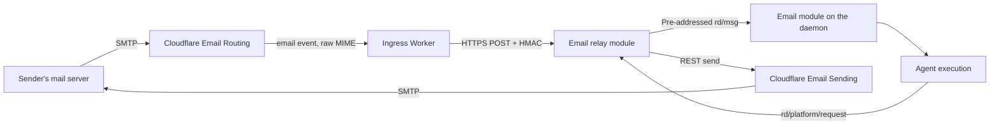

# Email Integration Design

Status: Proposed (draft). Provider facts come from Cloudflare's documentation as
of November 2026. Facts marked **measured** come from a probe Worker on a test
zone (§2.2); facts marked **unverified** still need one.

> Related: [platform modules](integration-plugin-architecture.md),
> [Microsoft Teams §8.5](teams-integration.md#85-egress-for-the-deployment-apps-rows)
> (the relay-egress precedent), [session visibility](session-visibility.md),
> [inbound attachments](inbound-file-attachments.md),
> [product conventions](../product-conventions.md).

## 1. Goal and scope

Give an agent an email address. A member of the agent's organization writes or
forwards mail to that address, the agent works on it, and its answer comes back
as a reply in the same thread. One address serves one agent.

The deployment operates the mail domain; an organization configures nothing but
the address's name. Mail is received and sent through Cloudflare Email Service,
on Cloud and on a self-hosted deployment alike (§7).

| Capability | First step                                                                                                                                                        |
| ---------- | ----------------------------------------------------------------------------------------------------------------------------------------------------------------- |
| Address    | One address per agent on the deployment's mail domain, named by an Agent editor, never reissued (§3).                                                             |
| Receiving  | Anyone can send to the address. Only authenticated mail from a member who may use the agent starts or continues work (§4).                                        |
| Sessions   | One mail thread is one session: a member's own thread in that member's direct conversation, a thread with several people in a group conversation of its own (§5). |
| Replies    | One reply per turn, sent when the turn ends, to the sender and the thread's other eligible members (§6).                                                          |
| Content    | Text and HTML bodies as text, up to a size cap. Attachments are named but not delivered (§5.4).                                                                   |
| History    | Earlier mail is read in full with the existing history tools, served from the daemon's session records; there is no second store (§5.6).                          |
| Approvals  | In the Console, as on a platform with no approval card.                                                                                                           |
| Setup      | Operator: one mail domain, one Worker, one API token (§7). Organization: pick the address in the agent's Integrations (§3.1).                                     |

Outside the first step, each with what it needs in §10: mail the agent starts on
its own, mail through the coordinator, senders outside the organization, an
organization's own domain, attachments, and mail between agents. Drafts,
labels, read state and a mailbox view in the Console are not planned: the
Console shows mail as sessions.

## 2. Architecture

Three properties decide this shape:

- **Mail bodies stay on the data plane.** The Worker hands the raw message to
  the relay, the relay parses it and forwards the normalized message to the
  owning daemon, and neither stores it. The Control Plane sees addresses and
  verdicts, never a subject or a body.
- **The sending credential never reaches a daemon.** One API token can send as
  any address on the mail domain, and a daemon can be enrolled by any member of
  an organization. The token stays on the relay, and a daemon sends through
  `rd/platform/request`, as a Teams row of the deployment's app does.
- **The relay keeps nothing durable.** What a daemon may send is carried by a
  signed ticket the relay issued with the inbound message (§6.2), so any relay
  can serve any call. Its only state is the in-memory counters of §6.3.

### 2.1 Provider facts

- Email Routing delivers each message to a Worker's `email` handler with the
  SMTP envelope sender and recipient, the header fields, and the raw message as
  a stream. Messages over 25 MiB are rejected before the Worker runs.
- A catch-all rule exists only on a zone's apex. A subdomain takes literal
  rules, at most 200 per domain. The mail domain is therefore a zone of its own
  whose every address reaches the Worker.
- The zone must use Cloudflare DNS and Cloudflare's MX records. A domain that
  already receives mail elsewhere cannot be onboarded.
- Before the Worker runs, Email Routing rejects mail that fails its sender
  domain's DMARC policy and mail that fails both SPF and DKIM, and it prepends
  an `Authentication-Results` header whose authserv-id is `mx.cloudflare.net`.
- `setReject(reason)` ends the SMTP exchange with a permanent error.
- Email Sending is in beta on the Workers Paid plan: 3,000 messages a month
  included, then a per-thousand price. A new account starts with a daily quota
  the documentation does not state.
- A message is sent by `POST /accounts/{account_id}/email/sending/send` with an
  API token. `In-Reply-To`, `References` and `Auto-Submitted` may be set;
  `Message-ID` may not, and Cloudflare generates it. At most 50 recipients and
  25 MiB a message.
- Cloudflare suppresses a recipient after a complaint or a hard bounce, and a
  send to a suppressed recipient is refused with an error. Delivery, bounce and
  complaint events are published to a Queue, with no webhook.

### 2.2 Measured

Twelve messages sent from one hosted mailbox to a probe Worker behind a test
zone's catch-all, November 2026. The Worker recorded the envelope, the header
fields and the size of each message, and ended the event a different way for
each of four addresses.

- **A rejection reaches the sender at once.** `setReject(reason)` came back to
  the sender within three seconds as `555 5.7.1 <reason>`, in its own
  provider's failure notice.
- **A Worker that fails is retried, not bounced.** For a Worker that threw and
  for one that never returned, the sender received no notice and its server
  delivered the message again, on its own backoff: five attempts in 106
  minutes for the first and four in 58 for the second, each running the Worker
  again. A failed event is therefore a temporary failure to the sender. Email
  Routing recorded the Worker that never returned as failed within a minute,
  so a Worker's answer has well under that long.
- **One message to two addresses runs the Worker twice**, once for each
  envelope recipient.
- **A subaddress arrives intact.** Mail to `<name>+<tag>` reached the catch-all
  with the tag in the envelope recipient.
- **The authentication header.** Each message carried one
  `Authentication-Results`, Cloudflare's, of this shape:
  `mx.cloudflare.net; dkim=pass header.d=<domain> header.s=<selector>
header.b=<prefix>; dmarc=pass header.from=<domain> policy.dmarc=<policy>;
spf=none (<comment>) smtp.helo=<host>; spf=pass (<comment>)
smtp.mailfrom=<address>; arc=pass`. It holds two `spf` results, one for the
  HELO name and one for the envelope sender. The pure check of §4 step 2
  accepts it.
- **A Worker's `headers` cannot show order.** The `Headers` object merges
  fields of one name and iterates them sorted, so which
  `Authentication-Results` is topmost can be read only from the raw message.
  The relay reads the raw message for exactly this.
- **A legitimate message can be refused before the Worker.** One of the twelve
  was rejected by Cloudflare's mail server with `550 Sender IP reverse lookup
rejected`, naming an address of the sender's own provider. It is a permanent
  error, so the sender got a failure notice at once, and the same message sent
  again was accepted. One in twelve says nothing about the rate, and nothing
  on our side can see or retry such a message.

## 3. The address

An address is `<name>@<mail domain>`. The name is 3 to 40 characters of
lower-case letters, digits, `.` and `-`, starting and ending with a letter or a
digit; matching ignores case. `<name>+<tag>` reaches the same agent, and the tag
is ignored.

- **Unique in the deployment.** On a shared deployment every organization draws
  from one namespace, so a name is first come, first served.
- **Reserved names.** Role names a correspondent would trust (`postmaster`,
  `abuse`, `admin`, `security`, `support`, `billing`, `noreply` and their
  like) cannot be taken.
- **Never reissued.** Removing the integration or deleting the agent retires
  the address for good. Mail still arrives for an old address long after it is
  gone, and a new holder would receive it. An agent that gets Email again takes
  a new name.

The address is the `Bot` row's `externalAppId`, stored lower-cased, and the
relay's demux key. The row's secret slot holds a fixed marker: there is no
per-address credential. A retired address stays in a deployment-wide table that
outlives its `Bot` row, which is the one schema addition.

### 3.1 Console

Email appears among an agent's integrations when the operator has configured it
(§7). Adding it asks for one thing, the name, shown beside the mail domain with
a live check that the name is free. The address is then shown with a copy
button. There is no credential to paste and nothing to install.

## 4. Who may write to an agent

Anyone on the internet can deliver to the address. A message starts or continues
a session only when all of the following hold. The relay checks 1, 2 and 4
itself before it forwards anything; the daemon checks 3 when it admits the
message:

1. **The message is not automatic.** A message with `Auto-Submitted` other than
   `no`, a `Precedence` of `bulk`, `list` or `junk`, a `List-Id` or
   `List-Unsubscribe` header, an empty envelope sender, or the deployment's own
   mail domain as its sender is accepted and discarded without an answer. This
   is what keeps two automatic responders from answering each other.
2. **The sender is authenticated.** The first `Authentication-Results` header
   must carry `mx.cloudflare.net` as its authserv-id and report `dmarc=pass`.
   Where the sender's domain publishes no DMARC record, a `dkim=pass` whose
   signing domain is the `From` domain or a parent of it is accepted instead.
   Anything else is refused. The envelope sender is never used to identify
   anyone. DMARC proves the domain, not the mailbox: the sender domain's own
   mail system is trusted for the local part, as it is for that domain's
   sign-in.
3. **The sender is a member who may use the agent.** The `From` address is a
   verified address of one member of the agent's organization, and the
   agent's visibility admits that member (everyone in the organization, or its
   list). An address no sign-in method stands behind is never matched, and one
   that an organization's own single sign-on connection asserts counts in that
   organization alone ([organization-sso.md](organization-sso.md)).
4. **The sender is within the rate limit.** Each address may start work on one
   agent 30 times an hour.

A message refused at step 2, 3 or 4 is rejected in the SMTP exchange with a
short reason, so the sender's own mail server tells them. The reason for step 3
is the same whether the address is unknown, belongs to another organization, or
is not on the agent's list: "This address accepts mail from members of its
organization." The agent sends no mail of its own to a sender it refused.

The daemon makes the step 3 decision by asking the Control Plane, as it asks
whether a chat member is an Agent editor: one question per agent and address,
an allowed answer reused for two minutes and a refusal for thirty seconds. When
the Control Plane cannot be asked, the message is not admitted and the relay
answers for a retry (§5.5), which mail's own redelivery absorbs.

Step 3 is a new identity rule and a narrow one. Elsewhere a matching email
address grants nothing, because a chat account and a console account are two
identities that merely share a string. Here the address is the platform
identity itself, proven for each message by step 2, and it is matched only
against an email a sign-in method stands behind.

The Control Plane records what the account's linked sign-in methods say about
its addresses, and step 3 reads nothing else. A person often signs in with one
address and mails from another, so every address a linked method reports
counts, not only the account's stored one. Four kinds of evidence count, and no
other:

- **A social sign-in method** linked to the account reports the address as the
  account's own, which such a method does only for an address its provider
  verified ([organization-sso.md](organization-sso.md) §4.3). The address then
  counts in every organization the account belongs to, until the method is
  unlinked.
- **A linked Microsoft identity** reports the address, and its domain is one the
  organization has verified now. Microsoft's work and school accounts carry the
  address their own tenant set, and anyone can create a tenant, so the address
  proves no mailbox by itself; the organization's verified domain does.
- **The organization's own single sign-on connection** asserts the address,
  the connection is active, and the address's domain is one that organization
  has verified now. It counts in that organization and in no other. The organization proved it controls the
  domain, and it chose the provider that signs that domain's addresses in, so
  for its own agents it answers for both ends: the mailbox step 2 proves and
  the sign-in that names the member. Another organization the same account
  belongs to made neither choice, so the address is unproven there. What this
  accepts is the organization's own risk of
  [organization-sso.md](organization-sso.md) §4.1: a provider that lets its
  people set their own address lets one of them be read as a colleague on the
  same domain. A draft connection never counts, and deactivating or removing
  the connection or releasing the domain ends the match at once, because all
  three are read when the question is asked.
- **The deployment's own connector**, where the deployment has one instead of
  organization connections, asserts the address and is an OIDC connector that
  does not trust unverified addresses, so only an address its provider marks
  verified reaches the account. It counts in every organization. With that
  setting on it never counts, and neither does a SAML connector, whose
  assertion carries no such mark.

An address two members of the organization both hold names neither of them,
and the mail is refused. An invited or directory-provisioned account nobody has
signed in to, a service account and a suspended membership never match. The evidence is read from the
identity service each time a Control Plane process first resolves the account's
sign-in, and again at a sign-in through a connector new to that process;
evidence that is gone is dropped then. Where the Control Plane cannot read the
identity service's accounts, nothing is recorded and nobody is matched.

Mail is a platform that names its people, so
"[What people can do in chat](../product-conventions.md#what-people-can-do-in-chat)"
applies console permissions. The first step has no approval card or settings
command in mail, so every level behaves as **Talk to the agent**: an approval
goes to the agent's editors in the Console.

## 5. Conversations and sessions

### 5.1 Threads

One mail thread is one session. The daemon resolves a message's thread key
from the messages it already knows: it walks `References` from the newest ID
to the oldest, then `In-Reply-To`, and takes the thread of the first ID it has
received or sent whose conversation this message may continue (§5.2). When it
knows none, the key is the first ID in `References`; without `References` it is
the `In-Reply-To` ID; without either it is the message's own `Message-ID`, and
the message starts a thread. A message with no `Message-ID` is refused at
step 2 of §4, since nothing could reply to it.

Resolving to the nearest known message, not always to the root, is what lets a
thread that split off continue: a message the fence of §5.2 turned into a
thread of its own is the nearest known message of every reply to it, so those
replies reach it and do not fall back on the thread it left.

The agent's replies carry the `References` chain of the message they answer, so
a reply to the agent names a message the daemon knows. The agent's own
`Message-ID` is generated by Cloudflare, and the daemon records it with the
thread it belongs to (§5.6), which also covers a mail client that sends only
`In-Reply-To`. Whether the send call returns that ID is **unverified**; if it
does not, a reply that names nothing else the daemon knows starts a new
session.

### 5.2 Conversations

The conversation a message belongs to is read from the message itself. Its
**participants** are its sender and every `To` and `Cc` address other than the
agent's own.

| Participants                     | Conversation          | Kind       | Session key                         |
| -------------------------------- | --------------------- | ---------- | ----------------------------------- |
| The sender alone                 | `dm:<sender address>` | a 1:1 DM   | the conversation and the thread key |
| The sender and at least one more | `group:<thread key>`  | a group DM | the conversation                    |

So a member's own threads all sit in that member's direct conversation, one
session a thread, as a direct conversation keyed by person does on every other
platform, and a thread several people are on is a small private room of its
own. The manifest takes the conservative arm of every axis and adds
`dmChannelPattern: /^dm:/`. A message that reached the address is addressed to
the agent wherever the address appears (`To`, `Cc` or `Bcc`), and no place is
switched on or off, because admission is by person (§4).

The existing rules then apply with nothing written for mail:

- **Memory.** A direct conversation reads and writes its member's person
  layer, keyed by the console account the member answer of §4 names. A group
  conversation has a place layer of its own, and nobody's person layer is
  injected there
  ([product conventions](../product-conventions.md#memory-layers)).
- **A turn nobody typed.** The person of `dm:<address>` is that address's
  member, read from the key.
- **Reading elsewhere.** A history read, `recall` and every other read are
  judged by who is asking
  ([product conventions](../product-conventions.md#reading-other-conversations)).
  In a member's direct conversation that is the member. In a group conversation
  it is the sender of the turn's message, and bringing something of theirs into
  the thread is their call, as in a group DM anywhere. The listing of a
  person's other direct conversations is offered only in their own.

**No conversation changes kind.** A message in a member's own thread that names
another recipient is, by the table, a message of `group:<thread key>`: it opens
that group conversation's session, which starts from this message and the
history quoted in it. The member's direct session is not continued, and none of
its context is carried over. A reply that drops the other recipients goes back
to the member's direct conversation. A group conversation that gains a
recipient stays the same conversation, as a group chat that gains a member
does.

**The participant fence.** A thread key is not a secret, and anyone can write
one into a header. A group conversation's **current members** are the
participants of its latest admitted message, and a message continues the
conversation only when its sender is one of them and the member who opened it
is among the message's participants. Any other message is read as starting a
thread of its own, keyed by its own `Message-ID`: one from an address the
thread never named, one from someone since taken off it, whose reply would
otherwise be written with messages they were never sent, and one that leaves
the opener off, which would otherwise land in a session and a place layer whose
only Console reader never received it. A current member brings someone back by
naming them on a message. A direct conversation needs no fence: its key is the
authenticated sender.

Mail never runs a coordinator. A new thread opens its session directly, for an
assistant-mode agent too: the manifest lists no kind in `appendKinds`, so no
row is put on `auto` and assistant mode has no place to force onto one session.
§10 says what routing mail through the coordinator would take.

### 5.3 Visibility

A session of a direct conversation is `private` to its member and owned as
`user:<member>`, the rule an install-bound sender already follows
([session-visibility.md §4.2](session-visibility.md#42-default-rules)). The
Control Plane provider's `dmOwnerMember` resolves the member from the address
at ingest. No match, or a failed read, leaves the row private to the address,
visible to no one, never `org`.

A session of a group conversation is `private` to the member whose message
opened it, which is a new default row for mail: the general rule would make a
group conversation `org`, and a mail thread among three people is not the
organization's. Every message of the session reached that member (§5.2), and
the other participants have the messages they were sent and continue the
thread by mail; they do not gain the session, or its place layer, in the
Console.

Two things are accepted for the first step. Session visibility's rule that a
shared conversation never takes one initiator as its access owner is set aside
here: following it needs the Control Plane to know the thread's participants,
which the first step keeps on the daemon. And a recipient someone adds to a
group thread receives replies written with the thread's earlier context, as a
person added to a group chat reads on from what was said; adding them was a
participant's call.

### 5.4 What the agent reads

The agent receives a header block (`From`, `To`, `Cc`, `Subject`, `Date`) and
the body. The text part is used when there is one; an HTML-only message is
converted to text. The body is cut at 64 KiB with a visible marker, which keeps
a normalized message inside one relay frame. Quoted history and forwarded
content are kept as written, because a forwarded message is often the whole
point; the cost of repeating a long thread's quotes is accepted for the first
step.

Attachments are not delivered in the first step. Each one is named in the
prompt with its type and size and the words "not delivered", so the agent can
say what it could not read.

Everything in a message is the sender's content: the member's own words carry
the authority a chat message from them would, and text they forwarded is data
the agent reads, not instructions from its author.

### 5.5 Admission and redelivery

The relay answers the Worker from its own checks (§4 steps 1, 2 and 4) and,
for a message that passes them, from the verdict `forwardStrict` returns:

| Verdict                                        | Relay answers | Worker does                             |
| ---------------------------------------------- | ------------- | --------------------------------------- |
| Admitted, a settled duplicate, or §4 step 1    | 200           | Returns; the message is accepted.       |
| Refused at §4 step 2, 3 or 4, or no such agent | 200 + reason  | `setReject(reason)`.                    |
| Retryable refusal or timeout                   | 503           | Fails the event, for a later redelivery |

A failed event makes the sender's server retry, on its own schedule, for as
long as it keeps trying (**measured**, §2.2). Each retry runs the Worker and
the relay again, which is what the dedup below is for. The relay answers
within 10 seconds, since a Worker that waits a minute is already recorded as
failed.

The dedup identity is the bot and the `Message-ID`, in the relay's table and in
the daemon's durable receipt, so a redelivered message never starts a second
turn.

### 5.6 Earlier mail

A new thread is a new session, and the provider keeps no mail to read back.
What the agent received and sent is nevertheless already kept: every admitted
message is a turn of its session and every reply is that turn's answer, in the
daemon's session records.

The mail module serves the daemon platform contract's two history reads from
those records, where another platform's module calls its provider:

- `getChannelHistory` of a conversation returns the first message of each of
  its threads, newest first, each with its header block, its thread key and
  the number of messages after it. For `dm:<address>` that is the list of what
  this member and the agent have written to each other.
- `getThreadReplies` returns one thread's messages in full, received and sent,
  oldest first, and only those of the conversation it names. One thread key
  can run through a member's direct conversation and a group conversation
  (§5.2), and core calls this read itself to recover a thread's context, so a
  read keyed by thread alone would hand a group session the member's private
  messages of the same thread.

The agent therefore reads earlier mail with the `getChannelHistory` and
`getThreadHistory` tools it already has on other platforms, under their
existing rule: a member's direct conversation is readable when that member is
asking, and a group conversation when the person asking is one of its current
members, the same list the fence of §5.2 uses. Someone taken off a thread stops
being able to read it, as someone removed from a group chat does, and is never
handed messages sent after they left. No second store, no mail-specific tool
and no second read rule is added, and `recall` is unchanged.

How the two reads map onto the daemon's session records, on both of its store
backends, is to be confirmed in the build (§9).

The daemon keeps one small index beside the sessions: for each message it
received or sent, the message ID and the thread and conversation it belongs
to, and for a sent message the delivery outcome. It is what §5.1 resolves a
thread from, and it marks a reply undelivered. On a self-hosted deployment both
stay with the daemon that wrote them, as session records do.

Nothing is moved, flagged or deleted as in a mailbox, and incoming mail does
not wait to be picked up: each message starts or continues a session on
arrival.

## 6. Replies

### 6.1 What is sent

A turn sends one message when it ends: no progress mail, no acknowledgement, no
edit. A turn that fails sends its failure as that message. A question the agent
asks is the text of its reply, and the member's answer is the next message of
the thread.

- **From** is the agent's address, with the agent's name as the display name.
- **To** is the sender of the message the turn answers. In a group
  conversation **Cc** is every other address on that message that is itself an
  eligible member (§4 step 3), asked of the Control Plane in one batch.
  Addresses outside the organization are left off, and the prompt tells the
  agent which ones, so its reply can say who did not receive it. When the
  Control Plane cannot be asked as the turn ends, the reply goes to the sender
  alone and the session records that the others were left off.
- **Subject** is the thread's subject with a single `Re:`.
- **In-Reply-To** is the answered message's ID, and **References** is its chain
  with that ID appended, cut from the front past 50 entries.
- **Auto-Submitted** is `auto-replied`, so automatic responders stay silent.
- The body is the agent's Markdown as plain text and as simple HTML.

A send the provider refuses (a suppressed recipient, quota, a malformed
address) fails the delivery, not the turn: the answer stays in the Console's
session, marked undelivered with the provider's reason.

### 6.2 The relay's fence

When the relay forwards an inbound message it adds a ticket:
`e1.<thread key>.<issued at>.<HMAC over the version, the bot, the thread key,
the issue time and the sorted set of the message's sender and recipients>`. The
key is derived from the Control Plane's pepper by a domain-separated HMAC, as
the Teams ticket key is. The daemon keeps the latest ticket of each thread
beside the session.

The daemon sends `rd/platform/request` with `{ platformId: 'email', botId,
payload }`, where the payload names the ticket, the recipients, the subject,
the two threading headers and the body. The relay checks:

1. the socket's daemon is a member of the bot's assignment;
2. the ticket's MAC holds for this bot and the recipient set the request
   restates, and every `To` and `Cc` of the send is in that set;
3. the send is within the budgets of §6.3.

It then builds the provider call itself: the `From` address is the
assignment's, never the request's. A compromised daemon can therefore write
only as its own agents, and only to people already on a thread that reached
them.

One budget of 12 seconds covers the call and a single retry; the daemon waits 15. `refused` and `unavailable` mean the provider was never called and are
retried as unsent; a send cut off by the budget may have landed and is never
repeated, as with a Teams post.

### 6.3 Counters and budgets

The relay's counters are in memory, one set per relay instance, and are lost
on a restart. With several instances a limit is therefore approximate: at most
the stated number on each.

| Counter                     | Limit                             | On exceeding it                 |
| --------------------------- | --------------------------------- | ------------------------------- |
| Dedup of `Message-ID`       | the relay's shared, bounded table | the duplicate is settled (§5.5) |
| Inbound, per sender and bot | 30 an hour (§4 step 4)            | the message is rejected         |
| Sends, per bot              | 200 a day                         | the send is refused             |
| Sends, per organization     | 1,000 a day                       | the send is refused             |
| Sends, whole deployment     | the operator's figure in Setup    | the send is refused             |

One Cloudflare account, with one daily quota, sends for every organization on
a shared deployment, so the per-organization budget is what keeps one
organization from spending the rest's. The provider's own quota remains the
hard stop behind all three. The daemon's durable receipt, not the relay's
table, is what finally keeps a redelivered message from starting a second
turn.

### 6.4 When the Control Plane is unreachable

In [high-availability.md](high-availability.md)'s terms, mail admission and a
group reply's recipients each need a Control Plane answer, and neither is
served from the data plane alone:

- **A new sender, or one whose answer is older than two minutes**: not
  admitted, and the relay answers for a retry (§5.5). A thread already running
  therefore stops taking new mail two minutes into an outage and resumes when
  it ends; no message is refused for good.
- **A turn that ends during an outage**: its reply is sent to the sender alone
  (§6.1). A direct conversation's reply never asks.
- **Sending** needs no Control Plane call: the relay serves from its last
  snapshot, as for Teams.

## 7. Operator setup

**Setup → Email** holds the mail domain, the Cloudflare account ID, an API
token that may send (write-only), and an ingress secret Setup generates. Email
is offered in the Console once all four are present. The Control Plane's
deployment snapshot carries them to the relay.

The operator does three things in Cloudflare:

1. Onboards a zone used for nothing else as the mail domain, for routing and
   for sending. Cloudflare adds the MX, SPF, DKIM and DMARC records.
2. Deploys the ingress Worker shipped in this repository, configured with the
   relay's public URL and the ingress secret, and points the zone's catch-all
   rule at it.
3. Creates the API token and pastes it into Setup, which checks it before
   saving.

The Worker reads the raw message, posts it to the relay's `POST /email/inbound`
with the envelope sender and recipient, the message's full size and an HMAC
over the body and a timestamp, and applies the relay's answer (§5.5). It sends
at most the first 1 MiB of the message: the first step delivers 64 KiB of text
and no attachment, and the relay must hold the whole body before it can check
the HMAC, on an ingress every platform shares. A message cut this way is
parsed as far as it goes, and the prompt says it was cut. The Worker parses
nothing and holds no other configuration. The relay verifies the HMAC within a five-minute window
before it reads anything else, then finds the bot by the envelope recipient. A
recipient no bot holds is rejected as an unknown address.

A self-hosted deployment follows the same steps with its own Cloudflare account
and a domain it dedicates to agent mail. It cannot use a domain that already
receives the company's mail (§2.1). Each deployment needs a domain of its own,
a test environment included: one catch-all feeds one relay, and two deployments
on one domain would share its names and its sending reputation.

## 8. Platform module work

The integration implements the four host contracts of the
[platform module design](integration-plugin-architecture.md) plus one registry
line per host:

- **Relay**: the inbound route with its own raw-buffer parser and a 1 MiB
  limit, HMAC verification, MIME parsing, the checks of §4 steps 1, 2 and 4,
  `forwardStrict`, ticket minting, the counters of §6.3,
  `deploymentAssignments` from the snapshot, and `daemonRequest` for the send.
- **Daemon**: no connection of its own; the conversation and thread keys and
  the participant fence (§5.2), the member question (§4), final-only turn
  output through the relay transport, the two history reads over session
  records, and the message index (§5.6).
- **Control Plane**: the provider with name validation, the retired-address
  table, the record of a verified sign-in email, `dmOwnerMember`, the group
  conversation's visibility row, the member answer for one address or a batch,
  and a spec that names `email-v1` in `requires` so an older daemon never
  receives one.
- **Console**: the one-field add flow, the address display, and the mark.

Normalization lives in the message package with sanitized fixtures. The new
platform id follows the tolerant-reader rule: readers accept it a release
before writers emit it. The relay route is added to the chart's HTTPRoute in
the same change. The ingress Worker is a new, small workspace package with no
runtime dependency.

The build also owes two records outside this document: entries in
`.oss-scanner/threat_model.md` for the new public route, the relay-held sending
token and the address-to-member rule, and the mail rows of product conventions'
session access and memory layer tables.

Accepted: on a shared deployment the name check of §3.1 and the unknown-address
rejection of §7 both reveal which names other organizations hold. A name is
half of a public address, and the agent behind it answers nobody outside its
organization.

## 9. Unverified and open

- That the raw message the Worker receives carries Cloudflare's
  `Authentication-Results` as its topmost header of that name. The whole
  sender check of §4 step 2 rests on it, and a Worker's `headers` cannot show
  it (§2.2); the test is a message sent with an `Authentication-Results` of its
  own.
- How often Cloudflare refuses a legitimate message on the sender's reverse
  lookup before the Worker runs (§2.2), and whether anything configures it. A
  member whose mail is refused this way gets a notice the product did not
  write.
- How long a Worker may wait on the relay before the event is failed.
- Whether the send call returns the generated `Message-ID` (§5.1), and how mail
  clients thread a reply whose `Message-ID` domain differs from its `From`
  domain.
- The exact `Authentication-Results` text for a domain with no DMARC record.
- The starting daily sending quota, and how fast it grows.
- Whether the first step should cut quoted history from a follow-up (§5.4).
- That the daemon's session records hold each message and reply whole and can
  be listed by conversation and thread on both store backends, which the
  history reads of §5.6 rest on.

## 10. Later

- **Mail the agent starts.** A tool that sends a new message, for a schedule's
  report or a hand-off. It needs its own fence at the relay, since no inbound
  ticket exists: recipients limited to eligible members by a Control Plane
  answer the relay can verify. Such a message belongs to no mail session, so
  it is kept whole beside the message index and served by the same history
  reads, and a reply to it opens a session that begins with it.
- **Mail through the coordinator.** Each member's correspondence becomes a
  private place with a coordinator, which hands a new thread to an open task
  or opens one. The place is already keyed by member (§5.2); it needs `im` in
  the manifest's `appendKinds` and a ticket per member, since a coordinator's
  root post is a new message to that member.
- **Senders outside the organization.** A per-agent choice that lifts §4
  step 3. It needs a decision on who owns such a session, a tighter rate
  limit, and a reply path that is safe to open to strangers.
- **An organization's own domain.** A paid-plan feature. An organization will
  usually offer a subdomain of the domain its people already use, which
  Cloudflare cannot take as described in §2.1: it routes only zones in the
  deployment's own account, and a subdomain there has no catch-all. This step
  therefore needs either a mail provider that accepts another party's
  subdomain by its MX and DKIM records, or the organization's own mail system
  forwarding to the agent's address. The relay's inbound route already takes a
  raw message and an envelope from any front end, so only the Worker and the
  send call are provider-specific.
- **Attachments.** Inbound over the chunked path the Console upload uses, into
  the session's `uploads/` directory; outbound from agent-authored files.
- **Mail between agents.** Excluded today by §4 step 1, which is also what
  prevents a loop.
- **Delivery events.** Reading the provider's bounce and complaint Queue to
  mark a reply undelivered after the fact.

## 11. Validation

- Unit: thread-key derivation over `References`, `In-Reply-To` and neither; the
  participant fence; `Authentication-Results` parsing, including a forged
  second header and a foreign authserv-id; the automatic-mail filter; name
  validation and reserved names; ticket minting and every refusal of §6.2; the
  conversation a message falls in by its participants, a member's thread that
  gains a recipient opening a group session with nothing carried over, the
  memory layer of each kind, the two history reads and who may make them, and
  the counters of §6.3.
- Relay: the inbound route's HMAC window, an unknown recipient, each row of the
  §5.5 table, and dedup of a redelivered `Message-ID`.
- Control Plane: an address is never reissued; the member answer for a member,
  a member not on a restricted agent's list, another organization's member, a
  member whose sign-in email is unverified and an unknown address; session
  ownership at ingest for both kinds.
- Live, before release: a round trip from two common mail services, a reply
  that threads in each, a spoofed sender refused, an out-of-office answer that
  starts nothing, and each item of §9.

## 12. References

- Cloudflare Email Service documentation: Email Routing, Email Workers runtime
  API, Email Sending REST API, headers, limits, suppressions, postmaster.
- RFC 5322 (message format and threading headers), RFC 3834 (automatic
  responses), RFC 7489 (DMARC), RFC 8601 (`Authentication-Results`), RFC 5233
  (subaddressing).
