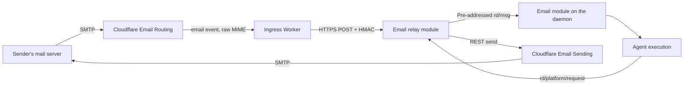

# Email Integration Design

Status: Proposed (draft). Provider facts come from Cloudflare's documentation as
of November 2026. Facts marked **unverified** still need a live probe; nothing
here is measured yet.

> Related: [platform modules](integration-plugin-architecture.md),
> [Microsoft Teams §8.5](teams-integration.md#85-egress-for-the-deployment-apps-rows)
> (the relay-egress precedent), [session visibility](session-visibility.md),
> [inbound attachments](inbound-file-attachments.md),
> [product conventions](../product-conventions.md).

## 1. Goal and scope

Give an agent an email address. A member of the agent's organization writes or
forwards mail to that address, the agent works on it, and its answer comes back
as a reply in the same thread. One address serves one agent.

The deployment operates the mail domain; an organization configures nothing but
the address's name. Mail is received and sent through Cloudflare Email Service,
on Cloud and on a self-hosted deployment alike (§7).

| Capability | First step                                                                                                                    |
| ---------- | ----------------------------------------------------------------------------------------------------------------------------- |
| Address    | One address per agent on the deployment's mail domain, named by an Agent editor, never reissued (§3).                         |
| Receiving  | Anyone can send to the address. Only authenticated mail from a member who may use the agent starts or continues work (§4).    |
| Sessions   | One mail thread is one session, private to the member who started it (§5).                                                    |
| Replies    | One reply per turn, sent when the turn ends, to the sender and the thread's other eligible members (§6).                      |
| Content    | Text and HTML bodies as text, up to a size cap. Attachments are named but not delivered (§5.3).                               |
| History    | Every message received and sent is kept as the agent's Inbox and Sent, which it searches and reads with two tools (§5.5).     |
| Approvals  | In the Console, as on a platform with no approval card.                                                                       |
| Setup      | Operator: one mail domain, one Worker, one API token (§7). Organization: pick the address in the agent's Integrations (§3.1). |

Outside the first step, each with what it needs in §10: mail the agent starts on
its own, mail through the coordinator, senders outside the organization, an
organization's own domain, attachments, and mail between agents. Drafts,
labels, read state and a mailbox view in the Console are not planned: the
Console shows mail as sessions.

## 2. Architecture

Three properties decide this shape:

- **Mail bodies stay on the data plane.** The Worker hands the raw message to
  the relay, the relay parses it and forwards the normalized message to the
  owning daemon, and neither stores it. The Control Plane sees addresses and
  verdicts, never a subject or a body.
- **The sending credential never reaches a daemon.** One API token can send as
  any address on the mail domain, and a daemon can be enrolled by any member of
  an organization. The token stays on the relay, and a daemon sends through
  `rd/platform/request`, as a Teams row of the deployment's app does.
- **The relay holds no state.** What a daemon may send is carried by a signed
  ticket the relay issued with the inbound message (§6.2), so any relay can
  serve any call.

### 2.1 Provider facts

- Email Routing delivers each message to a Worker's `email` handler with the
  SMTP envelope sender and recipient, the header fields, and the raw message as
  a stream. Messages over 25 MiB are rejected before the Worker runs.
- A catch-all rule exists only on a zone's apex. A subdomain takes literal
  rules, at most 200 per domain. The mail domain is therefore a zone of its own
  whose every address reaches the Worker.
- The zone must use Cloudflare DNS and Cloudflare's MX records. A domain that
  already receives mail elsewhere cannot be onboarded.
- Before the Worker runs, Email Routing rejects mail that fails its sender
  domain's DMARC policy and mail that fails both SPF and DKIM, and it prepends
  an `Authentication-Results` header whose authserv-id is `mx.cloudflare.net`.
- `setReject(reason)` ends the SMTP exchange with a permanent error. What the
  sender's server sees when a Worker throws or times out is **unverified**.
- Email Sending is in beta on the Workers Paid plan: 3,000 messages a month
  included, then a per-thousand price. A new account starts with a daily quota
  the documentation does not state.
- A message is sent by `POST /accounts/{account_id}/email/sending/send` with an
  API token. `In-Reply-To`, `References` and `Auto-Submitted` may be set;
  `Message-ID` may not, and Cloudflare generates it. At most 50 recipients and
  25 MiB a message.
- Cloudflare suppresses a recipient after a complaint or a hard bounce, and a
  send to a suppressed recipient is refused with an error. Delivery, bounce and
  complaint events are published to a Queue, with no webhook.

## 3. The address

An address is `<name>@<mail domain>`. The name is 3 to 40 characters of
lower-case letters, digits, `.` and `-`, starting and ending with a letter or a
digit; matching ignores case. `<name>+<tag>` reaches the same agent, and the tag
is ignored.

- **Unique in the deployment.** On a shared deployment every organization draws
  from one namespace, so a name is first come, first served.
- **Reserved names.** Role names a correspondent would trust (`postmaster`,
  `abuse`, `admin`, `security`, `support`, `billing`, `noreply` and their
  like) cannot be taken.
- **Never reissued.** Removing the integration or deleting the agent retires
  the address for good. Mail still arrives for an old address long after it is
  gone, and a new holder would receive it. An agent that gets Email again takes
  a new name.

The address is the `Bot` row's `externalAppId`, stored lower-cased, and the
relay's demux key. The row's secret slot holds a fixed marker: there is no
per-address credential. A retired address stays in a deployment-wide table that
outlives its `Bot` row, which is the one schema addition.

### 3.1 Console

Email appears among an agent's integrations when the operator has configured it
(§7). Adding it asks for one thing, the name, shown beside the mail domain with
a live check that the name is free. The address is then shown with a copy
button. There is no credential to paste and nothing to install.

## 4. Who may write to an agent

Anyone on the internet can deliver to the address. A message starts or continues
a session only when all of the following hold, checked in this order:

1. **The message is not automatic.** A message with `Auto-Submitted` other than
   `no`, a `Precedence` of `bulk`, `list` or `junk`, a `List-Id` or
   `List-Unsubscribe` header, an empty envelope sender, or the deployment's own
   mail domain as its sender is accepted and discarded without an answer. This
   is what keeps two automatic responders from answering each other.
2. **The sender is authenticated.** The first `Authentication-Results` header
   must carry `mx.cloudflare.net` as its authserv-id and report `dmarc=pass`.
   Where the sender's domain publishes no DMARC record, a `dkim=pass` whose
   signing domain is the `From` domain or a parent of it is accepted instead.
   Anything else is refused. The envelope sender is never used to identify
   anyone.
3. **The sender is a member who may use the agent.** The `From` address is the
   sign-in email of a member of the agent's organization, and the agent's
   visibility admits that member (everyone in the organization, or its list).
4. **The sender is within the rate limit.** Each address may start work on one
   agent 30 times an hour.

A message refused at step 2, 3 or 4 is rejected in the SMTP exchange with a
short reason, so the sender's own mail server tells them. The reason for step 3
is the same whether the address is unknown, belongs to another organization, or
is not on the agent's list: "This address accepts mail from members of its
organization." The agent sends no mail of its own to a sender it refused.

The daemon makes the step 3 decision by asking the Control Plane, as it asks
whether a chat member is an Agent editor: one question per agent and address,
an allowed answer reused for two minutes and a refusal for thirty seconds. When
the Control Plane cannot be asked, the message is not admitted and the relay
answers for a retry (§5.4), which mail's own redelivery absorbs.

Mail is a platform that names its people, so
"[What people can do in chat](../product-conventions.md#what-people-can-do-in-chat)"
applies console permissions. The first step has no approval card or settings
command in mail, so every level behaves as **Talk to the agent**: an approval
goes to the agent's editors in the Console.

## 5. Conversations and sessions

### 5.1 Threads

One mail thread is one session. The thread key is the first message ID in
`References`; without `References` it is the `In-Reply-To` ID; without either
it is the message's own `Message-ID`, and the message starts a thread. A message
with no `Message-ID` is refused at step 2 of §4, since nothing could reply to
it.

A thread key is not a secret, and anyone can write one into a header. A message
therefore continues a session only when its sender is already a participant of
that thread: the member who started it, or an address that member or the agent
wrote to within it. From anyone else it starts a new session, even when its
headers name an existing thread.

The agent's replies carry the `References` chain of the message they answer, so
a reply to the agent keeps the thread key. The agent's own `Message-ID` is
generated by Cloudflare. A mail client that sends only `In-Reply-To` when
replying to the agent names that generated ID, so the daemon resolves it to the thread through its Sent record (§5.5).
Whether the send call returns that ID is **unverified**; if it does not, such a
reply starts a new session.

The conversation coordinates are a fixed channel, `inbox`, and the thread key.
The manifest takes the conservative arm of every axis and adds
`dmChannelPattern: /^inbox$/`: every thread is a direct conversation, a message
that reached the address is addressed to the agent wherever the address appears
(`To`, `Cc` or `Bcc`), and no place is switched on or off, because admission is
by person (§4).

Mail never runs a coordinator. A new thread opens its session directly, for an
assistant-mode agent too: the manifest lists no kind in `appendKinds`, so no
row is put on `auto` and assistant mode has no place to force onto one session.
§10 says what routing mail through the coordinator would take.

### 5.2 Visibility

A session is `private` to the member who started the thread and is owned as
`user:<member>`, the rule an install-bound sender already follows
([session-visibility.md §4.2](session-visibility.md#42-default-rules)). The
Control Plane provider's `dmOwnerMember` resolves the member from the sender's
address at ingest. No match, or a failed read, leaves the row private to the
sender's address, visible to no one, never `org`. Another member who joins the
thread may continue it by mail but does not gain the session in the Console.

### 5.3 What the agent reads

The agent receives a header block (`From`, `To`, `Cc`, `Subject`, `Date`) and
the body. The text part is used when there is one; an HTML-only message is
converted to text. The body is cut at 64 KiB with a visible marker, which keeps
a normalized message inside one relay frame. Quoted history and forwarded
content are kept as written, because a forwarded message is often the whole
point; the cost of repeating a long thread's quotes is accepted for the first
step.

Attachments are not delivered in the first step. Each one is named in the
prompt with its type and size and the words "not delivered", so the agent can
say what it could not read.

Everything in a message is the sender's content: the member's own words carry
the authority a chat message from them would, and text they forwarded is data
the agent reads, not instructions from its author.

### 5.4 Admission and redelivery

The relay forwards with `forwardStrict` and answers the Worker from the
daemon's verdict:

| Verdict                                        | Relay answers | Worker does                             |
| ---------------------------------------------- | ------------- | --------------------------------------- |
| Admitted, a settled duplicate, or §4 step 1    | 200           | Returns; the message is accepted.       |
| Refused at §4 step 2, 3 or 4, or no such agent | 200 + reason  | `setReject(reason)`.                    |
| Retryable refusal or timeout                   | 503           | Fails the event, for a later redelivery |

Whether a failed event makes the sender's server retry is **unverified**
(§2.1). If it does not, the Worker rejects with a temporary-sounding reason
instead and the sender resends by hand.

The dedup identity is the bot and the `Message-ID`, in the relay's table and in
the daemon's durable receipt, so a redelivered message never starts a second
turn.

### 5.5 Inbox and Sent

A new thread is a new session, which knows nothing of the agent's other
threads, and the provider keeps no mail to read back. The daemon therefore
records every admitted message in the agent's **Inbox** and every message it
sent in its **Sent**: the header block, the body as the agent read or wrote it,
the thread key, the time, and for Sent the provider's message ID and the
delivery outcome. The record lives in the daemon's store beside the session
records, never on the Control Plane, and a thread's messages are kept as long
as its session's record is. A message refused under §4 is not recorded.

Two read-only tools reach it:

- `searchMail` lists messages by correspondent, subject words, folder and
  time, newest first, each with its ID, header block and first lines.
- `readMail` returns one message in full by its ID.

What they return depends on who can read the session the turn runs in, not
only on who is behind the turn. A session's transcript, its later turns and its
reply all reach the thread's participants, so mail read into it must already be
theirs:

- **A thread with one participant**, the member who started it: on that
  member's turn the tools return every message of the threads that member takes
  part in (§5.1).
- **A thread with several participants**: the tools return that thread's own
  messages and nothing else, whoever is behind the turn.
- **A turn no person is behind**: nothing.

A session that has read another thread's mail stays its starter's alone from
then on. Its replies go to the starter only, even when a later message adds
recipients, and a message another participant sends in the thread starts a new
session instead of continuing it. Without this, mail read while the thread was
private would be in context when someone else joined.

This is a record, not a mailbox: nothing is moved, flagged or deleted through
it, and incoming mail does not wait in it to be picked up, since each message
starts or continues a session on arrival. On a self-hosted deployment the
record stays with the daemon that wrote it, as session records do.

## 6. Replies

### 6.1 What is sent

A turn sends one message when it ends: no progress mail, no acknowledgement, no
edit. A turn that fails sends its failure as that message. A question the agent
asks is the text of its reply, and the member's answer is the next message of
the thread.

- **From** is the agent's address, with the agent's name as the display name.
- **To** is the sender of the message the turn answers. **Cc** is every other
  address on that message that is itself an eligible member (§4 step 3), asked
  of the Control Plane in one batch. Addresses outside the organization are
  left off, and the prompt tells the agent which ones, so its reply can say who
  did not receive it.
- **Subject** is the thread's subject with a single `Re:`.
- **In-Reply-To** is the answered message's ID, and **References** is its chain
  with that ID appended, cut from the front past 50 entries.
- **Auto-Submitted** is `auto-replied`, so automatic responders stay silent.
- The body is the agent's Markdown as plain text and as simple HTML.

A send the provider refuses (a suppressed recipient, quota, a malformed
address) fails the delivery, not the turn: the answer stays in the Console's
session, marked undelivered with the provider's reason.

### 6.2 The relay's fence

When the relay forwards an inbound message it adds a ticket:
`e1.<thread key>.<issued at>.<HMAC over the version, the bot, the thread key,
the issue time and the sorted set of the message's sender and recipients>`. The
key is derived from the Control Plane's pepper by a domain-separated HMAC, as
the Teams ticket key is. The daemon keeps the latest ticket of each thread
beside the session.

The daemon sends `rd/platform/request` with `{ platformId: 'email', botId,
payload }`, where the payload names the ticket, the recipients, the subject,
the two threading headers and the body. The relay checks, keeping no state:

1. the socket's daemon is a member of the bot's assignment;
2. the ticket's MAC holds for this bot and the recipient set the request
   restates, and every `To` and `Cc` of the send is in that set;
3. the bot has sent fewer than 200 messages in the last day.

It then builds the provider call itself: the `From` address is the
assignment's, never the request's. A compromised daemon can therefore write
only as its own agents, and only to people already on a thread that reached
them.

One budget of 12 seconds covers the call and a single retry; the daemon waits 15. `refused` and `unavailable` mean the provider was never called and are
retried as unsent; a send cut off by the budget may have landed and is never
repeated, as with a Teams post.

## 7. Operator setup

**Setup → Email** holds the mail domain, the Cloudflare account ID, an API
token that may send (write-only), and an ingress secret Setup generates. Email
is offered in the Console once all four are present. The Control Plane's
deployment snapshot carries them to the relay.

The operator does three things in Cloudflare:

1. Onboards a zone used for nothing else as the mail domain, for routing and
   for sending. Cloudflare adds the MX, SPF, DKIM and DMARC records.
2. Deploys the ingress Worker shipped in this repository, configured with the
   relay's public URL and the ingress secret, and points the zone's catch-all
   rule at it.
3. Creates the API token and pastes it into Setup, which checks it before
   saving.

The Worker reads the raw message, posts it to the relay's `POST /email/inbound`
with the envelope sender and recipient and an HMAC over the body and a
timestamp, and applies the relay's answer (§5.4). It parses nothing and holds
no other configuration. The relay verifies the HMAC within a five-minute window
before it reads anything else, then finds the bot by the envelope recipient. A
recipient no bot holds is rejected as an unknown address.

A self-hosted deployment follows the same steps with its own Cloudflare account
and a domain it dedicates to agent mail. It cannot use a domain that already
receives the company's mail (§2.1). Each deployment needs a domain of its own,
a test environment included: one catch-all feeds one relay, and two deployments
on one domain would share its names and its sending reputation.

## 8. Platform module work

The integration implements the four host contracts of the
[platform module design](integration-plugin-architecture.md) plus one registry
line per host:

- **Relay**: the inbound route with its own raw-buffer parser and a 25 MiB
  limit, HMAC verification, MIME parsing, the checks of §4 steps 1, 2 and 4,
  `forwardStrict`, ticket minting, `deploymentAssignments` from the snapshot,
  and `daemonRequest` for the send.
- **Daemon**: no connection of its own; thread canonicalization and the
  participant fence (§5.1), the member question (§4), final-only turn output
  through the relay transport, the Inbox and Sent record, and its two tools
  (§5.5).
- **Control Plane**: the provider with name validation, the retired-address
  table, `dmOwnerMember`, the member answer for one address or a batch, and a
  spec that names `email-v1` in `requires` so an older daemon never receives
  one.
- **Console**: the one-field add flow, the address display, and the mark.

Normalization lives in the message package with sanitized fixtures. The new
platform id follows the tolerant-reader rule: readers accept it a release
before writers emit it. The relay route is added to the chart's HTTPRoute in
the same change. The ingress Worker is a new, small workspace package with no
runtime dependency.

## 9. Unverified and open

- What the sender's server sees when the Worker fails an event (§5.4).
- Whether the Worker can stream a 25 MiB message to the relay inside its
  limits, and whether one message to two agents runs the Worker twice.
- That subaddressed mail reaches a catch-all Worker with the tag preserved.
- Whether the send call returns the generated `Message-ID` (§5.1), and how mail
  clients thread a reply whose `Message-ID` domain differs from its `From`
  domain.
- The exact `Authentication-Results` text for a domain with no DMARC record.
- The starting daily sending quota, and how fast it grows.
- Whether every sign-in method verifies the email it reports. A member whose
  sign-in email was never verified must not be matched (§4 step 3).
- Whether the first step should cut quoted history from a follow-up (§5.3).

## 10. Later

- **Mail the agent starts.** A tool that sends a new message, for a schedule's
  report or a hand-off. It needs its own fence at the relay, since no inbound
  ticket exists: recipients limited to eligible members by a Control Plane
  answer the relay can verify. The message is recorded in Sent with its thread
  key, and a reply to it opens a session that begins with that record, so the
  session knows what it answers.
- **Mail through the coordinator.** Each member's correspondence becomes a
  private place with a coordinator, which hands a new thread to an open task
  or opens one. It needs the place keyed by member instead of one `inbox`, a
  thread several members write in kept with the place of the member who
  started it, and a ticket per member, since a coordinator's root post is a
  new message to that member.
- **Senders outside the organization.** A per-agent choice that lifts §4
  step 3. It needs a decision on who owns such a session, a tighter rate
  limit, and a reply path that is safe to open to strangers.
- **An organization's own domain.** A paid-plan feature: the organization
  proves the domain and its mail is routed to the same Worker.
- **Attachments.** Inbound over the chunked path the Console upload uses, into
  the session's `uploads/` directory; outbound from agent-authored files.
- **Mail between agents.** Excluded today by §4 step 1, which is also what
  prevents a loop.
- **Delivery events.** Reading the provider's bounce and complaint Queue to
  mark a reply undelivered after the fact.

## 11. Validation

- Unit: thread-key derivation over `References`, `In-Reply-To` and neither; the
  participant fence; `Authentication-Results` parsing, including a forged
  second header and a foreign authserv-id; the automatic-mail filter; name
  validation and reserved names; ticket minting and every refusal of §6.2; the
  Inbox and Sent record, what the two tools return in a thread of one and of
  several participants, and a session that read other threads' mail refusing a
  second participant.
- Relay: the inbound route's HMAC window, an unknown recipient, each row of the
  §5.4 table, and dedup of a redelivered `Message-ID`.
- Control Plane: an address is never reissued; the member answer for a member,
  a member not on a restricted agent's list, another organization's member and
  an unknown address; session ownership at ingest.
- Live, before release: a round trip from two common mail services, a reply
  that threads in each, a spoofed sender refused, an out-of-office answer that
  starts nothing, and each item of §9.

## 12. References

- Cloudflare Email Service documentation: Email Routing, Email Workers runtime
  API, Email Sending REST API, headers, limits, suppressions, postmaster.
- RFC 5322 (message format and threading headers), RFC 3834 (automatic
  responses), RFC 7489 (DMARC), RFC 8601 (`Authentication-Results`), RFC 5233
  (subaddressing).
