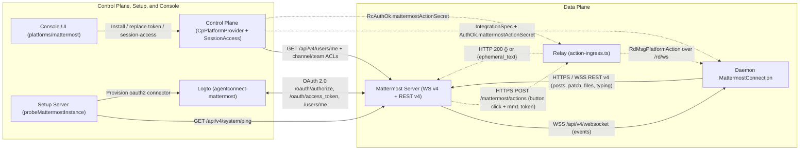
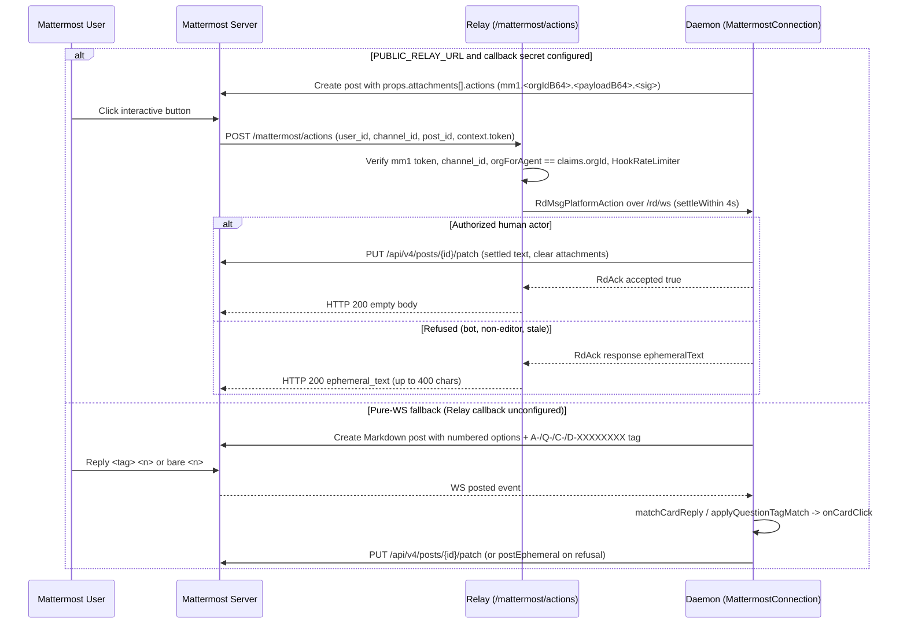

# Mattermost Integration Design

> **Status:** Implemented behind the `mattermost` console feature flag (Refs #4340).
> Bot WebSocket v4 transport, full-channel reconnect recovery, message normalization, turn
> streaming, credentialed media transfer, interactive cards (org-scoped Relay callbacks with
> pure-WebSocket reply fallback), Logto OAuth 2.0 session access, Helm/Compose wiring, and
> automated unit, fake-server, and PostgreSQL route suites are implemented. Custom slash
> commands (`/agentconnect`), Interactive Dialog multi-field modals (`trigger_id`), distributed
> OAuth bot installation, and multi-agent shared bots (`multiAgentShareable: false`) remain
> outside v1 scope.
>
> **Related:**
> [platform modules](integration-plugin-architecture.md),
> [Lark / Feishu](feishu-integration.md),
> [DingTalk](dingtalk-integration.md),
> [Google Chat](google-chat-integration.md),
> [Slack streaming](slack-streaming-turn-output.md),
> [Slack approval DM](slack-approval-dm.md),
> [Slack install](slack-integration-install.md),
> [Slack identity](slack-identity.md),
> [session visibility](session-visibility.md),
> [inbound attachments](inbound-file-attachments.md),
> [sendMessage routing](send-message-routing-rework.md),
> [auto session mode](auto-session-mode.md),
> [assistant mode](assistant-mode.md),
> [capability matrices](../capability-matrices.md),
> [product conventions](../product-conventions.md).

## 1. Goal, non-goals, and capability summary

Add `mattermost` as a first-class chat integration for both **self-hosted intranet servers**
(including `http://` LAN deployments, path prefixes such as `https://corp.example.com/mm`,
and private/self-signed PKI via `NODE_EXTRA_CA_CERTS`) and **Mattermost Cloud** workspaces
(`https://*.cloud.mattermost.com`). Unlike fixed cloud SaaS platforms, Mattermost is tenant-addressed
by a user-supplied base URL, must operate in air-gapped or NAT-bound intranet deployments with no
public callback endpoint, and must preserve full interactive-card parity across both topologies.

**Why WebSocket v4 + REST v4 instead of Outgoing Webhooks:** Mattermost Outgoing Webhooks only
fire in public channels (`O`), omit private channels (`P`), group DMs (`G`), and 1:1 DMs (`D`),
and require the server to reach an inbound HTTP listener. AgentConnect therefore runs inbound
delivery and outbound REST calls exclusively over daemon-owned outbound connections (`/api/v4/websocket`
and `/api/v4/*`), and `POST /api/v1/orgs/:orgId/integrations` rejects `transport: 'http'` for
Mattermost because `MattermostCpProvider` omits `projectBotAssign`.

| Platform          | Tenant / app addressing                            | Inbound transport                | Public callback required            | Conversation & thread model                                         | Interactive cards & fallback                                                       | Console permission sync                                          |
| ----------------- | -------------------------------------------------- | -------------------------------- | ----------------------------------- | ------------------------------------------------------------------- | ---------------------------------------------------------------------------------- | ---------------------------------------------------------------- |
| **Slack**         | App + Workspace (`T…`)                             | Daemon Socket Mode or Relay HTTP | HTTP mode only                      | Channels (`root_id` = `thread_ts`), flat DMs                        | Block Kit actions (Relay or Socket Mode)                                           | Workspace OAuth (`users.info` / membership)                      |
| **Lark / Feishu** | Custom or distributed app (`cli_…`, region)        | Daemon WSClient or Relay HTTP    | HTTP mode only                      | Topic/thread replies, flat 1:1 chats                                | CardKit (`card.action.trigger`)                                                    | Feishu/Lark OAuth + chat membership                              |
| **DingTalk**      | Per-org internal app (`clientId`, edition)         | Daemon Stream WebSocket          | No                                  | Mention / reply-chain tracking, flat DMs                            | Action cards with numbered text fallback                                           | None in v1                                                       |
| **Google Chat**   | Workspace add-on (`projectNumber`)                 | Relay HTTPS only                 | Yes                                 | Space mentions (`threads`), flat DMs                                | Google Chat cards / dialogs                                                        | Workspace identity + Space sync                                  |
| **Mattermost**    | Normalized `serverUrl` (`mm-<16-hex>`) + bot token | Daemon WebSocket v4 + REST v4    | Optional (Relay button clicks only) | `O`/`P`/`G`/`D` channels, single-level `root_id`, flat DMs (`'dm'`) | Attachment buttons via Relay `mm1` token, else pure-WS `A-`/`Q-`/`C-`/`D-` replies | Logto `oauth2` (`target: mattermost`) + live channel/team checks |

### Mattermost v1 capability summary

| Capability               | Implemented v1 boundary                                                                                                                                                                            |
| ------------------------ | -------------------------------------------------------------------------------------------------------------------------------------------------------------------------------------------------- |
| Bot installation         | Each organization supplies a normalized `serverUrl` and Bot Account token (or PAT), verified via `GET /api/v4/users/me`; one bot serves one agent (§3).                                            |
| Transport & recovery     | Pooled daemon WebSocket v4 with post-open `authentication_challenge`, single-flight `401` revocation probe, frozen pre-disconnect watermarks, and full-channel bounded catch-up (§4).              |
| Conversations & threads  | Public channels (`O`), private channels (`P`), group DMs (`G`), and 1:1 DMs (`D`); `root_id` threads with HTTP `400` recovery and multi-team permalink resolution (§5).                            |
| Streaming & Markdown     | Throttled `PUT /api/v4/posts/{id}/patch` previews (`>= 1_000 ms`), `user_typing` frames (`4_000 ms`), `MaxPostSize` surrogate-safe splitting, and image-beacon-safe Console `MarkdownText` (§5.3). |
| Media                    | Credentialed `readMattermostFile` downloads pinned to `serverUrl` and two-step `POST /api/v4/files` + `POST /api/v4/posts` uploads with `@everyone`/`@here`/`@channel`/`@all` escaping (§5.4).     |
| Interactive cards        | Signed `mm1` buttons routed via Relay `POST /mattermost/actions` when `PUBLIC_RELAY_URL` exists; pure-WS `A-`/`Q-`/`C-`/`D-XXXXXXXX` and bare-digit fallback everywhere (§6).                      |
| Sign-in & session access | Setup Server `GET /api/v4/system/ping` probe, Logto `oauth2` connector with unverified email disabled, and live Control Plane channel/team membership + non-guest checks (§7).                     |

### Non-goals for v1

- Mattermost custom slash commands (`/agentconnect` webhook callbacks).
- Interactive Dialog multi-field modal forms (`POST /api/v4/actions/dialogs/open` via `trigger_id`).
- Distributed OAuth bot installation (one-click workspace app install).
- Multi-agent shared bots (`Bot.shareable = true` / `PlatformManifest.multiAgentShareable: true`).
- `http` bot-level inbound webhook transport (`POST /integrations` with `transport: 'http'`).

## 2. Architecture and four-host module layout

Control Plane and Setup never sit on the chat message path. The daemon owns the WebSocket v4
socket, REST v4 posting/streaming, file transfers, and pure-WS card reply matching. When
`PUBLIC_RELAY_URL` is configured, interactive attachment buttons post to Relay `POST /mattermost/actions`,
which verifies the org-scoped HMAC token and forwards `RdMsgPlatformAction` over `/rd/ws` to the
agent's current daemon.

### Module and contract inventory

| Package / host      | Key files                                                                                                                                                                                                                                           | Contract / responsibilities                                                                                                                                                                                                                        |
| ------------------- | --------------------------------------------------------------------------------------------------------------------------------------------------------------------------------------------------------------------------------------------------- | -------------------------------------------------------------------------------------------------------------------------------------------------------------------------------------------------------------------------------------------------- |
| `protocol`          | `src/platform-manifest.ts`, `src/frames/integration.ts`, `src/frames/auth.ts`, `src/frames/relay-cp.ts`, `src/frames/relay-daemon.ts`, `src/frames/collab.ts`, `src/mattermost-action-token.ts`                                                     | `MATTERMOST_PLATFORM = 'mattermost'`, `PlatformManifest`, `IntegrationMattermostConfig`, `AuthOk`/`RcAuthOk` `mattermostActionSecret`, `CollabAgentPlacement.botUsername`, `WireMattermostCardAction`, `mm1` token signing/verification.           |
| `message`           | `src/mattermost-message.ts`, `src/mattermost-mention-address.ts`                                                                                                                                                                                    | WS/REST post parsing, CVE-2023-48732-safe `@username` scanning (`stripMattermostNonMentionSpans`), webhook/bot spoofing checks, `props.agentconnect_thread_event`, `response-final`, attachment mapping, multi-agent handle resolution.            |
| `activation-policy` | `src/index.ts`                                                                                                                                                                                                                                      | Reads `manifestFor('mattermost').botSenderRouting` (`true`) so verified AgentConnect authors and third-party bots explicitly `@mention`ing the receiving bot enter the routing ladder.                                                             |
| `control-plane`     | `src/platforms/mattermost/{provider,routes,server-url,session-access}.ts`, `src/registry/authService.ts`, `src/container.ts`                                                                                                                        | `CpPlatformProvider`, `PUT /api/v1/orgs/:orgId/bots/:id/mattermost/credentials`, `normalizeMattermostServerUrl`, `mattermostExternalAppId`, `MattermostSessionAccessService`, SSRF rules, per-org/master `mattermostActionSecret` issuance.        |
| `setup`             | `src/mattermost-probe.ts`, `src/logto-connectors.ts`, `src/server/{index,logto-management}.ts`                                                                                                                                                      | `POST /api/v1/check/mattermost` (`probeMattermostInstance`), `agentconnect-mattermost` Logto `oauth2` connector provisioning, and redirect URI checks.                                                                                             |
| `relay`             | `src/platforms/mattermost/action-ingress.ts`, `src/index.ts`                                                                                                                                                                                        | Direct mount of `POST /mattermost/actions` (`MATTERMOST_ACTION_PATH`), `mm1` token verification, `orgForAgent` tenant fencing, `HookRateLimiter`, `settleWithin(4_000 ms)` forwarding to `daemonForAgent`.                                         |
| `daemon`            | `src/platforms/mattermost/{module,client,connection,media,rate-limit,surface,turn-output,command-chrome,attachments,action-button,*-card}.ts`, `src/platforms/{connection-reconciler,read-ports}.ts`, `src/daemon.ts`                               | Pooled WS/REST client, catch-up recovery, per-channel queues, `MattermostTurnStream` / `MattermostConverger`, `READ_PORTS['mattermost']`, SSRF media helpers, Relay card click handling, and pure-WS reply fallback.                               |
| `web`               | `src/components/console/platforms/mattermost/{index,Body,settings,mark}.tsx`, `src/components/console/platforms/mattermost/api.ts`, `src/components/console/markdown-text.tsx`, `src/components/console/views/{SettingsView,SessionDetailView}.tsx` | Feature-gated (`FEATURE_FLAGS=mattermost`) Self-hosted / Cloud install wizard, token replacement UI, `#` room list semantics, `MarkdownText` (`SafeMarkdownText`), `/_redirect/pl/<postId>` links, `SessionAccessCard`, and `profileProviderHint`. |

### `PlatformManifest` declaration

In `packages/protocol/src/platform-manifest.ts`, `manifestFor('mattermost')` sets:

- `consoleContinuation: true` — mirrors Console continuation prompts back to Mattermost (`postAsAuthor`).
- `membershipEnumeration: 'authoritative'` — `GET /api/v4/users/me/channels` lists the bot's complete joined channel set.
- `botSenderRouting: true` — allows verified AgentConnect peer bots and explicit `@mention`s from third-party bots to enter the routing ladder.
- `leaveGranularity: 'conversation'` — leaving withdraws from individual channels (`DELETE /api/v4/channels/{id}/members/{botUserId}`), not spaces.
- `multiAgentShareable: false` — one bot credential serves at most one agent.
- `ownerAsDefault: false`, `addressedByConstruction: false` — channels require explicit `@bot` mention or matching bind rules; DMs route directly.
- `appendKinds: ['channel', 'mpim']` — channels (`O`/`P`) and group DMs (`G`) support `append` mode, while 1:1 DMs (`D`) are already one continuous `'dm'` session.
- `listsConversations: true`, `dmChannelPattern: undefined`, `threadlessRoomRoot: undefined` — 26-char z-base-32 IDs carry no DM prefix, and rooms support single-level `root_id` threads.

## 3. Bot installation, canonical `serverUrl` identity, and SSRF policy

### 3.1 Canonical URLs, D6 bot identity, and credential rotation

A Mattermost bot connection is defined by `(serverUrl, botToken)` (`IntegrationMattermostConfig` in
`packages/protocol/src/frames/integration.ts`, with optional CP-seeded `botUserId` and `botUsername`).

- **Canonical `serverUrl` (`normalizeMattermostServerUrl`):** Available in `packages/control-plane/src/platforms/mattermost/server-url.ts` (and mirrored in `packages/daemon/src/platforms/mattermost/module.ts` and `media.ts`). Lowercases scheme and host, removes default ports (`:80` / `:443`), preserves deployment subpaths (for example `https://corp.example.com/mm`) while stripping trailing slashes, and rejects non-HTTP(S) schemes, whitespace, control characters, query strings (`?`), fragments (`#`), embedded userinfo (`@`), and literal link-local or unspecified IPs.
- **Colon-free tenant realm (`mattermostExternalAppId`):** Computes `mm-${sha256(normalizedServerUrl).slice(0, 16)}`. Because `ownerIdentity`, `approvalRoute`, and `SessionAccessViewer` split identity strings on `:`, hashing the URL prevents scheme/port colons from corrupting tenant keys.
- **D6 bot uniqueness (`Bot` table):** `MattermostCpProvider.buildNewBotInstall` writes `externalIdentity: { externalAppId, externalTenantId: botUserId }`, `secrets: { botToken, appToken: null, signingSecret: null }`, `platformConfig: { serverUrl, botUserId, botUsername }`, and `workspaceName: new URL(serverUrl).host`. Postgres's `@@unique([platform, externalAppId, externalTenantId])` index prevents installing the same Mattermost bot account twice on the same server while permitting multiple distinct bots per server.
- **Token verification (`verifyMattermostBot`):** Calls `GET <serverUrl>/api/v4/users/me` with `Bearer <botToken>` (`MATTERMOST_CHECK_TIMEOUT_MS = 10_000`) and classifies failures deterministically:
  - `400 MATTERMOST_SERVER_URL_INVALID`: bad URL shape, SSRF block, `404` API root missing, or malformed `/users/me` payload.
  - `400 MATTERMOST_CREDENTIALS_INVALID`: `401`, `403`, or other non-404 `4xx`.
  - `503 MATTERMOST_CHECK_UNAVAILABLE`: `408`, `429`, `5xx`, `3xx`, or transport failure.
  - `409 MATTERMOST_BOT_ALREADY_INSTALLED`: duplicate `(mattermost, externalAppId, botUserId)` bot row.
- **Credential rotation (`replaceMattermostBotToken`):** `PUT /api/v1/orgs/:orgId/bots/:id/mattermost/credentials` (`operationId: replaceMattermostBotToken`, `interactiveOnly: true`) verifies the new token against the stored `serverUrl`, refuses tokens belonging to a different Mattermost user with `400 MATTERMOST_BOT_MISMATCH`, updates `platformConfig.botUsername` if renamed, calls `botCredential.install(..., { restoreRevokedMemberships: true })`, and pushes updated configs to serving daemons via `pushBotConfig`.
- **Console wizard (`Body.tsx`):** Provides **Self-hosted** and **Mattermost Cloud** tabs. Cloud mode expands a workspace slug (`acme` -> `https://acme.cloud.mattermost.com`) or bare Cloud hostname to HTTPS and rejects cleartext `http://` Cloud URLs; both modes strip `/admin_console(/.*)?` UI suffixes before submission.

### 3.2 Intranet SSRF and TLS boundaries

Because administrators supply `serverUrl`, every outbound Mattermost caller pins DNS resolution and
disables HTTP redirects while keeping internal allowlists isolated from Relay MCP egress
(`RELAY_MCP_ALLOWED_UPSTREAMS`):

| Host / component                                                                         | Always-blocked targets (`isLinkLocalOrUnspecifiedAddress`)                                                                                                                                                                                                                                       | Private / loopback policy (`RFC 1918`, `127.0.0.0/8`, `::1`, `fc00::/7`, `100.64.0.0/10`)                                                                                                                                               | DNS pinning & redirect guard                                                                                                                                                                | Custom PKI                                                      |
| ---------------------------------------------------------------------------------------- | ------------------------------------------------------------------------------------------------------------------------------------------------------------------------------------------------------------------------------------------------------------------------------------------------ | --------------------------------------------------------------------------------------------------------------------------------------------------------------------------------------------------------------------------------------- | ------------------------------------------------------------------------------------------------------------------------------------------------------------------------------------------- | --------------------------------------------------------------- |
| **Setup Server** (`probeMattermostInstance`)                                             | `0.0.0.0/8`, `169.254.0.0/16`, `100.100.100.200`, `192.0.0.0/24` (Oracle IMDS `192.0.0.192`), `198.18.0.0/15`, `224.0.0.0/4+`, `::`, `fe80::/10`, `ff00::/8`, `fd00:ec2::254`, and IPv4 embedded in `::ffff:0:0/96`, `::ffff:0:0:0/96` (SIIT), `::/96`, NAT64 `64:ff9b::/96` / `64:ff9b:1::/48`. | Permits self-hosted private/loopback URLs so admins can probe intranet hosts during setup; only `invalid_url` stops saving (`probeMattermostBlocksSave`).                                                                               | `nodePinnedProbeGet` (`makePinnedLookup` with `options.all` Happy Eyeballs), `5_000 ms` timeout, `64 KiB` body cap, no redirects followed.                                                  | `NODE_EXTRA_CA_CERTS` (`tls_untrusted` surfaced as diagnostic). |
| **Control Plane** (`verifyMattermostBot`, `MattermostSessionAccessService`)              | Enforced unconditionally via `guardedRequest` (`isLinkLocalOrUnspecifiedAddress`).                                                                                                                                                                                                               | `MATTERMOST_ALLOW_PRIVATE_NETWORK` defaults to `false` when `NODE_ENV === 'production'`, `true` otherwise; explicit hostnames allowed via `CP_ALLOWED_OUTBOUND_HOSTS`, `AGENTCONNECT_INTERNAL_ALLOWED_HOSTS`, or configured OAuth host. | `guardedRequest` (`makeGuardedLookup` reject-if-any, `GUARDED_TIMEOUT_MS = 10_000`, `GUARDED_MAX_BYTES = 1 MiB`), `node:http`/`https` without redirects.                                    | `NODE_EXTRA_CA_CERTS`                                           |
| **Daemon** (`MattermostClient`, `validateMattermostServerUrl`, `downloadMattermostFile`) | Enforced unconditionally via `validateMattermostServerUrl` + `makeMattermostLookup`.                                                                                                                                                                                                             | `allowMattermostPrivateNetwork()` defaults to `true` except when `AGENTCONNECT_SUPERVISOR === 'k8s'`, overridable via `MATTERMOST_ALLOW_PRIVATE_NETWORK`, `MATTERMOST_ALLOWED_HOSTS`, or `AGENTCONNECT_INTERNAL_ALLOWED_HOSTS`.         | Undici `Agent` (`makeMattermostLookup`) + `WsWebSocket` `lookup`; REST/media pass `redirect: 'error'`; `resolveMattermostFileUrl` pins origin + subpath (`/api/v4/files/<id>[/thumbnail]`). | `NODE_EXTRA_CA_CERTS`                                           |
| **Logto** (OAuth 2.0 server)                                                             | Logto SSRF protection blocks private hosts by default.                                                                                                                                                                                                                                           | Configured via `LOGTO_SSRF_ALLOWED_ADDRESSES` (defaults in `compose.logto.yaml` to `AGENTCONNECT_INTERNAL_ALLOWED_HOSTS`).                                                                                                              | Handled by Logto container runtime.                                                                                                                                                         | `NODE_EXTRA_CA_CERTS`                                           |

Relay (`POST /mattermost/actions`) makes **no** outbound HTTP requests to Mattermost; outbound
SSRF checks live exclusively on Setup, Control Plane, and Daemon.

## 4. WebSocket v4 transport, revocation, and reconnect recovery

### 4.1 Connection pooling, authentication quirk, and revocation probe

`consolidateMattermost` groups all integrations sharing the same normalized `(serverUrl, botToken)`
onto a single `MattermostConnection` keyed by `mattermostConnKey` (`sha256(JSON.stringify([serverUrl, botToken]))`).
`reconcileMattermostConnections` (`packages/daemon/src/platforms/connection-reconciler.ts`) starts,
updates, and retries failed connections every `30_000 ms`.

- **Startup sequence (`MattermostConnection.start()`):**
  1. Calls `getMe()` (`GET /api/v4/users/me`) to resolve authoritative `botUserId` and `botUsername`.
  2. Calls `getClientCapabilities()` (`GET /api/v4/config/client?format=old`) to read `MaxPostSize` (falling back safely to `MATTERMOST_DEFAULT_MAX_POST_SIZE = 4_000`), `EnablePostUsernameOverride`, and `EnablePostIconOverride`.
  3. Seeds teams (`GET /api/v4/users/me/teams`) and active non-deleted channels (`GET /api/v4/users/me/channels?include_deleted=false`) into `channels` (`CHANNEL_CACHE_MAX = 2_000`) and `channelWatermarks` (`WATERMARK_CACHE_MAX = 50_000`).
  4. Sets `lastConnectedAt` and opens the WebSocket via `MattermostClient.start()`.
- **Post-open `authentication_challenge` quirk:** `MattermostClient` dials `ws(s)://<host><basePath>/api/v4/websocket`
  and authenticates strictly with a post-open `{ seq, action: 'authentication_challenge', data: { token } }` frame.
  Sending an HTTP `Authorization` header during the WebSocket Upgrade pre-authenticates Mattermost's
  `WebConn` (`wc.IsAuthenticated() === true`), causing Mattermost to ignore the subsequent
  `authentication_challenge` frame without returning a `seq_reply` acknowledgment.
- **Heartbeat and socket fencing:** `DEFAULT_TIMING` sets `openTimeoutMs: 15_000`, `requestTimeoutMs: 15_000`,
  `heartbeatMs: 30_000`, `maxMissedPongs: 2`, `retryBaseMs: 1_000`, `retryMaxMs: 30_000`,
  `stableMs: 60_000`, and `maxRateLimitRetries: 2`. Every message/close handler checks
  `socket === this.socket` so stale sockets never corrupt active connection state. Outbound REST
  requests share a per-client `MattermostRateLimiter` (handling `429` `Retry-After` / `X-RateLimit-Reset`
  capped at `60_000 ms`) and per-channel FIFO `MattermostSendQueue` (up to `1_000` queues, `100 ms`
  interval, `30_000 ms` queue timeout).
- **Single-flight `401` revocation confirmation:** If a REST call returns HTTP `401` (or a reconnect
  `authentication_challenge` fails), `MattermostConnection` triggers `confirmRevocationOnUnauthorized()`,
  which runs a single-flight `getMe({ skipUnauthorizedHook: true })` probe. Only a confirmed `401`
  emits `tokens_revoked` via `onCredentialRevoked`, preventing transient gateway errors from
  incorrectly revoking active integrations.

### 4.2 Hardened full-channel reconnect catch-up

WebSocket drops or Mattermost server restarts can occur while users continue posting across any
channel. `MattermostConnection` guarantees zero silent post loss through four invariants in
`freezeRecoveryWatermarks()`, `fetchChannelPostsSince()`, and `catchUpOnce()`:

1. **Frozen pre-disconnect watermarks (`WATERMARK_CACHE_MAX = 50_000`):** `onWsDisconnect()`,
   `onWsReconnect()`, and `catchUpAfterReconnect()` snapshot each channel's pre-outage `channelWatermarks`
   value (and `lastConnectedAt` into `recoveryFallbackSince`) into `recoveryWatermarks`. Keeping
   `WATERMARK_CACHE_MAX = 50_000` separate from `CHANNEL_CACHE_MAX = 2_000` ensures high-channel-count
   bots retain pre-outage watermarks for every joined channel. Unseeded channels are frozen **only**
   during `initialFreeze`; any channel that receives a live WebSocket event while recovery or retry
   backoff is still pending keeps falling back to `recoveryFallbackSince` so retries never skip
   missed outage posts.
2. **Full sweep of all non-deleted joined channels:** `catchUpOnce()` calls unpaginated
   `GET /api/v4/users/me/channels?include_deleted=false`, deduplicates by channel ID, drops deleted
   channels (`delete_at` truthy), and sorts **every** non-deleted channel (`O`, `P`, `G`, `D`) in
   `last_post_at ?? update_at` descending order (no channel count truncation). If `getMyChannels`
   fails (`channelsListComplete = false`), it merges cached `this.channels` with any non-deleted
   channel IDs present in `recoveryWatermarks` and resolves missing `channel.type` metadata via
   `getChannelCached(ch.id)` before dispatching posts.
3. **Epoch-fenced per-channel completion & `before`-cursor pagination:** Workers (`concurrency = 4`)
   skip channels already in `recoveryCompletedChannels` for the current `recoveryEpoch`. Any
   mid-pass disconnect increments `recoveryEpoch`, clears `recoveryCompletedChannels`, and aborts
   the active worker loop (`allChannelsClean = false`) without marking in-flight channels completed.
   For each pending channel, `fetchChannelPostsSince(ch.id, Math.max(1, watermark - 1_000))` executes:
   - Initial query: `GET /api/v4/channels/{id}/posts?since=<since>&per_page=60`. Because Mattermost's
     `since` filter matches both `create_at` and `update_at` and caps at `MATTERMOST_SINCE_SERVER_CAP = 1_000`
     posts, `fetchChannelPostsSince` anchors the `before` cursor on the oldest post whose
     `create_at >= since` — preventing an older post edited during the outage from pulling `?before=`
     past unseen outage messages.
   - Backward pages: `?before=<oldestId>&per_page=60` up to `MAX_CATCH_UP_PAGES = 200` whenever
     `prev_post_id` or page-cap heuristics indicate older posts exist.
   - Posts are filtered, sorted oldest-first, deduplicated (`seen`, `SEEN_LIMIT = 2_000`), and
     dispatched serially per channel (`inboundChains`). Only when every page finishes without
     dispatch errors in the same active `recoveryEpoch` does the channel mark `recoveryCompletedChannels.add(ch.id)`
     and advance both watermarks.
4. **Two-phase catch-up retry & clean reset:** `recoveryWatermarks`, `recoveryFallbackSince`,
   `recoveryCompletedChannels`, and `lastConnectedAt = Math.max(lastConnectedAt, passStartedAt)` clear
   **only** on a fully clean pass (`allChannelsClean === true` with an active socket and no queued pass).
   Partial failures schedule `catchUpRetryTimer` (`.unref?.()`) in two phases while `!stopped && !wsDisconnected`:
   - **Fast exponential backoff:** For the first `CATCH_UP_FAST_RETRIES = 8` retries
     (`catchUpRetryCount < 8`), delays grow as
     `Math.min(MAX_CATCH_UP_RETRY_BACKOFF_MS, baseMs * 2 ** catchUpRetryCount)`
     (`CATCH_UP_RETRY_BASE_MS = 1_000 ms` up to `MAX_CATCH_UP_RETRY_BACKOFF_MS = 30_000 ms`, overridable
     via `catchUpRetryBaseMs`).
   - **Steady low-frequency polling:** Once all 8 fast retries are exhausted, `MattermostConnection`
     logs a single warning and continues retrying every `CATCH_UP_STEADY_RETRY_MS = 60_000 ms`
     (overridable via `catchUpSteadyRetryMs`) with frozen `recoveryWatermarks` until catch-up completes
     cleanly, the WebSocket drops/reconnects (resetting `catchUpRetryCount = 0`), or `stop()` is called.

## 5. Conversations, normalization, streaming, and media

### 5.1 Channel model, multi-team permalinks, and threading

- **26-char z-base-32 IDs & channel types:** Channels (`O` public, `P` private), group DMs (`G`),
  and 1:1 DMs (`D`) all share `^[a-z0-9]{26}$` IDs. `mattermostPlatformModule.canonicalizeThread`
  sets `msg.thread = 'dm'` (`MATTERMOST_DM_THREAD`) for 1:1 DMs (`isDm === true`) and
  `msg.thread || nativeMessageId(msg.msgId)` for channels/group DMs.
- **Multi-team support & permalinks:** `listBotChannels()` resolves team slugs across all teams the
  bot belongs to, building `<serverUrl>/<teamName>/channels/<channelName>` for console lists. Thread
  deep links (`mattermostThreadUrl`) always emit `<serverUrl>/_redirect/pl/<postId>` for valid
  26-char post IDs so DMs, GMs, and cross-team sessions stay team-slug independent.
- **Single-level `root_id` & HTTP `400` recovery:** Replies pass `root_id: post.root_id || post.id`.
  Because Mattermost rejects nested `root_id` targets (pointing to a reply rather than the root) or
  deleted parents with HTTP `400` (`invalid root_id`), `createPost` and `uploadMattermostMedia`
  recover by fetching `getPost(rootId)` to unwrap `parent.root_id` or falling back to a top-level
  post.

### 5.2 Inbound normalization, CVE-2023-48732 guard, and multi-agent collaboration

In `packages/message/src/mattermost-message.ts` and `mattermost-mention-address.ts`:

- **JSON decoding & filtering:** `parseMattermostPost` and `parseMattermostMentions` accept both
  JSON-encoded strings (WebSocket `posted`/`post_edited`) and pre-parsed objects (REST catch-up).
  Deleted posts (`delete_at > 0`), `system_*` posts, and empty posts (no text and no files) return `null`.
- **Linear-time `@username` mention scanner:** `stripMattermostNonMentionSpans` strips fenced code
  blocks (`stripFencedCodeBlocks` honoring CommonMark info-string rules), balanced multi-backtick
  inline code spans (`stripInlineCodeSpansInParagraph`), and Markdown link destinations
  (`stripLinkDestinationsInParagraph`) in `O(N)` linear time with zero catastrophic regex
  backtracking (mitigating CVE-2023-48732). `mattermostMentionsBot`, `extractMattermostUsernameMentions`,
  and `mattermostTextAddressesAnyone` scan only the remaining visible text while ignoring `@channel`,
  `@all`, and `@here` and rejecting email addresses such as `user@bot`.
- **Sender identity & spoofing guard:** For non-webhook posts, `normalizePostEvent` prefers verified
  `data.sender_name ?? context.senderName` over spoofable `props.override_username`. Bot classification
  sets `isBot = props.from_bot === 'true' | true || isWebhook || context.senderIsBot === true`.
- **Authorship claims & `response-final`:** `readMattermostAgentAuthorshipClaim` parses
  `props.agentconnect_thread_event`, and `normalizeMattermostResponseFinalization` unwraps
  `post_edited` frames **only** when `claim?.deliveryState === 'final'` (`ingressEventTag = 'response-final'`).
  `MattermostConnection.onWsEvent` drops unfinalized own-bot streaming edits and UI chrome posts
  (`props.agentconnect_chrome === true`) while allowing finalized bot posts through so peer bots can
  collaborate across daemons.
- **Cross-daemon `@botUsername` collaboration:** `CollabAgentPlacement.botUsername` carries each
  agent's handle without `@`; `resolveMattermostMentionedAgents` maps `@handle` mentions (with
  trailing-slug disambiguation when multiple agents share a handle) into `mentionedAgentIds` on
  `prepareMattermostResponseClosure` / `closeMattermostResponse`.

### 5.3 Turn streaming, `postAsAuthor`, reactions, and SafeMarkdown

- **Turn streaming & converger modes:** `MattermostTurnStream` (`packages/daemon/src/platforms/mattermost/turn-output.ts`)
  posts the initial reply via `POST /api/v4/posts` and coalesces subsequent edits over
  `PUT /api/v4/posts/{id}/patch` (Mattermost v4 requires `PUT .../patch`, never HTTP `PATCH`) at
  `MATTERMOST_EDIT_INTERVAL_MS = 1_000` with `inFlight` serialization. If the final patch hits HTTP
  `404`, `reconcile` recreates the post. `splitMattermostPostText` (`splitMarkdown(..., utf16Units)`)
  and `splitMattermostPost` split oversized replies within the server's `MaxPostSize` without
  breaking UTF-16 surrogate pairs or code fences. `MattermostConverger` supports:
  - `none`: records transcript segments only (`recordOnly: true`), posting nothing to Mattermost.
  - `minimal`: emits `user_typing` (`MATTERMOST_TYPING_INTERVAL_MS = 4_000`) while working and posts final text only.
  - `low` (default): live throttled streaming post + `user_typing` + attribution footer.
  - `medium`: adds live `🔨` progress and `📋` plan chrome posts.
  - `high`: adds `💭` reasoning (capped at `2_800` chars) and `📄`/`❌` tool-output blocks (capped at `2_800` chars).
- **Console continuation (`postAsAuthor`):** Mattermost strips `props.override_username` for REST
  bot tokens unless webhook overrides are enabled, and can reject override props dynamically with
  `400`/`403`. `MattermostConnection.createPost`/`patchPost` latches `usernameOverrideEnabled`/`iconOverrideEnabled`
  to `false` on `400`/`403` override rejections, while `postAsAuthor` renders a distinct `#6366F1`
  attachment card (`💬 **<author>** _(via console)_`, `author_icon`) — falling back to quoted
  Markdown past `maxPostSize - 200` — and preserves the card by omitting `finalizeResponse`.
- **`addReaction` `403`-vs-`404` probe & `403` not-joined probe:** Mattermost checks channel
  permissions before post existence on `POST /api/v4/reactions`, returning `403` for unknown post
  IDs. `addReaction` probes `getPost(postId)` on `403` to surface clear `404` diagnostics; turn
  triage reactions use `eyes` (`seen`) and `thinking_face` (`triaging`). `createPost` similarly
  probes `hasChannelMember` + `getChannelCached` on `403` in active `'O'` channels to trigger
  `markNotJoined`.
- **Console rendering (`SafeMarkdownText`):** `mattermostModule.textRenderer` explicitly sets
  `MarkdownText` (`packages/web/src/components/console/markdown-text.tsx`), which parses CommonMark +
  GFM (`MAX_PARSE = 100_000`), strips non-`http(s)`/`mailto:` links, and converts `` images
  into clickable external `<a>` links rather than auto-fetching remote tracking beacons.

### 5.4 Media transfer and `READ_PORTS['mattermost']`

- **Read ports (`packages/daemon/src/platforms/read-ports.ts`):** Mattermost registers
  `openDirectMessage`, `channelMentions: 'gateway'`, `channelHistory`, `threadHistory`, `reactions`,
  `messageDelete`, `publicMessageSearch` (explicitly fail-closed on non-`'O'` and deleted channels),
  `conversationCreate`, `publicChannelReach`, `authoritativeMembers`, `channelPrivacy`,
  `workspaceMembers`, `sharedConversations`, and `attachmentReadTool: MATTERMOST_ATTACHMENT_TOOL`
  (`readMattermostFile`).
- **Inbound files (`readMattermostFile`):** Agents invoke `readMattermostFile` (dispatched via
  `packages/daemon/src/mcp/ops/platform-reads.ts#readAttachment`), which validates file IDs or URLs
  against the bot's `serverUrl` via `resolveMattermostFileUrl` and streams bytes via `downloadMattermostFile`
  (`30_000 ms` timeout, `redirect: 'error'`, HTML response rejection, `DEFAULT_MAX_ATTACHMENT_BYTES = 8 MiB`).
- **Outbound files (`shareFile` / `uploadMattermostMedia`):** Enforces `MATTERMOST_UPLOAD_MAX_FILES = 10`
  and `mattermostUploadName` (`256`-byte UTF-8 filename cap preserving extensions), escapes
  `@everyone`/`@here`/`@channel`/`@all` in captions (`escapeCaptionMentions` in `share-file.ts`),
  uploads multipart `FormData` (`undici`) to `POST /api/v4/files?channel_id=...`, creates the post
  on `POST /api/v4/posts` (with `400` `invalid root_id` retry), and posts any caption overflow as
  threaded follow-up posts.

## 6. Interactive cards: org-scoped Relay callbacks and pure-WS fallback

Mattermost Interactive Message Attachment button callbacks include **no** cryptographic request
signature or verification token in HTTP headers, and Mattermost buttons cannot open external URLs.
AgentConnect therefore authenticates clicks using an HMAC-signed `mm1` token embedded inside
`integration.context.token` and maintains a pure-WebSocket numbered-reply fallback for NAT/intranet
deployments where `PUBLIC_RELAY_URL` (or the callback secret) is unconfigured.

### 6.1 Signed `mm1` token format and per-org key derivation

- **Master & org-scoped secrets:** Control Plane derives a default master secret via
  `deriveMattermostActionSecret(API_KEY_PEPPER)` (`HMAC-SHA256(pepper, 'agentconnect:mattermost-action:v1')`)
  unless `MATTERMOST_ACTION_SECRET` (min 32 chars) is set. In `AuthService`, single-org daemons
  (`organizationMode: 'connection'`) receive `AuthOk.mattermostActionSecret = deriveMattermostOrgActionSecret(secret, orgId)`,
  whereas multi-tenant cluster pool daemons (`organizationMode: 'frame'`) receive the master secret
  and derive per-org secrets dynamically in `Daemon.mattermostActionCallback(agentId)`. Relay receives
  the master secret in `RcAuthOk.mattermostActionSecret`.
- **Wire token (`packages/protocol/src/mattermost-action-token.ts`):**
  - Org-scoped: `mm1.<orgIdB64>.<payloadB64>.<sig>`, HMAC-SHA256 signed over `mm-action-v2:<orgIdB64>.<payloadB64>` using `deriveMattermostOrgActionSecret(masterSecret, orgId)`. `verifyMattermostActionTokenWithMaster` extracts and validates `orgId` (`SAFE_ID_RE`) **before** parsing untrusted JSON payload bytes.
  - Standalone fallback (tests/single-secret): `<payloadB64>.<sig>` signed over `mm-action-v1:<payloadB64>`.
  - Claims include `v: 1`, `orgId?`, `daemonId`, `agentId`, `integrationId`, `channelId`, `kind` (`'approval' | 'elicit' | 'capability' | 'draft'`), `requestId`, `option?`, `token?`, `cardId?`, `generation?`, and `exp` (`MATTERMOST_ACTION_TTL_MS = 7 days`).
  - Mattermost strictly requires alphanumeric button IDs (`^[a-zA-Z0-9]+$`), enforced by `buildMattermostAttachmentActions` (`action-button.ts`).

### 6.2 Relay ingress (`POST /mattermost/actions`) and fail-closed checks

1. `registerMattermostActionIngress` (`packages/relay/src/platforms/mattermost/action-ingress.ts`)
   validates `MattermostButtonCallbackBody` (`64 KiB` body limit, `SAFE_ID_RE = /^[A-Za-z0-9_-]{1,64}$/`
   on `user_id`, `channel_id`, `post_id`, and optional `team_id`).
2. Verifies the `mm1` token (`401` on invalid/expired, `503` if secret unconfigured), requires
   `body.channel_id === claims.channelId` (`403`), checks `orgForAgent(claims.agentId) === claims.orgId`
   (`403` cross-tenant replay guard), and enforces `HookRateLimiter` (`capacity: 10`, `refillPerSec: 1`,
   `maxEntries: 10_000` per `claims.integrationId` -> `429`).
3. Resolves live `daemonForAgent(claims.agentId)` (handling agent moves across daemons) and forwards
   `RdMsgPlatformAction` (`sessionKey: "mattermost-action:<post_id>"`, deterministic `msgId: mattermostActionMsgId`)
   bounded by `settleWithin(..., MATTERMOST_ACTION_DEADLINE_MS = 4_000)`.
4. **Daemon fail-closed guards & settlement:** `Daemon.handleRelayCardClick` verifies the agent and
   integration, looks up `conn.getUserProfile(userId)` when `isBot === undefined` (failing closed as
   `isBot: true` if lookup fails), invokes `answerCardClick`, patches settled posts with
   `{ props: { attachments: [] } }` to strip buttons, and caps refusal notices at `MATTERMOST_CARD_NOTE_MAX = 400`.

### 6.3 Card facets and pure-WS numbered reply fallback

| Card facet                                    | Tag prefix          | Constraints & caps                                                                                                         | Relay buttons                            | Accepted pure-WS reply forms                                                                                                                    |
| --------------------------------------------- | ------------------- | -------------------------------------------------------------------------------------------------------------------------- | ---------------------------------------- | ----------------------------------------------------------------------------------------------------------------------------------------------- |
| **Permission approval** (`approval-card.ts`)  | `A-` (`A-XXXXXXXX`) | Max `25` options (`MATTERMOST_APPROVAL_MAX_OPTIONS`), button label cap `40`; returns `null` if body exceeds `maxPostSize`. | `opt0..optN` + `mm1` tokens              | `<A-XXXXXXXX> <n>`, `<n> <A-XXXXXXXX>`, or bare `<n>` if unambiguous in thread/DM.                                                              |
| **Question elicitation** (`elicit-card.ts`)   | `Q-` (`Q-XXXXXXXX`) | `enum` + `boolean`, max `20` options, question cap `3_400`, button label cap `40`.                                         | `opt0..optN` + `Dismiss`                 | `<Q-XXXXXXXX> <n \| label \| value>`, `<n> <Q-XXXXXXXX>`, or bare `<n>` if unambiguous.                                                         |
| **Capability request** (`capability-card.ts`) | `C-` (`C-XXXXXXXX`) | Fail-closed `isPerson`; Console deep link always included.                                                                 | `Decline` button + Console Markdown link | `<C-XXXXXXXX> decline` (or `1` when unambiguous in thread/DM; plus Console Markdown link).                                                      |
| **Assistant draft** (`draft-card.ts`)         | `D-` (`D-XXXXXXXX`) | `DRAFT_CARD_TEXT_CAP = 10_000`; fail-closed `isPerson` (`false` unless `profile.isBot === false`).                         | `Approve` + `Discard`/`Deny`             | `<D-XXXXXXXX> 1\|approve`, `<D-XXXXXXXX> 2\|discard\|deny`, `<choice> <D-XXXXXXXX>`, or bare `1`/`2`/`approve`/`discard`/`deny` if unambiguous. |
| **Form Fill** (`fill-card.ts`)                | —                   | Link-only (`REASON_MAX = 200`); credentials never entered in chat.                                                         | Console Markdown link only               | Console Markdown link only (settled via `patchPost`).                                                                                           |

`matchCardReply` (`packages/daemon/src/platforms/mattermost/connection.ts`) strips leading
`@mentions`, matches `<TAG> <choice>` (`O(1)` Map lookup), `<choice> <TAG>` (`O(N)` linear scan),
or bare digits only when **exactly one** open card or question occupies that channel/thread/DM
scope (`QUESTION_TAG_LIMIT = 500`), posting refusals privately via `postEphemeral`.

## 7. Sign-in with Mattermost and `sessionExternalAccess`

### 7.1 Setup probe and Logto `oauth2` connector

- **Instance probe (`packages/setup/src/mattermost-probe.ts`):** `POST /api/v1/check/mattermost`
  runs `probeMattermostInstance` (`GET <serverUrl>/api/v4/system/ping`, `5_000 ms` timeout, `64 KiB`
  response cap, DNS-pinned manual redirect). Returns `'ok'` (`200` JSON ping or `401`/`403` JSON behind
  an auth gateway), `'invalid_url'`, `'unreachable'`, `'tls_untrusted'` (`TLS_FAILURE_CODES` hinting
  `NODE_EXTRA_CA_CERTS`), or `'not_a_mattermost_api_root'`. Only `invalid_url` sets `blocksSave: true`.
- **Logto connector (`packages/setup/src/server/logto-management.ts`):** Provisions Logto's built-in
  `oauth2` connector under ID `LOGTO_MATTERMOST_CONNECTOR_ID = 'agentconnect-mattermost'` (`metadata.target = 'mattermost'`)
  pointing to `${serverUrl}/oauth/authorize`, `${serverUrl}/oauth/access_token`, and
  `${serverUrl}/api/v4/users/me` (`tokenEndpointResponseType: 'json'`). Because Mattermost OAuth
  profile responses do not carry a verified-email guarantee, `profileMap.email` is pinned to
  `'__disabled_unverified_email__'` (with `id: 'id'`, `name: 'username'`) to prevent account takeover
  by unverified email collision, and `scope` is deliberately omitted (`connectorMatches` ensures
  stale `scope` keys are absent). Redirect URIs checked by Setup cover `/callback/agentconnect-mattermost`,
  `/account/callback/social/agentconnect-mattermost`, and `/auth/social/callback`.

### 7.2 Control Plane `MattermostSessionAccessService`

`GET/PUT /api/v1/orgs/:orgId/session-access/mattermost` (`packages/control-plane/src/http/routes/sessions.ts`)
reads and toggles organization-wide Mattermost audience enforcement (`available` requires both
`LogtoIdentityService` and `mattermostOauthRealmKey` from `logto.mattermostConnector.serverUrl` or
`MATTERMOST_OAUTH_SERVER_URL`, returning `409` if unconfigured and re-pushing integrations via
`convergeOrgPlatform` on toggle).

When resolving visibility in `MattermostSessionAccessService` (`packages/control-plane/src/platforms/mattermost/session-access.ts`),
`addViewerIdentities` reads `user.identities.mattermost.userId` (`^[a-z0-9]{26}$`) under
`tenant: mattermostOauthRealmKey`. For each matching conversation scope (`CHECK_CONCURRENCY = 4`,
`CHECK_BUDGET_MS = 5_000`, `LRUCache` `fetchMethod` signals decoupled from caller deadlines; TTLs
`120_000 ms` allow / `30_000 ms` deny / `5_000 ms` unknown):

1. **Direct channel membership (`GET /api/v4/channels/{channelId}/members/{mmUserId}`):**
   - On `200` (with matching `channel_id` and `user_id`), verifies `GET /api/v4/users/{mmUserId}`
     has `delete_at === 0` (`user.active`). This admits any active explicit channel member, including
     channel-invited `system_guest` users in channels, GMs, or DMs.
   - On `401` or `403`, fails with `app_authorization`.
2. **Public-channel team fallback (strictly on `404` from step 1):**
   - Calls `GET /api/v4/channels/{channelId}` and requires `type === 'O'`, `delete_at === 0`, and a
     valid 26-char `team_id`. Private channels (`P`), GMs (`G`), and DMs (`D`) stop as denied.
   - Requires `user.active && !user.isSystemGuest` (denying `system_guest` users who are not explicit
     channel members).
   - Verifies `GET /api/v4/teams/{teamId}/members/{mmUserId}` returns `200` with matching IDs,
     `delete_at === 0`, `scheme_guest !== true`, and `!roles.includes('team_guest')`.

In Console UI, `SettingsView.tsx` exposes `'mattermost'` in `SessionAccessCard`, and
`SessionDetailView.tsx` maps `profileProviderHint('mattermost')` directly to `'mattermost'` without
falling back to GitLab.

## 8. Deployment configuration, Helm chart, and feature flag

Mattermost onboarding tiles in the Console wizard are gated by `FEATURE_FLAGS=mattermost`
(`packages/web/src/lib/feature-flags.ts`, `charts/agentconnect/values.yaml` `features.mattermost: false`
by default; existing configured bots remain manageable in Settings). Gateway `HTTPRoute`
(`charts/agentconnect/templates/httproute.yaml`) explicitly routes `/mattermost/actions` to the
Relay pool so interactive card clicks never 404 at the ingress gateway.

| Knob / setting                                           | Component(s)                                | Default / value                                   | Purpose                                                                                          |
| -------------------------------------------------------- | ------------------------------------------- | ------------------------------------------------- | ------------------------------------------------------------------------------------------------ |
| `FEATURE_FLAGS` / `features.mattermost`                  | `web`, Helm `web.yaml`                      | `false` (off)                                     | Enables Mattermost install entry points in the Console.                                          |
| `/mattermost/actions` (`MATTERMOST_ACTION_PATH`)         | `relay`, Helm `httproute.yaml`              | Mounted on Relay HTTP server                      | Receives Mattermost interactive attachment button callbacks.                                     |
| `MATTERMOST_ACTION_SECRET`                               | `control-plane`, `relay`, `daemon`          | Derived from `API_KEY_PEPPER`                     | Master HMAC secret for `mm1` button callback tokens (`>= 32` chars).                             |
| `MATTERMOST_ALLOW_PRIVATE_NETWORK`                       | `control-plane`, `daemon`, `compose.yaml`   | `false` in prod / `k8s`; `true` in dev / Compose  | Allows dialing private/loopback `serverUrl` targets (link-local/IMDS remain blocked).            |
| `AGENTCONNECT_INTERNAL_ALLOWED_HOSTS`                    | `control-plane`, `daemon`, `compose.yaml`   | Empty                                             | Comma-separated internal Mattermost/OAuth hostnames allowed when private networks are off.       |
| `CP_ALLOWED_OUTBOUND_HOSTS` / `MATTERMOST_ALLOWED_HOSTS` | `control-plane` / `daemon`                  | Empty                                             | Host-specific outbound allowlists for Mattermost without touching `RELAY_MCP_ALLOWED_UPSTREAMS`. |
| `MATTERMOST_OAUTH_SERVER_URL`                            | `control-plane`, `compose.yaml`             | From Setup `logto.mattermostConnector.serverUrl`  | Binds the Mattermost OAuth realm key (`mm-<16-hex>`) for `MattermostSessionAccessService`.       |
| `LOGTO_SSRF_ALLOWED_ADDRESSES`                           | `compose.logto.yaml` / Logto                | Defaults to `AGENTCONNECT_INTERNAL_ALLOWED_HOSTS` | Permits Logto container to reach intranet Mattermost OAuth/user endpoints.                       |
| `NODE_EXTRA_CA_CERTS`                                    | `setup`, `control-plane`, `daemon`, `logto` | Unset                                             | Custom internal CA bundle path for self-signed Mattermost HTTPS certificates.                    |

## 9. Validation and test matrix

Verified Mattermost automated coverage across the workspace:

| Layer               | Verified test files & suites                                                                                                                                                                                                                                                                                                                                                                                                                    |
| ------------------- | ----------------------------------------------------------------------------------------------------------------------------------------------------------------------------------------------------------------------------------------------------------------------------------------------------------------------------------------------------------------------------------------------------------------------------------------------- |
| `protocol`          | `src/mattermost-action-token.test.ts` (token signing/expiry/tampering/org scoping), plus `platform-manifest.test.ts`, `platform-tolerance.test.ts`, `codec.test.ts`, `frames/{collab,relay-daemon,session-visibility}.test.ts`.                                                                                                                                                                                                                 |
| `message`           | `test/mattermost-message.test.ts` (WS/REST normalization, CVE-2023-48732 code/link stripping, spoofing guards, `response-final`), `test/mattermost-mention-address.test.ts`, `test/wire-coordinates.test.ts`.                                                                                                                                                                                                                                   |
| `activation-policy` | `test/policy.test.ts` (explicit third-party bot `@mention` admission via `botSenderRouting`).                                                                                                                                                                                                                                                                                                                                                   |
| `control-plane`     | Unit: `src/platforms/mattermost/provider.test.ts`, `src/platforms/mattermost/session-access.test.ts`, `src/registry/authService.test.ts`, `src/ws/relay-connection.test.ts`, `src/platforms/env.test.ts`. Integration (real Postgres): `test/integration/mattermost-provider.route.test.ts`, `test/integration/session-visibility.route.test.ts`, `src/http/platform-route-mounts.test.ts`, `src/http/plugins/openapi.test.ts`.                 |
| `setup`             | `test/mattermost-probe.test.ts`, `test/mattermost-login.route.test.ts`, `test/logto-management.test.ts`, `test/deployment-config-client.test.ts`.                                                                                                                                                                                                                                                                                               |
| `relay`             | `src/platforms/mattermost/action-ingress.test.ts` (`mm1` verification, `orgForAgent` tenant fencing, `HookRateLimiter`, `settleWithin` timeout/ephemeral responses), `src/relay-cp-client.test.ts`.                                                                                                                                                                                                                                             |
| `daemon`            | Unit: `test/mattermost-{client,connection,reconciler,media,turn-output,command-chrome,cards,elicit-card,ws-card-fallback,search-reach,mention-address}.test.ts`, plus `daemon-platform-authorship.test.ts`, `platform-read-ports.test.ts`, `platform-registry-drift.test.ts`, `chat-approval-cards.test.ts`, `ingress-coordinate-strategies.test.ts`. Fake-server E2E: `test/mattermost-e2e.test.ts` against `test/fakes/mattermost-server.ts`. |
| `web`               | `src/components/console/platforms/mattermost/{Body,settings}.test.tsx`, `src/components/console/views/SessionDetailView.mattermost-access.test.tsx`, plus `platform-set.test.tsx`, `reuse.test.ts`, `transcript.test.ts`, `MessageText.test.tsx`, `SocialLoginButtons.test.tsx`, `SettingsView.test.tsx`, `AddIntegrationModal.placement.test.tsx`.                                                                                             |
| `charts`            | `scripts/test-chart-render.rb` (`features.mattermost` default `false` / `FEATURE_FLAGS` injection + Gateway `HTTPRoute` `/mattermost/actions`).                                                                                                                                                                                                                                                                                                 |

Live verification against a self-hosted Mattermost container or Mattermost Cloud tenant covers:
WS reconnect under channel activity (>100 channels), custom PKI via `NODE_EXTRA_CA_CERTS`, Relay
interactive card button clicks + NAT fallback replies, file upload/download, and Logto OAuth 2.0
sign-in with `sessionExternalAccess` active.

## 10. Out of scope and follow-ups

1. **Custom slash commands (`/agentconnect`):** Would require a Relay HTTP webhook endpoint with a
   user-configured per-command token and `channel_id` mapping.
2. **Interactive Dialog modals (`trigger_id`):** Multi-field forms (for example multi-question
   elicitations) remain deferred; v1 uses single-question `enum`/`boolean` cards and falls back to
   Console for complex forms.
3. **Distributed OAuth bot installation:** Mattermost OAuth apps authenticate human users or
   installers rather than issuing workspace-wide multi-tenant bot tokens; v1 uses per-bot token paste.
4. **Multi-agent shared Mattermost bot (`multiAgentShareable: true`):** Would require Relay inbound
   delivery arbitration and `projectBotAssign`, which conflicts with pure-intranet WebSocket-only
   deployments.
5. **Multi-server OAuth login and standalone intranet E2E/docs:** Supporting multiple Logto
   Mattermost connectors per deployment, an end-to-end Docker Compose Mattermost server test suite,
   and publishing the user-facing `connect-automate/chat-platforms/mattermost` guide page.
