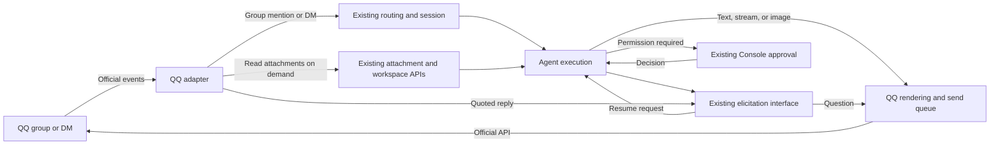
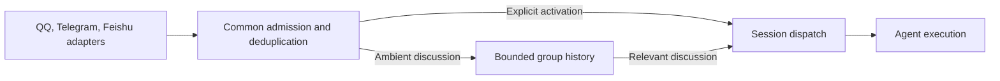

# QQ Integration Design

Status: implemented.

> Related: [platform modules](integration-plugin-architecture.md),
> [inbound attachments](inbound-file-attachments.md),
> [agent-authored attachments](agent-authored-attachments.md),
> [issue #2178](https://github.com/agentconnect-md/agentconnect/issues/2178).

## 1. Goal and scope

Add a native `qq` integration using the official QQ Bot API. One bot serves one
agent across multiple conversations. Members of the same group share a task
session; different groups and individual DMs remain separate.

The first contribution focuses on QQ adaptation through existing contracts.
Shared group-history behavior requires an upstream-owned design; QQ adopts that
contract once agreed and available. Chat approval has one, which QQ does not take (§4).

| Capability            | Initial scope and boundary                                                                                                                          |
| --------------------- | --------------------------------------------------------------------------------------------------------------------------------------------------- |
| Groups and DMs        | Explicit bot mentions in groups; ordinary messages in DMs. Shared group context contains addressed tasks, not ambient discussion.                   |
| Replies and Markdown  | Native quoted replies and supported Markdown, with readable formatting fallbacks.                                                                   |
| Streaming             | Native DM streaming. Groups receive limited progress and final replies; QQ does not provide group streaming.                                        |
| Attachments           | Receive images/files and send images. Non-image sending is conditional on the small common extension in section 4.                                  |
| Interactive questions | A numbered text card through `ElicitCardFacet`, answered by quoting it. Single-choice and yes/no questions; other shapes keep the decline notice.   |
| Tool approvals        | Existing Console approval, with a notice in the conversation; QQ has no approval card (§4).                                                         |
| Feedback and results  | DM typing hints or brief group acknowledgement; retained results remain available in the Console if delivery fails. No native read-receipt promise. |

QQ channels/guilds, dedicated audio/video support, multi-agent bot sharing,
Webhook ingress, and new result-retrieval commands are outside this scope.
The contribution covers implementation, tests, documentation, and review fixes,
without a commitment to indefinite maintenance.

## 2. Architecture

The daemon obtains an access token with AppID/AppSecret, opens an outbound QQ
WebSocket, and owns REST calls, attachment transfers, and agent execution. No
public callback endpoint or separate file-hosting service is required. The
Control Plane handles installation, credentials, and configuration, staying off
the live message path.

Follow the existing per-host platform modules: daemon transport and output,
Control Plane provider, Console setup, and shared platform declarations.
Normalization remains pure in the message package. Registration may span
packages; QQ-specific policies must not become core branches. This transport
requires no relay module.

The console offers QQ only where the deployment turns on the `qq` feature flag
(the chart's `features.qq`, on by default); the Control Plane and daemon serve
it either way.

## 3. Behavior and invariants

### Conversations and activation

Scope user identity to AppID plus OpenID; `user_openid` and `member_openid`
normalize into the same identity when their values match. Distinguish group and DM addresses. Use a stable
logical session key per group, independent of the sender or quoted message;
retain each sender's identity. Secret rotation must not change session identity.
Never merge people by nickname.

When an event supplies `author.username`, cache it under that app-scoped
identity so later group and DM messages share the confirmed name. A nameless
event never replaces a cached name. Derive the avatar URL from AppID plus OpenID
inside the QQ module; do not call an external profile service.

After admission checks, match pending answers before treating a message as a
prompt. QQ group tasks require an explicit mention: the whole-group session key
must not make ambient messages activate through thread affinity or execute
commands. Existing platforms retain their thread behavior; admitted QQ
follow-ups reuse normal steering and queuing.

Keep session identity, passive-reply IDs, and native quote indices separate.
Deduplicate received tasks across reconnects. Normalize only required fields;
credentials and sensitive scene extensions must not enter transcripts or logs.

### Replies and delivery

DM streaming sends ordered chunks with a stable delivered prefix. End the
current segment before a question and start a new segment after resumption;
finalization or cancellation closes the stream when possible. Group output uses
complete content boundaries, not token-sized posts or repeated deletion.

Preserve the [product conventions](../product-conventions.md) for message
splitting, workspace links, and user-facing output. Record generated replies
independently of delivery. Budget progress, questions, attachments, and results
against QQ's reply windows and rate limits. Use proactive delivery after expiry
only when allowed; otherwise retain the result for Console access. Unknown send
outcomes must not cause blind retries under new identities.

Feedback describes actual acceptance, steering, or queuing, never a native read
receipt. It is best effort and must not delay execution.

### Attachments

Map attachments from admitted messages and available quoted content to the
existing attachment model. Reuse image/text reads and workspace storage for
other files. Preserve metadata, apply the lower project/platform size limit,
and report expired downloads or unsupported content explicitly.

Send workspace images through `shareFile`: the QQ adapter prepares an upload,
uploads and confirms its parts, merges them, then sends `file_info` as rich
media. Respect expiry and group/DM scope; PNG and JPEG are the baseline formats.
A Markdown path must not implicitly upload a file. Reuse the partial-send
contract: a delivered file with a failed caption must not be sent again.

### Interactive questions

Reuse `ElicitCardFacet`, core schema validation, and request settlement. Message
buttons need a separate provider grant (an approved template or an invitation),
so the card is text a self-hosted bot can always send: the question, its options
numbered, and how to answer. The reader quotes the card and replies with a
number or an option label; in a group the reply must also mention the bot,
because QQ delivers nothing else. The quote identifies the card: QQ's reference
index resolves to the card's own message id, and core matches the bot-qualified
conversation and the pending request, so ordinary chat, other quotes, and stale
answers settle nothing. A quote naming no option is still claimed, so it never
reaches the agent as a prompt, and the instruction is repeated.

The card supports single-choice and yes/no questions, which one reply answers
whole. Typed, multi-select, and multi-field requests keep the decline notice.

QQ turns post through a leased egress rather than a reply connection, so core
offers a card to a turn with either transport. A card and its follow-ups are
passive replies to the triggering message; in a group each keeps one reply slot
free for the final answer. QQ cannot edit a sent message, so settlement posts a
short outcome under the card, when the reply budget allows it. A card answered by
a reply in the chat posts no outcome, since that reply already shows the choice;
an answer from elsewhere, a cancellation, or an expiry still does. Tool approvals
stay on the Console.

## 4. Shared capabilities and ownership

These needs inform upstream review without prescribing interfaces or assuming
maintainer commitments. Agree ownership and contracts separately, then update
this design to consume them.

### Group discussion context

**Need:** people discuss a plan, then say “@bot, carry out that plan,” without
manually summarizing it. Existing observation depends on a recently active
session, while thread affinity may activate ordinary messages. Receiving all QQ
messages alone fixes neither issue.

**Suggested direction:** upstream separates observation from activation, with
bounded history for enabled groups and relevant replay on waking. Admission,
authorship, retention, deduplication, and coverage gaps should have consistent
semantics across providers, within each provider's receive/history capabilities.

QQ supplies full-group events and verified message identities. Observation must
not consume a later mention trigger if both events describe one message. Missing
pre-installation or outage history remains a visible gap. This common capability
is outside the base contribution; initially advertise shared addressed-task
context, not complete group discussion awareness.

### In-chat tool approvals

Tool approvals now have a common interface, the approval-card facet
([integration-plugin-architecture.md](integration-plugin-architecture.md) §7.3),
and who may answer is the agent's "What people can do in chat" setting
([product-conventions.md](../product-conventions.md)). QQ does not implement it:
its message buttons need a grant from QQ that a bot cannot count on. A QQ
conversation gets a notice, and its approvals are answered in the Console.

### Non-image file sharing

**Need:** send generated PDFs, spreadsheets, or archives to the current chat.
QQ supports files. `shareFile` now accepts any file type
(agent-authored-attachments.md §4), so the common side is done: the QQ sender is
handed a document with its name and MIME type and today answers the port's
`unsupported_type`, which the tool relays as "QQ can host only images here".

**Remaining, QQ-owned:** prepare the upload with the file `file_type` instead of
the image one, skip the image sniff for a document, and send the matching rich
media type, under the same expiry and group/DM scope as images. Richer question
workflows and result retrieval likewise require separate agreement.

## 5. Validation

Use sanitized event fixtures and a mock service for deterministic behavior,
then a real official bot for provider/client behavior:

- Shared group tasks, isolated groups/DMs, and no ambient task or command execution.
- Correct question correlation, validation, expiry, and duplicate handling for
  quoted replies, including a quote of a card sent while a DM stream is open.
- DM streaming, quotes, Markdown, image exchange, inbound files, size limits,
  and expired links on mobile and desktop.
- Reconnects, duplicate events, reply expiry, rate limits, and ambiguous sends
  without lost saved results or blind duplicate delivery.
- Downloadable non-image output and partial-send handling if that extension is included.

Quote identifiers, button access, stream limits, and reply windows require live
validation; QQ's DM documentation gives inconsistent reply durations. Full-group
events can be probed independently without building a QQ-only history system.
Common-history acceptance adds pre-mention context and visible gaps. It is
separate from base adapter acceptance; this design does not claim live QQ validation.

## 6. References

- Existing code: [elicitation](../../packages/daemon/src/platforms/elicit-card.ts), [permissions](../../packages/daemon/src/permissions/coordinator.ts), [file sharing](../../packages/daemon/src/mcp/ops/share-file.ts).
- QQ transport and delivery: [WebSocket](https://bot.q.qq.com/wiki/develop/api-v2/dev-prepare/event-emit/websocket.html), [message rules](https://bot.q.qq.com/wiki/develop/api-v2/server-inter/message/overview.html), [DM streaming](https://bot.q.qq.com/wiki/develop/api-v2/autogen/api/v2_users_user_openid_stream_messages.post.html), [group sending](https://bot.q.qq.com/wiki/develop/api-v2/autogen/api/v2_groups_group_openid_messages.post.html), [DM sending and typing](https://bot.q.qq.com/wiki/develop/api-v2/autogen/api/v2_users_user_openid_messages.post.html).
- QQ content and interaction: [Markdown](https://bot.q.qq.com/wiki/develop/api-v2/server-inter/message/type/markdown.html), [buttons](https://bot.q.qq.com/wiki/develop/api-v2/server-inter/message/trans/msg-btn.html), [interaction events](https://bot.q.qq.com/wiki/develop/api-v2/autogen/event/interaction_create.html), [rich media](https://bot.q.qq.com/wiki/develop/api-v2/server-inter/message/rich-media.html).
- QQ group events: [mentions and attachments](https://bot.q.qq.com/wiki/develop/api-v2/autogen/event/group_at_message_create.html), [full-group messages](https://bot.q.qq.com/wiki/develop/api-v2/autogen/event/group_message_create.html).
