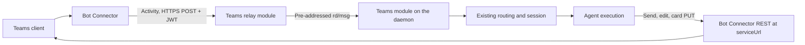

# Microsoft Teams Integration Design

Status: Proposed (draft). Provider facts come from Microsoft's documentation as
of October 2026. Facts marked **measured** come from a live probe against a
test tenant; facts marked **unverified** still need one.

> Related: [platform modules](integration-plugin-architecture.md),
> [Google Chat](google-chat-integration.md), [DingTalk](dingtalk-integration.md),
> [session modes](channel-session-mode.md),
> [approval surfaces](slack-approval-dm.md),
> [product conventions](../product-conventions.md). Refs #3208.

## 1. Goal and scope

Add a native `msteams` integration. One Teams bot serves one agent across 1:1
chats, group chats, and the channels of the teams it is installed in. Teams
delivers every activity as an HTTPS POST, so ingress is a relay module; the
daemon sends, edits, and deletes through the Bot Connector REST API. No
Microsoft SDK is used.

| Capability           | Initial scope and boundary                                                                                                                                   |
| -------------------- | ------------------------------------------------------------------------------------------------------------------------------------------------------------ |
| Distribution         | Each organization registers its own bot and Entra app and pastes the credentials into the Console (§2); or connects its tenant to the deployment's app (§8). |
| Ingress              | Relay-terminated HTTPS with Bot Framework token verification and durable admission (§3, §4.2).                                                               |
| Conversations        | Every message the app's resource-specific consent delivers, filtered by the existing channel triggers (§4.1).                                                |
| Sessions             | A 1:1 chat is one session; a channel post is a thread; a group chat follows the DingTalk reply-chain model (§4.1).                                           |
| Replies              | Post once, then edit in place; extended Markdown; no native streaming (§4.3).                                                                                |
| Questions, approvals | Adaptive Cards with `Action.Execute`, answered in place; who may approve follows session access sync (§4.4, §4.5).                                           |
| Setup                | A Console wizard that checks the credentials live and downloads the Teams app package for the admin to upload (§5).                                          |
| Access               | Microsoft sign-in links a person; session access sync checks conversation membership with the bot's credentials (§4.5).                                      |

Outside this scope: files and attachments in either direction, meetings and
calls ([voice participation](voice-meeting-participation.md)), the Teams Store,
native streaming, and one bot serving several agents.

## 2. Distribution model

A Teams bot needs two registrations the organization makes itself:

- **An Entra app registration** with a client secret. Its application (client)
  ID is the bot's ID.
- **A bot registration** that names that app and the messaging endpoint, either
  an Azure Bot resource (needs an Azure subscription; the Teams channel is free
  on every tier) or a bot in the Teams Developer Portal (no Azure subscription;
  no Bot Service single sign-on, which v1 does not use). Since 31 July 2025 a
  new bot registration is single-tenant or uses a managed identity. A managed
  identity only obtains tokens on Azure compute, so v1 supports a client secret.

Credentials are the **app ID**, the **tenant ID**, and the **client secret**.
They map onto existing columns with no migration: `externalAppId` ← app ID,
`externalTenantId` ← tenant ID, and the `botToken` secret slot ← client secret.
The relay's assignment carries the app and tenant IDs and the bot's mention
identity `28:<appId>`; an organization's own secret goes to the daemon alone, as
with Google Chat. The deployment's own app is the exception: its secret never
leaves the deployment, and its rows send through the relay (§8.5).

Validation requests a client-credentials token from the tenant's endpoint
(`https://login.microsoftonline.com/{tenantId}/oauth2/v2.0/token`, scope
`https://api.botframework.com/.default`). That proves the app, tenant, and
secret together, but not the messaging endpoint or the Teams channel; only the
first inbound activity proves those. An unreachable Entra answers 503
(`MSTEAMS_CHECK_UNAVAILABLE`); a definitive refusal answers 400 with a code the
Console shows: `MSTEAMS_SECRET_INVALID` (a wrong or expired secret),
`MSTEAMS_APP_NOT_FOUND`, `MSTEAMS_TENANT_NOT_FOUND`, or
`MSTEAMS_CREDENTIALS_INVALID`. Both IDs are stored lower-cased, since the relay
matches them exactly. A Developer Portal bot obtains its token from the
tenant endpoint and receives Bot Framework tokens inbound (**measured**).

The Developer Portal creates the bot's Entra app as multi-tenant, open to all
tenants, by default (**measured**). It also ties the bots it lists to the
signed-in name of the person who created them: after that person's sign-in name
was changed to a custom domain, the portal listed none of their bots and could
not open one by its ID, while the bots themselves kept receiving traffic
(**measured**). A bot that needs another owner, or whose owner's sign-in name
may change, is safer as an Azure Bot resource.

## 3. Architecture

The messaging endpoint is the relay's `POST /msteams/messages`. Every request
carries a JWT in `Authorization`. The relay verifies it before routing:

- keys from `https://login.botframework.com/v1/.well-known/openidconfiguration`,
  cached and refreshed at least daily, refetched once for an unknown `kid`;
- issuer `https://api.botframework.com`, audience equal to the candidate bot's
  app ID, five minutes of clock skew;
- the `serviceUrl` claim equal to the activity's `serviceUrl`.

Demultiplexing follows the existing ladder: an unverified app ID from the token
and the tenant ID from `channelData.tenant.id` pick the candidate `Bot` row by
`(externalAppId, externalTenantId)`, and verification confirms it. A token that
fails, or one no assigned bot owns, answers 401 before anything is forwarded.
Tokens issued by Entra rather than the Bot Framework are refused.

Outbound calls go to the `serviceUrl` the conversation's latest activity
carried, which the daemon records per conversation and keeps in its local store
across restarts; a row of the deployment's app makes them through the relay
(§8.5). Proactive sends need that
recorded reference, since Teams offers no lookup by email or user principal
name. The `serviceUrl` is regional and tenant-specific
(`https://smba.trafficmanager.net/<region>/<tenantId>/`), so it is read, never
built (**measured**). A proactive 1:1 is opened by `POST v3/conversations`
naming the person by the `29:` ID their roster entry carries; that works for a
member of a team the app is installed in even if they never installed it
themselves. Named by their Entra object ID instead, the same person is refused
with 403 `BadArgument`, "Bot is not installed in user's personal scope"
(**measured**, both).

## 4. Behavior and invariants

### 4.1 Conversations, sessions, and mentions

`conversation.conversationType` is `personal`, `groupChat`, or `channel`.

- **1:1 chat.** One continuous session per chat, like every other platform's DM.
- **Channel.** Teams channels are threaded by construction: a top-level post
  opens a conversation whose ID ends in `;messageid=<root>`, and replies share
  it. The root ID is the thread key, so a new post starts a session and a reply
  continues it, as a Slack thread does. A reply's `replyToId` is empty, so the
  key comes from the conversation ID alone, and a post's subject line never
  reaches the bot, only its body (**measured**).
- **Group chat.** There are no threads, so group chats follow the DingTalk model
  ([DingTalk §4.1](dingtalk-integration.md#41-conversations-sessions-and-identity)),
  itself Telegram's reply chain for groups without topics: a message that
  quotes nothing starts a session rooted at itself, a quote of a recorded bot
  message continues that message's session, and a quote that resolves to
  nothing starts a new session rather than guessing. The module implements the
  daemon's `canonicalizeThread` member, the third after Telegram and DingTalk.
  A quoted reply carries a `quotedReply` entity whose `messageId` is the quoted
  activity's ID — for a bot message, the ID its send returned — with the
  quoted `senderId` and `validatedMessageReference: true`, so the lookup is by
  message ID, as on Telegram (**measured** in a 1:1 chat). The text starts with
  `<quoted messageId="…"/>` and the HTML attachment with the quoted block; the
  normalizer removes both. Channel threads offer no quote action.

That is the default `createNew` [session mode](channel-session-mode.md). Channel
and group-chat rows also offer `append`; a 1:1 chat offers no mode, so the
manifest declares `appendKinds: ['channel']`.

**Resource-specific consent (RSC).** By default Teams delivers only messages
that mention the bot. The app package requests `ChannelMessage.Read.Group` and
`ChatMessage.Read.Chat`, which the team owner or chat member who installs the
app grants for that team or chat alone. The install dialog lists them as "Read
messages in this team." and "Read this chat's messages." beside reading the
roster; an administrator's install from the Teams admin center grants them with
no prompt. Teams then delivers every message there — unmentioned top-level
posts and thread replies alike (**measured**) — the same shape as Slack, which
receives every message of the conversations it has joined. The existing
activation policy does the filtering, unchanged:

- the channel trigger `off`, `mention`, or `auto` decides whether an
  unmentioned new message starts work;
- thread affinity routes an unmentioned follow-up in a thread the agent already
  has an open session in, and a quote in a group chat lands in that thread
  through `canonicalizeThread`;
- anything else is dropped after admission and starts nothing.

That holds in a team's standard channels only. In a private or a shared
channel, where the app is added to the channel itself, Teams delivered a
mention and the bot's replies posted there, but neither an unmentioned thread
reply nor an unmentioned top-level post reached the relay (**measured** in
both, with the team holding the grant). Neither the layout nor the channel's
own install is the cause: a standard channel switched to the threads layout
still delivered the unmentioned reply, and removing the app from the private
channel and adding it back changed nothing. There a thread continues only
through a mention, and an `auto` trigger never sees an unmentioned post.

Graph does not close the gap. With the same grant, a change-notification
subscription to a standard channel's messages is accepted, and one to a private
or a shared channel's is refused with 403 after the endpoint validates
(**measured**). The grant does let the bot read those channels' messages and
replies through Graph, so polling the threads the agent is active in is the
only way to see an unmentioned reply there.

The manifest therefore leaves `addressedByConstruction` unset. If a tenant
blocks RSC consent, the bot receives mentions only; `auto` and unmentioned
follow-ups then do nothing, and how the bot can detect that is **unverified**.

The package also requests the grants other features read through Microsoft
Graph, so that an installed app does not have to ask its installers again:
`ChannelSettings.Read.Group` and `ChannelMember.Read.Group` for a team's channel
names and members, `TeamSettings.Read.Group` for a team's visibility (§4.6),
and `OnlineMeeting.ReadBasic.Chat` and `OnlineMeetingTranscript.Read.Chat` for
a meeting chat's meeting details and transcripts. A shared channel's members
and a team's visibility are read (§4.6); the rest are not yet. An organization
that installed an earlier package grants them when it uploads a re-downloaded
one.

A mention arrives as a `mention` entity whose `mentioned.id` is the bot
(`28:<appId>`) and whose `text` is the `<at>…</at>` span in the activity text
(**measured**). The normalizer removes exactly that span and sets
`mentionedBots`, lower-casing a `28:` ID; a display name is never matched. The
relay reads a mention as addressing the bot only through the assignment's
`28:<appId>`, so a channel's first contact is a mention: it reaches the daemon,
which registers the channel for the Console, Off where the agent is gated.

A channel's messages carry its ID but not its name, so the daemon names a
channel from its team's channel list, `GET {serviceUrl}/v3/teams/{teamId}/conversations`,
read with the bot's own token at most once per team every ten minutes. Teams
answers the default channel, whose ID is the team's, unnamed (**measured**), and the Console shows it as **General**,
as the Teams client does. A failed read leaves the ID until the next one.

Every team has a General, so a channel row carries its team as its space (the
team's ID, named by `GET {serviceUrl}/v3/teams/{teamId}` with the bot's own token
at most once per team every ten minutes, **measured**), which the Console groups
rows under and a row keeps once learned. The daemon keeps each conversation it has
seen (its kind, team, `serviceUrl` and names, never content) in its local store,
bounded per bot, so after a restart a seen channel's row keeps its team from the
first refresh, without waiting for new traffic there. A team-wide install
(`bot-added` with `teamMemberAdded`) reports the team's standard channels,
General included, at once, seeded as a first mention would seed them; a private
or a shared channel takes the app only when it is added there, so its row still
appears on its first mention.

Identity is tenant-scoped: `from.aadObjectId` with the tenant ID identifies a
person, and `from.id` is specific to the bot. Display names are for display
only. Email and user principal name are available from the conversation member
API without Graph permissions, as optional enrichment; they never merge people.

### 4.2 Admission and redelivery

The relay forwards with `forwardStrict` and answers from the daemon's admission
verdict, as Google Chat does
([Google Chat §4](google-chat-integration.md#ack-is-an-admission-boundary)):
200 after a durable admission or a duplicate its receipt settles, 200 after a
deliberate gate, and 503 for a retryable refusal or an admission timeout. The
route settles within 10 seconds, which keeps relay requests bounded.

Redelivery is minimal (**measured**). A 503 brings exactly one redelivery about
a second later, with the same activity ID, and nothing after it. An answer that
takes 20 seconds brings none, and the sender sees no error. A 503 therefore
buys one immediate retry, which no daemon restart or handover fits inside, so a
message that arrives while no daemon can admit it is lost, as on DingTalk, and
user documentation says so. The relay's dedup table and the daemon's durable
receipt both key on the bot, the conversation ID, and the activity ID, because
Teams message IDs are unique only within a conversation; the retry never starts
a second turn.

Non-message activities the module does not act on (typing, reactions,
`conversationUpdate`, `installationUpdate`) are answered 200 and not forwarded;
`installationUpdate` refreshes the recorded conversation reference.

### 4.3 Replies, editing, and Markdown

A turn posts one message as its acknowledgement and edits it in place
(`PUT /v3/conversations/{id}/activities/{activityId}`) as text arrives; a
channel reply posts into the thread's conversation ID. Microsoft's limits are
per bot per conversation — 7 operations a second, 60 per 30 seconds, 1,800 an
hour — and 50 requests a second per app per tenant, with 429 above them. The
turn output therefore:

- coalesces edits to at most one every two seconds per conversation, through a
  per-conversation send queue;
- shares a per-tenant write budget across the daemon, as the Google Chat module
  does;
- retries 429, 412, 502, and 504 with backoff, honoring `Retry-After`.

Text is sent with `textFormat: "extendedmarkdown"` (generally available since
8 October 2026), which renders headings, both list kinds, quotes, fenced code
with a copy button, and tables in the web client, and renders progressively as
a message is edited (**measured**; the fence's language label is not shown).
Rendering on mobile clients is **unverified**. A message is limited to 100 KB,
so the renderer splits an answer under 80 KB into consecutive messages.

Native streaming works only in 1:1 chats, one stream per chat, at one update a
second, for at most two minutes. Turns often run longer, so v1 uses post-then-
edit everywhere; native streaming in 1:1 chats is later work.

### 4.4 Questions and approvals

Questions and approvals are Adaptive Cards (schema 1.6 or lower), built by the
module's `ElicitCardFacet` and `ApprovalCardFacet`. Each button is an
`Action.Execute` whose `data` carries the request ID, the option's position
(never its value), and a token.

A click arrives as an `adaptiveCard/action` invoke on the same endpoint, with
`replyToId` set to the card's activity ID, and the client waits about five
seconds for the HTTP response before retrying. The relay verifies the token,
dedupes by a hash of the click as Google Chat does, forwards it to the
integration as a `platform_action`, and answers at once with a short text
response (`type: "application/vnd.microsoft.activity.message"`), never waiting
for the daemon; the clicker sees that text as a dismissible note under the
card. The daemon re-checks the agent and integration, hands the click to the
permission coordinator, and replaces the card (`PUT` on the card's activity)
with the question and its decision and no controls; the client then shows the
card as edited (**measured**). A refused click leaves the card as it
was and tells the clicker privately: the daemon returns the refusal in the
click's `rd/ack` `response`, and the relay answers the invoke with it in place
of the generic note when the ack arrives within its two-second wait; a later ack
leaves the generic note. Whether a targeted message in group chats and channels
could carry it instead is **unverified**.

Anyone who can see a question card may answer it, as on every surface. A tool
approval follows the chat-authority rule for in-chat cards
([approval surfaces](slack-approval-dm.md), "What people can do in chat" in
[product conventions](../product-conventions.md)). While the organization has
not enabled Teams session access sync, anyone in the conversation may approve at
the agent's chat level. With sync on, a click settles an approval only when the
clicker is linked to an editor of the agent (§4.5); an unlinked clicker or a
non-editor is refused privately and the card stays live. The module's
`chatMemberKey` is the clicker's `aadObjectId`, lower-cased.

In an external place (§4.6) no approval card goes into the conversation, as on
Slack ([assistant mode](assistant-mode.md) §5.5): a neutral notice does, replaced
with the outcome once the request settles and naming nobody there
([approval surfaces](slack-approval-dm.md) §5.5; **measured**: it read "✅
Permission granted." after the editor allowed it from their 1:1 chat), and
the card goes to the asker's own 1:1 chat when they are a full member of the
home tenant. The connection opens that chat (`openDirectMessage`) by the
asker's `29:` ID, read from a conversation the bot shares with them. Only the
asker may answer that card, judged as the asker of the external place, so an
approval switched off there or a conversation closed since refuses them too.
An asker who is not a full member, or whose chat cannot be opened, leaves the
request on the editor path. The card is the module's `ApprovalCardFacet` card,
posted through core's platform-neutral asker path, which any platform whose
connection offers `isFullMember` and `openDirectMessage` shares; Slack keeps its
own DM card.

On the editor path (an external place with sync on, an asker who is not a full
member, or no asker card) the editor DM reaches Teams too
([approval surfaces](slack-approval-dm.md) §3). The Control Plane walks the same
preference chain with each editor's linked Microsoft account (§4.5), and the
daemon posts the same card into the chosen editor's 1:1 chat, under a line that
names the agent and the person who asked and links the session. The connection
opens that chat by the `29:` ID from a conversation it shares with the editor,
else from the roster of a team it knows, which lists every team member. Only that
editor answers the card, rechecked by the Control Plane on each click as Slack's
DM is; the chat approval level does not reach it (**measured** end to end in a
shared channel with sync on). A Slack integration of the same
agent is tried first, so an editor linked on both gets Slack's DM. The same card
goes beside a card that only editors may answer (sync on, and the person who
asked is not an editor): the routed editor gets it in their 1:1 chat while the
conversation's card stays, and the first answer from either decides. Its handle
is the row's `beside*` one, so the reconnect sweep retires it too.

An MCP tool approval asked as a question (`elicitation/create`) takes the
asker's and the editor's 1:1 chats as a permission request does when its one
field reduces to choices: the card offers those choices and Deny, and a click
settles it with the chosen value (**measured** with a Codex agent's MCP tool,
from the editor's 1:1 chat). One that reduces to no choices gets no Teams
card on either path and is answered in the console. Other questions take
neither path; they stay in their conversation.

### 4.5 Sign-in, linking, and session access sync

Teams joins the existing permission sync model as Telegram, Discord, and Google
Chat did ([Telegram and Discord permission sync](telegram-discord-permission-sync.md)):
one login application per installation proves who a person is, each
organization's own bot checks what that person may read, and an organization
owner turns sync on under **Settings → Session access**.

**What identifies a person (measured).** In the test tenant, one member's Entra
object ID, as the Entra admin center shows it, is the `from.aadObjectId` of
every activity that member sends, in a 1:1 chat and in a channel alike. The
Bot Connector member APIs return the same value with the bot's own token and no
Graph permission: `GET /v3/conversations/{teamId}/pagedmembers` as `aadObjectId`,
and the older `GET /v3/conversations/{id}/members` as `objectId`. Every member
also carries the bot's tenant ID and a `userRole` of `user` or `guest`. A
standard channel's member list is its team's roster (**measured**).

**Which ID each sign-in connector records.** The deployment's identity
provider offers three Microsoft connectors, and they record different IDs:

| Connector                     | Identity it records                                               | Usable as the link key                        |
| ----------------------------- | ----------------------------------------------------------------- | --------------------------------------------- |
| Azure AD social connector     | Graph `GET /me` `id`, the user's Entra object ID                  | Yes: equals `aadObjectId` for a tenant member |
| Microsoft Entra ID OIDC (SSO) | the ID token's `sub`, with the other claims kept as extra details | Not `sub`, which is pairwise per application  |
| Microsoft Entra ID SAML (SSO) | the SAML `nameID`                                                 | Only if `nameID` is mapped to the object ID   |

The social connector is the one to use. It is a social sign-in like the others
the Console already offers, so Setup manages it as it manages Discord: one Entra
application registered for the installation, multi-tenant and open to all
tenants, with authority `organizations` so personal Microsoft accounts cannot
sign in. Setup creates or updates the connector with target `azuread`, enables
the target, and keeps the client secret write-only. A person links Microsoft
under **Profile → Sign-in methods**, which records their object ID.

A sign-in through that connector, in the test tenant, recorded the member's
object ID as the identity's user ID, the same lower-case value as the
`aadObjectId` of their Teams activities (**measured**). The identity holds the
Graph profile and no tenant ID.

The connector runs with email sync off. Graph's `mail` is a directory attribute
any tenant's administrator can set, and with `organizations` the connector
accepts every tenant, so a synced address could equal an existing Console
user's email, and automatic account linking would then attach the foreign
identity to that user. With sync off the address stays in the raw profile and
never becomes an identifier (**measured**: the new identity's user has no
primary email).

Each person consents to the login application on first sign-in, and Entra
labels an application without a verified publisher **unverified** on that
prompt (**measured**). Tenants that allow user consent only for verified
publishers block that prompt, so the installation's application needs
publisher verification before customers use it, or an administrator in each
tenant consents for its members.

**The link key.** The Control Plane reads the linked identity as
`{ platform: 'msteams', tenant: 'global', memberId: <object ID, lower-cased> }`,
and the Teams provider's `chatMemberTenant` answers `global` while its bot is
live and the deployment offers Microsoft sign-in. The connector records no
tenant ID (Graph's `/me` carries none), but none is needed: Entra assigns every
object ID, so a person can link only their own, and the bot row already fences
each activity to its tenant (§3).

A guest is the one person this cannot link. A guest in the bot's tenant is a
separate directory object there, so Teams sends that object's ID, while the
guest signs in to the Console through their home tenant and links its ID.
Guests therefore stay unlinked, and with sync on they cannot approve or read
sessions in the Console.

**Access rules with sync on.**

- A conversation admits its current members: a 1:1 chat its one member, a
  standard channel its team's roster, a group chat its members. The Control
  Plane asks with the conversation's bot token for one member,
  `GET /v3/conversations/{conversationId}/members/{objectId}`, and admits the
  viewer only when the answer carries the same `aadObjectId` and the bot's
  tenant ID. A non-member answers 404 `MemberNotFoundInConversation`, and an
  unknown conversation 404 `ConversationNotFound` (**measured**).
- The session's audience realm is the bot's tenant ID and its resource is the
  conversation ID without a thread suffix. The lookup goes to the public cloud's
  global Bot Connector origin, `https://smba.trafficmanager.net/teams/`, which
  answers it for a conversation whose activities carry a regional `serviceUrl`
  (**measured**), so the audience records no service URL. National clouds have
  other origins and are out of scope.
- Approvals and in-chat settings follow §4.4: linked editors only.
- A missing link, a revoked bot, a mismatched tenant, a malformed response, or a
  provider failure never grants access. A successful verdict lasts at most two
  minutes, as for the other providers.

Turning sync on and off, the fence on historical sessions, and the migration
that marks earlier Teams conversations pending follow the same rules as
Telegram and Discord. Only identity and membership metadata reach the Control
Plane; message bodies stay on the daemon.

**What exists.** Sign-in is the Setup login application (**Setup → Microsoft**,
connector `agentconnect-azuread`) with the Console's Microsoft entry on the
sign-in page and under **Profile → Sign-in methods**; the Control Plane lists a
linked object ID as an `msteams` member. Sync is the Teams provider's
`chatMemberTenant` and audience realm, the session-access plugin over the
member lookup (enabled when the deployment offers Microsoft sign-in), the
`msteams` audience in the protocol and daemon, the **Settings → Session access**
row, and the migrations that fence earlier Teams conversations on the Control
Plane and bind them to their tenant in the daemon's store.

With sync on, a linked member's channel @mention settled its session under the
bot's tenant and that channel, and the member could open it in the Console;
sessions from before sync stayed hidden until their conversation spoke again,
and a session of another tenant stayed hidden from a member of this one
(**measured**).

### 4.6 Audience

A Teams place is judged external by the same three signals as any platform
([assistant-mode.md §5.3](assistant-mode.md)), read with the bot's own token:

- **Shared.** A shared channel (the team's channel list's `type`: `standard`,
  `private` or `shared`) is shared with another organization when one of its
  members, read through Graph's `allMembers` under `ChannelMember.Read.Group`,
  belongs to another tenant; its posts then carry the share and
  `getChannelInfo` reports it. A shared channel whose members cannot be read,
  or are more than one listing reads, is taken to reach another organization; a
  channel whose type cannot be read is unknown, never unshared. The share lifts
  when no member from another tenant remains.
- **A guest.** A person added to a channel, chat or team (`conversationUpdate`
  with `membersAdded`, forwarded by the relay) is looked up in that
  conversation. `userRole: guest` makes the place external, and it stays so.
  A person added to a team reaches every standard channel the team's list
  names.
- **Another organization.** A looked-up `tenantId` other than the bot's tenant
  makes the place external the same way.

A person is a full member, who may approve a draft, when a lookup in a
conversation the bot shares with them answers `userRole: user` in the bot's
tenant; no conversation to ask means no answer, never yes. A conversation's
member list is authoritative: `pagedmembers` for standard and private channels
and chats, and Graph's `allMembers` for a shared channel, whose Bot Connector
read refuses the bot (**measured**, HTTP 403).

A standard channel is open to its whole team, so it reports public only when
Graph reads its team's `visibility` as `public` under `TeamSettings.Read.Group`;
a private or hidden team, or one whose visibility cannot be read, keeps it
private. Private and shared channels are their members' and report private. A
chat is shared with no organization; a person from another one in it is a
member's reason, found when they join.

A place that turns external this way starts Off for every agent until an
editor enables it, as a Slack Connect channel does. Teams gives the relay no
egress, so a mention there is handed to the bot's agent's daemon, which posts
the notice and starts no turn. The relay-ingress `observe` step has
already recorded the conversation's `serviceUrl` by then, so the notice can
answer even the conversation's first activity.

Measured in a shared channel once a member from another tenant joined: the
join wrote the channel's row Off and undecided with `externalMember` as its
reason, and a mention was dropped. Before the fix there was nothing; after it
the thread got the notice once. Enabled from the Console, the next mention ran
a turn whose session took `external` visibility, synced to the conversation's
members, while the row kept its reason. Graph's `allMembers` listed the
requester twice there, once directly and once through the team the channel is
shared with; the read keeps one entry per user ID (**measured**).

### 4.7 First run: welcome and help

The Teams Store requires a bot to greet the people who install it and to
answer `help`, so a first contact never dead-ends.

- **Welcome.** A `conversationUpdate` that adds the bot itself is forwarded to
  the bot's agent as a `platform_action` (`bot-added`: the conversation, its
  scope, its team, and who added it). Core composes one welcome and Teams posts it as an
  Adaptive Card: what it does, how to reach it in that scope, a line that an
  admin turns it on in the console when the conversation is not enabled yet,
  how to ask for help, and links to the console, the guide and support. The
  greeting names no app: the activity's recipient name is the bot
  registration's, not the app's (**measured**), and the Store requires a name
  in the welcome to match the manifest. Outside a 1:1 chat the card mentions
  the person who added the bot; a team install names them by ID only, so the
  name is looked up in the conversation's roster first. The relay's dedup key is the conversation and the
  activity, so a redelivery welcomes once and a later reinstall again.
  In a channel the agent is enabled in, the card roots a thread, so core seeds
  the agent's idle session at it as for its own channel-root post
  ([session-concept §7.2](session-concept.md#72-case-2a-post-to-a-channel-without-mentioning-another-agent)):
  an unmentioned reply under the welcome continues that agent.
  `installationUpdate` starts nothing.
- **Help.** A message that is exactly `help` (the bot's mention removed) is
  answered by the daemon's relay-ingress step with how to use the bot, every
  command, and the guide and support links; it starts no turn. It runs after
  the gate, so in a conversation that is not enabled the not-enabled notice
  answers instead.
- **Manifest.** The bot's command list offers `help` and two prompts the agent
  answers, and the long description says an admin connects the app to an
  AgentConnect organization first and where to sign up or ask.

A tenant no organization has connected still gets nothing: its activities
match no row (§8.3). That case needs the deployment app's own answer and is
not covered here.

## 5. Console setup

The wizard walks the admin through both registrations and then:

- shows the messaging endpoint to paste, `https://<relay>/msteams/messages`;
- takes the app ID, tenant ID, and client secret, and checks them live (§2);
- downloads the Teams app package: `manifest.json` in the current schema, a
  192×192 color icon, and a 32×32 outline icon. The manifest names the bot's app
  ID with the `personal`, `team`, and `groupChat` scopes, the RSC
  permissions with the `webApplicationInfo` they require, the relay host in
  `validDomains`, and `supportsChannelFeatures: "tier1"`, without which Teams
  refuses a v1.25-or-later manifest that has the `team` scope (**measured**).
  The Control Plane builds it from the integration's row
  (`GET /integrations/:id/msteams/app-package`). Its app ID is a UUIDv5 of the
  bot's app ID, so a re-download, even after a reinstall, updates the same app,
  and its version grows with each download. The app's name is the agent's;
  a non-production deployment sets `MSTEAMS_APP_LABEL` (for example `test`) to
  show it as "AgentConnect (test)", so two deployments' apps in one tenant
  are told apart. The catalog
  assigns the uploaded app an ID of its own and keeps the manifest's as its
  external ID.

The admin uploads the package in the Teams admin center, or a user uploads it
where the organization's app setup policy allows custom apps. Installing it into
a team or group chat grants the RSC permissions for that place. The wizard
states both steps; neither can be automated without Graph permissions the
integration does not request.

The install paths differ widely in how fast they take effect (**measured** in
a new tenant). The admin center's "Add to team" installs at once: the bot
receives `conversationUpdate` and `installationUpdate` within a second. A
personal-scope install for chosen users took about three and a half hours to
reach the Bot Connector, and the Teams client took hours to list the uploaded
app. The wizard therefore leads with the admin center upload and "Add to team",
and says that 1:1 chats may take hours to open.

### 5.1 Keeping the app current

The agent's name and icon, and the manifest itself, live in the package, so
Teams shows what was last published until a new package reaches it. Microsoft
lets only a Teams administrator's delegated token update a catalog app; no
application permission can, so the Control Plane cannot push a change in the
background as it does a Telegram or Discord avatar.

The Control Plane records a fingerprint of each package that reaches Teams in
the bot row's `platformConfig.appPackage`: a hash of the manifest without its
version and of the agent's icon descriptor. A connected tenant records it after
each catalog publish whose team upgrades all succeeded (§8.3); an own bot records it on each download, the last
step the Control Plane sees before the admin uploads by hand.
`GET /integrations/:id/msteams/app-package/status` compares it with the package
the integration would build now, and a row with none counts as out of date.

When they differ, the bot's row in the Console says Teams has an older version.
A connected tenant gets **Update in Teams**, which runs the connect flow of §8.3
again for the same agent; an own bot uploads a fresh download. A new
resource-specific permission is part of the manifest, so it surfaces the same
way, and the connect flow's team upgrade re-consents it without removing the
app from the team (§8.3 step 5).

Measured on a connected tenant whose catalog app carried another agent's name
and icon: **Update in Teams** took the administrator through Microsoft's
account picker with no new consent, and the connect page reported the one team
that had the app as updated. The admin center showed the new version with this
agent's icon, accent color and description after about two minutes, and the
team's app list showed the new icon without the app being removed. Reads that
need the team's resource-specific grants kept answering, and the Console then
counted the package current (**measured**).

## 6. Platform module work

The integration implements the four host contracts of the
[platform module design](integration-plugin-architecture.md) plus one registry
line per host: a relay module (token verification, demux hints, `forwardStrict`,
invoke handling), a daemon module (connection, `canonicalizeThread`,
`chatMemberKey`, turn output, card facets, write budget), a Control Plane
provider (credential schema, live validation, the package builder), and a
Console module (wizard, settings, mark). Normalization lives in the message
package with sanitized fixtures. The new id follows the tolerant-reader rule:
readers accept it a release before writers emit it in `KNOWN_PLATFORMS`. The
relay route is added to the chart's HTTPRoute in the same change.

## 7. Unverified and open

- That a group-chat quote carries the same `quotedReply` entity as the measured
  1:1 quote (§4.1).
- What the bot receives when a tenant blocks RSC consent, and who may consent in
  a group chat (§4.1).
- Whether a refused clicker can be told privately in a group chat or channel
  (§4.4).
- What a member sees when their tenant blocks user consent to an unverified or
  any third-party application, and that an administrator's consent unblocks
  linking (§4.5).
- The member list of a group chat and of private and shared channels (§4.5).
- That the bot's own team-wide install carries `eventType: teamMemberAdded` as a
  member's does (§4.1).
- Extended Markdown on mobile clients (§4.3).
- How soon a personal install shows a new icon, which the Control Plane does
  not upgrade (§5.1). That the upgrade of §8.3 step 5 takes a
  resource-specific permission the team has not granted before is now
  **measured** (§8.6.2).

## 8. The deployment's Teams app

Status: **implemented and measured** in a second tenant (§8.3); the Console
offers it once Setup configures the app. Each organization can still register
its own bot (§2); this
section adds one app the deployment operates, so an organization connects its
Microsoft 365 tenant from the Console with an administrator's sign-in and no
registration, package download or upload of its own.

### 8.1 Provider facts

Measured with a Developer Portal bot whose Entra app is multi-tenant, from a
second, new tenant:

- The customer's admin uploads the package in the Teams admin center and adds
  the app to a team; no Store listing or Partner Center review is needed.
  Installation events and a channel mention reached the bot's endpoint within
  two seconds of **Add to team**.
- Installing created the app's service principal in the customer tenant: a
  client-credentials request against that tenant failed with AADSTS7000229
  before the install and succeeds after it.
- Sending into the customer tenant takes a token from the bot's **home**
  tenant; tokens from the customer tenant and from `botframework.com` are
  refused with 401. The Bot Connector origin is regional and carries the
  customer tenant, for example `https://smba.trafficmanager.net/amer/<tenant>/`,
  and arrives as each activity's `serviceUrl`.
- A new tenant's app management takes most of an hour to become usable; an
  upload made before then did not persist.
- The admin's upload can be replaced by Graph calls made while the admin is
  signed in, with three delegated scopes and admin consent:
  `AppCatalog.ReadWrite.All` publishes the package to the organization
  catalog (published at once, no review; application permissions are not
  supported for this call), `Team.ReadBasic.All` lists the admin's teams, and
  `TeamsAppInstallation.ReadWriteAndConsentSelfForTeam` installs the app into
  the chosen team with its resource-specific permissions in
  `consentedPermissionSet`. "Self" binds the token to the app it installs, so
  the signed-in application must be the bot's own Entra app. The install
  returned 201, the bot received its installation events, and the team then
  held the app's `ChannelMessage.Read.Group` grant. The same install for a
  package whose bot ID had no bot registration failed with 400 at the step
  that adds the bot to the team.

### 8.2 The app and its rows

The deployment app is the Microsoft sign-in application of §4.5, as Slack's
platform app is also its sign-in app. **Setup → Microsoft** holds one Entra
application (client) ID and one write-only client secret; entering the app's
**home tenant ID** there makes it the Teams app too, and clearing either turns
Teams off. The operator registers a bot for the app whose messaging endpoint is
the relay's `/msteams/messages`, and adds the Console's connect page (§8.3) as
another Web redirect URI; Setup shows both URLs. Setup checks the secret with a
client-credentials request to the home tenant, as §2 does, before it saves the
tenant. One app and one secret mean a rotation reaches sign-in and Teams
together.

Every connected tenant gets a **customer row**: the deployment app's ID as
`externalAppId` and the customer tenant as `externalTenantId`, one row per
`(app, tenant)`, owned by one organization, marked prebuilt. Its public
`platformConfig` records the home tenant as `tokenTenantId`. The row holds **no
copy of the deployment secret**: its secret slot holds a fixed marker, and its
daemon sends through the relay (§8.5). A row is a deployment-app row by what it
stores, so removing or replacing the configured app never turns it into an
organization's own bot: `platformConfig.appOwner: deployment`, which every
connect writes, or the `tokenTenantId` and prebuilt flag every earlier connect
wrote; a row whose `externalAppId` is the configured app's ID, or whose secret
slot holds the marker, is one too. A boot pass runs whatever the configuration
is and reads every Teams row's slot: it records `appOwner` on every such row,
replaces any secret an older build stamped there with the marker, and re-syncs
the row. Replacing a Teams secret from the Console is refused for such a row.

With no row copies, rotating the secret touches only the identity provider's
connector, the Control Plane and the relay, which take the new value from Setup
on their next start or registration. Entra keeps two secrets of one app valid
at once, so the new secret is added before the old one is deleted.

The relay's assignment is the `(app ID, tenant ID)` pair of §3, so the
composite index routes each activity to its tenant's row; an activity from a
tenant no row claims reaches the deployment app's anchor instead (§8.4). Where a
tenant matters, the two tenants stay apart:

- **The customer tenant** is the session realm (§4.5), the daemon's tenant
  scope, the relay's fence, and the tenant whose members are matched.
- **The token tenant** issues every Bot Connector token the bot uses: the
  relay's calls for the row's daemon (§8.5) and the Control Plane's member
  lookups (§4.5). Both mint it with the deployment app's own credential, never
  a row's. An organization's own bot keeps its own tenant for both.

One customer row serves one agent, as an organization's own bot does (§1). An
organization that wants another agent in the same tenant registers its own bot
for it; §8.6 proposes a bot the deployment creates for each further agent
instead.

### 8.3 Connecting a tenant

When the deployment app is configured, the Teams wizard leads with **Connect
with Microsoft** and keeps **Use your own Teams bot instead** one click away. A
per-agent install that pastes the deployment app's ID is refused
(`MSTEAMS_DEPLOYMENT_APP`), and the deployment app's secret follows the Setup
Server rather than a Console rotation. Connecting needs the agent's daemon to
advertise `msteams-relay-egress-v1` (§8.5); an older daemon is refused with
`MSTEAMS_CONNECT_NO_AGENT` and a reason to upgrade it.

1. **Sign-in.** The Console asks the Control Plane for an authorization URL
   (`POST /orgs/:orgId/integrations/msteams/connect`, `{ agentId }`, an editor
   of the agent). The Control Plane signs a state of the organization, the
   agent, the caller and an expiry of ten minutes, and returns Microsoft's
   `organizations` authorize URL for the deployment app with the three scopes
   of §8.1, `User.Read` (the organization's display name, which names the
   integration in the Console), and `openid`, a PKCE challenge whose verifier only the Control
   Plane can derive from the state, and the Console's
   `/msteams/connect` page as the redirect URI.
2. **Exchange.** That page posts the code and state back
   (`POST /orgs/:orgId/integrations/msteams/connect/callback`). The Control
   Plane checks the state and caller, redeems the code with the deployment
   secret, and takes the customer tenant from the ID token's `tid`, received
   straight from Entra's token endpoint. A personal Microsoft account is
   refused.
3. **The row.** A tenant another organization holds is refused
   (`MSTEAMS_TENANT_TAKEN`, naming no organization). A tenant this organization
   holds for another agent is refused (`MSTEAMS_TENANT_IN_USE`) until that
   integration is removed. Otherwise the Control Plane writes or reuses the
   customer row, installs it on the agent, and syncs the relay assignment.
4. **The catalog.** It builds the package of §5 from the row and publishes it
   to the tenant's organization catalog, or adds an app definition when the
   catalog already holds the app's external ID, so a reconnect updates it.
5. **The team.** It answers the admin's teams (`/me/joinedTeams`) and a
   short-lived, encrypted handle to the delegated token, which never leaves the
   Control Plane in the clear. The page lists the teams; the admin picks one or
   more and the Control Plane installs the app into each with the package's
   resource-specific permissions
   (`POST /orgs/:orgId/integrations/msteams/connect/install`). Before answering,
   the Control Plane upgrades the app to the published definition in each of
   those teams that already has it
   (`POST /teams/{id}/installedApps/{id}/upgrade`), consenting to the
   package's resource-specific permissions again; the delegated
   `TeamsAppInstallation.ReadWriteAndConsentSelfForTeam` scope covers both the
   read and the upgrade. A team that only picks up a new grant after the app is
   removed and added again (**measured** without this step) takes it here. The
   page marks those teams as updated and preselects none of the others. A team
   whose read or upgrade Microsoft refuses or fails is marked as not updated
   and cannot be picked for an install, which would count its existing app as
   installed; the fingerprint of §5.1 then stays unrecorded, so **Update in
   Teams** stays on offer to retry. The page drops
   the single-use code from the address bar before redeeming it.
   The app also appears under **Built for your org**, where people add it to a
   1:1 chat themselves where their app setup policy allows.

The three scopes need an administrator: a member who is not one sees Entra's
admin-approval page, and the connect page asks for a Teams or Global
administrator instead. Removing the integration releases the customer row for another claim;
the catalog app stays until the tenant's admin removes it. Entra labels the
app **unverified** until publisher verification, which tenants that only allow
verified publishers require.

Measured end to end from a second, new tenant (**measured**): its
administrator's sign-in and consent, the catalog publish, and the install into
the chosen team all succeeded from the connect page; the Control Plane wrote the
tenant's prebuilt row with the home tenant as its token tenant; Teams sent the
bot its installation events; and a channel @mention there ran a turn whose
reply, signed with the home tenant's token, appeared in the channel.

### 8.4 A tenant no organization connected

Status: **implemented and measured** in a tenant that added the app from its
organization catalog (not yet from the Store). Once the app is listed in the
Teams Store, anyone can add
it to a tenant that no organization has connected, a Store reviewer included.
The Store requires the bot to welcome that install and to answer every message,
signed in or not, with a way forward
([§4.7](#47-first-run-welcome-and-help)). Such an activity matches no customer
row, so without an answer of its own the person would see nothing.

**The anchor.** The Control Plane's deployment snapshot gains a Teams anchor
when the deployment app is configured and the Console origin is https: the
app ID, the home tenant, the client secret, and the Console's connect URL. The
relay builds a deployment-owned assignment from it, as it does for Google
Chat's (§10.4 there), keyed by the app ID alone. Demux tries the
`(app, tenant)` row first and falls back to the anchor, so a connected tenant
never reaches it. The anchor forwards nothing to a daemon and reports nothing
to the Control Plane. The assignment itself carries no secret: the plugin keeps
the snapshot's credentials and updates them in place when a snapshot changes
them.

**Egress on the relay.** Teams takes no reply in the HTTP response, so the
anchor posts its answers itself: it mints a Bot Framework token from the home
tenant with the client credentials (§8.1) and posts to the activity's
`serviceUrl`, which the token check has already bound to the activity. Only the
deployment app's secret reaches the relay, for the anchor and for its rows'
egress (§8.5); an organization's own bot stays secret-free there.

**What it answers.**

- An install (a `conversationUpdate` adding the bot) gets a welcome card: what
  the app is, that an AgentConnect organization must connect this Microsoft 365
  tenant before it answers, and **Connect AgentConnect**, **Guide** and
  **Contact us** buttons. Outside a 1:1 chat it mentions the person who added it.
- Every DM and every @mention gets a shorter card with the same Connect button,
  as a reply in its thread. `help` gets the same card, with the guide link.
- Everything else (typing, reactions, roster changes, invokes) gets an empty 200.

**Connect.** The button opens `<Console>/msteams/connect?tenant=<tid>`, the
page Microsoft also returns to; a `tenant` without a `code` starts a Store
connect. The page signs the person in to AgentConnect, offers the organizations
they can edit and the agents they can configure, and starts §8.3 with the
tenant pinned (`POST …/msteams/connect` with `tenantId`). The state carries the
tenant; sign-in and redemption use that tenant's own authority, so Entra offers
only its accounts, and the redemption refuses an ID token whose `tid` differs
(`MSTEAMS_TENANT_MISMATCH`). The other refusals of §8.3 apply unchanged.

**Store installs skip the catalog.** A tenant that installed from the Store
already has the app, so the pinned flow asks only for `openid` and `User.Read`,
writes the customer row with `source: store` in its `platformConfig`, and
answers `store: true` with no teams and no ticket: no catalog publish (which
would put a second copy of the app beside the Store one) and no team install.
The page then shows the connection as done. Proving the tenant takes any work
account of that tenant, not an administrator, and the first organization to
connect it holds it, as §8.3 already does. A Store row's package status always
reads current, since the Store listing, not the Console, updates the app.

**Measured** in a second tenant no organization had connected, with the
app added from its organization catalog: a personal install got the welcome
card within seconds, a DM and a channel @mention each got the Connect card in
place, and re-adding the app to a team posted the welcome in its channel. That
tenant had been connected through §8.3 before, so its admin had consented to
the app.
The Connect button opened the pinned page; Entra asked the signed-in account for user
consent to sign-in and profile only, and the page finished without a team
step. The row was written with `source: store` and a DM then ran a turn.

**Unverified.** Whether a Store install and an organization-catalog copy of the
same app ID conflict; whether the welcome reaches a personal install from the
Store before the tenant's admin approves the app; whether the relay's token
posts into a tenant whose admin never consented to the app.

### 8.5 Egress for the deployment app's rows

Status: **implemented**, not yet measured against Microsoft.

**Why the daemon holds no secret.** The deployment app's secret is one Entra
credential shared by every connected tenant, and it is also the Microsoft
sign-in application (§4.5) and the deployment's Azure DevOps application.
Microsoft offers no Bot Connector credential or token limited to one tenant: a
Bot Connector token carries no customer tenant and works in every tenant the
app is installed in. Daemons can be enrolled by any member of an organization,
so a secret or a Bot Connector token on a daemon would let one organization's
member act as the bot in every other tenant, read their resource-specific
consent through Graph, and reach the deployment's Azure DevOps grants. The
secret therefore stays on the Control Plane, the relay and the identity
provider, and a row's daemon sends through the relay.

**The spec.** A deployment-app row's `IntegrationMsTeamsConfig` carries the app
and tenant IDs, `egress: 'relay'`, and the row's `botId`, and no `clientSecret`
or token tenant. An organization's own bot keeps `clientSecret` and sends
directly. A deployment-app row whose app is not the configured one, or with no
app configured, gets no spec at all, never its stored secret.

**Older daemons.** The spec names `msteams-relay-egress-v1` in
`IntegrationSpec.requires`, which a Teams daemon module advertises through its
platform module's registration features. A daemon would ignore a spec it cannot
parse and keep the one it holds, so the Control Plane never sends it one:
wherever integrations reach a daemon (`register/ok`, `integration/upsert`,
`agent/activate` and `duty/fetch/ok`), a daemon without a required feature gets
the integration removed (`drop.integrations` or `integration/remove`) instead.
The removal stops further use, but it cannot recall a secret an older build
already delivered: **upgrading to this change requires rotating the deployment
app's secret** once every Control Plane and relay runs it.

**The relay's credential.** The Control Plane's deployment snapshot carries the
app (`msTeamsApp`: app ID, home tenant, secret, and a ticket key) whenever the
app is configured, independent of the anchor. The ticket key is derived from
the Control Plane's pepper by a domain-separated HMAC, as its other signing
keys are, so it needs no operator configuration and is the same on every relay.

**Conversation tickets.** When the relay forwards a verified activity of a
deployment-app row (a message, a card click, the bot's own install, people
joining), it adds a ticket for the conversation and, in a team, one for the
team: `t1.<conversation ID and service URL>.<HMAC over the version, the row's
botId, its tenant, the conversation ID and the service URL>`. A channel
thread's `;messageid=` suffix is dropped, so one ticket covers the channel. The
daemon keeps the tickets beside the conversation's `serviceUrl` in its store,
so they survive restarts, and replaces them with each new activity's.

**The call.** The daemon sends `rd/platform/request` on its authenticated
relay socket, `{ platformId: 'msteams', botId, payload }`, to any relay that
advertises `platform-request-v1`. The payload is one of a fixed set: post,
update or delete an activity, read one member or a page of members, read a
team's details or its channels, open a 1:1 chat, or mint a Graph token. The
relay checks, keeping no state of its own:

1. the socket's daemon is a member of the bot's assignment, and the assignment
   is a deployment-app row (its app ID is the snapshot's), whose tenant T is
   the assignment's tenant;
2. the ticket's MAC holds for this `botId` and T, and the call's conversation
   or team is the one the ticket names;
3. the ticket's service URL is an https URL on a Bot Connector host:
   `smba.trafficmanager.net` and the GCC, GCC High and DoD hosts
   `smba.infra.gcc.teams.microsoft.com`, `smba.infra.gov.teams.microsoft.us`
   and `smba.infra.dod.teams.microsoft.us`.

It then builds the path and body itself under the ticket's service URL, never
a path or URL from the request, and refuses an ID that would change that path
(a `.` or `..` segment, which the schema also rejects). It attaches a
home-tenant Bot Connector token and answers Microsoft's status, `Retry-After`
and JSON body. One budget of 12 seconds covers the token request, the send and
a single retry after a 401, and the daemon waits 15 seconds, so the relay always
answers first: out of time before sending, it answers `unavailable`; a send cut
off by the budget answers a gateway timeout, which the daemon treats as a send
that may have landed and never repeats for a post. Opening a 1:1 chat
names the bot and sets `tenantId` and `channelData.tenant.id` to T whatever the
daemon asked, and answers a ticket for the new chat; a team's channel list
answers a ticket for each channel. A refused call answers `refused`; Entra
unreachable answers `unavailable`, which the daemon retries as unsent.

**Graph.** The relay mints an app-only Graph token against
`/{T}/oauth2/v2.0/token` for the row's tenant only and hands it to the daemon,
which caches it and keeps calling Graph directly. Such a token carries only T's
resource-specific consent.

**The daemon.** `MsTeamsApi` sits on a transport chosen from the spec: direct
with the bot's own token, or the relay. Retries and their classification stay
the daemon's: a call no relay took is retried even for a post, and one the
relay may have sent is treated as a send that may have landed. Without a relay
a deployment-app row cannot send.

**Assignment lag.** Relays receive assignments independently, and a pool
member's routes follow its duty with a delay, so one relay may not yet list the
daemon. `refused` and `unavailable` both mean Microsoft was never called; a
refusal the relay's assignments or snapshot may still lift (`unknown_bot`,
`not_member`, or `not_deployment_app` when its snapshot names no app or another
one) carries `retryable`. A handler failure, which may follow the call to
Microsoft, is answered with an error frame the daemon treats as a send that may
have landed, and a reply the relay could not send is not replaced by another. The daemon then asks the
next ready relay, each of which checks membership on its own, and treats a
refusal every relay returned as retryable as a call not sent, which its usual
bounded backoff retries. A call that may have reached Microsoft is never sent to
a second relay.

**High availability.** No Control Plane call is on this path. A relay keeps
serving from its last snapshot through a Control Plane outage, and any relay
can serve any call, since every relay holds the same key and credential.

**Known limits.**

- A conversation last active before this change has no ticket until its next
  activity, so a proactive send to it is refused until then.
- The relay takes the tenant from the activity body, which the token does not
  sign. Forging it needs a valid inbound token, which Microsoft sends only to
  the relay.

### 8.6 More agents in one tenant

Status: **proposed**. The provider behavior is **measured** end to end from one
tenant acting on a second; the product change is not built.

The deployment app's bot serves one agent per tenant (§8.2). This section gives
each further agent in that tenant a bot of its own, with its own name, icon,
mention and 1:1 chat, which the deployment creates and the organization never
registers. The first agent keeps the deployment app's shared bot; Store
installs (§8.4) and existing rows retain their identities. The additional
administrator consent proposed in §8.6.5 is separate from that unchanged bot
identity. A deployment that does not configure agent bots (§8.6.3) keeps the
limit of §8.2.

#### 8.6.1 The objects

- **The deployment app** is unchanged: sign-in (§4.5), the OAuth client of the
  connect flow (§8.3), the Store listing, and the bot of one agent per tenant.
- **The blueprint** is a second deployment-wide object in the home tenant: a
  Microsoft Entra _agent identity blueprint_. It holds the only credential the
  agent bots have. It is not a bot and is never installed in Teams.
- **An agent bot** is an _agent identity_ created from the blueprint **in the
  customer's tenant**, plus a bot registration in the deployment's Azure
  subscription whose messaging endpoint is the relay's `/msteams/messages`. An
  agent identity has no credential of its own: the blueprint obtains its
  tokens, and the customer's tenant issues them.
- **The package** of an agent bot names the agent identity as `bots[].botId`
  and **the blueprint** as `webApplicationInfo.id`. Name, icon and the UUIDv5
  manifest `id` follow §5. Microsoft lists a package whose bot is an agent
  identity only when its associated application is that identity's blueprint:
  with any other application the organization's catalog does not return the
  app, so it cannot be looked up or updated, and the Teams client offers no
  mention and no Open button for it. Resource-specific consent is therefore
  granted to the blueprint: the relay reads Graph for an agent bot's row with
  the blueprint's own token in the row's tenant (§8.6.7). The deployment
  app's `TeamsAppInstallation.ReadWriteAndConsentSelfForTeam` scope does not
  reach this package, whose application is no longer the caller's (§8.6.2), so
  the connect flow installs it into no team. It adds the app for the person
  who connects the agent, and the agent joins a team when someone mentions it
  in a channel there: the Teams client adds it, consent included.

Compared with the deployment app's bot, an agent bot's Bot Connector token is
issued by the customer's tenant for an identity that exists only there, where
the deployment app's token works in every tenant the app is installed in
(§8.5). The customer's administrator sees every agent in the Entra admin
center under the blueprint, with the person who connected it as its sponsor,
and can disable it there. The home tenant gains no application and no secret
per agent.

#### 8.6.2 Provider facts

All **measured**, unless marked.

- **The blueprint in a customer tenant.** The delegated permission
  `AgentIdentityBlueprintPrincipal.Create`, with an administrator's consent,
  allows `POST /servicePrincipals/microsoft.graph.agentIdentityBlueprintPrincipal`
  with the blueprint's app ID. From then on the blueprint's own
  client-credentials token from that tenant carries the role
  `AgentIdentity.CreateAsManager` with no further consent.
- **Creating an agent identity.** With that token,
  `POST /servicePrincipals/microsoft.graph.agentIdentity` with a display name,
  the blueprint's ID and a sponsor answered 201 in under a second; a call
  without a sponsor is refused. Right after the principal was created the call
  answered 401 `Authorization_IdentityNotFound` for about thirty seconds.
- **Its tokens.** Two client-credentials calls against the customer tenant's
  token endpoint: the blueprint, with its credential, requests
  `api://AzureADTokenExchange/.default` with `fmi_path` set to the identity;
  the identity then presents that token as its client assertion and requests
  `https://api.botframework.com/.default`. Both took about a second together.
- **An agent identity as a bot.** An Azure Bot resource in the deployment's
  subscription with `msaAppId` the identity, `msaAppType: SingleTenant` and
  `msaAppTenantId` **the customer's tenant**, and its Teams channel, were
  created in a few seconds. A package naming the identity as its bot was
  published and installed into a team, and the identity's token posted to a
  channel. Microsoft documents no such use of an agent identity; this is
  measured behavior, not a documented contract.
- **Consent and install.** A package's resource-specific permissions are
  granted to its `webApplicationInfo.id`, never to the bot. With an ordinary
  application there and an agent identity as the bot, the install succeeded
  with that application's "Self" scope, the identity posted, and the
  application's Graph token read the channel. The install must carry the
  permissions in `consentedPermissionSet`, and several packages sharing one
  `webApplicationInfo.id` install into the same team without conflict. An
  upgrade (§8.3 step 5) to a package with a further resource-specific
  permission granted it to the team.
- **The associated application decides the listing.** With the identity as the
  bot and an ordinary application as `webApplicationInfo.id`, the package was
  accepted and installed, and the bot posted, but the organization's catalog
  did not return the app: a lookup by manifest `id` found nothing, a second
  publish answered 409, and the Teams client offered neither a mention nor an
  Open button. Uploading through the Teams admin center changed nothing. With
  the identity's blueprint there, the catalog returned the app within a
  minute, the client listed the bot, a mention in a channel of a team that
  lacked it made the client add it there with its consent on the blueprint,
  and the blueprint's app-only token read the team, its channels, messages
  and members, where the identity's own token was refused. An install upgraded
  from the first shape to the second moved the team's grants from the
  application to the blueprint.
- **The "Self" scopes and the blueprint.** With the blueprint as the package's
  application, the deployment app's delegated
  `TeamsAppInstallation.ReadWriteAndConsentSelfForTeam` no longer installs it:
  `POST /teams/{id}/installedApps` answers 403 "Caller is not authorized" for
  a Teams administrator, for an owner of the team and for a member alike. The
  personal scope differs: `TeamsAppInstallation.ReadWriteAndConsentSelfForUser`
  with the package's permissions in `consentedPermissionSet` added the app for
  an administrator and for a member, a minute after the package was published.
- **Inbound.** Teams delivers to an agent identity's endpoint as to any bot:
  installation events within a second, and an unmentioned channel message
  about two seconds after it is posted. The request's token has the identity
  as its audience and `https://api.botframework.com` as its issuer; a mention
  names `28:<identity>`, and Graph reports the identity as the author of the
  bot's messages.
- **What the blueprint may do to its identities** with its own token: rename,
  disable, delete, and replace sponsors. It cannot purge a deleted identity
  (403). After an administrator disables an identity or the blueprint's
  principal, the token request fails within seconds with `AADSTS7000112`, and
  works again seconds after it is enabled; a deleted identity fails with
  `AADSTS700016` a few minutes later.
- **Submitting without an administrator.** `AppCatalog.Submit` never
  publishes: `POST /appCatalogs/teamsApps?requiresReview=true` leaves the
  package `submitted`, and without `requiresReview` Graph answers 403, for an
  administrator's token too. Only the submitter's token reads the pending
  package (an application token gets 404). An administrator publishes it in
  the Teams admin center. Publishing through Graph
  (`PATCH …/appDefinitions/{id}` with `publishingState: published`) is not
  equivalent for a package whose application is a blueprint: it answered 500
  and left the definition `published` with no availability, an app nobody
  could add, where the admin center's **Publish** on an identical submission
  made it available to everyone. After the admin center's approval the
  submitter's token saw `published`
  five to eight seconds later.
- **Installing without an administrator.** With the delegated "Self" scope
  consented tenant-wide, an ordinary member of a team installed the package
  with its consent set. A team owner is not required; a person outside the
  team is refused (403), and so is a guest ("Guest members are not allowed to
  install the apps").
- **Consent across tenants.** A member of another tenant who is not an
  administrator gets Entra's "Need admin approval" page for an application
  whose publisher is not verified, until an administrator consents tenant-wide
  to the same delegated scopes; the member then signs in with no prompt.
- **Personal scope.** A just-published package cannot be installed into a
  person's own scope through Graph at once: the install answers 403 "blocked
  by app permission policy" for a time that has measured from under a minute
  to more than twelve. The connect therefore tries again on a widening
  interval for about a quarter of an hour, after it has answered.
- **The catalog** enforces only a unique manifest `id`: two packages with one
  display name are both accepted and both listed.
- **Limits** (documented). A blueprint may hold 250 agent identities in one
  tenant, and a deleted identity counts until Entra purges it thirty days
  later. A resource group holds 800 bot resources by default. The F0 bot tier
  is free and its Teams channel unmetered.

#### 8.6.3 Setup

**Setup → Microsoft** gains an **Agent bots** group, shown once the Teams app
is configured (§8.2): a **Create blueprint** button, and the Azure subscription
ID and resource group for the bot registrations. The operator does three
things once:

1. grants the deployment app three Graph application permissions in the home
   tenant: `AgentIdentityBlueprint.Create`,
   `AgentIdentityBlueprint.AddRemoveCreds.All` and
   `AgentIdentityBlueprintPrincipal.Create`;
2. assigns the deployment app's service principal the Contributor role on the
   resource group;
3. registers the `Microsoft.BotService` resource provider on the subscription.

**Create blueprint** makes the blueprint through Graph, open to other
organizations, with the operator as its owner and sponsor; adds a client
secret, which goes straight into the deployment secret store and is never
shown; and creates its principal in the home tenant (**measured** with exactly
these permissions). A blueprint the operator made by hand in the Entra admin
center can be entered by its ID and a secret instead (**measured**); the form
there creates it for one organization only, so it must be opened to others
first.

The three permissions are needed only for that button, and Setup says so: the
operator may remove them afterwards. Nothing at run time uses them, since
agent identities are created with the blueprint's own token. Rotating the
blueprint's secret from Setup needs `AgentIdentityBlueprint.AddRemoveCreds.All`
again; an operator who removed it rotates by hand.

Before saving, Setup checks the blueprint's secret with a client-credentials
request to the home tenant, that the blueprint is open to other organizations,
the resource group, and the provider's registration. The blueprint's secret is
a second deployment credential under the rule of §8.5: it reaches the Control
Plane and the relay and never a daemon.

#### 8.6.4 Rows and names

The tenant's first row is the deployment app's, exactly as §8.2. A further
agent's row has the agent identity as `externalAppId` and the customer tenant
as `externalTenantId`. It is prebuilt, keeps `platformConfig.appOwner:
deployment`, holds the marker in its secret slot, and sends through the relay.
Two things differ: its `tokenTenantId` is **the customer tenant**, and it adds
the blueprint's ID and the Azure resource name as two entries,
`platformConfig.agentBotBlueprintId` and `platformConfig.agentBotResourceName`,
since the bag holds strings. `platformConfig.agentBotName` records the name the
bot was last given.

A tenant still belongs to one organization (`MSTEAMS_TENANT_TAKEN`).
`MSTEAMS_TENANT_IN_USE` goes away where agent bots are configured: an
organization that already holds the tenant gets an agent bot for the next
agent. The agent on the deployment app's bot is whichever was connected first,
or the one a Store install connected (§8.4), and moves only by removing that
integration.

Teams lists every bot of the tenant in one mention picker and the catalog
accepts duplicate names, so the Control Plane refuses a further agent whose
package name (§5) equals that of another package it published to the tenant,
the deployment app's included, and names the agent that holds it.

#### 8.6.5 Connecting a further agent

The administrator's flow of §8.3 with these differences:

1. **Sign-in.** The scopes of §8.3 plus `AppCatalog.Submit` and
   `AgentIdentityBlueprintPrincipal.Create`, and the consent is asked
   **tenant-wide**, so that members can add agents later (§8.6.6). Entra's
   tenant-wide consent endpoint names the scopes, `offline_access` among them,
   and returns no code, so the connect page goes on to the sign-in at once: two
   redirects. That endpoint shows its page on every visit, accepted before or
   not (**measured**), so the consent is asked once per tenant: the sign-in that
   follows it records `platformConfig.tenantConsent` on the tenant's row, and
   an organization that holds such a row signs in directly from then on. A
   sign-in that skipped the page and turns out to be of a tenant with no record
   answers `MSTEAMS_CONSENT_NEEDED`, and the connect page starts again through
   the consent. A tenant connected before this change sees the page once more.
2. **The blueprint's principal** is created with the administrator's token if
   the tenant has none. The first connect creates it too.
3. **The agent identity** is created by the blueprint with the agent's name
   and the signed-in person as its sponsor, retrying while Graph answers 401
   after a new principal.
4. **The registration**: the Azure Bot resource and its Teams channel, named
   by a key derived from the agent and the tenant so that a retry finds them.
5. **The proof**: a Bot Connector token for the identity, which shows the
   principal, the identity and the blueprint's secret working together.
6. **The row and the catalog**, as §8.3 steps 3 and 4, with the agent bot's
   package, and the app added for the person who connected it.

There is no team step: Graph refuses the deployment app a team install of this
package (§8.6.2). The connect page ends by saying to mention the agent in a
channel, where the Teams client adds it to that team. A team that holds an
earlier version of the package is offered the update by its own client.

Steps 2 to 5 took about 10 seconds for a tenant that already had the principal
and about 40 for one that did not (**measured**), so the connect page shows
them as a step of its own. A failed attempt writes no row; the next connect
resumes from what the key and the tenant already hold.

- **Refused.** A tenant where the principal or the identity cannot be created
  answers `MSTEAMS_AGENT_BOTS_UNAVAILABLE` with Microsoft's reason. Its first
  agent is unaffected, and no second identity scheme is built as a fallback.
- **Removal.** Removing the integration releases the row, deletes the bot
  registration and has the blueprint delete the agent identity, none of which
  needs the customer's administrator; the bot then neither receives nor sends.
  The catalog app and its installs in teams stay as a dead entry until the
  administrator removes them or connects again, when the flow removes them. A
  reaper lists the registrations and each connected tenant's identities every
  hour and deletes those that neither a row nor a waiting request names, once
  two passes in a row found them so; a connect in flight has its row by then.
- **Disabled by the customer.** The token request then fails with a code that
  names the cause (§8.6.2): `AADSTS7000112` for a disabled identity or
  principal, `AADSTS700016` for a deleted one. The relay answers the daemon's
  call as refused and reports a credential check with that code; the next
  token that is issued clears it. Any other refusal, a wrong blueprint secret
  included, is the deployment's and marks no row. The Control Plane marks the
  row's credential rejected with that reason,
  which the Console shows with the way back: enable the agent in the Entra
  admin center, or connect it again.
- **Renaming** updates the registration and the identity's display name
  within a minute, on a pass that compares each row's recorded name with its
  agent's, and marks the package out of date (§5.1).
- **Another tenant.** An agent bot has no anchor (§8.4): its package is in one
  tenant's catalog, and an activity that names it from another tenant matches
  no row and answers 401 (§3).

#### 8.6.6 Without an administrator's sign-in

Once an administrator has connected the tenant, a member who is not one can
add a further agent. Before that, Entra refuses the member's sign-in (§8.6.2)
and the connect page says, as today, that an administrator has to connect
first. A member cannot publish: Graph answers a catalog publish from a person
without the administrator role with 403 even where `AppCatalog.ReadWrite.All`
is consented tenant-wide (**measured**), so the member's package is submitted
for review.

There is **one way in**. The Console does not ask who the person is: everyone
uses **Connect with Microsoft** and signs in with the scopes of §8.6.5, which
the tenant-wide consent already covers for every member. The flow is the
administrator's up to the publish, and Microsoft's answer to that call decides
the rest.

1. **Sign-in**, as §8.6.5 step 1, with `offline_access` among the scopes so
   that a submission can wait. A person whose account is of another tenant
   than the one the organization connected may be a guest of it: where the
   organization connected exactly one tenant, the connect page signs them in
   once more at that tenant's own authority, silently, with their account as
   the hint. A guest has an account there and the connect goes on; anyone
   else gets Entra's error back with no page shown, and the connect page
   starts again through the consent, as it does for a new tenant.
2. **The agent bot** is provisioned as in §8.6.5 steps 2 to 5, with the
   signed-in person as the identity's sponsor. A tenant with no principal of
   the blueprint cannot get one from a member, and answers that agent bots are
   unavailable there.
3. **Publish, or submit.** The publish is tried. Refused with 403, the same
   package goes to the catalog as `submitted` instead, unless the agent
   already has its bot, which only an administrator's connect updates.
4. **The pending request.** An approval can come days later, long after the
   member closed the page, so the Control Plane stores the request: the agent,
   the tenant, the catalog app, and the member's **refresh token**, sealed in
   the deployment secret store. The token is kept only
   while the request is pending and is deleted when the request finishes, is
   cancelled or expires. It never reaches a daemon or the relay.
5. **Waiting for approval.** The agent's Teams entry in the Console shows the
   request as **Waiting for approval**, on the connect page and wherever the
   agent's integrations are listed. It says that a Teams administrator of the
   tenant must approve the agent and that Microsoft does not notify them, and
   carries a link to **the pending app's own page** in the Teams admin center,
   where **Publish** approves it, for the member to send or an administrator
   to follow. The Console offers no approval of its own: publishing the
   definition through Graph leaves an app nobody can add (§8.6.2). **Check
   again** and **Cancel request** sit beside the link.
6. **Detecting the approval.** A background loop redeems the stored token and
   reads the package's state, on a backoff from seconds to minutes; the open
   page and **Check again** read it at once. The member's token does not read
   a published package reliably: the same read has answered `published` and
   has answered 404, as it does for a package that was removed (**measured**).
   A 404 is settled by adding the app for the member, which succeeds for a
   published package and answers 404 for a removed one; any other answer
   leaves the request waiting.
7. **Finish.** Once published, the Control Plane adds the app for the member
   with their token and the package's consent set, writes the row, and the
   entry turns into a connected integration. The agent joins a team when
   someone mentions it there (§8.6.5).

**When the stored token no longer works.** Entra revokes a refresh token when
the person changes their password, an administrator revokes their sessions, or
a sign-in policy demands a fresh sign-in, and the member may have left the
team meanwhile. The request stays pending with that reason and finishes when
the member opens the Console and signs in again.

**A request that is never approved** leaves a pending package and a
provisioned bot. Cancelling withdraws the submission, which `AppCatalog.Submit`
allows for one's own, and removes the bot; the reaper does the same for a
request older than thirty days.

**Not taken: application permissions.** Granted through Entra's admin-consent
link, `AppCatalog.Read.All` and
`TeamsAppInstallation.ReadWriteAndConsentSelfForTeam.All` would let the
Control Plane finish with no member's token (**measured**). They are a standing
permission to install the deployment's apps into any team of the tenant and
need a second consent page, so the design keeps to the member's own token.

#### 8.6.7 The relay

- **Ingress** keeps its shape: `(app ID, tenant ID)` selects the row and the
  token's audience is checked against the row's app ID, here the identity. The
  assignment marks the row as an agent bot of the deployment, which the relay
  cannot tell otherwise.
- **Egress** (§8.5) keeps its tickets, whose MAC covers the row's `botId` and
  tenant. For an agent bot's row the relay obtains the Bot Connector token by
  the two-step exchange against **the row's tenant** with the blueprint's
  secret, and caches it per identity; a 1:1 chat it opens names the row's bot.
- **Graph** tokens for an agent bot's row are the blueprint's: an app-only
  token it obtains with its secret in the row's tenant, where the package's
  resource-specific consent was granted to it (§8.6.1). The agent identity's
  own token carries no such consent and is refused. The deployment app's row
  keeps the deployment app's token.
- **Mentions.** A message that mentions one agent bot also reaches every other
  bot the team installed, as an unmentioned message. The existing trigger
  check, which looks for the row's own `28:<app ID>`, keeps the others quiet.
- **The snapshot** carries the blueprint's ID and secret beside the app's.
- **Member lookups** of session access sync (§4.5) use the token of the bot
  that is in the conversation, so the Control Plane runs the same exchange.

The daemon needs no change: its spec already names `egress: relay` and a
`botId`.

#### 8.6.8 What it does not solve

- **The blueprint's secret is deployment-wide.** A stolen token reaches one
  bot in one tenant, but the secret can obtain a token for every agent bot. It
  sits where the deployment app's secret sits.
- **The agent on the deployment app's bot** keeps a token that works in every
  tenant, and stays behind the relay for that reason.
- **Updates.** A package that is renamed or gains a permission still needs an
  administrator of the customer tenant (§5.1), once per agent.
- **Azure DevOps.** An agent identity is not an Azure DevOps identity: it was
  issued a token for Azure DevOps, but the organization refused to add it as a
  member, where the same call added an ordinary service principal
  (**measured**). The [Azure DevOps](azure-devops-integration.md) connection
  stays on the deployment app for every agent.
- **1:1 chats.** The connect flow installs into teams only (§8.6.2, personal
  scope); people add the agent to a 1:1 chat from **Built for your org**, as
  §8.3 already says.
- **The limit of 250.** A tenant that adds and removes agents often can reach
  it below 250 live agents, since the blueprint cannot purge what it deleted.
- **Sponsors.** An identity whose sponsor has left keeps working (**measured**
  with none left). A tenant can disable sponsorless agents by policy
  (documented); the bot then stops as a disabled one does, and connecting
  again names a new sponsor.

#### 8.6.9 Unverified

- An administrator installing into a team they do not belong to.
- The stored-token chain of §8.6.6 end to end: its parts are measured, a
  redemption after days is not.
- A link that opens the pending app's own page in the Teams admin center
  rather than the list.
- A tenant that restricts agent identities, other than by disabling the
  blueprint's principal.
- A group-chat install of an agent bot, and unmentioned messages in private
  and shared channels (§4.1).
- A team whose settings stop members from adding apps.

### 8.7 Administrator recovery

First claims keep their existing checks. When a connection answers
`MSTEAMS_TENANT_TAKEN`, the Console offers **Verify administrator access** and
**Contact support** without disclosing the other organization's name or agents.
The original installer does not need to participate.

1. An editor selects the destination organization and agent through the normal
   connect flow. Recovery starts only while another organization holds the tenant.
2. Microsoft sign-in is pinned to that tenant and returns to the existing
   `/msteams/connect` redirect URI. Recovery requests only `openid`, `profile`
   and delegated `User.Read`; it does not request a refresh token or change the
   normal connection scopes, including the separate proposal in §8.6.5.
3. The Control Plane verifies the ID token's signature, issuer, audience,
   expiration, tenant and nonce, and matches `oid` to Graph `/me`. It calls
   [`/me/checkMemberObjects`](https://learn.microsoft.com/en-us/graph/api/directoryobject-checkmemberobjects?view=graph-rest-1.0)
   with the built-in Global Administrator and Teams Administrator role template
   IDs. This API accepts role template IDs and requires only `User.Read` for
   the signed-in user. Directory role membership is separate from the
   [`scopedMembers`](https://learn.microsoft.com/en-us/graph/api/resources/directoryrole?view=graph-rest-1.0)
   relationship; a Team owner, application installer, scoped administrator or
   merely eligible PIM administrator does not supply this tenant-wide role proof.
4. Verification returns an encrypted confirmation ticket that expires ten minutes
   after recovery starts. The page names the destination organization and explains
   that all deployment-owned
   Teams connections in the previous organization will be removed. Verification
   alone changes nothing; **Cancel** leaves the old connections in place.
5. **Recover connection** rechecks the administrator through Graph and the
   caller's current destination membership and agent edit permission. A changed
   binding or expired ticket requires a new attempt. Connect and recovery
   serialize per tenant across Control Plane replicas. One database transaction
   releases the exact old binding set, reserves the replacement shared-bot row,
   and records recovery in both organizations' audit logs. New bot identity IDs
   make confirmation replay fail.
6. Old relay assignments and integration specs are removed, provider teardown
   runs for each deleted bot, and the shared bot is installed on the selected
   agent with the deployment credential marker. Original agents and session
   history remain in their original organization; settings and organization-owned
   apps are not transferred. An interrupted publication can be retried through
   normal connect in the destination organization. A custom catalog package can
   then be updated to the new agent's name and icon through **Update in Teams**.

**Contract with §8.6.** Ownership and recovery cover all deployment-owned rows
in the tenant, regardless of their external app ID. Further-agent provisioning,
pending publication and completion must use the same tenant mutation boundary
and recheck the tenant's current organization before writing or installing.
Recovery must cancel old pending requests and discard their sealed member
tokens; old requests must never recreate a deleted bot or finish after ownership
changes. Additional-bot teardown must use the provider's `onBotDelete` hook for
the Azure registration and agent identity, with the reaper as backstop.
§8.6 meets these: the agent bot's row and a member's request are written under
the tenant's lock after rereading the tenant's rows, recovery deletes the
previous organization's waiting requests in its transaction, and a check that
finds its tenant held elsewhere installs nothing and removes its bot. An
already accepted external API request cannot be recalled, but it cannot
restore a deleted local binding.

Removing the app from one chat, Team or group chat never releases tenant-wide
ownership. Uninstall events do not establish that the entire tenant removed
the app. If administrator verification is unavailable or the case needs manual
review, support checks current tenant authority before releasing a binding.

### 8.8 Open

- Whether members of a tenant that connected through §8.3 can sign in with
  Microsoft without their own consent prompt (§4.5).
- What the bot receives when the tenant's admin removes the catalog app;
  conversation-scoped removal never releases tenant ownership (§8.7).

## 9. Later

- **Native streaming** in 1:1 chats (§4.3).
- **Files**: 1:1 file consent cards, and Graph access for channel and group-chat
  files.

## 10. Validation

Use sanitized fixtures for normalization and token verification, then a test
tenant:

- An admin connects a bot from the Console without editing files on the daemon
  host; the package uploads and installs.
- A 1:1 message starts a session whose reply edits in place.
- A channel post starts a session; a reply in its thread continues it with and
  without a mention; a new post starts another.
- A group-chat quote of a bot reply continues its session; a new message starts
  another.
- Without session access sync, a permission request shows as a card that anyone
  in the conversation can settle. With sync on, a click by a linked editor settles
  it, and a click by an unlinked person or a non-editor is refused privately.
- On the editor path, the chosen editor gets the approval card in their 1:1 chat
  and their click settles it.
- A person links Microsoft in the Profile; with sync on, a channel session is
  visible to a linked member of its team and hidden from a linked non-member.
- A redelivered activity does not start a second turn.
- A request with a missing or invalid token is rejected before routing.
- Edits stay within the per-conversation budget; 429 responses back off.
- The Control Plane never receives a message body.

For agent bots (§8.6), once built:

- An organization connects a second agent to a tenant; both appear in Teams
  under their own names, and a mention of one never starts a turn of the other.
  The first agent's connect and a Store install behave as before.
- A member with no administrator role adds a further agent: the entry shows
  **Waiting for approval** with its link, and after the approval the agent is
  installed into the team they picked without the member returning.
- The same member in a tenant no administrator has connected is told that an
  administrator must connect first; a guest and a person outside the team are
  refused the install with the reason.
- A cancelled or expired request leaves no bot registration, identity or
  pending package behind, and a provisioning step that fails half-way is
  finished by the retry.
- Removing the second agent's integration deletes its registration and leaves
  the first agent answering.
- An administrator disables the agent identity; the Console shows the row as
  rejected, and connecting again restores it.
- A deployment with no agent bots configured behaves as before.

## 11. References

- Bot Connector: [authentication](https://learn.microsoft.com/azure/bot-service/rest-api/bot-framework-rest-connector-authentication), [conversations](https://learn.microsoft.com/microsoftteams/platform/bots/build-conversational-capability), [channel and group chats](https://learn.microsoft.com/microsoftteams/platform/bots/how-to/conversations/channel-and-group-conversations), [proactive messages](https://learn.microsoft.com/microsoftteams/platform/bots/how-to/conversations/send-proactive-messages), [rate limits](https://learn.microsoft.com/microsoftteams/platform/bots/how-to/rate-limit), [Teams context](https://learn.microsoft.com/microsoftteams/platform/bots/how-to/get-teams-context).
- Registration: [Azure Bot quickstart](https://learn.microsoft.com/azure/bot-service/abs-quickstart), [Developer Portal](https://learn.microsoft.com/microsoftteams/platform/concepts/build-and-test/manage-your-apps-in-developer-portal), [app manifest](https://learn.microsoft.com/microsoft-365/extensibility/schema/), [custom app policies](https://learn.microsoft.com/microsoftteams/teams-custom-app-policies-and-settings).
- Messages and cards: [formatting](https://learn.microsoft.com/microsoftteams/platform/bots/how-to/format-your-bot-messages), [Universal Actions](https://learn.microsoft.com/adaptive-cards/authoring-cards/universal-action-model), [streaming](https://learn.microsoft.com/microsoftteams/platform/bots/streaming-ux).
- Consent: [resource-specific consent](https://learn.microsoft.com/microsoftteams/platform/graph-api/rsc/resource-specific-consent).
- Agent bots: [agent identity blueprints](https://learn.microsoft.com/entra/agent-id/agent-blueprint), [agent identities](https://learn.microsoft.com/entra/agent-id/agent-identities), [publishing to the catalog](https://learn.microsoft.com/graph/api/teamsapp-publish), [approving custom apps](https://learn.microsoft.com/microsoftteams/submit-approve-custom-apps), [directory limits](https://learn.microsoft.com/entra/identity/users/directory-service-limits-restrictions).
