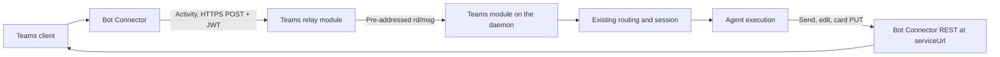

# Microsoft Teams Integration Design

Status: Proposed (draft). Provider facts come from Microsoft's documentation as
of October 2026; facts marked **unverified** still need a live probe against a
test tenant.

> Related: [platform modules](integration-plugin-architecture.md),
> [Google Chat](google-chat-integration.md), [DingTalk](dingtalk-integration.md),
> [session modes](channel-session-mode.md),
> [approval surfaces](slack-approval-dm.md),
> [product conventions](../product-conventions.md). Refs #3208.

## 1. Goal and scope

Add a native `msteams` integration. One Teams bot serves one agent across 1:1
chats, group chats, and the channels of the teams it is installed in. Teams
delivers every activity as an HTTPS POST, so ingress is a relay module; the
daemon sends, edits, and deletes through the Bot Connector REST API. No
Microsoft SDK is used.

| Capability           | Initial scope and boundary                                                                                             |
| -------------------- | ---------------------------------------------------------------------------------------------------------------------- |
| Distribution         | Each organization registers its own bot and Entra app and pastes the credentials into the Console (§2).                |
| Ingress              | Relay-terminated HTTPS with Bot Framework token verification and durable admission (§3, §4.2).                         |
| Conversations        | Every message the app's resource-specific consent delivers, filtered by the existing channel triggers (§4.1).          |
| Sessions             | A 1:1 chat is one session; a channel post is a thread; a group chat follows the DingTalk reply-chain model (§4.1).     |
| Replies              | Post once, then edit in place; extended Markdown; no native streaming (§4.3).                                          |
| Questions, approvals | Adaptive Cards with `Action.Execute`, answered in place; approvals from linked agent editors, else the Console (§4.4). |
| Setup                | A Console wizard that checks the credentials live and downloads the Teams app package for the admin to upload (§5).    |

Outside this scope: files and attachments in either direction, meetings and
calls ([voice participation](voice-meeting-participation.md)), the Teams Store,
one app serving many customer tenants (§8), native streaming, and one bot
serving several agents.

## 2. Distribution model

A Teams bot needs two registrations the organization makes itself:

- **An Entra app registration** with a client secret. Its application (client)
  ID is the bot's ID.
- **A bot registration** that names that app and the messaging endpoint, either
  an Azure Bot resource (needs an Azure subscription; the Teams channel is free
  on every tier) or a bot in the Teams Developer Portal (no Azure subscription;
  no Bot Service single sign-on, which v1 does not use). Since 31 July 2025 a
  new bot registration is single-tenant or uses a managed identity. A managed
  identity only obtains tokens on Azure compute, so v1 supports a client secret.

Credentials are the **app ID**, the **tenant ID**, and the **client secret**.
They map onto existing columns with no migration: `externalAppId` ← app ID,
`externalTenantId` ← tenant ID, and the `botToken` secret slot ← client secret.
The relay's assignment carries the app and tenant IDs only; the secret goes to
the daemon alone, as with Google Chat.

Validation requests a client-credentials token from the tenant's endpoint
(`https://login.microsoftonline.com/{tenantId}/oauth2/v2.0/token`, scope
`https://api.botframework.com/.default`). That proves the app, tenant, and
secret together, but not the messaging endpoint or the Teams channel; only the
first inbound activity proves those. An unreachable Entra answers 503; a
rejected secret answers 400.

## 3. Architecture

The messaging endpoint is the relay's `POST /msteams/messages`. Every request
carries a JWT in `Authorization`. The relay verifies it before routing:

- keys from `https://login.botframework.com/v1/.well-known/openidconfiguration`,
  cached and refreshed at least daily, refetched once for an unknown `kid`;
- issuer `https://api.botframework.com`, audience equal to the candidate bot's
  app ID, five minutes of clock skew;
- the `serviceUrl` claim equal to the activity's `serviceUrl`.

Demultiplexing follows the existing ladder: an unverified app ID from the token
and the tenant ID from `channelData.tenant.id` pick the candidate `Bot` row by
`(externalAppId, externalTenantId)`, and verification confirms it. A token that
fails, or one no assigned bot owns, answers 401 before anything is forwarded.
Tokens issued by Entra rather than the Bot Framework are refused.

Outbound calls go to the `serviceUrl` the conversation's latest activity
carried, which the daemon records per conversation; proactive sends need that
recorded reference, since Teams offers no lookup by email or user principal
name.

## 4. Behavior and invariants

### 4.1 Conversations, sessions, and mentions

`conversation.conversationType` is `personal`, `groupChat`, or `channel`.

- **1:1 chat.** One continuous session per chat, like every other platform's DM.
- **Channel.** Teams channels are threaded by construction: a top-level post
  opens a conversation whose ID ends in `;messageid=<root>`, and replies share
  it. The root ID is the thread key, so a new post starts a session and a reply
  continues it, as a Slack thread does.
- **Group chat.** There are no threads, so group chats follow the DingTalk model
  ([DingTalk §4.1](dingtalk-integration.md#41-conversations-sessions-and-identity)),
  itself Telegram's reply chain for groups without topics: a message that
  quotes nothing starts a session rooted at itself, a quote of a recorded bot
  message continues that message's session, and a quote that resolves to
  nothing starts a new session rather than guessing. The module implements the
  daemon's `canonicalizeThread` member, the third after Telegram and DingTalk.
  A send returns the new activity's ID, so the lookup is by message ID, as on
  Telegram. Whether a quoted reply carries the quoted message's ID is
  **unverified**; if it does not, group chats default to `append` instead.

That is the default `createNew` [session mode](channel-session-mode.md). Channel
and group-chat rows also offer `append`; a 1:1 chat offers no mode, so the
manifest declares `appendKinds: ['channel']`.

**Resource-specific consent (RSC).** By default Teams delivers only messages
that mention the bot. The app package requests `ChannelMessage.Read.Group` and
`ChatMessage.Read.Chat`, which the team owner or chat member who installs the
app grants for that team or chat alone. Teams then delivers every message there,
the same shape as Slack, which receives every message of the conversations it
has joined. The existing activation policy does the filtering, unchanged:

- the channel trigger `off`, `mention`, or `auto` decides whether an
  unmentioned new message starts work;
- thread affinity routes an unmentioned follow-up in a thread the agent already
  has an open session in, and a quote in a group chat lands in that thread
  through `canonicalizeThread`;
- anything else is dropped after admission and starts nothing.

The manifest therefore leaves `addressedByConstruction` unset. If a tenant
blocks RSC consent, the bot receives mentions only; `auto` and unmentioned
follow-ups then do nothing, and how the bot can detect that is **unverified**.

A mention arrives as a `mention` entity whose `mentioned.id` is the bot and
whose `text` is the `<at>…</at>` span in the activity text. The normalizer
removes exactly that span and sets `mentionedBots`; a display name is never
matched.

Identity is tenant-scoped: `from.aadObjectId` with the tenant ID identifies a
person, and `from.id` is specific to the bot. Display names are for display
only. Email and user principal name are available from the conversation member
API without Graph permissions, as optional enrichment; they never merge people.

### 4.2 Admission and redelivery

The relay forwards with `forwardStrict` and answers from the daemon's admission
verdict, as Google Chat does
([Google Chat §4](google-chat-integration.md#ack-is-an-admission-boundary)):
200 after a durable admission or a duplicate its receipt settles, 200 after a
deliberate gate, and 503 for a retryable refusal or an admission timeout. The
route settles within 10 seconds, because the Bot Service reports a timeout to
the client after 10 to 15.

Teams documents no redelivery for message activities, but duplicates of slow
deliveries are reported in practice. The relay's dedup table and the daemon's
durable receipt both key on the bot, the conversation ID, and the activity ID,
because Teams message IDs are unique only within a conversation; a duplicate
never starts a second turn. Whether a 503 is redelivered is **unverified**; if
it is not, a message that arrives while no daemon can admit it is lost, and
user documentation says so.

Non-message activities the module does not act on (typing, reactions,
`conversationUpdate`, `installationUpdate`) are answered 200 and not forwarded;
`installationUpdate` refreshes the recorded conversation reference.

### 4.3 Replies, editing, and Markdown

A turn posts one message as its acknowledgement and edits it in place
(`PUT /v3/conversations/{id}/activities/{activityId}`) as text arrives; a
channel reply posts into the thread's conversation ID. Microsoft's limits are
per bot per conversation — 7 operations a second, 60 per 30 seconds, 1,800 an
hour — and 50 requests a second per app per tenant, with 429 above them. The
turn output therefore:

- coalesces edits to at most one every two seconds per conversation, through a
  per-conversation send queue;
- shares a per-tenant write budget across the daemon, as the Google Chat module
  does;
- retries 429, 412, 502, and 504 with backoff, honoring `Retry-After`.

Text is sent with `textFormat: "extendedmarkdown"` (generally available since
8 October 2026), which renders headings, lists, fenced code, and tables, and
renders progressively as a message is edited. Rendering on mobile clients is
**unverified**. A message is limited to 100 KB, so the renderer splits an answer
under 80 KB into consecutive messages.

Native streaming works only in 1:1 chats, one stream per chat, at one update a
second, for at most two minutes. Turns often run longer, so v1 uses post-then-
edit everywhere; native streaming in 1:1 chats is later work.

### 4.4 Questions and approvals

Questions and approvals are Adaptive Cards (schema 1.6 or lower), built by the
module's `ElicitCardFacet` and `ApprovalCardFacet`. Each button is an
`Action.Execute` whose `data` carries the request ID, the option's position
(never its value), and a token.

A click arrives as an `adaptiveCard/action` invoke on the same endpoint, and the
client waits about five seconds for the HTTP response before retrying. The relay
verifies the token, dedupes by a hash of the click as Google Chat does, forwards
it to the integration as a `platform_action`, and answers at once with a short
text response (`type: "application/vnd.microsoft.activity.message"`), never
waiting for the daemon. How Teams shows that response is **unverified**. The
daemon re-checks the agent and integration, hands the click to the permission
coordinator, and replaces the card (`PUT` on the card's activity) with the
question and its decision and no controls. A refused click leaves the card as it
was and tells the clicker privately; whether that can be a targeted message in
group chats and channels is **unverified**.

Anyone who can see a question card may answer it, as on every surface. A tool
approval follows the editor check for in-chat cards
([approval surfaces](slack-approval-dm.md)): a click settles it only if the
clicker's Teams identity is linked to an editor of the agent. The module's
`chatMemberKey` is the clicker's `aadObjectId`, scoped by tenant. Linking needs the Console user's
Entra object ID; whether the sign-in connector records `oid` (stable in a
tenant) rather than `sub` (pairwise per application) is **unverified**. Until a
link exists, approvals go to the Console queue with a notice in the
conversation.

## 5. Console setup

The wizard walks the admin through both registrations and then:

- shows the messaging endpoint to paste, `https://<relay>/msteams/messages`;
- takes the app ID, tenant ID, and client secret, and checks them live (§2);
- downloads the Teams app package: `manifest.json` in the current schema, a
  192×192 color icon, and a 32×32 outline icon. The manifest names the bot's app
  ID with the `personal`, `team`, and `groupChat` scopes, the two RSC
  permissions with the `webApplicationInfo` they require, and the relay host in
  `validDomains`. The Control Plane builds it from the integration's row; its
  app ID is a GUID stable per integration, so a re-download updates the same
  app.

The admin uploads the package in the Teams admin center, or a user uploads it
where the organization's app setup policy allows custom apps. Installing it into
a team or group chat grants the RSC permissions for that place. The wizard
states both steps; neither can be automated without Graph permissions the
integration does not request.

## 6. Platform module work

The integration implements the four host contracts of the
[platform module design](integration-plugin-architecture.md) plus one registry
line per host: a relay module (token verification, demux hints, `forwardStrict`,
invoke handling), a daemon module (connection, `canonicalizeThread`,
`chatMemberKey`, turn output, card facets, write budget), a Control Plane
provider (credential schema, live validation, the package builder), and a
Console module (wizard, settings, mark). Normalization lives in the message
package with sanitized fixtures. The new id follows the tolerant-reader rule:
readers accept it a release before writers emit it in `KNOWN_PLATFORMS`. The
relay route is added to the chart's HTTPRoute in the same change.

## 7. Unverified and open

- Whether a quoted reply in a group chat carries the quoted message's ID (§4.1).
- What the bot receives when a tenant blocks RSC consent, and who may consent in
  a group chat (§4.1).
- Whether a 503 or a timeout is redelivered, and whether a redelivery keeps the
  same activity ID (§4.2).
- How Teams shows a text response to `Action.Execute`, and whether a refused
  clicker can be told privately in a group chat or channel (§4.4).
- Which Entra ID the sign-in connector records, which decides approval linking
  (§4.4).
- Extended Markdown on mobile clients (§4.3).
- Private and shared channels: Microsoft's pages disagree on whether bots may
  post there.

## 8. Later

- **One app for many tenants.** Microsoft documents a single-tenant bot
  registration with a multi-tenant Entra app as installable in any tenant. A
  hosted app would reuse Google Chat's anchor-and-claim pattern
  ([Google Chat §10](google-chat-integration.md#10-marketplace-distribution-and-multi-tenant-installs)),
  with one `Bot` row per customer tenant. Which tenant's token endpoint a
  cross-tenant send uses is unverified, and Store listing has its own review.
- **Native streaming** in 1:1 chats (§4.3).
- **Files**: 1:1 file consent cards, and Graph access for channel and group-chat
  files.

## 9. Validation

Use sanitized fixtures for normalization and token verification, then a test
tenant:

- An admin connects a bot from the Console without editing files on the daemon
  host; the package uploads and installs.
- A 1:1 message starts a session whose reply edits in place.
- A channel post starts a session; a reply in its thread continues it with and
  without a mention; a new post starts another.
- A group-chat quote of a bot reply continues its session; a new message starts
  another.
- A permission request shows as a card, and a click by a linked editor settles
  it; a click by anyone else does not.
- A redelivered activity does not start a second turn.
- A request with a missing or invalid token is rejected before routing.
- Edits stay within the per-conversation budget; 429 responses back off.
- The Control Plane never receives a message body.

## 10. References

- Bot Connector: [authentication](https://learn.microsoft.com/azure/bot-service/rest-api/bot-framework-rest-connector-authentication), [conversations](https://learn.microsoft.com/microsoftteams/platform/bots/build-conversational-capability), [channel and group chats](https://learn.microsoft.com/microsoftteams/platform/bots/how-to/conversations/channel-and-group-conversations), [proactive messages](https://learn.microsoft.com/microsoftteams/platform/bots/how-to/conversations/send-proactive-messages), [rate limits](https://learn.microsoft.com/microsoftteams/platform/bots/how-to/rate-limit), [Teams context](https://learn.microsoft.com/microsoftteams/platform/bots/how-to/get-teams-context).
- Registration: [Azure Bot quickstart](https://learn.microsoft.com/azure/bot-service/abs-quickstart), [Developer Portal](https://learn.microsoft.com/microsoftteams/platform/concepts/build-and-test/manage-your-apps-in-developer-portal), [app manifest](https://learn.microsoft.com/microsoft-365/extensibility/schema/), [custom app policies](https://learn.microsoft.com/microsoftteams/teams-custom-app-policies-and-settings).
- Messages and cards: [formatting](https://learn.microsoft.com/microsoftteams/platform/bots/how-to/format-your-bot-messages), [Universal Actions](https://learn.microsoft.com/adaptive-cards/authoring-cards/universal-action-model), [streaming](https://learn.microsoft.com/microsoftteams/platform/bots/streaming-ux).
- Consent: [resource-specific consent](https://learn.microsoft.com/microsoftteams/platform/graph-api/rsc/resource-specific-consent).
