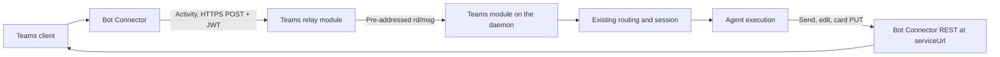

# Microsoft Teams Integration Design

Status: Proposed (draft). Provider facts come from Microsoft's documentation as
of October 2026. Facts marked **measured** come from a live probe against a
test tenant; facts marked **unverified** still need one.

> Related: [platform modules](integration-plugin-architecture.md),
> [Google Chat](google-chat-integration.md), [DingTalk](dingtalk-integration.md),
> [session modes](channel-session-mode.md),
> [approval surfaces](slack-approval-dm.md),
> [product conventions](../product-conventions.md). Refs #3208.

## 1. Goal and scope

Add a native `msteams` integration. One Teams bot serves one agent across 1:1
chats, group chats, and the channels of the teams it is installed in. Teams
delivers every activity as an HTTPS POST, so ingress is a relay module; the
daemon sends, edits, and deletes through the Bot Connector REST API. No
Microsoft SDK is used.

| Capability           | Initial scope and boundary                                                                                                                                   |
| -------------------- | ------------------------------------------------------------------------------------------------------------------------------------------------------------ |
| Distribution         | Each organization registers its own bot and Entra app and pastes the credentials into the Console (§2); or connects its tenant to the deployment's app (§8). |
| Ingress              | Relay-terminated HTTPS with Bot Framework token verification and durable admission (§3, §4.2).                                                               |
| Conversations        | Every message the app's resource-specific consent delivers, filtered by the existing channel triggers (§4.1).                                                |
| Sessions             | A 1:1 chat is one session; a channel post is a thread; a group chat follows the DingTalk reply-chain model (§4.1).                                           |
| Replies              | Post once, then edit in place; extended Markdown; no native streaming (§4.3).                                                                                |
| Questions, approvals | Adaptive Cards with `Action.Execute`, answered in place; who may approve follows session access sync (§4.4, §4.5).                                           |
| Setup                | A Console wizard that checks the credentials live and downloads the Teams app package for the admin to upload (§5).                                          |
| Access               | Microsoft sign-in links a person; session access sync checks conversation membership with the bot's credentials (§4.5).                                      |

Outside this scope: files and attachments in either direction, meetings and
calls ([voice participation](voice-meeting-participation.md)), the Teams Store,
native streaming, and one bot serving several agents.

## 2. Distribution model

A Teams bot needs two registrations the organization makes itself:

- **An Entra app registration** with a client secret. Its application (client)
  ID is the bot's ID.
- **A bot registration** that names that app and the messaging endpoint, either
  an Azure Bot resource (needs an Azure subscription; the Teams channel is free
  on every tier) or a bot in the Teams Developer Portal (no Azure subscription;
  no Bot Service single sign-on, which v1 does not use). Since 31 July 2025 a
  new bot registration is single-tenant or uses a managed identity. A managed
  identity only obtains tokens on Azure compute, so v1 supports a client secret.

Credentials are the **app ID**, the **tenant ID**, and the **client secret**.
They map onto existing columns with no migration: `externalAppId` ← app ID,
`externalTenantId` ← tenant ID, and the `botToken` secret slot ← client secret.
The relay's assignment carries the app and tenant IDs and the bot's mention
identity `28:<appId>`; the secret goes to the daemon alone, as with Google Chat.

Validation requests a client-credentials token from the tenant's endpoint
(`https://login.microsoftonline.com/{tenantId}/oauth2/v2.0/token`, scope
`https://api.botframework.com/.default`). That proves the app, tenant, and
secret together, but not the messaging endpoint or the Teams channel; only the
first inbound activity proves those. An unreachable Entra answers 503
(`MSTEAMS_CHECK_UNAVAILABLE`); a definitive refusal answers 400 with a code the
Console shows: `MSTEAMS_SECRET_INVALID` (a wrong or expired secret),
`MSTEAMS_APP_NOT_FOUND`, `MSTEAMS_TENANT_NOT_FOUND`, or
`MSTEAMS_CREDENTIALS_INVALID`. Both IDs are stored lower-cased, since the relay
matches them exactly. A Developer Portal bot obtains its token from the
tenant endpoint and receives Bot Framework tokens inbound (**measured**).

The Developer Portal creates the bot's Entra app as multi-tenant, open to all
tenants, by default (**measured**). It also ties the bots it lists to the
signed-in name of the person who created them: after that person's sign-in name
was changed to a custom domain, the portal listed none of their bots and could
not open one by its ID, while the bots themselves kept receiving traffic
(**measured**). A bot that needs another owner, or whose owner's sign-in name
may change, is safer as an Azure Bot resource.

## 3. Architecture

The messaging endpoint is the relay's `POST /msteams/messages`. Every request
carries a JWT in `Authorization`. The relay verifies it before routing:

- keys from `https://login.botframework.com/v1/.well-known/openidconfiguration`,
  cached and refreshed at least daily, refetched once for an unknown `kid`;
- issuer `https://api.botframework.com`, audience equal to the candidate bot's
  app ID, five minutes of clock skew;
- the `serviceUrl` claim equal to the activity's `serviceUrl`.

Demultiplexing follows the existing ladder: an unverified app ID from the token
and the tenant ID from `channelData.tenant.id` pick the candidate `Bot` row by
`(externalAppId, externalTenantId)`, and verification confirms it. A token that
fails, or one no assigned bot owns, answers 401 before anything is forwarded.
Tokens issued by Entra rather than the Bot Framework are refused.

Outbound calls go to the `serviceUrl` the conversation's latest activity
carried, which the daemon records per conversation; proactive sends need that
recorded reference, since Teams offers no lookup by email or user principal
name. The `serviceUrl` is regional and tenant-specific
(`https://smba.trafficmanager.net/<region>/<tenantId>/`), so it is read, never
built (**measured**). A proactive 1:1 is opened by `POST v3/conversations`
naming the person by the `29:` ID their roster entry carries; that works for a
member of a team the app is installed in even if they never installed it
themselves. Named by their Entra object ID instead, the same person is refused
with 403 `BadArgument`, "Bot is not installed in user's personal scope"
(**measured**, both).

## 4. Behavior and invariants

### 4.1 Conversations, sessions, and mentions

`conversation.conversationType` is `personal`, `groupChat`, or `channel`.

- **1:1 chat.** One continuous session per chat, like every other platform's DM.
- **Channel.** Teams channels are threaded by construction: a top-level post
  opens a conversation whose ID ends in `;messageid=<root>`, and replies share
  it. The root ID is the thread key, so a new post starts a session and a reply
  continues it, as a Slack thread does. A reply's `replyToId` is empty, so the
  key comes from the conversation ID alone, and a post's subject line never
  reaches the bot, only its body (**measured**).
- **Group chat.** There are no threads, so group chats follow the DingTalk model
  ([DingTalk §4.1](dingtalk-integration.md#41-conversations-sessions-and-identity)),
  itself Telegram's reply chain for groups without topics: a message that
  quotes nothing starts a session rooted at itself, a quote of a recorded bot
  message continues that message's session, and a quote that resolves to
  nothing starts a new session rather than guessing. The module implements the
  daemon's `canonicalizeThread` member, the third after Telegram and DingTalk.
  A quoted reply carries a `quotedReply` entity whose `messageId` is the quoted
  activity's ID — for a bot message, the ID its send returned — with the
  quoted `senderId` and `validatedMessageReference: true`, so the lookup is by
  message ID, as on Telegram (**measured** in a 1:1 chat). The text starts with
  `<quoted messageId="…"/>` and the HTML attachment with the quoted block; the
  normalizer removes both. Channel threads offer no quote action.

That is the default `createNew` [session mode](channel-session-mode.md). Channel
and group-chat rows also offer `append`; a 1:1 chat offers no mode, so the
manifest declares `appendKinds: ['channel']`.

**Resource-specific consent (RSC).** By default Teams delivers only messages
that mention the bot. The app package requests `ChannelMessage.Read.Group` and
`ChatMessage.Read.Chat`, which the team owner or chat member who installs the
app grants for that team or chat alone. The install dialog lists them as "Read
messages in this team." and "Read this chat's messages." beside reading the
roster; an administrator's install from the Teams admin center grants them with
no prompt. Teams then delivers every message there — unmentioned top-level
posts and thread replies alike (**measured**) — the same shape as Slack, which
receives every message of the conversations it has joined. The existing
activation policy does the filtering, unchanged:

- the channel trigger `off`, `mention`, or `auto` decides whether an
  unmentioned new message starts work;
- thread affinity routes an unmentioned follow-up in a thread the agent already
  has an open session in, and a quote in a group chat lands in that thread
  through `canonicalizeThread`;
- anything else is dropped after admission and starts nothing.

That holds in a team's standard channels only. In a private or a shared
channel, where the app is added to the channel itself, Teams delivered a
mention and the bot's replies posted there, but an unmentioned thread reply
never reached the relay (**measured** in both, with the team holding the
grant). Neither the layout nor the channel's own install is the cause: a
standard channel switched to the threads layout still delivered the
unmentioned reply, and removing the app from the private channel and adding
it back changed nothing. A thread there continues only through a mention. Whether an
unmentioned top-level post there reaches an `auto` trigger is **unverified**.

The manifest therefore leaves `addressedByConstruction` unset. If a tenant
blocks RSC consent, the bot receives mentions only; `auto` and unmentioned
follow-ups then do nothing, and how the bot can detect that is **unverified**.

The package also requests the grants other features read through Microsoft
Graph, so that an installed app does not have to ask its installers again:
`ChannelSettings.Read.Group` and `ChannelMember.Read.Group` for a team's channel
names and members, `TeamSettings.Read.Group` for a team's visibility (§4.6),
and `OnlineMeeting.ReadBasic.Chat` and `OnlineMeetingTranscript.Read.Chat` for
a meeting chat's meeting details and transcripts. A shared channel's members
and a team's visibility are read (§4.6); the rest are not yet. An organization
that installed an earlier package grants them when it uploads a re-downloaded
one.

A mention arrives as a `mention` entity whose `mentioned.id` is the bot
(`28:<appId>`) and whose `text` is the `<at>…</at>` span in the activity text
(**measured**). The normalizer removes exactly that span and sets
`mentionedBots`, lower-casing a `28:` ID; a display name is never matched. The
relay reads a mention as addressing the bot only through the assignment's
`28:<appId>`, so a channel's first contact is a mention: it reaches the daemon,
which registers the channel for the Console, Off where the agent is gated.

A channel's messages carry its ID but not its name, so the daemon names a
channel from its team's channel list, `GET {serviceUrl}/v3/teams/{teamId}/conversations`,
read with the bot's own token at most once per team every ten minutes. Teams
answers the default channel, whose ID is the team's, unnamed (**measured**), and the Console shows it as **General**,
as the Teams client does. A failed read leaves the ID until the next one.

Identity is tenant-scoped: `from.aadObjectId` with the tenant ID identifies a
person, and `from.id` is specific to the bot. Display names are for display
only. Email and user principal name are available from the conversation member
API without Graph permissions, as optional enrichment; they never merge people.

### 4.2 Admission and redelivery

The relay forwards with `forwardStrict` and answers from the daemon's admission
verdict, as Google Chat does
([Google Chat §4](google-chat-integration.md#ack-is-an-admission-boundary)):
200 after a durable admission or a duplicate its receipt settles, 200 after a
deliberate gate, and 503 for a retryable refusal or an admission timeout. The
route settles within 10 seconds, which keeps relay requests bounded.

Redelivery is minimal (**measured**). A 503 brings exactly one redelivery about
a second later, with the same activity ID, and nothing after it. An answer that
takes 20 seconds brings none, and the sender sees no error. A 503 therefore
buys one immediate retry, which no daemon restart or handover fits inside, so a
message that arrives while no daemon can admit it is lost, as on DingTalk, and
user documentation says so. The relay's dedup table and the daemon's durable
receipt both key on the bot, the conversation ID, and the activity ID, because
Teams message IDs are unique only within a conversation; the retry never starts
a second turn.

Non-message activities the module does not act on (typing, reactions,
`conversationUpdate`, `installationUpdate`) are answered 200 and not forwarded;
`installationUpdate` refreshes the recorded conversation reference.

### 4.3 Replies, editing, and Markdown

A turn posts one message as its acknowledgement and edits it in place
(`PUT /v3/conversations/{id}/activities/{activityId}`) as text arrives; a
channel reply posts into the thread's conversation ID. Microsoft's limits are
per bot per conversation — 7 operations a second, 60 per 30 seconds, 1,800 an
hour — and 50 requests a second per app per tenant, with 429 above them. The
turn output therefore:

- coalesces edits to at most one every two seconds per conversation, through a
  per-conversation send queue;
- shares a per-tenant write budget across the daemon, as the Google Chat module
  does;
- retries 429, 412, 502, and 504 with backoff, honoring `Retry-After`.

Text is sent with `textFormat: "extendedmarkdown"` (generally available since
8 October 2026), which renders headings, both list kinds, quotes, fenced code
with a copy button, and tables in the web client, and renders progressively as
a message is edited (**measured**; the fence's language label is not shown).
Rendering on mobile clients is **unverified**. A message is limited to 100 KB,
so the renderer splits an answer under 80 KB into consecutive messages.

Native streaming works only in 1:1 chats, one stream per chat, at one update a
second, for at most two minutes. Turns often run longer, so v1 uses post-then-
edit everywhere; native streaming in 1:1 chats is later work.

### 4.4 Questions and approvals

Questions and approvals are Adaptive Cards (schema 1.6 or lower), built by the
module's `ElicitCardFacet` and `ApprovalCardFacet`. Each button is an
`Action.Execute` whose `data` carries the request ID, the option's position
(never its value), and a token.

A click arrives as an `adaptiveCard/action` invoke on the same endpoint, with
`replyToId` set to the card's activity ID, and the client waits about five
seconds for the HTTP response before retrying. The relay verifies the token,
dedupes by a hash of the click as Google Chat does, forwards it to the
integration as a `platform_action`, and answers at once with a short text
response (`type: "application/vnd.microsoft.activity.message"`), never waiting
for the daemon; the clicker sees that text as a dismissible note under the
card. The daemon re-checks the agent and integration, hands the click to the
permission coordinator, and replaces the card (`PUT` on the card's activity)
with the question and its decision and no controls; the client then shows the
card as edited (**measured**). A refused click leaves the card as it
was and tells the clicker privately: the daemon returns the refusal in the
click's `rd/ack` `response`, and the relay answers the invoke with it in place
of the generic note when the ack arrives within its two-second wait; a later ack
leaves the generic note. Whether a targeted message in group chats and channels
could carry it instead is **unverified**.

Anyone who can see a question card may answer it, as on every surface. A tool
approval follows the chat-authority rule for in-chat cards
([approval surfaces](slack-approval-dm.md), "What people can do in chat" in
[product conventions](../product-conventions.md)). While the organization has
not enabled Teams session access sync, anyone in the conversation may approve at
the agent's chat level. With sync on, a click settles an approval only when the
clicker is linked to an editor of the agent (§4.5); an unlinked clicker or a
non-editor is refused privately and the card stays live. The module's
`chatMemberKey` is the clicker's `aadObjectId`, lower-cased.

In an external place (§4.6) no approval card goes into the conversation, as on
Slack ([assistant mode](assistant-mode.md) §5.5): a neutral notice does, and
the card goes to the asker's own 1:1 chat when they are a full member of the
home tenant. The connection opens that chat (`openDirectMessage`) by the
asker's `29:` ID, read from a conversation the bot shares with them. Only the
asker may answer that card, judged as the asker of the external place, so an
approval switched off there or a conversation closed since refuses them too.
An asker who is not a full member, or whose chat cannot be opened, leaves the
request on the editor path. The card is the module's `ApprovalCardFacet` card,
posted through core's platform-neutral asker path, which any platform whose
connection offers `isFullMember` and `openDirectMessage` shares; Slack keeps its
own DM card.

On the editor path (an external place with sync on, an asker who is not a full
member, or no asker card) the editor DM reaches Teams too
([approval surfaces](slack-approval-dm.md) §3). The Control Plane walks the same
preference chain with each editor's linked Microsoft account (§4.5), and the
daemon posts the same card into the chosen editor's 1:1 chat, under a line that
names the agent and the person who asked and links the session. The connection
opens that chat by the `29:` ID from a conversation it shares with the editor,
else from the roster of a team it knows, which lists every team member. Only that
editor answers the card, rechecked by the Control Plane on each click as Slack's
DM is; the chat approval level does not reach it. A Slack integration of the same
agent is tried first, so an editor linked on both gets Slack's DM. The same card
goes beside a card that only editors may answer (sync on, and the person who
asked is not an editor): the routed editor gets it in their 1:1 chat while the
conversation's card stays, and the first answer from either decides. Its handle
is the row's `beside*` one, so the reconnect sweep retires it too. Questions
(elicitations) stay Slack-only; on Teams they are answered in the console.

### 4.5 Sign-in, linking, and session access sync

Teams joins the existing permission sync model as Telegram, Discord, and Google
Chat did ([Telegram and Discord permission sync](telegram-discord-permission-sync.md)):
one login application per installation proves who a person is, each
organization's own bot checks what that person may read, and an organization
owner turns sync on under **Settings → Session access**.

**What identifies a person (measured).** In the test tenant, one member's Entra
object ID, as the Entra admin center shows it, is the `from.aadObjectId` of
every activity that member sends, in a 1:1 chat and in a channel alike. The
Bot Connector member APIs return the same value with the bot's own token and no
Graph permission: `GET /v3/conversations/{teamId}/pagedmembers` as `aadObjectId`,
and the older `GET /v3/conversations/{id}/members` as `objectId`. Every member
also carries the bot's tenant ID and a `userRole` of `user` or `guest`. A
standard channel's member list is its team's roster (**measured**).

**Which ID each sign-in connector records.** The deployment's identity
provider offers three Microsoft connectors, and they record different IDs:

| Connector                     | Identity it records                                               | Usable as the link key                        |
| ----------------------------- | ----------------------------------------------------------------- | --------------------------------------------- |
| Azure AD social connector     | Graph `GET /me` `id`, the user's Entra object ID                  | Yes: equals `aadObjectId` for a tenant member |
| Microsoft Entra ID OIDC (SSO) | the ID token's `sub`, with the other claims kept as extra details | Not `sub`, which is pairwise per application  |
| Microsoft Entra ID SAML (SSO) | the SAML `nameID`                                                 | Only if `nameID` is mapped to the object ID   |

The social connector is the one to use. It is a social sign-in like the others
the Console already offers, so Setup manages it as it manages Discord: one Entra
application registered for the installation, multi-tenant and open to all
tenants, with authority `organizations` so personal Microsoft accounts cannot
sign in. Setup creates or updates the connector with target `azuread`, enables
the target, and keeps the client secret write-only. A person links Microsoft
under **Profile → Sign-in methods**, which records their object ID.

A sign-in through that connector, in the test tenant, recorded the member's
object ID as the identity's user ID, the same lower-case value as the
`aadObjectId` of their Teams activities (**measured**). The identity holds the
Graph profile and no tenant ID.

The connector runs with email sync off. Graph's `mail` is a directory attribute
any tenant's administrator can set, and with `organizations` the connector
accepts every tenant, so a synced address could equal an existing Console
user's email, and automatic account linking would then attach the foreign
identity to that user. With sync off the address stays in the raw profile and
never becomes an identifier (**measured**: the new identity's user has no
primary email).

Each person consents to the login application on first sign-in, and Entra
labels an application without a verified publisher **unverified** on that
prompt (**measured**). Tenants that allow user consent only for verified
publishers block that prompt, so the installation's application needs
publisher verification before customers use it, or an administrator in each
tenant consents for its members.

**The link key.** The Control Plane reads the linked identity as
`{ platform: 'msteams', tenant: 'global', memberId: <object ID, lower-cased> }`,
and the Teams provider's `chatMemberTenant` answers `global` while its bot is
live and the deployment offers Microsoft sign-in. The connector records no
tenant ID (Graph's `/me` carries none), but none is needed: Entra assigns every
object ID, so a person can link only their own, and the bot row already fences
each activity to its tenant (§3).

A guest is the one person this cannot link. A guest in the bot's tenant is a
separate directory object there, so Teams sends that object's ID, while the
guest signs in to the Console through their home tenant and links its ID.
Guests therefore stay unlinked, and with sync on they cannot approve or read
sessions in the Console.

**Access rules with sync on.**

- A conversation admits its current members: a 1:1 chat its one member, a
  standard channel its team's roster, a group chat its members. The Control
  Plane asks with the conversation's bot token for one member,
  `GET /v3/conversations/{conversationId}/members/{objectId}`, and admits the
  viewer only when the answer carries the same `aadObjectId` and the bot's
  tenant ID. A non-member answers 404 `MemberNotFoundInConversation`, and an
  unknown conversation 404 `ConversationNotFound` (**measured**).
- The session's audience realm is the bot's tenant ID and its resource is the
  conversation ID without a thread suffix. The lookup goes to the public cloud's
  global Bot Connector origin, `https://smba.trafficmanager.net/teams/`, which
  answers it for a conversation whose activities carry a regional `serviceUrl`
  (**measured**), so the audience records no service URL. National clouds have
  other origins and are out of scope.
- Approvals and in-chat settings follow §4.4: linked editors only.
- A missing link, a revoked bot, a mismatched tenant, a malformed response, or a
  provider failure never grants access. A successful verdict lasts at most two
  minutes, as for the other providers.

Turning sync on and off, the fence on historical sessions, and the migration
that marks earlier Teams conversations pending follow the same rules as
Telegram and Discord. Only identity and membership metadata reach the Control
Plane; message bodies stay on the daemon.

**What exists.** Sign-in is the Setup login application (**Setup → Microsoft**,
connector `agentconnect-azuread`) with the Console's Microsoft entry on the
sign-in page and under **Profile → Sign-in methods**; the Control Plane lists a
linked object ID as an `msteams` member. Sync is the Teams provider's
`chatMemberTenant` and audience realm, the session-access plugin over the
member lookup (enabled when the deployment offers Microsoft sign-in), the
`msteams` audience in the protocol and daemon, the **Settings → Session access**
row, and the migrations that fence earlier Teams conversations on the Control
Plane and bind them to their tenant in the daemon's store.

With sync on, a linked member's channel @mention settled its session under the
bot's tenant and that channel, and the member could open it in the Console;
sessions from before sync stayed hidden until their conversation spoke again,
and a session of another tenant stayed hidden from a member of this one
(**measured**).

### 4.6 Audience

A Teams place is judged external by the same three signals as any platform
([assistant-mode.md §5.3](assistant-mode.md)), read with the bot's own token:

- **Shared.** A shared channel (the team's channel list's `type`: `standard`,
  `private` or `shared`) is shared with another organization when one of its
  members, read through Graph's `allMembers` under `ChannelMember.Read.Group`,
  belongs to another tenant; its posts then carry the share and
  `getChannelInfo` reports it. A shared channel whose members cannot be read,
  or are more than one listing reads, is taken to reach another organization; a
  channel whose type cannot be read is unknown, never unshared. The share lifts
  when no member from another tenant remains.
- **A guest.** A person added to a channel, chat or team (`conversationUpdate`
  with `membersAdded`, forwarded by the relay) is looked up in that
  conversation. `userRole: guest` makes the place external, and it stays so.
  A person added to a team reaches every standard channel the team's list
  names.
- **Another organization.** A looked-up `tenantId` other than the bot's tenant
  makes the place external the same way.

A person is a full member, who may approve a draft, when a lookup in a
conversation the bot shares with them answers `userRole: user` in the bot's
tenant; no conversation to ask means no answer, never yes. A conversation's
member list is authoritative: `pagedmembers` for standard and private channels
and chats, and Graph's `allMembers` for a shared channel, whose Bot Connector
read refuses the bot (**measured**, HTTP 403).

A standard channel is open to its whole team, so it reports public only when
Graph reads its team's `visibility` as `public` under `TeamSettings.Read.Group`;
a private or hidden team, or one whose visibility cannot be read, keeps it
private. Private and shared channels are their members' and report private. A
chat is shared with no organization; a person from another one in it is a
member's reason, found when they join.

A place that turns external this way starts Off for every agent until an
editor enables it, as a Slack Connect channel does. Teams gives the relay no
egress, so a mention there is handed to the bot's agent's daemon, which posts
the one-time notice and starts no turn. The relay-ingress `observe` step has
already recorded the conversation's `serviceUrl` by then, so the notice can
answer even the conversation's first activity.

Measured in a shared channel once a member from another tenant joined: the
join wrote the channel's row Off and undecided with `externalMember` as its
reason, and a mention was dropped. Before the fix there was nothing; after it
the thread got the notice once. Enabled from the Console, the next mention ran
a turn whose session took `external` visibility, synced to the conversation's
members, while the row kept its reason. Graph's `allMembers` listed the
requester twice there, once directly and once through the team the channel is
shared with; the read keeps one entry per user ID (**measured**).

### 4.7 First run: welcome and help

The Teams Store requires a bot to greet the people who install it and to
answer `help`, so a first contact never dead-ends.

- **Welcome.** A `conversationUpdate` that adds the bot itself is forwarded to
  the bot's agent as a `platform_action` (`bot-added`: the conversation, its
  scope, the bot's manifest name, and who added it). Core composes one welcome
  and Teams posts it as an Adaptive Card: the bot's name, what it does, how to
  reach it in that scope, a line that an admin turns it on in the console when
  the conversation is not enabled yet, how to ask for help, and links to the
  console, the guide and support. Outside a 1:1 chat the card mentions the
  person who added the bot. The relay's dedup key is the conversation and the
  activity, so a redelivery welcomes once and a later reinstall again.
  `installationUpdate` starts nothing.
- **Help.** A message that is exactly `help` (the bot's mention removed) is
  answered by the daemon's relay-ingress step with how to use the bot, every
  command, and the guide and support links; it starts no turn. It runs after
  the gate, so in a conversation that is not enabled the not-enabled notice
  answers instead.
- **Manifest.** The bot's command list offers `help` and two prompts the agent
  answers, and the long description says an admin connects the app to an
  AgentConnect organization first and where to sign up or ask.

A tenant no organization has connected still gets nothing: its activities
match no row (§8.3). That case needs the deployment app's own answer and is
not covered here.

## 5. Console setup

The wizard walks the admin through both registrations and then:

- shows the messaging endpoint to paste, `https://<relay>/msteams/messages`;
- takes the app ID, tenant ID, and client secret, and checks them live (§2);
- downloads the Teams app package: `manifest.json` in the current schema, a
  192×192 color icon, and a 32×32 outline icon. The manifest names the bot's app
  ID with the `personal`, `team`, and `groupChat` scopes, the RSC
  permissions with the `webApplicationInfo` they require, the relay host in
  `validDomains`, and `supportsChannelFeatures: "tier1"`, without which Teams
  refuses a v1.25-or-later manifest that has the `team` scope (**measured**).
  The Control Plane builds it from the integration's row
  (`GET /integrations/:id/msteams/app-package`). Its app ID is a UUIDv5 of the
  bot's app ID, so a re-download, even after a reinstall, updates the same app,
  and its version grows with each download. The catalog
  assigns the uploaded app an ID of its own and keeps the manifest's as its
  external ID.

The admin uploads the package in the Teams admin center, or a user uploads it
where the organization's app setup policy allows custom apps. Installing it into
a team or group chat grants the RSC permissions for that place. The wizard
states both steps; neither can be automated without Graph permissions the
integration does not request.

The install paths differ widely in how fast they take effect (**measured** in
a new tenant). The admin center's "Add to team" installs at once: the bot
receives `conversationUpdate` and `installationUpdate` within a second. A
personal-scope install for chosen users took about three and a half hours to
reach the Bot Connector, and the Teams client took hours to list the uploaded
app. The wizard therefore leads with the admin center upload and "Add to team",
and says that 1:1 chats may take hours to open.

### 5.1 Keeping the app current

The agent's name and icon, and the manifest itself, live in the package, so
Teams shows what was last published until a new package reaches it. Microsoft
lets only a Teams administrator's delegated token update a catalog app; no
application permission can, so the Control Plane cannot push a change in the
background as it does a Telegram or Discord avatar.

The Control Plane records a fingerprint of each package that reaches Teams in
the bot row's `platformConfig.appPackage`: a hash of the manifest without its
version and of the agent's icon descriptor. A connected tenant records it after
each catalog publish whose team upgrades all succeeded (§8.3); an own bot records it on each download, the last
step the Control Plane sees before the admin uploads by hand.
`GET /integrations/:id/msteams/app-package/status` compares it with the package
the integration would build now, and a row with none counts as out of date.

When they differ, the bot's row in the Console says Teams has an older version.
A connected tenant gets **Update in Teams**, which runs the connect flow of §8.3
again for the same agent; an own bot uploads a fresh download. A new
resource-specific permission is part of the manifest, so it surfaces the same
way, and the connect flow's team upgrade re-consents it without removing the
app from the team (§8.3 step 5).

Measured on a connected tenant whose catalog app carried another agent's name
and icon: **Update in Teams** took the administrator through Microsoft's
account picker with no new consent, and the connect page reported the one team
that had the app as updated. The admin center showed the new version with this
agent's icon, accent color and description after about two minutes, and the
team's app list showed the new icon without the app being removed. Reads that
need the team's resource-specific grants kept answering, and the Console then
counted the package current (**measured**).

## 6. Platform module work

The integration implements the four host contracts of the
[platform module design](integration-plugin-architecture.md) plus one registry
line per host: a relay module (token verification, demux hints, `forwardStrict`,
invoke handling), a daemon module (connection, `canonicalizeThread`,
`chatMemberKey`, turn output, card facets, write budget), a Control Plane
provider (credential schema, live validation, the package builder), and a
Console module (wizard, settings, mark). Normalization lives in the message
package with sanitized fixtures. The new id follows the tolerant-reader rule:
readers accept it a release before writers emit it in `KNOWN_PLATFORMS`. The
relay route is added to the chart's HTTPRoute in the same change.

## 7. Unverified and open

- That a group-chat quote carries the same `quotedReply` entity as the measured
  1:1 quote (§4.1).
- What the bot receives when a tenant blocks RSC consent, and who may consent in
  a group chat (§4.1).
- Whether a refused clicker can be told privately in a group chat or channel
  (§4.4).
- What a member sees when their tenant blocks user consent to an unverified or
  any third-party application, and that an administrator's consent unblocks
  linking (§4.5).
- The member list of a group chat and of private and shared channels (§4.5).
- Extended Markdown on mobile clients (§4.3).
- That the upgrade of §8.3 step 5 takes a resource-specific permission the team
  has not granted before (the measured upgrade re-consented grants it already
  held), and how soon a personal install shows a new icon, which the Control
  Plane does not upgrade (§5.1).

## 8. The deployment's Teams app

Status: **implemented and measured** in a second tenant (§8.3); the Console
offers it once Setup configures the app. Each organization can still register
its own bot (§2); this
section adds one app the deployment operates, so an organization connects its
Microsoft 365 tenant from the Console with an administrator's sign-in and no
registration, package download or upload of its own.

### 8.1 Provider facts

Measured with a Developer Portal bot whose Entra app is multi-tenant, from a
second, new tenant:

- The customer's admin uploads the package in the Teams admin center and adds
  the app to a team; no Store listing or Partner Center review is needed.
  Installation events and a channel mention reached the bot's endpoint within
  two seconds of **Add to team**.
- Installing created the app's service principal in the customer tenant: a
  client-credentials request against that tenant failed with AADSTS7000229
  before the install and succeeds after it.
- Sending into the customer tenant takes a token from the bot's **home**
  tenant; tokens from the customer tenant and from `botframework.com` are
  refused with 401. The Bot Connector origin is regional and carries the
  customer tenant, for example `https://smba.trafficmanager.net/amer/<tenant>/`,
  and arrives as each activity's `serviceUrl`.
- A new tenant's app management takes most of an hour to become usable; an
  upload made before then did not persist.
- The admin's upload can be replaced by Graph calls made while the admin is
  signed in, with three delegated scopes and admin consent:
  `AppCatalog.ReadWrite.All` publishes the package to the organization
  catalog (published at once, no review; application permissions are not
  supported for this call), `Team.ReadBasic.All` lists the admin's teams, and
  `TeamsAppInstallation.ReadWriteAndConsentSelfForTeam` installs the app into
  the chosen team with its resource-specific permissions in
  `consentedPermissionSet`. "Self" binds the token to the app it installs, so
  the signed-in application must be the bot's own Entra app. The install
  returned 201, the bot received its installation events, and the team then
  held the app's `ChannelMessage.Read.Group` grant. The same install for a
  package whose bot ID had no bot registration failed with 400 at the step
  that adds the bot to the team.

### 8.2 The app and its rows

The deployment app is the Microsoft sign-in application of §4.5, as Slack's
platform app is also its sign-in app. **Setup → Microsoft** holds one Entra
application (client) ID and one write-only client secret; entering the app's
**home tenant ID** there makes it the Teams app too, and clearing either turns
Teams off. The operator registers a bot for the app whose messaging endpoint is
the relay's `/msteams/messages`, and adds the Console's connect page (§8.3) as
another Web redirect URI; Setup shows both URLs. Setup checks the secret with a
client-credentials request to the home tenant, as §2 does, before it saves the
tenant. One app and one secret mean a rotation reaches sign-in and Teams
together.

Every connected tenant gets a **customer row**: the deployment app's ID as
`externalAppId` and the customer tenant as `externalTenantId`, one row per
`(app, tenant)`, owned by one organization, marked prebuilt, with a copy of the
deployment secret. Its public `platformConfig` records the home tenant as
`tokenTenantId`. A boot pass re-stamps the secret on every customer row when
the configured secret changes, as Google Chat's reconciler does
([Google Chat §10.3](google-chat-integration.md#103-data-model-one-row-per-customer-as-slack-does-per-team)).

The relay needs nothing new: its assignment is the `(app ID, tenant ID)` pair
of §3, so the composite index routes each activity to its tenant's row, and an
activity from a tenant no row claims matches nothing and is dropped. Where a
tenant matters, the two tenants stay apart:

- **The customer tenant** is the session realm (§4.5), the daemon's tenant
  scope, the relay's fence, and the tenant whose members are matched.
- **The token tenant** issues every token the bot uses: the daemon's outbound
  calls and the Control Plane's member lookups (§4.5). `IntegrationMsTeamsConfig`
  gains an optional `tokenTenantId`; absent, it is `tenantId`, so an
  organization's own bot is unchanged.

One customer row serves one agent, as an organization's own bot does (§1). An
organization that wants another agent in the same tenant registers its own bot
for it.

### 8.3 Connecting a tenant

When the deployment app is configured, the Teams wizard leads with **Connect
with Microsoft** and keeps **Register your own bot instead** one click away. A
per-agent install that pastes the deployment app's ID is refused
(`MSTEAMS_DEPLOYMENT_APP`), and a customer row's secret follows the Setup Server
rather than a Console rotation.

1. **Sign-in.** The Console asks the Control Plane for an authorization URL
   (`POST /orgs/:orgId/integrations/msteams/connect`, `{ agentId }`, an editor
   of the agent). The Control Plane signs a state of the organization, the
   agent, the caller and an expiry of ten minutes, and returns Microsoft's
   `organizations` authorize URL for the deployment app with the three scopes
   of §8.1, `User.Read` (the organization's display name, which names the
   integration in the Console), and `openid`, a PKCE challenge whose verifier only the Control
   Plane can derive from the state, and the Console's
   `/msteams/connect` page as the redirect URI.
2. **Exchange.** That page posts the code and state back
   (`POST /orgs/:orgId/integrations/msteams/connect/callback`). The Control
   Plane checks the state and caller, redeems the code with the deployment
   secret, and takes the customer tenant from the ID token's `tid`, received
   straight from Entra's token endpoint. A personal Microsoft account is
   refused.
3. **The row.** A tenant another organization holds is refused
   (`MSTEAMS_TENANT_TAKEN`, naming no organization). A tenant this organization
   holds for another agent is refused (`MSTEAMS_TENANT_IN_USE`) until that
   integration is removed. Otherwise the Control Plane writes or reuses the
   customer row, installs it on the agent, and syncs the relay assignment.
4. **The catalog.** It builds the package of §5 from the row and publishes it
   to the tenant's organization catalog, or adds an app definition when the
   catalog already holds the app's external ID, so a reconnect updates it.
5. **The team.** It answers the admin's teams (`/me/joinedTeams`) and a
   short-lived, encrypted handle to the delegated token, which never leaves the
   Control Plane in the clear. The page lists the teams; the admin picks one or
   more and the Control Plane installs the app into each with the package's
   resource-specific permissions
   (`POST /orgs/:orgId/integrations/msteams/connect/install`). Before answering,
   the Control Plane upgrades the app to the published definition in each of
   those teams that already has it
   (`POST /teams/{id}/installedApps/{id}/upgrade`), consenting to the
   package's resource-specific permissions again; the delegated
   `TeamsAppInstallation.ReadWriteAndConsentSelfForTeam` scope covers both the
   read and the upgrade. A team that only picks up a new grant after the app is
   removed and added again (**measured** without this step) takes it here. The
   page marks those teams as updated and preselects none of the others. A team
   whose read or upgrade Microsoft refuses or fails is marked as not updated
   and cannot be picked for an install, which would count its existing app as
   installed; the fingerprint of §5.1 then stays unrecorded, so **Update in
   Teams** stays on offer to retry. The page drops
   the single-use code from the address bar before redeeming it.
   The app also appears under **Built for your org**, where people add it to a
   1:1 chat themselves where their app setup policy allows.

The three scopes need an administrator: a member who is not one sees Entra's
admin-approval page, and the connect page asks for a Teams or Global
administrator instead. Removing the integration releases the customer row for another claim;
the catalog app stays until the tenant's admin removes it. Entra labels the
app **unverified** until publisher verification, which tenants that only allow
verified publishers require.

Measured end to end from a second, new tenant (**measured**): its
administrator's sign-in and consent, the catalog publish, and the install into
the chosen team all succeeded from the connect page; the Control Plane wrote the
tenant's prebuilt row with the home tenant as its token tenant; Teams sent the
bot its installation events; and a channel @mention there ran a turn whose
reply, signed with the home tenant's token, appeared in the channel.

### 8.4 Open

- Whether members of a tenant that connected through §8.3 can sign in with
  Microsoft without their own consent prompt (§4.5).
- What the bot receives when the tenant's admin removes the catalog app or the
  team removes the bot, and whether the row should then be released.

## 9. Later

- **Native streaming** in 1:1 chats (§4.3).
- **Files**: 1:1 file consent cards, and Graph access for channel and group-chat
  files.

## 10. Validation

Use sanitized fixtures for normalization and token verification, then a test
tenant:

- An admin connects a bot from the Console without editing files on the daemon
  host; the package uploads and installs.
- A 1:1 message starts a session whose reply edits in place.
- A channel post starts a session; a reply in its thread continues it with and
  without a mention; a new post starts another.
- A group-chat quote of a bot reply continues its session; a new message starts
  another.
- Without session access sync, a permission request shows as a card that anyone
  in the conversation can settle. With sync on, a click by a linked editor settles
  it, and a click by an unlinked person or a non-editor is refused privately.
- On the editor path, the chosen editor gets the approval card in their 1:1 chat
  and their click settles it.
- A person links Microsoft in the Profile; with sync on, a channel session is
  visible to a linked member of its team and hidden from a linked non-member.
- A redelivered activity does not start a second turn.
- A request with a missing or invalid token is rejected before routing.
- Edits stay within the per-conversation budget; 429 responses back off.
- The Control Plane never receives a message body.

## 11. References

- Bot Connector: [authentication](https://learn.microsoft.com/azure/bot-service/rest-api/bot-framework-rest-connector-authentication), [conversations](https://learn.microsoft.com/microsoftteams/platform/bots/build-conversational-capability), [channel and group chats](https://learn.microsoft.com/microsoftteams/platform/bots/how-to/conversations/channel-and-group-conversations), [proactive messages](https://learn.microsoft.com/microsoftteams/platform/bots/how-to/conversations/send-proactive-messages), [rate limits](https://learn.microsoft.com/microsoftteams/platform/bots/how-to/rate-limit), [Teams context](https://learn.microsoft.com/microsoftteams/platform/bots/how-to/get-teams-context).
- Registration: [Azure Bot quickstart](https://learn.microsoft.com/azure/bot-service/abs-quickstart), [Developer Portal](https://learn.microsoft.com/microsoftteams/platform/concepts/build-and-test/manage-your-apps-in-developer-portal), [app manifest](https://learn.microsoft.com/microsoft-365/extensibility/schema/), [custom app policies](https://learn.microsoft.com/microsoftteams/teams-custom-app-policies-and-settings).
- Messages and cards: [formatting](https://learn.microsoft.com/microsoftteams/platform/bots/how-to/format-your-bot-messages), [Universal Actions](https://learn.microsoft.com/adaptive-cards/authoring-cards/universal-action-model), [streaming](https://learn.microsoft.com/microsoftteams/platform/bots/streaming-ux).
- Consent: [resource-specific consent](https://learn.microsoft.com/microsoftteams/platform/graph-api/rsc/resource-specific-consent).
