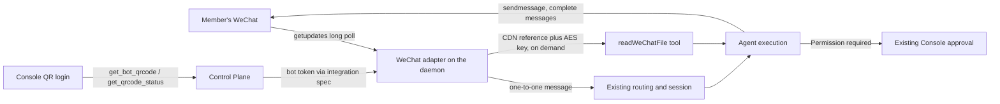

# WeChat (Personal) Integration Design

Status: draft. Facts marked **documented** cite Tencent's own `openclaw-weixin` plugin
(its protocol document or source); facts marked **observed** come from a live probe
against `ilinkai.weixin.qq.com` on 2026-10-24 with one personal WeChat account; facts
marked **unverified** still need a probe. §9.1 is implemented, with its §9.2 offline tests,
behind the `wechat` feature flag (§6), except the session-access plugin (§4.2), which waits
on §7. A live acceptance on 2026-11-10 ran §9.3 against the daemon; its findings are folded
into §2.3, §3.3, §4.3, §4.5 and §4.7.

> Related: [platform modules](integration-plugin-architecture.md),
> [QQ](qq-integration.md),
> [DingTalk](dingtalk-integration.md), [session visibility](session-visibility.md),
> [inbound attachments](inbound-file-attachments.md),
> [product conventions](../product-conventions.md).

## 1. Problem and goal

WeChat (微信) is the messenger most people in mainland China carry all day, and
AgentConnect has no route into it today. A member should be able to message their own
agent from their personal WeChat — ask a question on the way to work, get a result
while away from the desk — without the organization running anything public and
without an unofficial client that risks the account.

Add a native `wechat` integration on Tencent's **iLink Bot API**, the transport behind
WeChat's **ClawBot** plugin (设置 → 插件 → ClawBot). A member scans a QR code shown in
the Console with their own WeChat; that binds one iLink bot to one agent, and the bot
becomes a contact only that member can talk to.

### 1.1 What iLink is, and what it is not

iLink is an official, experimental channel between **one WeChat user and that user's own
assistant**. It is not a bot platform for groups or for the public:

- Only the WeChat user who scanned the QR code can talk to the bot. Other users cannot
  add it as a contact or invite it to a group (Tencent's launch statement, 2026-03-22;
  the official plugin hard-codes `groupPolicy: "disabled"` and admits only the scanner
  by default — **documented**).
- It carries messages only. It cannot read the user's other chats or act on the WeChat
  client.
- Tencent may throttle, filter, or end the service at any time.

So this integration is a **personal entry point** to an agent, not a team surface. It
changes nothing about how Slack or any other platform serves an organization.

### 1.2 Initial scope

| Capability           | Initial scope and boundary                                                                                                      |
| -------------------- | ------------------------------------------------------------------------------------------------------------------------------- |
| Distribution         | Self-service: a member scans a Console QR code with their own WeChat; one bot serves one agent and one person (§2).             |
| Ingress              | Daemon-owned HTTPS long poll (`getupdates`). No relay module and no public callback endpoint (§3).                              |
| Conversations        | One one-to-one chat per bot; no groups exist (§4.1).                                                                            |
| Sessions             | The chat is one continuous session (§4.1).                                                                                      |
| Visibility           | The chat's sessions are private to the bound member (§4.2).                                                                     |
| Replies              | Complete plain-text messages, sent in order; no streaming and no edits, because iLink drops a repeated `client_id` (§4.4).      |
| Inbound attachments  | Images, files, videos, and voice, downloaded and decrypted on demand through a `readWeChatFile` tool (§4.6).                    |
| Questions, approvals | Not drawn in WeChat: questions decline with the shared notice, approvals stay in the Console (§4.7).                            |
| Credentials          | The QR login issues the bot token; there is nothing to paste and nothing to rotate. A rejected token asks for a re-scan (§2.3). |

### 1.3 Out of scope

- Groups, and any second WeChat user talking to the same bot (impossible on iLink, §1.1).
- Unofficial transports: the Web, Windows hook, and iPad protocols, WeChatFerry and similar
  clients. They break WeChat's terms and have led to waves of account bans.
- Official Accounts (公众号) and WeChat Customer Service (微信客服). They are separate
  products, need a public callback and a relay module, and do not reach a user's own
  assistant.
- Outbound images and files (`shareFile`), quoted replies, and typing as an
  acknowledgement (§8).
- One bot serving several agents.

## 2. Distribution model

### 2.1 Who installs, and who it binds

Every other chat integration is installed by someone acting for the organization, and
many members talk to its bot. Here the installer and the only possible sender are the
same person, so the install is **self-service**: any member who may add an integration to
the agent may connect their own WeChat to it. No administrator step exists in WeChat or
in the Console.

The scan proves who the counterpart is. The QR code is shown inside the member's own
Console session, and the login result names the WeChat user who scanned it
(`ilink_user_id`, **observed**). The Control Plane records that pair on the bot row: the
bound member's user id and the bound WeChat user id. If the member hands the QR code to
someone else, that person becomes the bot's counterpart; the Console states this above
the code.

### 2.2 QR login

The login has two calls (**documented**, **observed**):

1. `POST /ilink/bot/get_bot_qrcode?bot_type=3` with `{local_token_list: []}` returns
   `qrcode` (an opaque value) and `qrcode_img_content`, a
   `https://liteapp.weixin.qq.com/q/…` URL that the Console renders as a QR code and
   offers as a link to open inside WeChat on the same phone.
2. `GET /ilink/bot/get_qrcode_status?qrcode=…` long-polls for about 35 seconds and returns
   one of `wait`, `scaned`, `confirmed`, `expired`, `need_verifycode`,
   `verify_code_blocked`, `scaned_but_redirect` (poll a new `redirect_host` instead), or
   `binded_redirect`.

On `confirmed` the response carries `bot_token`, `ilink_bot_id` (`<hex>@im.bot`),
`ilink_user_id` (`<id>@im.wechat`), and `baseurl` (**observed**). A code lives for about
**two to two and a half minutes** (**observed**), so the Console refreshes it on
`expired` and gives up after ten minutes. `need_verifycode` asks for a number shown on the
phone; the Console collects it and repeats the status call with `verify_code`. The probe
was not asked for one (**observed**), so that path is **unverified**.

The Control Plane runs both calls. Login is a control step that carries no message
content, and keeping it in the Control Plane
lets the bot row and its secret be written in one place. Because the status call
long-polls and a Control Plane may run several replicas, the login lives in a
**pending-install row** (`WechatPendingLogin`: org, requesting user, target agent,
`qrcode`, current poll host, expiry), reaped after ten minutes, as the provider contract
allows (`pendingInstall`). The Console polls the Control Plane, which forwards one status
call per poll.

### 2.3 Credentials, identity, and revocation

The bot token is the only secret. It goes to `BotSecret.botToken` through `SecretCipher`
like every bot token, with `ilink_bot_id` beside it in `appToken`, so a re-scan replaces
both in one credential write. The bot row claims no fenced external identity, because that
id changes on every re-scan; `platformConfig` holds public metadata only: `wechatBotId`,
the bound WeChat user id `wechatUserId`, the bound member's user id `boundMemberUserId`
(§2.1), and the login's `baseurl` when it is not the public endpoint.

There is no rotation. The token has no documented lifetime and no refresh call. When a
call answers `ret` or `errcode` `-14`, the token is no longer valid (**documented**: the
plugin's `STALE_TOKEN_ERRCODE`, after which it pauses the account for an hour). The
daemon stops polling that bot and retries once an hour as the plugin does. It does not
send `integration/revoked`: that frame admits only explicit platform lifecycle events
fenced by the platform's own event time, and `-14` is an API error with no event time,
so a late `-14` from a superseded token could revoke a fresh re-scan. The Console's
disconnected state and re-scan offer need a WeChat-specific report fenced by the
credential revision, designed with the Control Plane provider.

A re-scan by the same WeChat user issues a **new** `ilink_bot_id` and token, keeps the
same `ilink_user_id`, and the old token answers `-14` at once (**observed**, 2026-10-27).
The re-scan therefore replaces the bot row's identity and token in place, so the agent's
integration survives, and nothing durable may be keyed on the bot id. The transport
scope still follows the bot id, because it names one physical connection, so a re-scan
closes the chat's session and the next message opens a new one (**observed**). The owner
`wechat:ilink:<ilink_user_id>` is unchanged, so the closed session stays the member's.

Unbinding in the Console calls `msg/notifystop` and deletes the bot. Whether iLink offers
a call that releases the binding on Tencent's side is **unverified**; the user can also
remove the ClawBot plugin in WeChat.

## 3. Architecture

The daemon owns the long poll, every send, and every attachment download. The Control
Plane owns the QR login, the bot row, and the projection of the token to the daemon, and
stays off the message path.

### 3.1 The long poll

Every request is an HTTPS `POST` with JSON. Each request carries
`Authorization: Bearer <bot_token>`, `AuthorizationType: ilink_bot_token`, a fresh random
`X-WECHAT-UIN`, `iLink-App-Id`, and `iLink-App-ClientVersion`, plus a body field
`base_info: {channel_version, bot_agent}` (**documented**). The adapter sends
`bot_agent: AgentConnect/<version>`. A custom `bot_agent`, a missing `base_info`, and a
different `iLink-App-Id` were all accepted (**observed**). The adapter still sends the
plugin's `iLink-App-Id: bot` and a version-shaped client version, because nothing says
which of these Tencent may start enforcing.

1. On start, send `msg/notifystart` (**documented**: lifecycle bookkeeping; a failure is
   logged and ignored).
2. Loop `getupdates` with the last `get_updates_buf` cursor. The server holds the request
   up to `longpolling_timeout_ms` (35 seconds) and answers with a batch of `msgs` and a
   new cursor. Save the cursor only when it is non-empty (**documented**).
3. On stop, send `msg/notifystop`.

Messages arrive in batches, not one by one. In the probe a message waited 10 to 18
seconds behind the long poll before it was delivered (**observed**), so a WeChat turn
starts noticeably later than a Slack one. Whether the server returns early on new
messages under other conditions is **unverified**.

A transport failure retries with jittered exponential backoff from one second to one
minute. A `-14` stops the loop (§2.3).

### 3.2 One poller per bot

iLink keeps no single-consumer lease. Two pollers on the same bot, each with its own
cursor, **both received every message**, and neither was disconnected (**observed**).
Two daemons holding one bot would therefore run every turn twice. Exactly one daemon may
poll a bot, which the existing duty placement already guarantees for daemon-owned
connections. Nothing on iLink's side detects a second poller. The duty lease is the only
fence, and the adapter stops polling the moment it loses the duty.

### 3.3 The cursor and redelivery

The daemon persists an opaque poll cursor per bot in its local store and resumes polling
from that cursor after a restart. It advances the cursor only after handing off every
message in the batch, so interrupted delivery can resume without skipping the batch.

A duty handover to another daemon starts that daemon from an empty cursor, so messages
sent during the gap are lost. The user documentation says so, as it does for DingTalk. The cursor is not message content, so the Control Plane could carry it across a
handover. That is left open (§7).

`message_id` is the deduplication key. It is a 64-bit integer **larger than 2^53**
(**observed**), so it is parsed as a string and never as a JavaScript number. The adapter
drops a `message_id` it already delivered, from a bounded set of the last 2,000.

## 4. Behavior and limits

### 4.1 Conversations, sessions, and identity

A bot has exactly one counterpart, so it has exactly one conversation. Its key is
`dm:<ilink_user_id>`, and the normalized `msgId` is `wechat:<botId>:<message_id>`.
Inbound messages carry `session_id` and `group_id` as empty strings, plus `root_id` and
`parent_id`, which the protocol document does not describe (**observed**). The adapter
ignores all four.

The chat is one continuous session, like any DM. The manifest declares
`dmChannelPattern: /^dm:/`, `appendKinds: []`, `botSenderRouting: false`, and
`multiAgentShareable: false`. Every other field keeps the default.

A message whose `from_user_id` is not the bound WeChat user is dropped and logged once.
iLink should never deliver one (§1.1), and admitting one would hand the agent to a person
nobody bound. The sender identity is `wechat:user:ilink:<ilink_user_id>`: the tenant scope is the constant
`ilink`, because the bot id changes on a re-scan and the user id does not (§2.3). WeChat sends
no display name, so the Console shows the bound member's own name for it.

### 4.2 Visibility

[Session visibility](session-visibility.md) §4.2 makes a DM private only where the
platform names its people. Elsewhere it opens to the organization, so that no DM becomes
an owner-orphan. A WeChat bot names its one person at install: the scan binds the bot's
only possible sender to the member who ran the install (§2.1). So the chat's sessions are
**`private`**, with owner `wechat:ilink:<ilink_user_id>`.

A WeChat session-access plugin adds that tuple to the bound member's identity set for
every bot they bound. It reads the binding from the bot row. It needs no provider call
and no linked sign-in identity. This is a new case for §4.2: the identity is verified by
the install itself, not by a sign-in provider. It needs that design's owners to agree
(§7).

### 4.3 Admission

Admitted item types are text (`1`), image (`2`), voice (`3`, with `voice_item.text` as
WeChat's own transcription when present), file (`4`), and video (`5`) (**documented**).
Items `11` and `12`, tool-call progress, only ever come from a bot, and the adapter drops
any message whose `message_type` is not `1` (user). It also drops an empty message and
any message without a `message_id` or sender. A quoted message's `ref_msg` text becomes
`quoted.text`, bounded to 1,000 characters. Newer WeChat clients may send only a server
id for a quote, `ref_msg.svr_id`, sometimes with a `partial_text` selection (**documented**;
**observed**: the 2026-11-10 acceptance lost every quote this way). The id is the quoted
message's `message_id`: the inbound one for the user's own message, the one `sendmessage`
returned for the bot's. So the daemon keeps each bot's newest 2,000 message texts by that
id in the local `wechat_message` table, an inbound message's text before it is handed on
and each sent part's text after its send, and an id-only quote reads its text from there.
A selection is cut from that text by its edges and occurrence counts, read both ways
clients count the end edge, and kept only when its MD5 matches. A quote older than the
record reads as "quoted message is no longer available"; nothing is ever guessed. The
texts stay on the daemon like the transcript and never reach the Control Plane.

### 4.4 Replies

`sendmessage` takes one complete message: `to_user_id`, a fresh `client_id`,
`message_type: 2`, `message_state: 2`, `item_list`, and the conversation's latest
`context_token` (**documented**). It answers HTTP 200 and `{"message_id": …}`, and
reports no `ret` and no error for any variant the probe tried (**observed**).

What iLink does **not** do shaped this section:

- **No edits and no streaming.** A second send with the same `client_id` and
  `message_state: 2`, meant to complete a `message_state: 1` message, was answered 200 and
  never shown. The first message kept its text, and no new message appeared
  (**observed**). Nothing can be updated in place. Every send therefore uses a fresh
  `client_id` and `message_state: 2`.
- **No delivery signal.** A 200 with a `message_id` came back for the dropped send above,
  so a response proves nothing about delivery (**observed**).
- **No Markdown.** WeChat shows text as typed. The official plugin filters Markdown out of
  model output (**documented**: `StreamingMarkdownFilter`).

The adapter sends the answer the way DingTalk does, as complete messages, but in plain
text:

- The turn's text is rendered to plain text, with links sanitized and headings, emphasis,
  and code fences reduced to their text.
- Text is sent at paragraph boundaries as it completes, never mid-paragraph. Each
  message stays under a per-message limit. The real limit is **unverified**, so v1 uses
  2,000 characters until a probe raises it.
- Sends for one turn go one at a time, in order.
- In `none` mode nothing is sent, and the answer is recorded only.

A send whose outcome is unknown, because the request timed out, is not resent under a new
`client_id`, so the user never sees a paragraph twice. The dropped repeat above suggests
that iLink deduplicates by `client_id`. If so, retrying with the same `client_id` is
safe, but that is **unverified**, so v1 does not retry. The transcript keeps the full
answer.

Core notices (a turn cut to run again, an approval waiting in the Console) and command
replies go out the same way.

The turn has no acknowledgement. iLink has no reaction call, and a placeholder message
cannot be withdrawn or replaced once the answer arrives. iLink has a typing hint
(`getconfig` for a `typing_ticket`, then `sendtyping`, **documented**), but the
conventions do not count typing as an acknowledgement
([product conventions](../product-conventions.md#a-trigger-is-acknowledged-before-it-is-answered)).
v1 shows nothing until the first text. The typing hint is §8 work.

### 4.5 Context tokens and proactive sends

Every inbound message carries a new `context_token`, 136 characters in the probe
(**observed**). The plugin echoes the latest one on every send and persists the tokens
across restarts so that scheduled sends can use them (**documented**). Community write-ups
say a send without a valid token fails and that tokens expire after 24 hours. The probe
does not support the first claim. Shortly after the user wrote, all of these were
delivered (**observed**):

- a send with no token,
- a send with a forged token,
- a send with the previous message's token.

The adapter keeps the latest token per bot in the daemon's local store. It is a reply
credential, not message content, and it is never logged, never put in a prompt, and never
sent to the Control Plane. Every send carries it when one is held.

**A send after a long silence is refused** (**observed**). About 44 hours after the
user's last message, a send with the stored token, with no token, and with a forged token
each answered `ret -2` "prepare failed". The exact window is **unverified**; community
write-ups say 24 hours. The refusal is an API error, so the adapter records the send as
failed rather than losing it silently. Therefore:

- Replies and core notices inside a turn are unaffected, because a turn always follows a
  fresh inbound message.
- Proactive sends with no fresh message — a schedule delivering into WeChat, another
  agent's `sendMessage`, a notice after the turn has ended — succeed only inside the
  window. The Console says so where such a target is chosen. Holding a refused send until
  the user next writes, then delivering it, is §8 work.

### 4.6 Inbound attachments

Media items carry a CDN reference (`encrypt_query_param`, or a `full_url`) and an AES key.
Images may carry a hex `image_item.aeskey` instead (**documented**). The bytes come from
`https://novac2c.cdn.weixin.qq.com/c2c/download?encrypted_query_param=…`, or from
`full_url`, and are AES-128-ECB with PKCS#7 padding. A key arrives either as base64 of 16
raw bytes or as base64 of a 32-character hex string (**documented**).

The attachment's key stays in the connection's memory, keyed by reference in a bounded
map. It never enters the transcript, the prompt, or a log. Images go
through the shared attachment pipeline when the turn starts. Other files reach the agent
through a `readWeChatFile` tool that downloads and decrypts on demand, within the
existing size limit. A download accepts only a reference this connection received
together with its key. The tool cannot be pointed at an arbitrary address.

Voice arrives as SILK audio. Its transcription text is admitted as the message text, and
the audio is not decoded in v1. How long a CDN reference stays valid, and any size cap,
are **unverified**.

### 4.7 Questions and approvals

iLink has no buttons, cards, or other interactive elements. A numbered text question
answered by quoting it, as QQ does, would need a quote that names the question's message,
and a quote may carry only a server id the adapter cannot match (§4.3). So a question gets
the shared decline notice, and a tool approval gets the existing notice in the chat and is
answered in the Console.

`!stop` interrupts the turn and latches no mute. The mute exists to keep agents and other
people from re-waking a stopped thread, and a WeChat chat has neither: only the bound
person writes there, and nobody can mention the bot to lift a mute. A latched mute would
silently drop that person's next message (**observed** in the 2026-11-10 acceptance).
The command chrome's `stopLatchesMute: false` carries this to core, and the routing gate
ignores a latch left over from before.

### 4.8 Errors and limits

| Condition                             | Behavior                                                                             |
| ------------------------------------- | ------------------------------------------------------------------------------------ |
| `-14` on any call                     | Polling stops, the bot is marked disconnected, hourly retry, re-scan offered (§2.3). |
| Other non-zero `ret` on `getupdates`  | Backoff retry; nothing reaches the agent.                                            |
| HTTP or transport failure on a send   | That message and the rest of the turn are recorded, not sent.                        |
| No answer to a send within 15 seconds | Treated as indeterminate; not resent (§4.4).                                         |
| A sender other than the bound user    | Dropped and logged once (§4.1).                                                      |
| Rate limits                           | None documented; **unverified**. Sends for a turn are serialized.                    |

## 5. Console setup

The bot is added from the agent's integrations, like any platform. The wizard:

1. Tells the member what they are creating: a contact in their own WeChat that only they
   can talk to, which reaches this agent. It notes that the feature is experimental on
   WeChat's side, and that whoever scans the code becomes the bot's only counterpart.
2. Shows the QR code, plus a link for a member already on their phone. The code refreshes
   on expiry.
3. Collects the verification number if WeChat asks for one.
4. On success, names the bound WeChat user by id tail. The member finds the bot in WeChat
   under the ClawBot plugin and writes to it.

The bot's settings show its binding and its connection state, and offer **Reconnect**
(re-scan, §2.3) and **Unbind**. The Console offers WeChat only where the deployment turns
on the `wechat` feature flag (the chart's `features.wechat`, off by default) until the
§9.3 checks have run. The Control Plane and the daemon serve it either way.

## 6. Self-hosted and Cloud

All traffic is outbound HTTPS to `ilinkai.weixin.qq.com` and its CDN, so no domain, ICP
filing, or inbound rule applies, and the same bot works from a self-hosted daemon and a
Cloud pool member. The probe ran from one machine. Latency and availability from outside
mainland China are **unverified**. The daemon reads `AGENTCONNECT_WECHAT_API_URL` and
`AGENTCONNECT_WECHAT_CDN_URL`, and the Control Plane reads `WECHAT_API_URL`, to override
the endpoints. All default to the public ones.

The `wechat` Console feature flag controls only new-install entry points and is off by
default. The chart's `features.wechat` adds it to the Web `FEATURE_FLAGS` list. Hiding
those entry points does not stop existing integrations or remove their settings.

The Control Plane always serves the authorized QR-login routes and projects complete
WeChat integrations. The daemon always advertises its WeChat capability and connects
assigned integrations, with no separate feature switch. The generic `POST /integrations`
route never creates a WeChat integration: only a QR login proves who the counterpart is.

## 7. Open decisions

- **Terms of use.** The text of 微信 ClawBot 功能使用条款 has not been read here, and
  Tencent presents ClawBot as a way to connect OpenClaw. Whether a client other than
  OpenClaw may use the protocol directly must be settled before the feature flag comes
  off. Several third-party clients already do so publicly.
- **Visibility rule** (§4.2): an install-verified identity is a new basis for a
  `private` DM and needs session-visibility's owners to agree.
- **Bots per WeChat user.** Whether one WeChat user may hold several bots at once — one
  per agent — is **unverified**. The plugin removes a user's older accounts on re-login
  to avoid ambiguity on its own side (**documented**). If iLink allows only one bot per
  user, a member can connect only one agent through WeChat, and the Console must say so.
- **Proactive sends** (§4.5): settled by the 6-hour and 25-hour probes.
- **Cursor across handover** (§3.3): carry the cursor through the Control Plane, or
  accept the gap as DingTalk does.
- **Who may bind.** v1 lets any member who may add an integration to the agent bind their
  own WeChat. An organization may want to restrict this, because the binding moves the
  agent's answers onto a consumer messenger.
- **Connector catalog blocklist:** add WeChat's catalog id to
  `OPEN_CONNECTOR_PROVIDER_BLOCKLIST` once it is confirmed.

## 8. Later

- **Held proactive sends.** Keep a send iLink refused after a long silence (§4.5) in the
  daemon's store and deliver it, with a note that it waited, when the user next writes.
- **Typing hint.** Send `sendtyping` with status 1 when a turn starts and 2 when it ends,
  as liveness rather than acknowledgement (§4.4).
- **Outbound media.** `getuploadurl`, then AES-128-ECB encryption, a CDN upload whose
  `x-encrypted-param` response header becomes the download reference, then `sendmessage`
  with an image, video, or file item (**documented**). `shareFile` waits for a probe of
  size limits.
- **Voice audio.** Decoding SILK to WAV, as the plugin does, for runtimes that take audio.
- **Outbound voice is not available** (**observed**, 2026-10-27). A `voice_item` (`encode_type`
  6, Tencent SILK with the `0x02` prefix, uploaded as `media_type` 4 or 3) is accepted with
  a `message_id` but never shown on the phone or Mac client. Changing `encrypt_type`, key
  encoding, sample rate, optional fields or `context_token` changes nothing. SILK without the
  prefix is refused with `ret -2 "prepare failed"`, so the server parses the audio. The same
  audio sent as a `file_item` arrives as a file that the user must download. Spoken replies
  therefore wait for Tencent; a TTS file attachment is the only fallback.

## 9. Implementation, tests, and acceptance

### 9.1 Implementation scope

The integration implements the host contracts of the
[platform module design](integration-plugin-architecture.md):

- **protocol:** the `wechat` id in `KNOWN_PLATFORMS`, the manifest (§4.1), the
  integration payload `{botId, botToken, boundUserId, apiUrl, cdnUrl}`, and the
  channel-platform list.
- **message:** a pure `normalizeWeChatMessage` with the admission rules of §4.1 and §4.3.
- **daemon:**
  - the iLink client (headers, `base_info`, string-safe `message_id`);
  - the long-poll connection with its cursor, deduplication, and `-14` handling (§3);
  - the context-token store (§4.5) and the attachment map;
  - the plain-text turn output (§4.4), command chrome, and the attachment tool (§4.6);
  - registry lines. No relay module.
- **Control Plane:**
  - a provider with the QR login routes and `WechatPendingLogin` with its reaper (§2.2);
  - the bot row binding and the reconnect, a QR login with `botId` (§2.3);
  - the integration projection; the session-access plugin (§4.2) waits on §7.
- **web:** the QR wizard, the bot's binding and reconnect settings, the mark, labels, and
  the `wechat` feature flag.

`WechatPendingLogin` needs a migration. Everything else uses existing columns.

### 9.2 Offline tests

Sanitized fixtures from the probe and a fake iLink server cover:

- **Normalization:** the DM key, a `message_id` above 2^53 kept exact, text, voice
  transcription, quotes bounded, bot-authored and empty messages dropped, and a foreign
  sender dropped.
- **The client:** headers and `base_info`, cursor saved only when non-empty, backoff,
  `-14` stopping the loop, duplicate `message_id`s dropped, and polling stopped on duty
  loss.
- **Turn output:**
  - plain-text rendering;
  - paragraph splitting under the limit, sends serialized in order;
  - a fresh `client_id` per message, the latest context token attached;
  - an indeterminate send not retried;
  - `none` mode recorded only.
- **Attachments:** both key encodings, a wrong key and bad padding refused, references
  the connection never received refused, and no key in logs.
- **Control Plane:** every QR status, including redirect, verification code, and
  expiry refresh; the pending row reaped; the binding persisted; re-scan replacing the
  identity in place; and the session-access identity projected only to the bound member.

### 9.3 Live acceptance (manual; needs a personal WeChat account)

1. Bind from the Console. The QR code refreshes on expiry, and the bound user is shown.
2. A message gets a plain-text answer, and a long answer arrives as several messages in
   order.
3. The session is visible to the bound member and to no one else.
4. An image and a PDF reach the agent. Record how long a CDN reference stays readable.
5. **Proactive send after silence:** with no message from the user for 6 hours and then
   for 25 hours, send once with the stored token and once without. Record what arrives
   (§4.5).
6. Restart the daemon and send messages while it is down. Record whether they arrive
   from the stored cursor (§3.3).
7. Bind a second agent with the same WeChat user. Record whether both bots stay live
   (§7).
8. Re-scan an existing bot. Record whether `ilink_bot_id` changes (§2.3).
9. Send an answer over 2,000 characters as one message to find the real limit. Record
   any rate-limit response.

## 10. References

- Tencent, `openclaw-weixin`: https://github.com/Tencent/openclaw-weixin. The protocol
  document is `docs/protocol.md`. The source files cited above are
  `src/messaging/authorization.ts`, `src/messaging/inbound.ts`, `src/channel.ts`,
  `src/api/api.ts`, `src/auth/login-qr.ts`, and `src/storage/sync-buf.ts`.
- WeChat ClawBot launch coverage (2026-03-22), for the one-user boundary:
  https://www.chnfund.com/article/AR2a4f15aa-3409-21bb-b403-3a2026cd67c7
- Probe: the 2026-10-24 spike that produced every **observed** fact. Its script and log
  are kept outside the repository.
